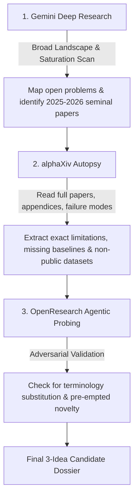

Viewed FINAL%20THESIS%20DECISION%20AUDIT.md:1-193
Viewed VLM%20Research.md:1-800
Viewed VLM%20Research.md:770-1112
Viewed VLM%20Research.md:770-1112
Listed directory Cross%20Modal
Listed directory VLM

### Strategic Assessment & Decision Context

Based on your [FINAL THESIS DECISION AUDIT.md](<file:///d:/Thesis/Important/Cross%20Modal/FINAL%20THESIS%20DECISION%20AUDIT.md>) and [VLM Research.md](<file:///d:/Thesis/Important/Cross%20Modal/VLM%20Research.md>), you already reached an exceptionally sharp finding:

1. **Your current "Trustworthy VLM" topic** (*Causal Conflict Verbalization and Source Arbitration*, testing whether intermediate contradiction reasoning causally steers decisions or is merely decorative post-hoc rationalization) is **the single most defensible, zero-cost, turnkey topic** you audited.
2. Exploring alternative subfields in VLM/MLLM is a great way to confirm your conviction and build a pipeline of future directions (2–3 solid, high-value ideas).
3. To avoid falling into the same traps identified in the audit (occupied engineering, pre-empted novelty, synthetic confounds, heavy GPU requirements), any candidate subfield must pass strict adversarial criteria: **Colab Pro feasibility (2B–7B models), turnkey public datasets, clean causal/diagnostic formulations, and clear publication-grade negative result value**.

---

### Step-by-Step Strategic Roadmap

```
Phase 1: Subfield Landscape & "Antithesis" Scan
   │  (Map high-impact VLM frontiers beyond unimodal/post-hoc trust)
   ▼
Phase 2: Deep Research & Gap Autopsy Protocol
   │  (Execute OpenResearch + Gemini Deep Research + alphaXiv autopsies)
   ▼
Phase 3: Adversarial Kill-Gate Filtering
   │  (Filter ideas through Compute, Turnkey Data, and Novelty Gates)
   ▼
Phase 4: Synthesis & Final Thesis Triangulation
   │  (Select 2-3 backup/future research proposals & lock primary thesis)
```

---

### Phase 1: High-Potential VLM/MLLM Subfields (Outside "Trustworthy VLM")

These three subfields match your experimental setup (Colab Pro / single GPU, zero-shot/few-shot probing, small open models like Qwen2.5-VL-3B, Gemma-3-4B, SmolVLM):

#### Candidate Field A: Multimodal Chain-of-Thought Dynamics & Test-Time Compute

* **The Core Premise:** Instead of studying trust/safety, investigate the *mechanics of visual test-time search and reasoning tokens*.
* **Potential Angles:**
  * *Visual Attention Drift during Extended CoT:* As reasoning token length grows ($T > 500$), do cross-attention layers gradually forget the visual tokens and collapse into a text-only prior?
  * *Compute-Allocation Efficiency:* Does spending compute on visual re-encoding (re-inspecting patches) yield more accuracy gain than spending compute on extra text reasoning tokens?
* **Why It’s Strong:** Directly connected to current 2025–2026 reasoning models (DeepSeek-R1-style, Qwen-VL-Thinking). Can be evaluated purely via logit probing and attention analysis on open models.

#### Candidate Field B: Cross-Modal In-Context Learning (ICL) & Multimodal Induction

* **The Core Premise:** Exploring how VLMs generalize from few-shot multimodal demonstrations.
* **Potential Angles:**
  * *Multimodal Induction Heads:* Do vision-language models possess cross-modal induction circuits (e.g., attending from an image in the prompt to an image in the demonstration), or is multimodal ICL mediated strictly through translated text tokens?
  * *Demonstration Order Sensitivity:* Testing whether cross-modal ICL is brittle to image-text interleaving order and whether label/image permutation destroys few-shot reasoning.
* **Why It’s Strong:** Pure inference probing; requires zero model training; uses clean synthetic and benchmark datasets (like MM-Vet, Seed-Bench, or Bongard-like visual concept tasks).

#### Candidate Field C: Visual Representation Binding & Compositional Grounding

* **The Core Premise:** Probing the architectural limits of VLM tokenizers and projection layers.
* **Potential Angles:**
  * *Attribute-Binding Breakdown:* Testing where and why VLMs confuse "red cube and blue sphere" with "blue cube and red sphere" (the classic Winoground/CLEVR binding problem).
  * *Layer-Wise Information Flow:* Using Logit Lens or Linear Probing on intermediate layers of Qwen2.5-VL to find the exact layer where visual attributes unbind or get dominated by linguistic frequency priors.
* **Why It’s Strong:** Grounded in fundamental representation learning, easily published in CVPR/ICLR, and works on lightweight models (2B–4B parameters).

---

### Phase 2: Execution Protocol for Your AI Research Stack

Use your tools in this exact order to prevent hallucinated novelty:



1. **Gemini Deep Research (Macro Landscape):**
   * *Objective:* Identify the 5 most influential papers from 2025–2026 for each candidate subfield and map what is already saturated.
2. **alphaXiv (Micro Autopsy):**
   * *Objective:* Do not read abstracts. Inspect §Limitations, baseline tables (check for missing unimodal controls), and data availability sections.
3. **OpenResearch (Adversarial Stress Test):**
   * *Objective:* Feed candidate research questions into OpenResearch and ask it to find any paper that uses different keywords for the exact same underlying mechanism.

---

### Phase 3: The Adversarial Kill Gates (Evaluation Rubric)

Before accepting any idea into your top 3, run it through this checklist:

| Kill Gate                          | Pass Condition                                                                                                                     | Immediate Fail Condition                                                    |
| :--------------------------------- | :--------------------------------------------------------------------------------------------------------------------------------- | :-------------------------------------------------------------------------- |
| **1. Compute Feasibility**   | Pure inference or linear probe on$\le 4\text{B}$ models (Qwen2.5-VL-3B, Gemma-3-4B). Runs in $< 2$ hours on Colab Pro T4/V100. | Requires full-model fine-tuning, RL loops, or 32B+ models.                  |
| **2. Turnkey Data**          | Public Hugging Face dataset with clean exact-match labels.                                                                         | Gated access (e.g., medical approvals, NDA, broken GitHub repos).           |
| **3. Metric Objectivity**    | Deterministic exact match, logit likelihood, or cross-entropy margin.                                                              | Relies solely on subjective LLM-as-a-Judge (e.g., GPT-4 scoring 1–5).      |
| **4. Negative-Result Value** | Publishable whether$H_1$ holds or $H_0$ holds (disproving a common assumption is high-value).                                  | If$H_0$ holds, the project collapses into a failed benchmark replication. |

---

### Phase 4: Prompts for ChatGPT & Deep Research

Copy and paste these exact prompts into ChatGPT / Gemini Deep Research:

#### Prompt 1: For ChatGPT (Structuring the Subfield Exploration & Search Queries)

```text
Act as a Principal Multimodal AI Scientist and Thesis Advisor. 

I am conducting an undergraduate computer science thesis. I have already fully formulated and audited one strong research direction in Trustworthy VLMs ("Causal Conflict Verbalization and Modality Arbitration under contradictory evidence"). 

Now, I need to explore 3 adjacent VLM/MLLM subfields to identify 2-3 backup/future research directions and confirm my confidence in my primary choice:
1. Multimodal Chain-of-Thought Dynamics & Visual Token Attention Drift (Test-time compute mechanics)
2. Cross-Modal In-Context Learning (ICL) & Multimodal Induction Circuits
3. Visual Attribute-Binding & Compositional Probing across intermediate layers

CONSTRAINTS:
- The research must be runnable via zero-shot inference or linear probing on small open-weight models (Qwen2.5-VL-3B, Gemma-3-4B, SmolVLM) on a single Colab Pro GPU (16GB VRAM, runtime < 3 hours).
- Datasets must be turnkey on Hugging Face (no credential delays, no manual scraping).
- Evaluation must be deterministic (exact match, log-probability margins, or cross-attention entropy), NOT subjective LLM-as-a-judge.
- Novelty must not be pre-empted by 2025–2026 papers.

YOUR TASK:
For each of the 3 candidate subfields above:
1. Formulate ONE concrete, highly falsifiable research question.
2. Define the exact 4-arm experimental intervention (including a length-matched or compute-matched control).
3. Specify 3-5 seminal 2025/2026 papers I must autopsy on alphaXiv to ensure the gap is completely open.
4. Explain the negative-result value: why is the study publishable even if the hypothesis is rejected?
```

#### Prompt 2: For Gemini Deep Research (Adversarial Gap Verification)

```text
Search for the latest 2025 and 2026 papers on arXiv, CVPR, ICCV, NeurIPS, and ICLR covering:
"multimodal chain of thought visual attention degradation", "cross-modal induction heads in vision language models", and "layer-wise visual attribute binding in Qwen-VL or LLaVA".

Identify:
1. Has anyone already demonstrated that visual attention weights degrade monotonically as text reasoning tokens increase in thinking VLMs? List specific paper titles and arXiv IDs.
2. What are the public Hugging Face datasets currently used to test visual binding failure versus language prior bias?
3. Which research groups (e.g., Stanford, Berkeley, THUNLP, Oxford) have published closest to these topics in the last 6 months?
```

#### Prompt 3: For alphaXiv Paper Autopsy

```text
I am performing a technical feasibility and gap autopsy on paper [INSERT ARXIV ID].
Do NOT summarize the abstract or introduction. Answer directly:
1. What exact dataset was used, and is there an active Hugging Face link provided?
2. What were the unimodal (text-only and image-only) baseline accuracies?
3. Did the authors evaluate models smaller than 7B (e.g., 2B-3B)?
4. Quote the most critical concessions in Section §Limitations regarding evaluation confounds, synthetic data artifacts, or unmeasured mechanisms.
```

---

### Recommended Next Move

1. **Keep your primary direction locked:** Your conflict verbalization thesis from [FINAL THESIS DECISION AUDIT.md](<file:///d:/Thesis/Important/Cross%20Modal/FINAL%20THESIS%20DECISION%20AUDIT.md>) is already vetted and defensible. Treat this exploration not as throwing away your progress, but as **contextualizing it** and building your future research pipeline.
2. **Run Prompt 1 in ChatGPT** to generate the initial structured candidates.
3. **Run Prompt 2 in Gemini Deep Research** on the resulting topics to immediately uncover if any candidate is already occupied.
4. **Select the top 2 candidate ideas** that pass all 4 Kill Gates and compare them against your frozen topic.
