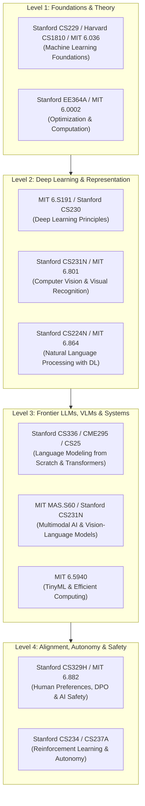

# 🏛️ Canonical AI/ML & Multimodal Course Explorer

### Stanford University · Massachusetts Institute of Technology (MIT) · Harvard University

> **Document Type:** Canonical Knowledge & Resource Explorer
> **Target Scope:** Graduate-Level AI/ML, Vision-Language Modeling (VLM), Deep Learning Systems, Agentic Reasoning, and Mathematical Foundations
> **Access Policy:** 100% Free Public Lectures, Syllabi, Assignments, and Course Portals (No Paywall Required)
> **Maintained For:** Cross-Modal & Multimodal Cognitive Systems Research

---

## 🧭 Executive Curriculum Map

This explorer aggregates and deduplicates the complete catalog of open-access AI/ML graduate and foundational courses from **Stanford**, **MIT**, and **Harvard**. Duplicate annual entries (e.g., repeating the same course across multiple calendar years) have been synthesized into **single canonical entries** pointing to the most up-to-date lectures and complete syllabus archives.

---

## 1. Stanford University Course Catalog

Stanford provides full graduate lecture video series via the Stanford Online YouTube channel, GitHub Pages, and Stanford Engineering Everywhere (SEE).

| Course Code  | Canonical Course Title                         | Primary Instructors                           | Core Topics & Competencies                                                                                                             | Primary Lecture & Site Links                                                                                                                                                                                                                                                                     |
| :------------- | :----------------------------------------------- | :---------------------------------------------- | :--------------------------------------------------------------------------------------------------------------------------------------- | :------------------------------------------------------------------------------------------------------------------------------------------------------------------------------------------------------------------------------------------------------------------------------------------------- |
| **CS229**    | Machine Learning                               | Andrew Ng                                     | Supervised/unsupervised learning, SVMs, kernels, neural nets, learning theory, EM algorithm, factor analysis.                          | [Course Site](https://cs229.stanford.edu/) · [YouTube Playlist](https://www.youtube.com/playlist?list=PLoROMvodv4rMiGQp3WXShtMGgzqpfVfbU) · [SEE Archive](https://see.stanford.edu/Course/CS229)                                                                                               |
| **CS221**    | AI: Principles & Techniques                    | Percy Liang, Dorsa Sadigh                     | Search, game playing, CSPs, Bayesian networks, Markov models, MDPs, reinforcement learning, logic.                                     | [Course Site (2024)](https://stanford-cs221.github.io/autumn2024/) · [Course Site (2022)](https://stanford-cs221.github.io/autumn2022/) · [YouTube Playlist](https://www.youtube.com/playlist?list=PLoROMvodv4rO1NB9TD4iUZ3qghGEGtqNX) · [SEE Archive](https://see.stanford.edu/Course/CS221) |
| **CS230**    | Deep Learning                                  | Andrew Ng, Kian Katanforoosh                  | Deep feedforward nets, convolutional networks, sequence models (RNN/LSTM), attention, Hyperparameter tuning.                           | [Course Site](https://cs230.stanford.edu/) · [YouTube Playlist](https://www.youtube.com/playlist?list=PLoROMvodv4rOABXSygqsbM79PRE8f5a9X)                                                                                                                                                       |
| **CS231N**   | Deep Learning for Computer Vision              | Fei-Fei Li, Justin Johnson, Serena Yeung-Levy | Image classification, object detection, segmentation, Vision Transformers (ViT), generative models, multimodal VLMs.                   | [Course Site](https://cs231n.stanford.edu/) · [YouTube (Recent)](https://www.youtube.com/playlist?list=PLoROMvodv4rOmsNzYBMe0gJY2XS8AQg16) · [YouTube (Foundational)](https://www.youtube.com/playlist?list=PLoROMvodv4rOhJXM2YNrX1I44382I8A8O)                                                |
| **CS224N**   | Natural Language Processing with Deep Learning | Christopher Manning                           | Word2Vec, GloVe, RNNs, Seq2Seq, Transformers, self-attention, pretraining (BERT/GPT), prompting, instruction-tuning.                   | [Course Site (2024)](https://web.stanford.edu/class/archive/cs/cs224n/cs224n.1244/) · [Course Site (2023)](https://web.stanford.edu/class/archive/cs/cs224n/cs224n.1234/) · [YouTube Playlist](https://www.youtube.com/playlist?list=PLoROMvodv4rOSHGv613K3eA7P8h8S2R9d)                       |
| **CS336**    | Language Modeling from Scratch                 | Percy Liang, Tatsunori Hashimoto              | End-to-end LLM construction: Byte-Pair Encoding (BPE), Transformer implementation, distributed training, scaling laws, SFT, alignment. | [Course Site](https://cs336.stanford.edu/) · [Lecture Hub](https://www.youtube.com/playlist?list=PLoROMvodv4rO1NB9TD4iUZ3qghGEGtqNX)                                                                                                                                                            |
| **CME295**   | Transformers & Large Language Models           | Afshine Amidi, Shervine Amidi                 | Attention mechanisms, efficient Transformer variants, parameter-efficient fine-tuning (LoRA), RLHF, DPO, RAG, agents.                  | [Course Syllabus](https://cme295.stanford.edu/syllabus/) · [Course Site](https://cme295.stanford.edu/) · [YouTube Playlist](https://www.youtube.com/playlist?list=PLoROMvodv4rNiJRchCzutFw5ItR_Z27CM)                                                                                          |
| **CS25**     | Transformers United (V1–V6)                   | Steven Feng, Karan Singh, Christopher Manning | Cutting-edge Transformer research seminar with industry/academia pioneers (Hinton, Vaswani, Karpathy, Anthropic, DeepMind).            | [Course Site](https://web.stanford.edu/class/cs25/) · [V5 Archive](https://web.stanford.edu/class/cs25/past/cs25-v5/) · [YouTube Series](https://www.youtube.com/playlist?list=PLoROMvodv4rNiJRchCzutFw5ItR_Z27CM)                                                                             |
| **CS236**    | Deep Generative Models                         | Stefano Ermon, Aditya Grover                  | Autoregressive models, Variational Autoencoders (VAEs), Generative Adversarial Networks (GANs), Normalizing Flows, Diffusion Models.   | [Course Site](https://deepgenerativemodels.github.io/) · [YouTube Playlist](https://www.youtube.com/playlist?list=PLoROMvodv4rO1NB9TD4iUZ3qghGEGtqNX)                                                                                                                                           |
| **CS329H**   | Machine Learning from Human Preferences        | Percy Liang, Dorsa Sadigh                     | Alignment theory, Bradley-Terry preference models, RLHF, Direct Preference Optimization (DPO), human-in-the-loop evaluation.           | [Course Site](https://cs329h.stanford.edu/) · [Web Archive](https://web.stanford.edu/class/cs329h/) · [YouTube Lectures](https://www.youtube.com/playlist?list=PLoROMvodv4rO1NB9TD4iUZ3qghGEGtqNX)                                                                                             |
| **CS234**    | Reinforcement Learning                         | Emma Brunskill                                | Markov Decision Processes, Value/Policy iteration, Q-learning, deep Q-networks (DQN), policy gradients, PPO, offline RL.               | [Course Site](https://cs234.stanford.edu/) · [YouTube Playlist](https://www.youtube.com/playlist?list=PLoROMvodv4rO1NB9TD4iUZ3qghGEGtqNX)                                                                                                                                                       |
| **CS228**    | Probabilistic Graphical Models                 | Daphne Koller                                 | Bayesian networks, Markov random fields, exact/approximate inference (belief propagation, MCMC, variational), parameter learning.      | [Course Site](https://stanford-cs228.github.io/spring2022/) · [YouTube Playlist](https://www.youtube.com/playlist?list=PLoROMvodv4rO1NB9TD4iUZ3qghGEGtqNX)                                                                                                                                      |
| **CS229M**   | Machine Learning Theory                        | Tengyu Ma                                     | Statistical learning theory, uniform convergence, generalization bounds, Rademacher complexity, overparameterized optimization.        | [Course Site / Stats 214](https://web.stanford.edu/class/stats214/) · [YouTube Lectures](https://www.youtube.com/playlist?list=PLoROMvodv4rO1NB9TD4iUZ3qghGEGtqNX)                                                                                                                              |
| **CS224W**   | Machine Learning with Graphs                   | Jure Leskovec                                 | Graph Neural Networks (GCN, GraphSAGE, GAT), knowledge graphs, link prediction, representation learning over networks.                 | [Course Site](https://web.stanford.edu/class/cs224w/)                                                                                                                                                                                                                                            |
| **CS224U**   | Natural Language Understanding                 | Christopher Manning                           | Semantic evaluation, dialogue systems, compositional semantics, grounded NLU, retrieval-augmented models.                              | [Course Site](https://web.stanford.edu/class/cs224u/)                                                                                                                                                                                                                                            |
| **CS224V**   | Conversational Virtual Assistants              | Monica Lam                                    | Dialogue management, contextual conversational modeling, task-oriented semantic parsing, virtual assistant systems.                    | [Course Site](https://web.stanford.edu/class/cs224v/)                                                                                                                                                                                                                                            |
| **CS223A**   | Introduction to Robotics                       | Oussama Khatib                                | Spatial representations, forward/inverse kinematics, dynamics, trajectory generation, force/motion control.                            | [SEE Archive](https://see.stanford.edu/Course/CS223A)                                                                                                                                                                                                                                            |
| **CS237A/B** | Principles of Robot Autonomy                   | Mac Schwager, Dorsa Sadigh, Marco Pavone      | State estimation, SLAM, motion planning, imitation learning, control barrier functions, safety-critical decision systems.              | [Course Portal](https://aisafety.stanford.edu/pages/courses.html)                                                                                                                                                                                                                                |
| **EE364A**   | Convex Optimization I                          | Stephen Boyd                                  | Convex sets and functions, convex optimization problems, duality theory, interior-point methods, unconstrained/equality optimization.  | [SEE Archive](https://see.stanford.edu/Course/EE364A)                                                                                                                                                                                                                                            |
| **EE263**    | Introduction to Linear Dynamical Systems       | Stephen Boyd                                  | State-space models, linear algebra, least squares, singular value decomposition (SVD), reachability, observability.                    | [SEE Archive](https://see.stanford.edu/Course/EE263)                                                                                                                                                                                                                                             |

---

## 2. Massachusetts Institute of Technology (MIT) Course Catalog

MIT provides extensive open coursework via MIT OpenCourseWare (OCW), the MIT HAN Lab, CSAIL, and annual IAP bootcamps.

| Course Code       | Canonical Course Title                     | Primary Instructors                             | Core Topics & Competencies                                                                                                                       | Primary Lecture & Site Links                                                                                                                                                                                                                                                                      |
| :------------------ | :------------------------------------------- | :------------------------------------------------ | :------------------------------------------------------------------------------------------------------------------------------------------------- | :-------------------------------------------------------------------------------------------------------------------------------------------------------------------------------------------------------------------------------------------------------------------------------------------------- |
| **6.S191**        | Introduction to Deep Learning              | Alexander Amini, Ava Soleimany                  | Comprehensive deep learning intensive: neural networks, CNNs, RNNs/Transformers, generative models, RL, LLMs, multimodal systems.                | [Course Portal](https://introtodeeplearning.com/) · [YouTube Playlist (2026/Latest)](https://www.youtube.com/playlist?list=PLtBw6njQRU-rwp5__7C0oIVt26ZgjG9NI) · [Multi-Year Archive](https://www.youtube.com/playlist?list=PLtB7J7K1T6V0qNzYBMe0gJY2XS8AQg16)                                  |
| **6.5940**        | TinyML & Efficient Deep Learning Computing | Song Han                                        | Model compression, pruning, weight quantization (FP8, INT4), Neural Architecture Search (NAS), hardware acceleration, on-device LLMs.            | [Course Site (2026/2024)](https://hanlab.mit.edu/courses/2024-fall-65940) · [HAN Lab YouTube Channel](https://www.youtube.com/@hanlabmit)                                                                                                                                                        |
| **MAS.S60**       | How to AI (Almost) Anything                | Rosalind Picard, Pattie Maes                    | Multi-sensory perception, multimodal AI architectures (vision, speech, physiological sensors), foundation model integration.                     | [MIT OCW Course](https://ocw.mit.edu/courses/mas-s60-how-to-ai-almost-anything-spring-2025/)                                                                                                                                                                                                      |
| **6.7960**        | Deep Learning (Graduate)                   | Phillip Isola, Yen-Lung Kuo                     | Theoretical foundations: backpropagation, auto-diff, generalization, optimization landscapes, Vision Transformers, diffusion, multimodal models. | [MIT OCW Course](https://ocw.mit.edu/courses/6-7960-deep-learning-fall-2024/) · [MIT Learn Resource](https://learn.mit.edu/c/topic/computer-science?resource=88418)                                                                                                                              |
| **6.S087**        | Foundation Models and Generative AI        | Rickard Brüel Gabrielsson                      | Foundation models, autoregressive pretraining, contrastive learning, multimodal alignment, generative diffusion, safety.                         | [Course Portal](https://futureofai.mit.edu/)                                                                                                                                                                                                                                                      |
| **6.036**         | Introduction to Machine Learning           | Leslie Kaelbling, Tomás Lozano-Pérez          | Linear classifiers, perceptrons, regression, neural networks, SVMs, clustering, gradient descent, feature representation.                        | [MIT OCW Course](https://ocw.mit.edu/courses/6-036-introduction-to-machine-learning-fall-2020/) · [MITx Open Learning](https://openlearninglibrary.mit.edu/courses/course-v1:MITx+6.036x+2T2020) · [YouTube Playlist](https://www.youtube.com/playlist?list=PLUl4u3cNGP63EdVPNLG3ToM6LaEUuStEY) |
| **6.801 / 6.866** | Machine Vision                             | Berthold Horn                                   | Physics of image formation, radiometry, photometric stereo, shape from shading, motion estimation, optic flow, camera calibration.               | [MIT OCW Course](https://ocw.mit.edu/courses/6-801-machine-vision-fall-2020/) · [YouTube Playlist](https://www.youtube.com/playlist?list=PLUl4u3cNGP63pfpS1gV5P9tDxxL_e4W8O)                                                                                                                     |
| **6.882**         | AI Safety & Alignment                      | Dylan Hadfield-Menell                           | Value alignment, reward misspecification, interpretability, robustness to distribution shift, multi-agent cooperative AI safety.                 | [MIT OCW Course](https://ocw.mit.edu/courses/6-882-ai-safety-spring-2021/)                                                                                                                                                                                                                        |
| **6.864**         | Advanced Natural Language Processing       | Michael Collins, Regina Barzilay, Jacob Andreas | Language modeling, sequence-to-sequence architectures, dependency parsing, compositional semantics, machine translation.                         | [MIT OCW Archive](https://ocw.mit.edu/courses/6-864-advanced-natural-language-processing-fall-2005/) · [Course Site Archive](https://www.mit.edu/~jda/teaching/6.864/sp20/)                                                                                                                      |
| **6.867**         | Machine Learning (Graduate Theory)         | Tommi Jaakkola                                  | Kernel methods, graphical models, variational inference, statistical complexity, nonparametric estimation, reinforcement learning theory.        | [MIT OCW Course](https://ocw.mit.edu/courses/6-867-machine-learning-fall-2006/)                                                                                                                                                                                                                   |
| **6.034**         | Artificial Intelligence (Classic)          | Patrick Henry Winston                           | Search algorithms, constraint satisfaction, adversarial search, rule-based systems, neural networks, SVMs, domain representations.               | [MIT OCW Course](https://ocw.mit.edu/courses/6-034-artificial-intelligence-fall-2010/) · [YouTube Playlist](https://www.youtube.com/playlist?list=PLUl4u3cNGP6317WaSNfmCvGym2ucw3oGp)                                                                                                            |
| **6.0002**        | Introduction to Computational Thinking     | John Guttag, Eric Grimson                       | Optimization models, dynamic programming, Monte Carlo simulation, statistical modeling, clustering, data classification.                         | [MIT OCW Course](https://ocw.mit.edu/courses/6-0002-introduction-to-computational-thinking-and-data-science-fall-2016/)                                                                                                                                                                           |
| **6.885**         | Ethics of Artificial Intelligence          | Salil Vadhan, Cynthia Dwork                     | Algorithmic fairness, differential privacy, demographic parity, causal fairness models, auditing automated decisions.                            | [MIT OCW Course](https://ocw.mit.edu/courses/6-885-ethics-of-ai-fall-2019/)                                                                                                                                                                                                                       |

---

## 3. Harvard University Course Catalog

Harvard offers rigorous foundational AI and ML courses through Harvard SEAS, Harvard Online, and the CS50 educational suite.

| Course Code               | Canonical Course Title                    | Primary Instructors                     | Core Topics & Competencies                                                                                                        | Primary Lecture & Site Links                                                                                                                                                                                                                                       |
| :-------------------------- | :------------------------------------------ | :---------------------------------------- | :---------------------------------------------------------------------------------------------------------------------------------- | :------------------------------------------------------------------------------------------------------------------------------------------------------------------------------------------------------------------------------------------------------------------- |
| **CS50 AI**               | Introduction to AI with Python            | David J. Malan, Brian Yu                | Graph search, minimax, propositional logic, Bayesian inference, Markov models, deep learning, NLP, reinforcement learning.        | [Course Portal](https://cs50.harvard.edu/ai/) · [edX Interactive Track](https://www.edx.org/course/cs50s-introduction-to-artificial-intelligence-with-python) · [YouTube Playlist](https://www.youtube.com/playlist?list=PLhQjrBD2T380xvTSUmhGHNZKpT8kVJqWj)     |
| **CS1810 / CS181**        | Machine Learning                          | Finale Doshi-Velez, David Alvarez-Melis | Probabilistic generative/discriminative models, regularization, kernels, PCA, neural networks, HMMs, MDPs, Bayesian optimization. | [Course Site (2025)](https://harvard-ml-courses.github.io/cs181-web-2025/) · [Course Site (2024)](https://harvard-ml-courses.github.io/cs181-web-2024/) · [YouTube Lecture Series](https://www.youtube.com/channel/UC0rDBCkhasTCVGJcnVyFHHQ/search?query=cs-181) |
| **CS281**                 | Advanced Machine Learning                 | Alexander M. Rush                       | Probabilistic modeling, deep generative systems, structural learning, attention mechanisms, modern NLP representation learning.   | [Course Site](https://harvard-ml-courses.github.io/cs281-web/)                                                                                                                                                                                                     |
| **AC295 / CS287**         | Deep Learning for NLP & Vision            | Harvard IACS Faculty                    | Advanced deep learning for sequence and multimodal modeling, Transformers, visual grounding, language-guided perception.          | [Course Site](https://harvard-iacs.github.io/CS287/) · [Supplemental Materials](https://harvard-iacs.github.io/CS287/supplemental)                                                                                                                                |
| **CS2281R**               | Principles for Training Foundation Models | Harvard SEAS Faculty                    | Theoretical foundations of scaling, architectural optimizations, compute-optimal training regimes, alignment interventions.       | [Harvard SEAS Catalog](https://csadvising.seas.harvard.edu/concentration/courses/tags/)                                                                                                                                                                            |
| **CS1060**                | Software Engineering with Generative AI   | Harvard SEAS Faculty                    | AI-assisted development workflows, automated testing, agentic software engineering pipelines, LLM code integration.               | [Harvard SEAS Catalog](https://csadvising.seas.harvard.edu/concentration/courses/tags/)                                                                                                                                                                            |
| **CS50x**                 | Introduction to Computer Science          | David J. Malan                          | Rigorous CS principles: memory management, C, data structures (hash tables, trees, graphs), Python, SQL, web architectures.       | [Course Portal](https://cs50.harvard.edu/x/) · [YouTube Master Playlist](https://www.youtube.com/playlist?list=PLhQjrBD2T382_R182iC2gNZI9HzWFMC_8)                                                                                                                |
| **HarvardX Data Science** | Data Science: Machine Learning            | Rafael Irizarry                         | Cross-validation, regularization, loss functions, recommendation system algorithms, high-dimensional data matrix factorization.   | [edX Course](https://www.edx.org/course/data-science-machine-learning) · [YouTube Playlist](https://www.youtube.com/playlist?list=PLhQjrBD2T383f9scHRNYJkior2VvYjpSL)                                                                                             |

---

## 4. Curated Thematic Research Tracks

For researchers focusing on **Vision-Language Models (VLMs), Cross-Modal Arbitration, and Multimodal Decision Systems**, these 5 tracks organize the coursework into a progressive sequence:

### Track A: Multimodal Systems & Vision-Language Modeling (VLM)

*Primary Goal: Master visual tokenization, cross-attention fusion, image-text alignment, and multimodal causal reasoning.*

1. **Stanford CS231N**: Deep Learning for Computer Vision (Foundational visual perception, ViT architectures, multimodal image-text models).
2. **MIT MAS.S60**: How to AI (Almost) Anything (Multi-sensory data, audio-visual-tactile fusion, frontier multimodal architectures).
3. **Stanford CS25**: Transformers United (Seminar sessions on multimodal foundation models, world models, and cross-attention).
4. **Harvard AC295 / CS287**: Deep Learning for NLP & Vision (Joint embeddings, contrastive visual grounding, multimodal alignment).
5. **MIT 6.801**: Machine Vision (Photometric stereo, geometric projection, and physical image formation).

### Track B: Foundation Models, LLM Architecture & Scaling

*Primary Goal: Understand language model internals from tokenization to distributed training and alignment.*

1. **Stanford CS336**: Language Modeling from Scratch (Implementation of Transformer layers, BPE, distributed scaling).
2. **Stanford CME295**: Transformers & Large Language Models (SFT, LoRA, quantization, RAG, tool calling, and evaluation).
3. **Stanford CS224N**: NLP with Deep Learning (Core linguistic embeddings, attention theory, self-supervised pretraining).
4. **MIT 6.S087**: Foundation Models and Generative AI (Theoretical underpinnings of foundation model scaling).
5. **Harvard CS2281R**: Principles for Training Foundation Models (Empirical scaling laws, compute frontiers, and training stability).

### Track C: Alignment, Causal Decision Arbitration & RL

*Primary Goal: Learn how models arbitrate conflicting signals, model human intent, and optimize agent policies.*

1. **Stanford CS329H**: Machine Learning from Human Preferences (RLHF, DPO, Bradley-Terry modeling, preference conflict).
2. **Stanford CS234**: Reinforcement Learning (MDP formulation, policy gradients, PPO, actor-critic dynamics).
3. **MIT 6.882**: AI Safety & Alignment (Value alignment, reward hacking, interpretability, and robust decision arbitration).
4. **Stanford CS221**: AI: Principles & Techniques (Probabilistic decision making under uncertainty, factor graphs, search).
5. **Harvard CS50 AI**: Introduction to Artificial Intelligence (Adversarial search, constraint satisfaction, and logical inference).

### Track D: Efficient Deep Learning & Hardware Acceleration

*Primary Goal: Fit advanced models into constrained environments (e.g., $\le 16\text{ GB}$ VRAM targets).*

1. **MIT 6.5940**: TinyML and Efficient AI Computing (Pruning, INT4/FP8 quantization, KV-cache optimization, flash attention).
2. **MIT 6.S191**: Introduction to Deep Learning (Practical PyTorch workflows, hardware acceleration patterns).
3. **Stanford CS230**: Deep Learning (Hyperparameter tuning, profiling bottlenecks, distributed multi-GPU training).

### Track E: Mathematical Foundations & Optimization

*Primary Goal: Build theoretical depth in convexity, statistical convergence, and graphical modeling.*

1. **Stanford EE364A**: Convex Optimization I (Duality theory, KKT conditions, interior point methods).
2. **Stanford CS229**: Machine Learning (MLE, MAP estimation, EM algorithm, kernel trick).
3. **Harvard CS1810**: Machine Learning (Bayesian models, graphical representations, Gaussian processes).
4. **Stanford CS228**: Probabilistic Graphical Models (Belief propagation, variational inference, factor graphs).
5. **MIT 6.0002**: Computational Thinking & Data Science (Monte Carlo methods, dynamic programming, empirical statistics).

---

## 5. Consolidated Master Media & Channel Directory

Direct links to official video archives and platforms:

### Official YouTube Channel Hubs

- **Stanford Online Hub**: [youtube.com/@StanfordOnline](https://www.youtube.com/@StanfordOnline) — Master catalog containing CS229, CS221, CS224N, CS231N, CS230, CS234, CS336, and CS25.
- **MIT OpenCourseWare Hub**: [youtube.com/@mitocw](https://www.youtube.com/@mitocw) — Full lecture series for 6.034, 6.036, 6.801, and 6.0002.
- **MIT HAN Lab**: [youtube.com/@hanlabmit](https://www.youtube.com/@hanlabmit) — Dedicated lectures and tutorials for TinyML (6.5940).
- **Alexander Amini (MIT 6.S191)**: [youtube.com/@AlexanderAmini](https://www.youtube.com/@AlexanderAmini) — Official yearly releases for MIT 6.S191.
- **Harvard CS50**: [youtube.com/@cs50](https://www.youtube.com/@cs50) — Full releases of CS50x, CS50 AI, CS50 Python, and CS50 Web.

### Key Central Course Playlists

- **Stanford Unified AI Playlist**: [YouTube Playlist](https://www.youtube.com/playlist?list=PLoROMvodv4rO1NB9TD4iUZ3qghGEGtqNX) (CS221, CS234, CS236, CS329H, CS336).
- **Stanford Transformers & LLMs**: [YouTube Playlist](https://www.youtube.com/playlist?list=PLoROMvodv4rNiJRchCzutFw5ItR_Z27CM) (CS25, CME295).
- **Stanford CS224N (NLP)**: [YouTube Playlist](https://www.youtube.com/playlist?list=PLoROMvodv4rOSHGv613K3eA7P8h8S2R9d).
- **Stanford CS231N (Vision)**: [YouTube Playlist](https://www.youtube.com/playlist?list=PLoROMvodv4rOmsNzYBMe0gJY2XS8AQg16).
- **MIT 6.S191 (Deep Learning)**: [YouTube Playlist](https://www.youtube.com/playlist?list=PLtBw6njQRU-rwp5__7C0oIVt26ZgjG9NI).
- **MIT 6.801 (Machine Vision)**: [YouTube Playlist](https://www.youtube.com/playlist?list=PLUl4u3cNGP63pfpS1gV5P9tDxxL_e4W8O).
- **Harvard CS50 AI**: [YouTube Playlist](https://www.youtube.com/playlist?list=PLhQjrBD2T380xvTSUmhGHNZKpT8kVJqWj).
- **Harvard CS1810 / CS181 (ML)**: [YouTube Channel Search](https://www.youtube.com/channel/UC0rDBCkhasTCVGJcnVyFHHQ/search?query=cs-181).

### Open Syllabus & Assignment Portals

- **Stanford Engineering Everywhere (SEE)**: [see.stanford.edu/Course](https://see.stanford.edu/Course)
- **MIT OpenCourseWare (OCW)**: [ocw.mit.edu](https://ocw.mit.edu/)
- **MIT Learn AI Hub**: [learn.mit.edu/c/topic/ai](https://learn.mit.edu/c/topic/ai)
- **Harvard Free Learning Portal**: [pll.harvard.edu](https://pll.harvard.edu/subject/artificial-intelligence)

---

## 6. Institutional Comparison Matrix

| Attribute                      | Stanford University                                                                                        | Massachusetts Institute of Technology (MIT)                                                                        | Harvard University                                                                                        |
| :------------------------------- | :----------------------------------------------------------------------------------------------------------- | :------------------------------------------------------------------------------------------------------------------- | :---------------------------------------------------------------------------------------------------------- |
| **Primary Strength**           | Unmatched graduate depth across modern NLP, Transformers, LLM architecture, and Computer Vision.           | Exceptional balance of foundational theory, hardware efficiency (TinyML), and intensive deep learning bootcamps.   | Outstanding foundational pedagogy, structured problem sets, and accessible intro-to-intermediate bridges. |
| **Flagship Flagbearer Course** | **CS224N** (NLP) / **CS231N** (Vision) / **CS336** (LLMs from Scratch)                                     | **6.S191** (Deep Learning) / **6.5940** (TinyML & Efficient Computing)                                             | **CS50 AI** (Python AI) / **CS1810** (Machine Learning)                                                   |
| **Pedagogical Style**          | Rigorous graduate assignments, mathematical formulations paired with PyTorch code implementations.         | Fast-paced, project-intensive, systems-level optimization and deep mechanistic insight.                            | Guided problem sets with autograders, clear modular software scaffolding, and high production value.      |
| **Course Code Standards**      | CS prefix (Computer Science), CME (Computational Math), EE (Electrical Engineering).                       | Course 6 (EECS), MAS (Media Arts & Sciences). S denotes special subject.                                           | CS prefix (Computer Science), AC (Applied Computation).                                                   |
| **Best Used For**              | Building custom model architectures, implementing attention mechanisms, research-level thesis experiments. | Optimizing inference latency, model quantization, running models on edge or constrained GPUs ($\le 16\text{ GB}$). | Mastering algorithmic fundamentals, search strategies, and foundational probabilistic programming.        |

---

## 7. Foundational Prerequisites & Exploratory Electives

For researchers or students needing to build up baseline software engineering skills, signals foundations, or explore non-technical and historical seminars, the following open courses provide structured material:

### A. Introductory Computer Science & Software Development

| Institution  | Course Code     | Course Name                              | Instructor(s)            | Focus & Highlights                                                                                                   | Primary Link                                                                                                                                     |
| :------------- | :---------------- | :----------------------------------------- | :------------------------- | :--------------------------------------------------------------------------------------------------------------------- | :------------------------------------------------------------------------------------------------------------------------------------------------- |
| **Stanford** | **CS106A**      | Programming Methodology                  | Mehran Sahami            | Foundational computer science and software engineering principles in Python.                                         | [SEE Course](https://see.stanford.edu/Course/CS106A)                                                                                             |
| **Stanford** | **CS106B**      | Programming Abstractions                 | Julie Zelenski           | Advanced data structures, recursive problem solving, memory management, and algorithmic analysis in C++.             | [SEE Course](https://see.stanford.edu/Course/CS106B)                                                                                             |
| **Stanford** | **CS107**       | Programming Paradigms                    | Jerry Cain               | Advanced systems programming in C, pointers, machine representation, and memory allocation.                          | [SEE Course](https://see.stanford.edu/Course/CS107)                                                                                              |
| **Harvard**  | **CS50 Python** | Introduction to Programming with Python  | David J. Malan           | Comprehensive introduction to Python: variables, conditions, loops, exceptions, libraries, unit tests, and file I/O. | [Course Portal](https://cs50.harvard.edu/python/) · [YouTube Playlist](https://www.youtube.com/playlist?list=PLhQjrBD2T382g3rRZCvzYkZv8KqVJqWj) |
| **Harvard**  | **CS50 Web**    | Web Programming with Python & JavaScript | David J. Malan, Brian Yu | Full-stack web application development: Django, React, SQL, REST APIs, scalability, and security.                    | [Course Portal](https://cs50.harvard.edu/web/) · [YouTube Playlist](https://www.youtube.com/playlist?list=PLhQjrBD2T382MdbKxQj2kH8p8Y8KqVJqW)   |

### B. Applied Mathematics & Signal Processing

| Institution  | Course Code | Course Name                              | Instructor(s) | Focus & Highlights                                                                                                             | Primary Link                                                                                                     |
| :------------- | :------------ | :----------------------------------------- | :-------------- | :------------------------------------------------------------------------------------------------------------------------------- | :----------------------------------------------------------------------------------------------------------------- |
| **Stanford** | **EE261**   | The Fourier Transform & its Applications | Brad Osgood   | Continuous and discrete Fourier transforms, convolution, sampling theorem, linear filters, and applications in optics/imaging. | [SEE Course](https://see.stanford.edu/Course/EE261)                                                              |
| **Stanford** | **EE364B**  | Convex Optimization II                   | Stephen Boyd  | Subgradient methods, localization methods, proximal methods, ADMM, conjugate gradient, and large-scale optimization.           | [SEE Portal](https://see.stanford.edu/Course/EE364A) · [Course Archive](https://web.stanford.edu/class/ee364b/) |

### C. Exploratory Seminars & Historical Courses

| Institution | Course Code        | Course Name                                 | Instructor(s)                    | Focus & Highlights                                                                                                                | Primary Link                                                                                                                     |
| :------------ | :------------------- | :-------------------------------------------- | :--------------------------------- | :---------------------------------------------------------------------------------------------------------------------------------- | :--------------------------------------------------------------------------------------------------------------------------------- |
| **MIT**     | **RES.6-013**      | AI 101                                      | Brandon Leshchinskiy             | Broad introduction to AI concepts for general audiences: computer vision, data pipelines, and RL intuition.                       | [MIT OCW Course](https://ocw.mit.edu/courses/res-6-013-ai-101-fall-2021/)                                                        |
| **Harvard** | **CS85**           | Intro to Generative AI for Arts & Sciences  | Harvard SEAS Faculty             | Interdisciplinary exploratory seminar applying modern LLMs and generative tooling to humanities and scientific study.             | [SEAS Course Catalog](https://csadvising.seas.harvard.edu/concentration/courses/tags/)                                           |
| **Harvard** | **CS1066**         | Build at the Speed of Thought               | Harvard SEAS Faculty             | Rapid prototyping, AI-augmented developer workflows, and human-in-the-loop software design.                                       | [SEAS Course Catalog](https://csadvising.seas.harvard.edu/concentration/courses/tags/)                                           |
| **MIT**     | **6.863J**         | Natural Language & Knowledge Representation | Robert Berwick, Stephanie Seneff | Historical computational linguistics (Spring 2003): syntax, formal grammars, compositional semantic trees, and speech interfaces. | [MIT OCW Archive](https://ocw.mit.edu/courses/6-863j-natural-language-and-the-computer-representation-of-knowledge-spring-2003/) |
| **MIT**     | **6.862 / 15.097** | Prediction: Machine Learning and Statistics | Dimitris Bertsimas               | Statistical learning theory, lasso regression, classification trees, and algorithmic prediction models.                           | [MIT OCW Archive](https://ocw.mit.edu/courses/15-097-prediction-machine-learning-and-statistics-spring-2012/)                    |
