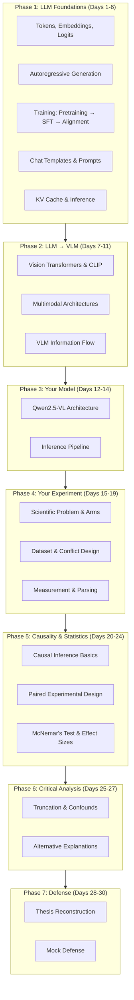

# 🎓 Thesis Knowledge Acquisition — Complete Course & Resource Map

### Causal Conflict Verbalization & Source Arbitration in Vision-Language Models

> **Document Type:** Canonical Knowledge Acquisition & Free Course Resource Map
> **Target Thesis:** *Causal Conflict Verbalization and Source Arbitration in Vision-Language Models*
> **Reference Model:** `Qwen/Qwen2.5-VL-3B-Instruct`
> **Author:** Mohammad Zahed Hossen (Final-Year BSc CSE)
> **Access Policy:** 100% Free — YouTube, MIT OCW, Coursera (Audit), edX (Audit), Stanford Online, fast.ai
> **Alignment:** Directly mapped to the [30-Day Thesis Understanding & Defense Plan](file:///d:/Thesis/Important/Cross%20Modal/Knowledge/30-Day%20Thesis%20Understanding%20&%20Defense%20Plan.md) and the [Canonical Thesis Master Report](file:///d:/Thesis/Important/Cross%20Modal/Finalize%20Topic/CANONICAL_THESIS_MASTER_REPORT.md)

---

## How to Use This Document

This document maps **every knowledge area required by your thesis** to specific free courses, lecture videos, and reading materials from reputed institutions. It is organized into **7 phases** that mirror your 30-Day Defense Plan, so you can follow it sequentially.

Each resource is tagged with:

- 🎯 **Critical** — Directly required for thesis defense
- 📘 **Recommended** — Strongly supports understanding
- 📎 **Supplementary** — Deepens background knowledge

> [!IMPORTANT]
> **Priority Rule:** If time is limited, focus exclusively on 🎯 **Critical** resources. These directly map to the 10 knowledge areas you must master for defense.

---

## Master Knowledge Dependency Graph



---

# PHASE 1 — LLM FOUNDATIONS (Days 1–6)

> **Goal:** Understand what a language model is, how autoregressive generation works, and why prompt changes alter model behavior.
> **Defense Knowledge:** Tokens → Embeddings → Transformer → Logits → Decoding → Generated Text

---

## 1.1 What Is an LLM? Transformers & Autoregressive Generation

> **Thesis Connection:** Your model produces tokens autoregressively. Everything you observe — rationales, source statements, answers, abstentions — is generated token by token. Arm 2 vs Arm 3 differences happen during generation.

### 🎯 Critical Resources


| # | Resource                                                                | Institution / Creator                 | Format                          | Duration        | What You Learn                                                                                                                                                                                                                                                             | Link                                                                                                                                                                                |
| :-- | :------------------------------------------------------------------------ | :-------------------------------------- | :-------------------------------- | :---------------- | :--------------------------------------------------------------------------------------------------------------------------------------------------------------------------------------------------------------------------------------------------------------------------- | :------------------------------------------------------------------------------------------------------------------------------------------------------------------------------------ |
| 1 | **Andrej Karpathy — "Let's build GPT from scratch"**                   | Independent (ex-OpenAI, ex-Tesla)     | YouTube Video                   | ~2 hours        | Build a GPT character-level language model from zero. Understand every component: tokens, embeddings, self-attention, positional encoding, layer norms, autoregressive generation.**The single best resource for understanding your thesis model's generation mechanism.** | [YouTube](https://www.youtube.com/watch?v=kCc8FmEb1nY)                                                                                                                              |
| 2 | **Andrej Karpathy — "Neural Networks: Zero to Hero" (Full Series)**    | Independent                           | YouTube Playlist (7+ videos)    | ~15 hours total | Progressive construction from micrograd → makemore → nanoGPT. Covers backpropagation, tokenization (BPE), attention, and complete Transformer internals.                                                                                                                 | [YouTube Playlist](https://www.youtube.com/playlist?list=PLAqhIrjkxbuWI23v9cThsA9GvCAUhRvKZ)                                                                                        |
| 3 | **3Blue1Brown — "Neural Networks" Series (Chapters 1–4 + Attention)** | 3Blue1Brown                           | YouTube Series                  | ~2 hours        | Exceptional visual intuition for neural networks, gradient descent, backpropagation. The "Attention in Transformers" video is a must-watch.                                                                                                                                | [Neural Networks Series](https://www.youtube.com/playlist?list=PLZHQObOWTQDNU6R1_67000Dx_ZCJB-3pi) · [Attention Video](https://www.youtube.com/watch?v=eMlx5fFNoYc)                |
| 4 | **Stanford CS224N — NLP with Deep Learning (Lectures 1–9)**           | Stanford · Christopher Manning       | YouTube Playlist (~20 lectures) | ~25 hours total | Word embeddings (Word2Vec, GloVe), RNNs, Seq2Seq, the Transformer architecture, self-attention mechanism, pretraining (BERT, GPT).**Lectures 1–5 cover your Phase 1 requirements; Lectures 6–9 cover Transformers in depth.**                                            | [YouTube Playlist](https://www.youtube.com/playlist?list=PLoROMvodv4rOSHGv613K3eA7P8h8S2R9d) · [Course Site (2024)](https://web.stanford.edu/class/archive/cs/cs224n/cs224n.1244/) |
| 5 | **MIT 6.S191 — Introduction to Deep Learning (Lectures 1–4)**         | MIT · Alexander Amini, Ava Soleimany | YouTube Playlist                | ~6 hours        | Fast-paced deep learning bootcamp. Lecture 1 (Intro to DL), Lecture 2 (Deep Sequence Models), Lecture 3 (Transformers/LLMs), Lecture 4 (Computer Vision).                                                                                                                  | [YouTube Playlist (2025)](https://www.youtube.com/playlist?list=PLtBw6njQRU-rwp5__7C0oIVt26ZgjG9NI) · [Course Portal](https://introtodeeplearning.com/)                            |

### 📘 Recommended Resources


| #  | Resource                                                    | Institution / Creator                        | Format                         | What You Learn                                                                                                                                                  | Link                                                                                                                                        |
| :--- | :------------------------------------------------------------ | :--------------------------------------------- | :------------------------------- | :---------------------------------------------------------------------------------------------------------------------------------------------------------------- | :-------------------------------------------------------------------------------------------------------------------------------------------- |
| 6  | **Stanford CS336 — Language Modeling from Scratch**        | Stanford · Percy Liang, Tatsunori Hashimoto | YouTube Lectures + Course Site | End-to-end LLM construction: BPE tokenization, Transformer implementation, scaling laws, SFT, alignment. Goes deeper than Karpathy into production LLM details. | [Course Site](https://cs336.stanford.edu/)                                                                                                  |
| 7  | **Stanford CME295 — Transformers & Large Language Models** | Stanford · Afshine Amidi, Shervine Amidi    | YouTube Playlist + Course Site | Attention mechanisms, efficient Transformer variants, LoRA, RLHF, DPO, RAG, agents. Excellent for understanding SFT and alignment.                              | [YouTube Playlist](https://www.youtube.com/playlist?list=PLoROMvodv4rNiJRchCzutFw5ItR_Z27CM) · [Course Site](https://cme295.stanford.edu/) |
| 8  | **Hugging Face — NLP Course**                              | Hugging Face                                 | Free Online Course             | Practical tokenization, model loading, pipeline usage, fine-tuning. Uses the exact`transformers` library your thesis code uses.                                 | [Course](https://huggingface.co/learn/nlp-course/)                                                                                          |
| 9  | **The Illustrated Transformer (Blog Post)**                 | Jay Alammar                                  | Blog Article                   | ~45 min read                                                                                                                                                    | The most cited visual explanation of the Transformer architecture. Essential visual reference.                                              |
| 10 | **The Illustrated GPT-2 (Blog Post)**                       | Jay Alammar                                  | Blog Article                   | ~30 min read                                                                                                                                                    | Visual walkthrough of autoregressive generation specifically, showing how GPT generates token by token.                                     |

### 📎 Supplementary Resources


| #  | Resource                                          | Institution / Creator                    | What You Learn                                                                                                                                     | Link                                                                                         |
| :--- | :-------------------------------------------------- | :----------------------------------------- | :--------------------------------------------------------------------------------------------------------------------------------------------------- | :--------------------------------------------------------------------------------------------- |
| 11 | **Stanford CS229 — Machine Learning**            | Stanford · Andrew Ng                    | Foundational ML: supervised/unsupervised learning, SVMs, kernels, learning theory. Not directly thesis-critical but builds mathematical intuition. | [YouTube Playlist](https://www.youtube.com/playlist?list=PLoROMvodv4rMiGQp3WXShtMGgzqpfVfbU) |
| 12 | **Stanford CS230 — Deep Learning**               | Stanford · Andrew Ng, Kian Katanforoosh | Deep feedforward nets, CNNs, sequence models, hyperparameter tuning.                                                                               | [YouTube Playlist](https://www.youtube.com/playlist?list=PLoROMvodv4rOABXSygqsbM79PRE8f5a9X) |
| 13 | **fast.ai — Practical Deep Learning for Coders** | fast.ai · Jeremy Howard                 | Top-down practical approach to deep learning. Free and comprehensive.                                                                              | [Course Site](https://course.fast.ai/)                                                       |

---

### Phase 1 — Specific Topic × Resource Matrix


| Day                                           | Topic from Defense Plan                                                  | Primary Resource                              | Specific Lectures / Sections                              |
| :---------------------------------------------- | :------------------------------------------------------------------------- | :---------------------------------------------- | :---------------------------------------------------------- |
| **Day 1** — What Is an LLM?                  | Tokens, embeddings, logits, next-token prediction                        | Karpathy "Let's build GPT"                    | Full video (first 45 min especially)                      |
|                                               |                                                                          | 3Blue1Brown Neural Nets                       | Chapters 1–3 + Attention video                           |
|                                               |                                                                          | Jay Alammar Illustrated Transformer           | Full blog post                                            |
| **Day 2** — Autoregressive Generation        | Causal masking, greedy decoding, sampling, temperature, top-k/top-p      | Karpathy "Zero to Hero"                       | nanoGPT video (video 7 in series)                         |
|                                               |                                                                          | Stanford CS224N                               | Lecture 9 (Self-Attention & Transformers)                 |
|                                               |                                                                          | MIT 6.S191                                    | Lecture 3 (Transformers & LLMs)                           |
| **Day 3** — LLM Training                     | Pretraining, cross-entropy loss, SFT, instruction tuning, alignment      | Stanford CME295                               | Lectures on Pretraining, SFT, and RLHF/DPO                |
|                                               |                                                                          | Stanford CS336                                | Lectures on tokenization, training, and scaling           |
| **Day 4** — Tokens, Chat Templates & Prompts | Tokenization, subword tokens, special tokens, chat templates, prefilling | Hugging Face NLP Course                       | Chapter 2 (Using Transformers) & Chapter 6 (Tokenizers)   |
|                                               |                                                                          | Karpathy "Zero to Hero"                       | makemore Part 5 (BPE tokenization video)                  |
| **Day 5** — Inference & KV Cache             | KV cache, generation loop,`max_new_tokens`, truncation                   | MIT 6.5940 TinyML                             | Lectures on KV-cache optimization and efficient inference |
|                                               |                                                                          | Jay Alammar Illustrated GPT-2                 | Full blog post                                            |
| **Day 6** — LLM Knowledge Checkpoint         | Self-assessment day                                                      | *No new material — review Phase 1 resources* | Answer the 12 checkpoint questions from the Defense Plan  |

---

# PHASE 2 — FROM LLM TO VLM (Days 7–11)

> **Goal:** Understand how images enter a Transformer-based model, what vision encoders do, and how multimodal architectures combine visual and textual information.
> **Defense Knowledge:** Image → Vision Encoder → Visual Tokens → Projection → LLM → Text Output

---

## 2.1 Vision Transformers (ViT) & CLIP

> **Thesis Connection:** Your model uses a Vision Transformer to convert images into visual representations that the language model can process. Understanding ViT and CLIP is essential for explaining how Qwen2.5-VL "sees" the rendered arithmetic images.

### 🎯 Critical Resources


| # | Resource                                                                              | Institution / Creator                  | Format           | Duration             | What You Learn                                                                                                                                               | Link                                                                                                                                        |
| :-- | :-------------------------------------------------------------------------------------- | :--------------------------------------- | :----------------- | :--------------------- | :------------------------------------------------------------------------------------------------------------------------------------------------------------- | :-------------------------------------------------------------------------------------------------------------------------------------------- |
| 1 | **Stanford CS231N — Deep Learning for Computer Vision (Lectures 1–11)**             | Stanford · Fei-Fei Li, Justin Johnson | YouTube Playlist | ~15 hours (selected) | Image classification, CNNs, object detection,**Vision Transformers (ViT)**, generative models. **Lectures 9–11 on ViT and multimodal models are critical.** | [YouTube (Recent)](https://www.youtube.com/playlist?list=PLoROMvodv4rOmsNzYBMe0gJY2XS8AQg16) · [Course Site](https://cs231n.stanford.edu/) |
| 2 | **Yannic Kilcher — "An Image is Worth 16×16 Words: ViT" (Paper Explanation)**       | Yannic Kilcher                         | YouTube Video    | ~30 min              | Clear walkthrough of the original Vision Transformer paper. Explains patch embedding, positional encoding for images, and why ViT works.                     | [YouTube](https://www.youtube.com/watch?v=TrdevFK_am4)                                                                                      |
| 3 | **Yannic Kilcher — "CLIP: Learning Transferable Visual Models" (Paper Explanation)** | Yannic Kilcher                         | YouTube Video    | ~40 min              | Contrastive image-text pretraining. How CLIP aligns visual and textual representations in a shared embedding space.                                          | [YouTube](https://www.youtube.com/watch?v=T9XSU0pKX2E)                                                                                      |

### 📘 Recommended Resources


| # | Resource                                                                                  | Institution / Creator  | Format           | What You Learn                                                                                                         | Link                                                                                                              |
| :-- | :------------------------------------------------------------------------------------------ | :----------------------- | :----------------- | :----------------------------------------------------------------------------------------------------------------------- | :------------------------------------------------------------------------------------------------------------------ |
| 4 | **MIT 6.S191 — Lecture 4 (Deep Learning for Computer Vision)**                           | MIT · Alexander Amini | YouTube          | ~1 hour                                                                                                                | Fast-paced overview of CNNs, image classification, and visual feature extraction. Good bridge from LLM knowledge. |
| 5 | **Lilian Weng — "Learning with Not Enough Data" & "Generalized Visual Language Models"** | OpenAI · Lilian Weng  | Blog Articles    | Excellent survey-style posts covering contrastive learning, CLIP, and early VLM architectures.                         | [Blog](https://lilianweng.github.io/)                                                                             |
| 6 | **MIT 6.801 — Machine Vision**                                                           | MIT · Berthold Horn   | YouTube Playlist | Physics of image formation, radiometry, calibration. Provides deep understanding of how images are structured as data. | [YouTube Playlist](https://www.youtube.com/playlist?list=PLUl4u3cNGP63pfpS1gV5P9tDxxL_e4W8O)                      |

---

## 2.2 Multimodal Architectures: How Vision Meets Language

> **Thesis Connection:** Understanding Flamingo, BLIP-2, and LLaVA architectures explains *where* image information enters the language model. This is essential for Day 9 (Multimodal Architectures) and Day 11 (Multimodal Information Flow).

### 🎯 Critical Resources


| # | Resource                                                                        | Institution / Creator             | Format           | Duration                                                                                                            | What You Learn                                                                                                                          | Link                                                                                                                                              |
| :-- | :-------------------------------------------------------------------------------- | :---------------------------------- | :----------------- | :-------------------------------------------------------------------------------------------------------------------- | :---------------------------------------------------------------------------------------------------------------------------------------- | :-------------------------------------------------------------------------------------------------------------------------------------------------- |
| 1 | **Yannic Kilcher — "Flamingo: a Visual Language Model for Few-Shot Learning"** | Yannic Kilcher                    | YouTube Video    | ~45 min                                                                                                             | DeepMind's Flamingo architecture: cross-attention gating, interleaved image-text processing. First major VLM architecture.              | [YouTube](https://www.youtube.com/watch?v=smUHQndcmOY)                                                                                            |
| 2 | **Yannic Kilcher — "BLIP-2: Bootstrapping Language-Image Pre-training"**       | Yannic Kilcher                    | YouTube Video    | ~35 min                                                                                                             | Q-Former architecture, how to bridge a frozen vision encoder to a frozen LLM. Projection mechanisms.                                    | [YouTube](https://www.youtube.com/watch?v=k0DAtZCCl1w)                                                                                            |
| 3 | **Yannic Kilcher — "LLaVA: Visual Instruction Tuning"**                        | Yannic Kilcher                    | YouTube Video    | ~30 min                                                                                                             | LLaVA's simple but effective approach: linear projection from vision encoder to LLM token space. Most similar to Qwen2.5-VL's approach. | [YouTube](https://www.youtube.com/watch?v=36k7EvzKHfA)                                                                                            |
| 4 | **Stanford CS25 — Transformers United (Selected Seminars)**                    | Stanford · Multimodal sessions   | YouTube Lectures | ~2 hours (selected)                                                                                                 | Cutting-edge Transformer research including multimodal foundation models, cross-attention, world models.                                | [YouTube Series](https://www.youtube.com/playlist?list=PLoROMvodv4rNiJRchCzutFw5ItR_Z27CM) · [Course Site](https://web.stanford.edu/class/cs25/) |
| 5 | **MIT 6.S087 — Foundation Models and Generative AI**                           | MIT · Rickard Brüel Gabrielsson | Course Portal    | Foundation models, autoregressive pretraining, contrastive learning,**multimodal alignment**, generative diffusion. | [Course Portal](https://futureofai.mit.edu/)                                                                                            |                                                                                                                                                   |

### 📘 Recommended Resources


| # | Resource                                                    | Institution / Creator               | Format      | What You Learn                                                                     | Link                                                                                  |
| :-- | :------------------------------------------------------------ | :------------------------------------ | :------------ | :----------------------------------------------------------------------------------- | :-------------------------------------------------------------------------------------- |
| 6 | **Harvard AC295 / CS287 — Deep Learning for NLP & Vision** | Harvard IACS                        | Course Site | Joint embeddings, contrastive visual grounding, multimodal alignment.              | [Course Site](https://harvard-iacs.github.io/CS287/)                                  |
| 7 | **MIT MAS.S60 — How to AI (Almost) Anything**              | MIT · Rosalind Picard, Pattie Maes | MIT OCW     | Multi-sensory perception, multimodal AI architectures (vision + speech + sensors). | [MIT OCW](https://ocw.mit.edu/courses/mas-s60-how-to-ai-almost-anything-spring-2025/) |
| 8 | **Hugging Face — Vision-Language Models Explained (Blog)** | Hugging Face                        | Blog Post   | Practical overview of how HF implements VLMs, including Qwen-VL series.            | [Blog](https://huggingface.co/blog/vlms)                                              |
| 9 | **MIT 6.7960 — Deep Learning (Graduate)**                  | MIT · Phillip Isola                | MIT OCW     | Theoretical foundations of Vision Transformers, diffusion, multimodal models.      | [MIT OCW](https://ocw.mit.edu/courses/6-7960-deep-learning-fall-2024/)                |

---

### Phase 2 — Specific Topic × Resource Matrix


| Day                                       | Topic from Defense Plan                                 | Primary Resource                        | Specific Lectures / Sections                                 |
| :------------------------------------------ | :-------------------------------------------------------- | :---------------------------------------- | :------------------------------------------------------------- |
| **Day 7** — Why LLMs Can't "See"         | Pixels → patches → visual tokens → projection → LLM | Yannic Kilcher ViT video                | Full video                                                   |
|                                           |                                                         | CS231N                                  | Lectures on ViT and image representations                    |
| **Day 8** — Vision Transformers & CLIP   | Patch embeddings, positional info, contrastive learning | Yannic Kilcher CLIP video               | Full video                                                   |
|                                           |                                                         | CS231N                                  | ViT lecture specifically                                     |
| **Day 9** — Multimodal Architectures     | Early/late fusion, cross-attention, projection          | Yannic Kilcher: Flamingo, BLIP-2, LLaVA | All three videos                                             |
|                                           |                                                         | Stanford CS25                           | Multimodal sessions                                          |
| **Day 10** — What Is a Modern VLM?       | LLM vs VLM vs MLLM terminology                          | MIT 6.S087                              | Foundation models lectures                                   |
|                                           |                                                         | Hugging Face VLM Blog                   | Full post                                                    |
| **Day 11** — Multimodal Information Flow | Trace one thesis sample through full pipeline           | *Use Qwen2.5-VL technical report*       | [Qwen2.5-VL Paper (arXiv)](https://arxiv.org/abs/2502.13923) |

---

# PHASE 3 — YOUR ACTUAL MODEL: Qwen2.5-VL (Days 12–14)

> **Goal:** Understand the specific architecture of the model you used — vision encoder, dynamic resolution, MRoPE, projector, and LLM backbone.
> **Defense Knowledge:** Image → ViT → Spatial Processing / Patch Merging → MRoPE → LLM → Autoregressive Generation

---

### 🎯 Critical Resources


| # | Resource                               | Type          | What You Learn                                                                                                                                                                  | Link                                                                |
| :-- | :--------------------------------------- | :-------------- | :-------------------------------------------------------------------------------------------------------------------------------------------------------------------------------- | :-------------------------------------------------------------------- |
| 1 | **Qwen2.5-VL Technical Report**        | arXiv Paper   | The authoritative source. Dynamic resolution handling, Multimodal Rotary Position Embedding (MRoPE), native vision encoder design, model card.**Read Sections 2–3 carefully.** | [arXiv:2502.13923](https://arxiv.org/abs/2502.13923)                |
| 2 | **Qwen2-VL Technical Report**          | arXiv Paper   | Predecessor architecture. Understanding the evolution from Qwen2-VL to Qwen2.5-VL clarifies design choices.                                                                     | [arXiv:2409.12191](https://arxiv.org/abs/2409.12191)                |
| 3 | **Qwen2.5-VL Hugging Face Model Card** | Documentation | Practical model details, supported features, usage examples with the`transformers` library.                                                                                     | [HF Model Card](https://huggingface.co/Qwen/Qwen2.5-VL-3B-Instruct) |
| 4 | **Qwen2.5-VL GitHub Repository**       | Code          | Source code for the model implementation, processor, and chat templates.                                                                                                        | [GitHub](https://github.com/QwenLM/Qwen2.5-VL)                      |

### 📘 Recommended Resources


| # | Resource                                                               | Type            | What You Learn                                                                                                                                                   | Link                                                                                                           |
| :-- | :----------------------------------------------------------------------- | :---------------- | :----------------------------------------------------------------------------------------------------------------------------------------------------------------- | :--------------------------------------------------------------------------------------------------------------- |
| 5 | **Hugging Face `transformers` Qwen2VL Documentation**                  | Library Docs    | How the processor, model, and generation pipeline work in practice. Maps to your`production_experiment_harness_v3.py` code.                                      | [Docs](https://huggingface.co/docs/transformers/model_doc/qwen2_vl)                                            |
| 6 | **MIT 6.5940 — TinyML & Efficient Deep Learning (Selected Lectures)** | MIT · Song Han | Model quantization (FP16 vs BF16 vs INT4), KV-cache optimization, flash attention.**Directly relevant to your SDPA and FP16 Tensor Core engineering decisions.** | [Course Site](https://hanlab.mit.edu/courses/2024-fall-65940) · [YouTube](https://www.youtube.com/@hanlabmit) |

---

### Phase 3 — Specific Topic × Resource Matrix


| Day                                   | Topic from Defense Plan                                                                  | Primary Resource                                        | What to Focus On                                             |
| :-------------------------------------- | :----------------------------------------------------------------------------------------- | :-------------------------------------------------------- | :------------------------------------------------------------- |
| **Day 12** — Qwen2.5-VL Architecture | Vision encoder, dynamic resolution, patch merging, MRoPE, LLM backbone                   | Qwen2.5-VL Technical Report                             | Sections 2–3: Architecture & Multimodal Positional Encoding |
| **Day 13** — Qwen Inference Pipeline | Trace: Dataset item → Image → Processor → Model → Generation → Parser → Statistics | Your own`production_experiment_harness_v3.py` + HF Docs | Map every function call to architectural concepts            |
| **Day 14** — Reconstruct One Sample  | End-to-end walkthrough of one item through all 4 arms                                    | Master Report Section 5 (4-Arm Protocol)                | Practice explaining without notes                            |

---

# PHASE 4 — YOUR EXPERIMENT (Days 15–19)

> **Goal:** Understand every experimental decision: the scientific problem, the 4-arm design, the dataset, the measurement system.
> **Defense Knowledge:** Problem → Arms → Controls → Intervention → Measurement → Classification

---

## 4.1 Experimental Design & Scientific Methodology

### 🎯 Critical Resources


| # | Resource                                    | Institution / Creator | Format   | What You Learn                                                                                                              | Link                                                                                                                        |
| :-- | :-------------------------------------------- | :---------------------- | :--------- | :---------------------------------------------------------------------------------------------------------------------------- | :---------------------------------------------------------------------------------------------------------------------------- |
| 1 | **Your Own Canonical Thesis Master Report** | *Your work*           | Document | The definitive reference for your experimental design, arms, prompts, and results.**Re-read Sections 5–6 for this phase.** | [Master Report](file:///d:/Thesis/Important/Cross%20Modal/Finalize%20Topic/CANONICAL_THESIS_MASTER_REPORT.md)               |
| 2 | **Your Own Topic Specification (Locked)**   | *Your work*           | Document | Research questions, formal hypotheses, exact prompt specifications.                                                         | [Topic Spec](file:///d:/Thesis/Important/Cross%20Modal/Finalize%20Topic/Canonical_Thesis_Topic_Specification%20(Locked).md) |

## 4.2 Anchor Papers You Must Read

> **Thesis Connection:** These papers define the scientific gap your thesis fills. You must be able to explain what they did, what they didn't do, and how your work extends them.

### 🎯 Critical Anchor Papers


| # | Paper                                                                      | Authors             | Year | What It Establishes                                                                          | What It Leaves Open (Your Gap)                                                                                                                 | Link                                                 |
| :-- | :--------------------------------------------------------------------------- | :-------------------- | :----- | :--------------------------------------------------------------------------------------------- | :----------------------------------------------------------------------------------------------------------------------------------------------- | :----------------------------------------------------- |
| 1 | **"Which Source Wins? Task-Dependent Reliance in Vision-Language Models"** | Ghosh, Gupta & Wang | 2026 | Systematic mapping of source reliance under visual degradation regimes                       | *"We do not test whether models detect the contradiction, express uncertainty, or abstain."* (Section 6)                                       | [arXiv:2608.17205](https://arxiv.org/abs/2608.17205) |
| 2 | **CLASH: Cross-modal Contradiction Detection**                             | —                  | 2025 | Contradiction detection formulated as abstention-only task                                   | Does not measure*source arbitration* — only whether models abstain. No measurement of which source the model follows when it doesn't abstain. | [arXiv:2511.19199](https://arxiv.org/abs/2511.19199) |
| 3 | **"Measuring Faithfulness in Chain-of-Thought Reasoning"**                 | Lanham et al.       | 2023 | CoT faithfulness testing (early answering, adding mistakes, paraphrasing) for text-only LLMs | Methodology confined to**text-only** LLMs. Multimodal source arbitration under conflict was never tested.                                      | [arXiv:2307.13702](https://arxiv.org/abs/2307.13702) |
| 4 | **"Language Models Don't Always Say What They Think"**                     | Turpin et al.       | 2023 | Showed CoT can be unfaithful — biased by irrelevant features in the prompt                  | Again text-only. Demonstrates that verbalization may not reflect internal computation.                                                         | [arXiv:2305.04388](https://arxiv.org/abs/2305.04388) |

---

### Phase 4 — Specific Topic × Resource Matrix


| Day                                           | Topic from Defense Plan                                                     | Primary Resource                                   | What to Focus On                                        |
| :---------------------------------------------- | :---------------------------------------------------------------------------- | :--------------------------------------------------- | :-------------------------------------------------------- |
| **Day 15** — The Scientific Problem          | Problem, phenomenon, intervention, outcome, non-claims                      | Master Report Section 1 (Executive Summary)        | Separate: Problem / Phenomenon / Intervention / Outcome |
| **Day 16** — Dataset & Conflict Construction | GSM8K/SVAMP, image rendering,`y_img` vs `y_txt`, clean cohort justification | Master Report Section 3 (Dataset Architecture)     | Why$N = 1,619$? Why `degradation_level = 0`?            |
| **Day 17** — Experimental Arms               | Arm 1 vs 2 vs 3 vs 4a/4b, control vs intervention                           | Master Report Section 5 (4-Arm Protocol)           | Why Arm 2 vs Arm 3 is the primary comparison            |
| **Day 18** — What Is Your Intervention?      | Conflict verbalization vs "more thinking" vs "telling it what to do"        | Master Report + Anchor Papers                      | Prepare answers for all 10 examiner attacks             |
| **Day 19** — Measurements & Parsing          | Entity extraction, exact match, abstention regex, parser validity           | Master Report Section 6 +`statistical_analysis.py` | Model behavior vs measurement of behavior               |

---

# PHASE 5 — CAUSALITY & STATISTICS (Days 20–24)

> **Goal:** Understand causal inference, paired experimental design, McNemar's test, odds ratios, and effect sizes well enough to defend your statistical claims.
> **Defense Knowledge:** Causal intervention → Paired design → Discordant pairs → McNemar → Effect sizes → Sensitivity analysis

---

## 5.1 Causal Inference & Experimental Design

### 🎯 Critical Resources


| # | Resource                                                                  | Institution / Creator                | Format                           | Duration          | What You Learn                                                                                                                                                                                       | Link                                                                                                                                                               |
| :-- | :-------------------------------------------------------------------------- | :------------------------------------- | :--------------------------------- | :------------------ | :----------------------------------------------------------------------------------------------------------------------------------------------------------------------------------------------------- | :------------------------------------------------------------------------------------------------------------------------------------------------------------------- |
| 1 | **"Causal Inference: The Mixtape" (Free Online Textbook)**                | Scott Cunningham (Baylor University) | Free Online Book                 | Selected chapters | Potential outcomes framework, treatment effects, counterfactuals. Read Chapter 1 (Introduction) and Chapter 4 (Potential Outcomes Causal Model).**Maps to your "causal" claim in the thesis title.** | [Free Book](https://mixtape.scunning.com/)                                                                                                                         |
| 2 | **"Crash Course Statistics" — Experimental Design Episodes**             | CrashCourse (YouTube)                | YouTube Series                   | ~15 min each      | Clear, visual explanation of controls, independent/dependent variables, confounding, randomization. Episodes 11–14 are most relevant.                                                               | [YouTube Playlist](https://www.youtube.com/playlist?list=PL8dPuuaLjXtNM_Y-bUAhblSAdWRnmR9eR)                                                                       |
| 3 | **Harvard CS50 AI — Lecture on Uncertainty**                             | Harvard · David Malan, Brian Yu     | YouTube                          | ~2 hours          | Bayesian inference, probability, conditional probability. Good foundation for understanding statistical tests.                                                                                       | [YouTube Playlist](https://www.youtube.com/playlist?list=PLhQjrBD2T380xvTSUmhGHNZKpT8kVJqWj)                                                                       |
| 4 | **Brady Neal — "Introduction to Causal Inference" (Free Online Course)** | Brady Neal                           | YouTube Lectures + Free Textbook | ~20 hours         | Comprehensive causal inference course. Covers interventions, potential outcomes, DAGs, and confounding. More rigorous than needed but excellent for deep understanding.                              | [YouTube Playlist](https://www.youtube.com/playlist?list=PLoazKTcS0RzZ1SUgeOgc6SWt51gfT80N0) · [Free Textbook](https://www.bradyneal.com/causal-inference-course) |

### 📘 Recommended Resources


| # | Resource                                                          | Institution / Creator        | Format           | What You Learn                                                                                                                       | Link                                                                                                                                                                        |
| :-- | :------------------------------------------------------------------ | :----------------------------- | :----------------- | :------------------------------------------------------------------------------------------------------------------------------------- | :---------------------------------------------------------------------------------------------------------------------------------------------------------------------------- |
| 5 | **MIT 18.650 — Statistics for Applications (Selected Lectures)** | MIT OCW · Philippe Rigollet | YouTube Lectures | Hypothesis testing, p-values, confidence intervals, chi-squared tests. Provides the mathematical foundation for your McNemar result. | [MIT OCW](https://ocw.mit.edu/courses/18-650-statistics-for-applications-fall-2016/) · [YouTube](https://www.youtube.com/playlist?list=PLUl4u3cNGP60uVBMaoNERc6knT_MgPKS0) |
| 6 | **StatQuest — "Chi-Square Tests" and "Odds Ratios" (Videos)**    | Josh Starmer                 | YouTube Videos   | ~15 min each                                                                                                                         | Crystal-clear visual explanation of chi-squared tests, odds ratios, and relative risk. Directly maps to your McNemar result.                                                |

---

## 5.2 McNemar's Test, Effect Sizes & Paired Design

> **Thesis Connection:** Your primary statistical test is McNemar's paired test ($\chi^2 = 982.40, p = 1.20 \times 10^{-215}$). You must understand why this test matches your paired within-item design, what discordant pairs ($b = 1057, c = 25$) mean, and why OR/RR/Cohen's $h$ provide different perspectives.

### 🎯 Critical Resources


| # | Resource                                                | Creator      | Format  | Duration | What You Learn                                                                                                            | Link                                                                                                         |
| :-- | :-------------------------------------------------------- | :------------- | :-------- | :--------- | :-------------------------------------------------------------------------------------------------------------------------- | :------------------------------------------------------------------------------------------------------------- |
| 1 | **StatQuest — "McNemar's Test" (Video)**               | Josh Starmer | YouTube | ~12 min  | Visual explanation of McNemar's test for paired nominal data. Shows exactly why you focus on discordant pairs.            | [YouTube Search "StatQuest McNemar"](https://www.youtube.com/results?search_query=statquest+mcnemar+test)    |
| 2 | **StatQuest — "Odds Ratios and Log(Odds Ratios)"**     | Josh Starmer | YouTube | ~11 min  | What odds ratios mean, how to interpret them, confidence intervals. Your OR = 42.28 (paired) and OR = 24.57 (marginal).   | [YouTube](https://www.youtube.com/watch?v=8nm0G-1uJzA)                                                       |
| 3 | **StatQuest — "Effect Size"**                          | Josh Starmer | YouTube | ~8 min   | Why p-values alone are insufficient, what effect sizes mean, Cohen's conventions. Your Cohen's$h = 1.42$ is "very large." | [YouTube Search "StatQuest effect size"](https://www.youtube.com/results?search_query=statquest+effect+size) |
| 4 | **"Paired vs Unpaired Tests Explained" (Khan Academy)** | Khan Academy | YouTube | ~10 min  | Why paired tests are more powerful and when to use them. Maps to your within-item experimental design.                    | [Khan Academy Statistics](https://www.khanacademy.org/math/statistics-probability)                           |

### 📘 Recommended Resources


| # | Resource                                                 | Institution / Creator     | Format           | What You Learn                                                                                            | Link                                                                                                             |
| :-- | :--------------------------------------------------------- | :-------------------------- | :----------------- | :---------------------------------------------------------------------------------------------------------- | :----------------------------------------------------------------------------------------------------------------- |
| 5 | **Stanford CS228 — Probabilistic Graphical Models**     | Stanford · Daphne Koller | YouTube Playlist | Bayesian networks, exact/approximate inference. Deep mathematical foundation for probabilistic reasoning. | [Course Site](https://stanford-cs228.github.io/spring2022/)                                                      |
| 6 | **MIT 6.0002 — Introduction to Computational Thinking** | MIT · John Guttag        | MIT OCW          | Monte Carlo simulation, statistical modeling, data classification.                                        | [MIT OCW](https://ocw.mit.edu/courses/6-0002-introduction-to-computational-thinking-and-data-science-fall-2016/) |

---

### Phase 5 — Specific Topic × Resource Matrix


| Day                                        | Topic from Defense Plan                                | Primary Resource                        | What to Focus On                                                              |
| :------------------------------------------- | :------------------------------------------------------- | :---------------------------------------- | :------------------------------------------------------------------------------ |
| **Day 20** — Correlation vs Causal Effect | What "causal" means in your thesis context             | Causal Inference: The Mixtape Ch. 1 & 4 | Your design: Same item, same model, different prompt → behavioral difference |
|                                            |                                                        | CrashCourse Statistics Eps 11–14       | Controls, confounding, independent variables                                  |
| **Day 21** — Why Paired Design?           | Paired data, within-item comparison, discordant pairs  | Khan Academy Paired Tests               | Why each item acts as its own control                                         |
| **Day 22** — McNemar's Test               | $\chi^2 = (|b-c|-1)^2 / (b+c)$, discordant pairs       | StatQuest McNemar's Test                | $b = 1057$ moved Vis→Non-vis, $c = 25$ moved Non-vis→Vis                    |
| **Day 23** — Effect Sizes                 | Risk difference, relative risk, odds ratio, Cohen's$h$ | StatQuest Odds Ratios + Effect Size     | 63.74 pp shift, RR = 0.288, OR = 42.28,$h = 1.42$                             |
| **Day 24** — Exact Match & Transitions    | Source-conditioned exact match, transition matrix      | Master Report Section 6                 | Img: 35.6%→11.7%, Txt: 4.7%→35.8%                                           |

---

# PHASE 6 — CRITICAL ANALYSIS (Days 25–27)

> **Goal:** Become the hostile examiner. Understand truncation, alternative explanations, and claim boundaries.
> **Defense Knowledge:** What you CAN claim vs what you CANNOT claim.

---

### 🎯 Critical Resources


| # | Resource                                                                           | Creator     | Format      | What You Learn                                                                                                                                                           | Link                                                                                                          |
| :-- | :----------------------------------------------------------------------------------- | :------------ | :------------ | :------------------------------------------------------------------------------------------------------------------------------------------------------------------------- | :-------------------------------------------------------------------------------------------------------------- |
| 1 | **Your Master Report — Section 4 (Truncation Sensitivity)**                       | *Your work* | Document    | Why truncation doesn't create the effect: Full ($-63.7$ pp), Non-truncated ($-65.0$ pp), Truncated ($-61.5$ pp).                                                         | [Master Report](file:///d:/Thesis/Important/Cross%20Modal/Finalize%20Topic/CANONICAL_THESIS_MASTER_REPORT.md) |
| 2 | **Your Master Report — "Do Not Write" Directives**                                | *Your work* | Document    | Terms to avoid: "reroutes attention heads", "epistemic competence", "safety filter". Terms to use: "observable source arbitration", "behavioral transition."             | [Master Report](file:///d:/Thesis/Important/Cross%20Modal/Finalize%20Topic/CANONICAL_THESIS_MASTER_REPORT.md) |
| 3 | **Lanham et al. (2023) — "Measuring Faithfulness in Chain-of-Thought Reasoning"** | Anthropic   | arXiv Paper | CoT can be unfaithful. Models may generate plausible rationales that don't reflect internal computation. Directly relevant to Attack 10: "Isn't the rationale post-hoc?" | [arXiv:2307.13702](https://arxiv.org/abs/2307.13702)                                                          |
| 4 | **Turpin et al. (2023) — "Language Models Don't Always Say What They Think"**     | —          | arXiv Paper | Biased chain-of-thought: models can be systematically influenced by irrelevant features. Relevant to understanding prompt-following as an alternative explanation.       | [arXiv:2305.04388](https://arxiv.org/abs/2305.04388)                                                          |

### 📘 Recommended Resources


| # | Resource                                         | Creator                               | Format      | What You Learn                                                                                                                                 | Link                                                                |
| :-- | :------------------------------------------------- | :-------------------------------------- | :------------ | :----------------------------------------------------------------------------------------------------------------------------------------------- | :-------------------------------------------------------------------- |
| 5 | **MIT 6.882 — AI Safety & Alignment**           | MIT · Dylan Hadfield-Menell          | MIT OCW     | Value alignment, reward misspecification, interpretability, robustness. Provides context for*why* understanding model decision-making matters. | [MIT OCW](https://ocw.mit.edu/courses/6-882-ai-safety-spring-2021/) |
| 6 | **Stanford CS329H — ML from Human Preferences** | Stanford · Percy Liang, Dorsa Sadigh | Course Site | RLHF, DPO, preference conflicts. Understanding how models learn from human preferences provides context for instruction-following behavior.    | [Course Site](https://cs329h.stanford.edu/)                         |

---

### Phase 6 — Attack Preparation Matrix


| Attack # | Examiner Question                                           | Knowledge Required                             | Where to Learn It                                 |
| :--------- | :------------------------------------------------------------ | :----------------------------------------------- | :-------------------------------------------------- |
| **1**    | "Arm 3 simply tells the model to choose differently."       | Instruction following vs semantic intervention | Master Report §5 (Methodological Precision note) |
| **2**    | "Arm 3 has more reasoning. Isn't this just extra compute?"  | Test-time compute confounding, placebo design  | Master Report §4 (Truncation Sensitivity)        |
| **3**    | "Why not compare Arm 1 and Arm 3?"                          | Experimental control design                    | Defense Plan Day 17                               |
| **4**    | "Your parser may be wrong."                                 | Measurement validity                           | Defense Plan Day 19                               |
| **5**    | "The model could simply be following keywords."             | Semantic intervention vs keyword priming       | Defense Plan Day 18                               |
| **6**    | "Why only one model?"                                       | Scope limitation                               | Master Report §8 (Claim Boundaries)              |
| **7**    | "Why arithmetic?"                                           | Domain selection rationale                     | Master Report §3 (Dataset Justification)         |
| **8**    | "Why rendered images?"                                      | Clean, controlled stimuli requirement          | Master Report §3 (Scientific Justification)      |
| **9**    | "How do you know the model changed its internal attention?" | Behavioral vs mechanistic evidence             | Master Report §8 ("NOT ESTABLISHED" claims)      |
| **10**   | "Isn't the rationale post-hoc?"                             | CoT faithfulness literature                    | Lanham et al. (2023), Turpin et al. (2023)        |

---

# PHASE 7 — THESIS RECONSTRUCTION & DEFENSE (Days 28–30)

> **Goal:** Reconstruct the thesis from a blank page. Pass a full mock defense.
> **No new external resources. This phase uses everything from Phases 1–6.**

---

### Day 28 — Rebuild Thesis From Blank Page

Use the template from the [30-Day Defense Plan](file:///d:/Thesis/Important/Cross%20Modal/Knowledge/30-Day%20Thesis%20Understanding%20&%20Defense%20Plan.md):

```
My thesis asks: _________________________
The problem is: _________________________
The gap is: _________________________
My hypothesis is: _________________________
I manipulate: _________________________
I compare: _________________________
My primary outcome is: _________________________
My statistical test is: _________________________
My main result is: _________________________
My strongest alternative explanation is: _________________________
My strongest limitation is: _________________________
```

### Day 29 — Three-Level Explanation Test


| Level       | Audience        | Key Concepts to Explain                                                                                       |
| :------------ | :---------------- | :-------------------------------------------------------------------------------------------------------------- |
| **Level 1** | Non-technical   | Conflicting image + text → model usually follows image → prompt to evaluate conflict → behavior changes    |
| **Level 2** | CSE Student     | Transformer, autoregressive generation, vision encoder, paired experiment, exact match, McNemar               |
| **Level 3** | Thesis Examiner | Estimand, intervention, control, paired design, measurement validity, sensitivity analysis, scope, non-claims |

### Day 30 — Full Mock Defense

Use the [54-question defense checklist](file:///d:/Thesis/Important/Cross%20Modal/Knowledge/30-Day%20Thesis%20Understanding%20&%20Defense%20Plan.md) (Days 30, Lines 1354–1428).

---

# CONSOLIDATED MASTER RESOURCE DIRECTORY

## Official YouTube Channel Hubs


| Channel                          | Institution | Core Content                                                | Link                                                                   |
| :--------------------------------- | :------------ | :------------------------------------------------------------ | :----------------------------------------------------------------------- |
| **Stanford Online**              | Stanford    | CS229, CS221, CS224N, CS231N, CS230, CS234, CS336, CS25     | [youtube.com/@StanfordOnline](https://www.youtube.com/@StanfordOnline) |
| **MIT OpenCourseWare**           | MIT         | 6.034, 6.036, 6.801, 6.0002                                 | [youtube.com/@mitocw](https://www.youtube.com/@mitocw)                 |
| **MIT HAN Lab**                  | MIT         | 6.5940 TinyML                                               | [youtube.com/@hanlabmit](https://www.youtube.com/@hanlabmit)           |
| **Alexander Amini (MIT 6.S191)** | MIT         | MIT 6.S191 Deep Learning                                    | [youtube.com/@AlexanderAmini](https://www.youtube.com/@AlexanderAmini) |
| **Harvard CS50**                 | Harvard     | CS50x, CS50 AI, CS50 Python                                 | [youtube.com/@cs50](https://www.youtube.com/@cs50)                     |
| **3Blue1Brown**                  | Independent | Visual math, neural networks, linear algebra, attention     | [youtube.com/@3blue1brown](https://www.youtube.com/@3blue1brown)       |
| **Andrej Karpathy**              | Independent | Zero to Hero, nanoGPT, GPT from scratch                     | [youtube.com/@AndrejKarpathy](https://www.youtube.com/@AndrejKarpathy) |
| **StatQuest**                    | Independent | Statistics: chi-squared, odds ratios, effect sizes, McNemar | [youtube.com/@statquest](https://www.youtube.com/@statquest)           |
| **Yannic Kilcher**               | Independent | ML paper explanations: ViT, CLIP, Flamingo, BLIP-2, LLaVA   | [youtube.com/@YannicKilcher](https://www.youtube.com/@YannicKilcher)   |

## Key Central Course Playlists


| Playlist                              | Content                                        | Link                                                                                |
| :-------------------------------------- | :----------------------------------------------- | :------------------------------------------------------------------------------------ |
| Stanford CS224N (NLP)                 | Full NLP course with deep Transformer coverage | [YouTube](https://www.youtube.com/playlist?list=PLoROMvodv4rOSHGv613K3eA7P8h8S2R9d) |
| Stanford CS231N (Vision)              | Full CV course with ViT and multimodal models  | [YouTube](https://www.youtube.com/playlist?list=PLoROMvodv4rOmsNzYBMe0gJY2XS8AQg16) |
| Stanford CME295 (Transformers & LLMs) | LoRA, SFT, RLHF, DPO, agents                   | [YouTube](https://www.youtube.com/playlist?list=PLoROMvodv4rNiJRchCzutFw5ItR_Z27CM) |
| MIT 6.S191 (Deep Learning)            | Annual deep learning bootcamp                  | [YouTube](https://www.youtube.com/playlist?list=PLtBw6njQRU-rwp5__7C0oIVt26ZgjG9NI) |
| MIT 6.801 (Machine Vision)            | Physics of vision and image formation          | [YouTube](https://www.youtube.com/playlist?list=PLUl4u3cNGP63pfpS1gV5P9tDxxL_e4W8O) |
| Harvard CS50 AI                       | AI with Python: search, inference, ML, RL      | [YouTube](https://www.youtube.com/playlist?list=PLhQjrBD2T380xvTSUmhGHNZKpT8kVJqWj) |
| Karpathy Zero to Hero                 | Complete neural network education from scratch | [YouTube](https://www.youtube.com/playlist?list=PLAqhIrjkxbuWI23v9cThsA9GvCAUhRvKZ) |
| CrashCourse Statistics                | Visual statistics education                    | [YouTube](https://www.youtube.com/playlist?list=PL8dPuuaLjXtNM_Y-bUAhblSAdWRnmR9eR) |

## Free Online Platforms & Open Courseware


| Platform                                  | What It Offers                                          | Link                                                                       |
| :------------------------------------------ | :-------------------------------------------------------- | :--------------------------------------------------------------------------- |
| **MIT OpenCourseWare (OCW)**              | Full lecture videos, notes, assignments for MIT courses | [ocw.mit.edu](https://ocw.mit.edu/)                                        |
| **Stanford Engineering Everywhere (SEE)** | Full Stanford course archives                           | [see.stanford.edu](https://see.stanford.edu/Course)                        |
| **Harvard Free Learning**                 | Harvard AI/ML courses                                   | [pll.harvard.edu](https://pll.harvard.edu/subject/artificial-intelligence) |
| **Hugging Face Learn**                    | NLP Course, Transformers Course, VLM tutorials          | [huggingface.co/learn](https://huggingface.co/learn/)                      |
| **fast.ai**                               | Practical Deep Learning for Coders (free)               | [course.fast.ai](https://course.fast.ai/)                                  |
| **Coursera (Audit)**                      | Andrew Ng's DeepLearning.AI courses (free to audit)     | [coursera.org](https://www.coursera.org/specializations/deep-learning)     |
| **edX (Audit)**                           | Harvard CS50 AI, MITx courses (free to audit)           | [edx.org](https://www.edx.org/)                                            |
| **Khan Academy**                          | Statistics, probability, paired tests                   | [khanacademy.org](https://www.khanacademy.org/math/statistics-probability) |
| **Causal Inference: The Mixtape**         | Free causal inference textbook                          | [mixtape.scunning.com](https://mixtape.scunning.com/)                      |

## Essential Blog Posts & Written Resources


| Resource                    | Author               | What It Covers                               | Link                                                                      |
| :---------------------------- | :--------------------- | :--------------------------------------------- | :-------------------------------------------------------------------------- |
| The Illustrated Transformer | Jay Alammar          | Visual Transformer architecture explanation  | [jalammar.github.io](https://jalammar.github.io/illustrated-transformer/) |
| The Illustrated GPT-2       | Jay Alammar          | Visual autoregressive generation explanation | [jalammar.github.io](https://jalammar.github.io/illustrated-gpt2/)        |
| The Illustrated BERT/ELMo   | Jay Alammar          | Pretraining and contextual representations   | [jalammar.github.io](https://jalammar.github.io/illustrated-bert/)        |
| Lilian Weng Blog            | Lilian Weng (OpenAI) | Survey-style posts on LLMs, VLMs, attention  | [lilianweng.github.io](https://lilianweng.github.io/)                     |
| Hugging Face VLM Blog       | Hugging Face         | Vision-Language Models explained             | [huggingface.co/blog/vlms](https://huggingface.co/blog/vlms)              |

---

# 📋 THE MINIMUM VIABLE KNOWLEDGE PATH

> [!CAUTION]
> **If you only have 15 hours total**, watch ONLY these resources in this exact order:


| Priority | Resource                                                   | Time     | What It Covers                                           |
| :--------- | :----------------------------------------------------------- | :--------- | :--------------------------------------------------------- |
| **1**    | Karpathy "Let's build GPT from scratch"                    | 2h       | LLM internals: tokens, embeddings, attention, generation |
| **2**    | 3Blue1Brown "Attention in Transformers"                    | 25m      | Visual intuition for self-attention                      |
| **3**    | Jay Alammar "Illustrated Transformer" (blog)               | 45m      | Architectural diagram walkthrough                        |
| **4**    | Yannic Kilcher — ViT paper explanation                    | 30m      | How images become tokens                                 |
| **5**    | Yannic Kilcher — CLIP paper explanation                   | 40m      | Contrastive image-text alignment                         |
| **6**    | Yannic Kilcher — LLaVA paper explanation                  | 30m      | How VLMs connect vision to language                      |
| **7**    | Qwen2.5-VL Technical Report (Sections 2–3)                | 1h       | Your specific model's architecture                       |
| **8**    | MIT 6.S191 Lecture 3 (Transformers & LLMs)                 | 1h       | LLM generation and training                              |
| **9**    | MIT 6.S191 Lecture 4 (Computer Vision)                     | 1h       | CNNs and visual features                                 |
| **10**   | StatQuest — McNemar's Test                                | 12m      | Your primary statistical test                            |
| **11**   | StatQuest — Odds Ratios                                   | 11m      | Your OR = 42.28 result                                   |
| **12**   | StatQuest — Effect Size                                   | 8m       | Your Cohen's$h = 1.42$ result                            |
| **13**   | CrashCourse Statistics — Experimental Design (Eps 11–14) | 1h       | Controls, confounding, paired design                     |
| **14**   | Causal Inference: The Mixtape Ch. 1                        | 1.5h     | What "causal" means scientifically                       |
| **15**   | Re-read your Master Report Sections 5–8                   | 2h       | Your experiment, results, and claim boundaries           |
|          | **Total**                                                  | **~13h** |                                                          |

---

# 📊 Knowledge Area × Course Coverage Matrix

This matrix maps the **10 things you must know extremely well** (from the Defense Plan) to specific courses and resources:


| #      | Critical Knowledge Area                     | Primary Course(s)                                   | Specific Resource(s)                          | Priority    |
| :------- | :-------------------------------------------- | :---------------------------------------------------- | :---------------------------------------------- | :------------ |
| **1**  | Autoregressive Generation                   | Karpathy GPT + CS224N L9 + MIT 6.S191 L3            | "Let's build GPT", CS224N Transformer lecture | 🎯 Critical |
| **2**  | Image → Vision Encoder → Multimodal Model | CS231N + Yannic Kilcher (ViT, CLIP, LLaVA)          | ViT/CLIP/LLaVA video explanations             | 🎯 Critical |
| **3**  | Qwen2.5-VL Architecture                     | Qwen2.5-VL Technical Report                         | arXiv:2502.13923, Sections 2–3               | 🎯 Critical |
| **4**  | Arm 2 vs Arm 3 (Control/Intervention)       | Master Report §5                                   | Exact prompt specifications table             | 🎯 Critical |
| **5**  | What "Causal" Means in Your Thesis          | Causal Inference: The Mixtape + CrashCourse         | Chapter 1 + Episodes 11–14                   | 🎯 Critical |
| **6**  | Your Measurement System                     | Master Report §6 +`statistical_analysis.py`        | Source classification + exact match           | 🎯 Critical |
| **7**  | Why McNemar's Test                          | StatQuest McNemar + Khan Academy Paired Tests       | $b = 1057, c = 25$ discordant pairs           | 🎯 Critical |
| **8**  | Exact-Match Crossover                       | Master Report §6                                   | Img 35.6%→11.7%, Txt 4.7%→35.8%             | 🎯 Critical |
| **9**  | Alternative Explanations                    | Lanham et al. + Turpin et al. + Defense Plan Day 26 | 10 examiner attacks                           | 🎯 Critical |
| **10** | Claim Boundaries                            | Master Report §8                                   | "Supported" vs "NOT ESTABLISHED" table        | 🎯 Critical |

---

# ⚠️ EXPLICIT EXCLUSION LIST

> Per the [30-Day Defense Plan](file:///d:/Thesis/Important/Cross%20Modal/Knowledge/30-Day%20Thesis%20Understanding%20&%20Defense%20Plan.md), **do NOT** spend serious study time on these topics during thesis preparation:


| Topic                                   | Why Excluded                                     |
| :---------------------------------------- | :------------------------------------------------- |
| RLHF / PPO implementation details       | You are not training or aligning models          |
| Distributed LLM training                | You use inference only                           |
| CUDA programming                        | Your harness uses PyTorch abstractions           |
| FlashAttention implementation internals | You use SDPA as a black box                      |
| Mixture-of-Experts (MoE)                | Qwen2.5-VL-3B is not MoE                         |
| Diffusion models / Image generation     | Not part of your thesis                          |
| Video-language models                   | Not part of your thesis                          |
| Robotics / VLA                          | Not part of your thesis                          |
| Autonomous driving                      | Not part of your thesis                          |
| Agents / RAG / MCP / Vector databases   | Not part of your thesis                          |
| Prompt engineering tricks               | Your prompts are frozen scientific interventions |
| Mechanistic interpretability (general)  | You make behavioral, not mechanistic, claims     |
| Training your own LLM/VLM               | Completely out of scope                          |

---

# 🔬 VERIFIED SUPPLEMENTARY RESOURCES (Cross-Verified by Research Audit)

> The following resources were independently verified for accessibility and relevance.

## A. Multimodal Machine Learning — The Missing Course


| # | Resource                                                                                | Institution / Creator                                               | Format                         | What You Learn                                                                                                                                                                                                                                                                               | Link                                                                                                                              |
| :-- | :---------------------------------------------------------------------------------------- | :-------------------------------------------------------------------- | :------------------------------- | :--------------------------------------------------------------------------------------------------------------------------------------------------------------------------------------------------------------------------------------------------------------------------------------------- | :---------------------------------------------------------------------------------------------------------------------------------- |
| 1 | **CMU 11-777 — Multimodal Machine Learning**                                           | Carnegie Mellon University · Louis-Philippe Morency, Paul Pu Liang | YouTube Lectures + Course Site | **The premier dedicated multimodal ML course.** Organized around 6 pillars: Representation, Alignment, Reasoning, Generation, Transference, Quantification. Covers cross-modal fusion, multimodal reasoning, and alignment theory. **Highly relevant to your thesis on source arbitration.** | [Course Site](https://cmu-multicomp-lab.github.io/mmml-course/fall2023/) · [YouTube](https://www.youtube.com/@cmu-multicomp-lab) |
| 2 | **Umar Jamil — "Coding a Multimodal (Vision) Language Model from scratch in PyTorch"** | Umar Jamil                                                          | YouTube Video (~3 hours)       | Hands-on implementation of a VLM covering PaliGemma, CLIP, SigLIP, ViT, and Rotary Embeddings. Builds deep understanding of the exact components in your Qwen2.5-VL model.                                                                                                                   | [YouTube](https://www.youtube.com/watch?v=vAmKB7iPkWw)                                                                            |

## B. Additional Causal Inference Resources


| # | Resource                                                   | Institution / Creator                      | Format                | What You Learn                                                               | Link                                                                                            |
| :-- | :----------------------------------------------------------- | :------------------------------------------- | :---------------------- | :----------------------------------------------------------------------------- | :------------------------------------------------------------------------------------------------ |
| 1 | **Coursera — "A Crash Course in Causality" (Free Audit)** | University of Pennsylvania · Jason A. Roy | Coursera (Audit Free) | Potential outcomes, treatment effects, observational vs experimental design. | [Coursera](https://www.coursera.org/learn/crash-course-in-causality)                            |
| 2 | **MIT 14.310x — "Data Analysis for Social Scientists"**   | MIT OCW · Esther Duflo, Sara Ellison      | MIT OCW               | Randomized experiments, causality, and data analysis methodology.            | [MIT OCW](https://ocw.mit.edu/courses/14-310x-data-analysis-for-social-scientists-spring-2020/) |

## C. McNemar's Test — Dedicated Statistical Resources


| # | Resource                                                        | Institution / Creator                        | Format                      | What You Learn                                                                                                                                                           | Link                                                     |
| :-- | :---------------------------------------------------------------- | :--------------------------------------------- | :---------------------------- | :------------------------------------------------------------------------------------------------------------------------------------------------------------------------- | :--------------------------------------------------------- |
| 1 | **Penn State STAT 504 — Analysis of Discrete Data (Lesson 5)** | Penn State University                        | Online Lecture Notes + Code | Rigorous treatment of matched pairs,$2 \times 2$ contingency tables, McNemar's test, with R and SAS implementations. **The most thorough free McNemar resource online.** | [STAT 504](https://online.stat.psu.edu/stat504/lesson/5) |
| 2 | **Stanford Statistical Learning (Free Textbook + Videos)**      | Stanford · Trevor Hastie, Robert Tibshirani | YouTube + Free PDF          | Statistical learning theory, classification, hypothesis testing foundations.                                                                                             | [Course Site](https://www.statlearning.com/)             |

## D. Essential Blog Posts — Verified URLs


| # | Resource                                  | Author               | What It Covers                                                                                     | Link                                                                    |
| :-- | :------------------------------------------ | :--------------------- | :--------------------------------------------------------------------------------------------------- | :------------------------------------------------------------------------ |
| 1 | **"Generalized Visual Language Models"**  | Lilian Weng (OpenAI) | Complete VLM taxonomy: cross-attention fusion (Flamingo), projection (LLaVA), CLIP representations | [Blog Post](https://lilianweng.github.io/posts/2022-06-09-vlm/)         |
| 2 | **"Contrastive Representation Learning"** | Lilian Weng (OpenAI) | CLIP contrastive loss, SimCLR, MoCo, InfoNCE mathematical foundations                              | [Blog Post](https://lilianweng.github.io/posts/2021-05-31-contrastive/) |
| 3 | **Papers With Code — Multimodal Hub**    | Papers With Code     | VQA benchmarks, multimodal model leaderboards, code implementations                                | [Multimodal Hub](https://paperswithcode.com/area/multimodal)            |

## E. Additional Paper Walkthrough Videos (VLM Architecture Deep Dives)


| # | Resource                                       | Creator        | What It Covers                                              | Link                                                   |
| :-- | :----------------------------------------------- | :--------------- | :------------------------------------------------------------ | :------------------------------------------------------- |
| 1 | **Yannic Kilcher — CLIP Paper Explanation**   | Yannic Kilcher | OpenAI CLIP contrastive image-text pretraining              | [YouTube](https://www.youtube.com/watch?v=Tjvc9M7R15k) |
| 2 | **Yannic Kilcher — BLIP-2 Paper Explanation** | Yannic Kilcher | Q-Former architecture, frozen encoder + frozen LLM bridging | [YouTube](https://www.youtube.com/watch?v=b4l04i3qY3M) |
| 3 | **Umar Jamil — CLIP Deep Dive**               | Umar Jamil     | CLIP training and inference implementation details          | [YouTube Channel](https://www.youtube.com/@uaborob)    |

---

**END OF THESIS KNOWLEDGE ACQUISITION RESOURCE MAP**

*This document is maintained alongside the [Canonical AI/ML & Multimodal Course Explorer](file:///d:/Thesis/Important/Cross%20Modal/Knowledge/Canonical%20AI_ML%20&%20Multimodal%20Course%20Explorer.md) and the [30-Day Thesis Understanding & Defense Plan](file:///d:/Thesis/Important/Cross%20Modal/Knowledge/30-Day%20Thesis%20Understanding%20&%20Defense%20Plan.md) as part of the Knowledge acquisition system for the Cross Modal thesis project.*
