## Adversarial LLM-Driven Synthetic Data Generation for Bangla Telephonic Transcripts

By

Abrar Jawad 223007512

Department of Computer Science and Engineering School of Science, Engineering and Technology

Supervised by Md. Jahidul Hasan Jahid Lecturer

In partial fulfillment of the requirement for the degree of Bachelor of Science in Computer Science and Engineering

## East Delta University

Noman Society, East Nasirabad, Chittagong-4209, Bangladesh

## Adversarial LLM-Driven Synthetic Data Generation for Bangla Telephonic Transcripts

This thesis is submitted in partial fulfillment of the requirement for the degree of Bachelor of Science in Computer Science and Engineering.

By

Abrar Jawad

223007512

Supervised by Md. Jahidul Hasan Jahid Lecturer

Department of Computer Science and Engineering School of Science, Engineering and Technology

East Delta University Noman Society, East Nasirabad, Chittagong-4209, Bangladesh The undergraduate thesis titled ' Adversarial LLM-Driven Synthetic Data Genera  tion for Bangla Telephonic Transcripts ' submitted by   Abrar Jawad (ID -223007512) has been accepted as satisfactory in fulfillment of the requirement for the degree of Bachelor of Science (B.Sc.) in Computer Science and Engineering (CSE) to be awarded by East Delta University.

## Board of Examiners

| Golam Moktader Daiyan                                               | Chairman   |
|---------------------------------------------------------------------|------------|
| Assistant Professor                                                 |            |
| School of Science, Engineering and Technology East Delta University |            |
| Mohammed Morshed Rana                                               |            |
| Lecturer                                                            | Member     |
| School of Science, Engineering and Technology                       |            |
| Arshiana Shamir                                                     | Member     |
| Lecturer School of Science, Engineering and Technology              |            |
| Lecturer                                                            |            |
| School of Science, Engineering and Technology                       |            |

/_/_/_/_/_/_/_/_/_/_/_/_/_/_/_/_/_/_/_/_/_/_

DECLARATION

It is hereby declared that the work contained in this thesis is original. The information

derived from the literature or work has been duly acknowledged and presented in the

reference section.

No part of this thesis has been submitted elsewhere for the degree,

diploma or other similar title of recognition.

Date: May 6th, 2026

iii Abrar Jawad ID: 223007512

## ACKNOWLEDGMENTS

First and foremost, my deepest gratitude goes to my parents. Thank you for your endless sacrifices, your unwavering support, and for always being my anchor. This milestone simply wouldn't exist without you.

I would also like to thank my supervisor for his direction, patience, and understanding during this project. It was an honor to have worked under you and I wholeheartedly thank you for being a pillar of encouragement during difficult times.

Lastly, I wish to express my gratitude to all the teachers with whom I have had the opportunity of studying at the University. Each lecture, discussion, and piece of advice inculcated in me the way I think and grow as a student and as a person.

## TABLE OF CONTENTS

|                       | Declaration                                                   | iii   |
|-----------------------|---------------------------------------------------------------|-------|
| Acknowledgments       |                                                               | iv    |
|                       | List of Tables                                                | ix    |
| List                  | of Figures                                                    | x     |
| List of Abbreviations | List of Abbreviations                                         | xi    |
| Abstract              | Abstract                                                      | xiii  |
| 1                     | Introduction                                                  | 1     |
| 1.1                   | Background and Motivation . . . . . . . . . . . . . . . .     | 1     |
| 1.2                   | Problem Statement . . . . . . . . . . . . . . . . . . . . .   | 2     |
| 1.3                   | Research Questions and Objectives . . . . . . . . . . . . .   | 3     |
| 1.4                   | Contributions of the Thesis . . . . . . . . . . . . . . . . . | 3     |
| 1.5                   | Organization of the Thesis . . . . . . . . . . . . . . . . .  | 4     |
| 2                     | Literature Review                                             | 5     |
| 2.1                   | Transformer Architectures and Language Modeling . . . .       | 5     |
| 2.2                   | Multilingual and Low-Resource Language Translation . .        | 6     |
| 2.3                   | Adversarial Vulnerability and Text Perturbation Techniques    | 8     |
| 2.4                   | Synthetic Data Generation and Sequential Constraints . . .    | 10    |
| 2.5                   | Summary and Critical Research Gaps . . . . . . . . . . .      | 12    |
| 2.5.1                 | Gap 1: Monolingual Bias in Adversarial NLP . . . . . .        | 12    |
| 2.5.2                 | Gap 2: Lack of Connection with Data in Real Life . . .        | 13    |

| 2.5.3                  | Gap 3: Uncontrolled Semantic Drift in Synthetic Generation      |   13 |
|------------------------|-----------------------------------------------------------------|------|
| 3                      | Methodology                                                     |   14 |
| 3.1                    | Overview of the Proposed Framework . . . . . . . . . . . .      |   14 |
| 3.2                    | Data Collection . . . . . . . . . . . . . . . . . . . . . . . . |   15 |
| 3.3                    | Audio Preprocessing . . . . . . . . . . . . . . . . . . . . .   |   16 |
| 3.4                    | Transcription . . . . . . . . . . . . . . . . . . . . . . . . . |   17 |
| 3.5                    | Transcription Performance Disparity . . . . . . . . . . . . .   |   17 |
| 3.5.1                  | Google Chirp V3 Output (Selected Approach) . . . . . . .        |   18 |
| 3.5.2                  | WhisperX Output (Rejected Approach) . . . . . . . . . .         |   18 |
| 3.6                    | Annotation . . . . . . . . . . . . . . . . . . . . . . . . . .  |   19 |
| 3.6.1                  | Gemini Fine-Tuning for Automated Annotation . . . . . .         |   19 |
| 3.6.2                  | Scaling Quality Metrics and Structural Validation . . . . .     |   21 |
| 3.7                    | Adversarial Generation . . . . . . . . . . . . . . . . . . . .  |   22 |
| 3.7.1                  | Used Models . . . . . . . . . . . . . . . . . . . . . . . .     |   23 |
| 3.7.2                  | Rejected Models . . . . . . . . . . . . . . . . . . . . . .     |   23 |
| 3.8                    | Adversarial Cleaning . . . . . . . . . . . . . . . . . . . . .  |   24 |
| 3.8.1                  | Linguistic Progression and Purification Showcase . . . . .      |   25 |
| 3.9                    | Final Dataset Shape and Partition Configuration . . . . . . .   |   27 |
| 3.9.1                  | Dataset Shape and Split Metrics . . . . . . . . . . . . . .     |   28 |
| 3.10                   | Model Training . . . . . . . . . . . . . . . . . . . . . . . .  |   28 |
| 4 Results and Analysis | 4 Results and Analysis                                          |   30 |
| 4.1                    | Training and Validation Performance . . . . . . . . . . . . .   |   30 |
| 4.1.1                  | Evaluation Metrics and Mathematical Formulations . . . .        |   30 |

| 4.1.2   | Model-wise Classification Performance Comparison . . . . . . . . . .          |   32 |
|---------|-------------------------------------------------------------------------------|------|
| 4.1.3   | Results Overview . . . . . . . . . . . . . . . . . . . . . . . . . . . . .    |   32 |
| 4.1.4   | Observations . . . . . . . . . . . . . . . . . . . . . . . . . . . . . . .    |   33 |
| 4.2     | Cross-Domain Training Analysis . . . . . . . . . . . . . . . . . . . . . .    |   33 |
| 4.2.1   | Observations . . . . . . . . . . . . . . . . . . . . . . . . . . . . . . .    |   34 |
| 4.2.2   | Interpretation . . . . . . . . . . . . . . . . . . . . . . . . . . . . . . .  |   34 |
| 4.3     | Confusion Matrix Analysis . . . . . . . . . . . . . . . . . . . . . . . . .   |   35 |
| 4.3.1   | Analysis of High-Fidelity Performance (The Best Configurations) . . .         |   35 |
| 4.3.2   | Analysis of Adversarial Domain Collapse (The Worst Configurations) .          |   37 |
| 4.3.3   | Key Empirical Takeaways and Architectural Insights . . . . . . . . . .        |   39 |
| 4.4     | Token Distribution Impact on Classification . . . . . . . . . . . . . . . .   |   39 |
| 4.4.1   | Token Statistics . . . . . . . . . . . . . . . . . . . . . . . . . . . . . .  |   40 |
| 4.4.2   | Visualization . . . . . . . . . . . . . . . . . . . . . . . . . . . . . . .   |   41 |
| 4.4.3   | Observations and Downstream Implications . . . . . . . . . . . . . . .        |   41 |
| 4.4.4   | Observations . . . . . . . . . . . . . . . . . . . . . . . . . . . . . . .    |   42 |
| 4.4.5   | Effect on Performance . . . . . . . . . . . . . . . . . . . . . . . . . .     |   43 |
| 4.5     | Effect of Adversarial Source on Generalization . . . . . . . . . . . . . .    |   43 |
| 4.5.1   | Logistic Regression Analysis . . . . . . . . . . . . . . . . . . . . . . .    |   43 |
| 4.6     | Summary of Findings . . . . . . . . . . . . . . . . . . . . . . . . . . . .   |   44 |
| 5       | Conclusion &Future Work                                                       |   46 |
| 5.1     | Conclusion . . . . . . . . . . . . . . . . . . . . . . . . . . . . . . . . .  |   46 |
| 5.2     | Limitations . . . . . . . . . . . . . . . . . . . . . . . . . . . . . . . . . |   47 |
| 5.3     | Future Work . . . . . . . . . . . . . . . . . . . . . . . . . . . . . . . . . |   48 |

References

Appendix A

Appendix B

Appendix C

Appendix D

50

52

54

61

69

## LIST OF TABLES

|   2.1 | Summary of Core Limitations in Existing Literature . . . . . . . . . . . . .   |   12 |
|-------|--------------------------------------------------------------------------------|------|
|   3.1 | Google Chirp V3 Transcription Performance Sample . . . . . . . . . . . .       |   18 |
|   3.2 | WhisperX Hallucination and Attentional Looping Error Sample . . . . . .        |   19 |
|   3.3 | DynamicDataset Partition Layouts and Quantitative Shapes Across Experimental   |      |
|       | Frameworks . . . . . . . . . . . . . . . . . . . . . . . . . . . . . . . .     |   28 |
|   4.1 | Performance benchmarking metrics across multiple model architectures and       |      |
|       | experimental setups . . . . . . . . . . . . . . . . . . . . . . . . . . . .    |   33 |
|   4.2 | Linguistic token distribution statistics across genuine dialogue and LLM-      |      |
|       | generated adversarial corpora . . . . . . . . . . . . . . . . . . . . . . .    |   41 |

## LIST OF FIGURES

|   3.1 | Theend-to-end research architecture of taxonomy-driven adversarial Bangla data generation and transformer benchmarking . . . . . . . . . . . . .   |   14 |
|-------|----------------------------------------------------------------------------------------------------------------------------------------------------|------|
|       | Data preprocessing and annotation pipeline architecture . . . . . . . . . . .                                                                      |   17 |
|   3.2 |                                                                                                                                                    |      |
|   3.3 | Gemini 2.5 Flash fine-tuning loss optimization across 4 training epochs . .                                                                        |   20 |
|   3.4 | Token-level training accuracy progression across 4 training epochs . . . . .                                                                       |   21 |
|   3.5 | Adversarial conversation generation framework . . . . . . . . . . . . . . .                                                                        |   24 |
|   4.1 | Cross-domain training configuration . . . . . . . . . . . . . . . . . . . . .                                                                      |   34 |
|   4.2 | Side-by-side confusion matrix matrix comparison contrasting the three optimal                                                                      |      |
|       | classification baselines (top row) against the three most severe adversarial                                                                       |      |
|       | domain collapses (bottom row) . . . . . . . . . . . . . . . . . . . . . .                                                                          |   36 |
|   4.3 | Probability density and frequency distribution of token counts across Genuine,                                                                     |      |
|       | Gemini-generated, and Qwen-generated Bangla conversations . . . . .                                                                                |   41 |

## LIST OF ABBREVIATIONS

AI

: Artificial Intelligence

ANLI

: Adversarial Natural Language Inference

API

: Application Programming Interface

BERT

: Bidirectional Encoder Representations from Transformers

BPC

: Bits Per Character

CSE

: Computer Science and Engineering

GLUE

: General Language Understanding Evaluation

GPT

: Generative Pre-trained Transformer

IEEE

: Institute of Electrical and Electronics Engineers

LLM

: Large Language Model

LM

: Language Model

MLM

: Masked Language Modeling

MuRIL

: Multilingual Representations for Indian Languages

NER

: Named Entity Recognition

NLI

: Natural Language Inference

NLP

: Natural Language Processing

NLU

: Natural Language Understanding

NSP

: Next Sentence Prediction

QoS

: Quality of Service

RoBERTa

: Robustly Optimized BERT Approach

TOC

: Table of Contents

VNF

: Virtual Network Function

XLM-R

: Cross-lingual Language Model - RoBERTa

XNLI

: Cross-lingual Natural Language Inference

In this study, ABSTRACT

we question whether large language models (LLMs) can be used to

create adversarial perturbations of real-world conversational Bangla data gathered from

educational agency phone calls in Bangladesh. The data set comprises of the customer

service, query handling, follow-up, feedback and promotional calls transcripts. We build

a multi-stage pipeline with audio preprocessing, speech transcription, manual and semi-

automated annotation, and LLM-based adversarial rewriting, which includes cloud-

based and local models. We compare the linguistic faithfulness, structural consistency,

and distributional discrepancies between authentic and adversarial datasets produced

by various LLMs such as Gemini 2.5 Flash and Qwen 2.5 14B, as well as those

rejected models like Phi-4, LLaMA-based models and DeepSeek variants.

Moreover,

we study the efficiency of adversarial data for the downstream classification tasks with

transformer-based encoders BanglaBERT, XLM-RoBERTa, IndicBERT, DistilBERT,

MuRIL. The results indicate the promise and challenges of using LLM-generated

adversarial Bangla conversational data, specifically in terms of preserving data integrity,

coherence, and preventing data leakage throughout the generation process.

Keywords:

Bengali NLP, Conversational AI, Transformer Models.

xiii

## CHAPTER 1

## INTRODUCTION

## 1.1 Background and Motivation

In recent years, the advent of Large Language Models (LLMs) has revolutionized the field of Natural Language Processing (NLP), presenting the ability to generate synthetic data in a wide variety of fields and using highly scalable procedures [1, 2]. Despite these advancements, a stark systemic disparity persists: low-resource languages, particularly Bangla, remain significantly underrepresented within mass-scale training corpora and standardized adversarial evaluation benchmarks [3]. This limited availability narrows the availability of production quality, strong conversational models based on the local linguistic context.

At the same time, the native conversation data obtained by using and talking on the phone in the real context in Bangladesh reflects the complex pragmatic contexts, code switching phenomena (such as Banglish) and colloquialism. These organic attributes are very hard to model or artificially generate using deterministic and rulebased computational systems. In the localized administrative and educational space of Bangladesh, structured and telephonic interactions are crucial to student counselling, admissions counselling, promotional outreach and programmatic feedback collection by institutional agencies. It is precisely because of their high volume that these interactions offer a clean slate of a very specific linguistic substrate, on which the study of natural Bangla conversational dynamics under realistic acoustic and pragmatic conditions can be performed.

Adversarial perturbations in training have been shown to be crucial to improve robustness of transformer-based models as seen in recent paradigms in NLP [4, 5]. However, manually building high-quality adversarial conversational evaluation data is very costly and takes much time. This study investigates the potential of using cutting-edge LLM models to be used effectively as automated adversarial generation engines. Specifically, the present work assesses the limits of creating linguistically valid adversarial variants of the transcripts of domain-specific Bangla phone calls keeping semantic consistency intact and without catastrophic data leakage.

## 1.2 Problem Statement

Current automated systems handling Bangla speech-to-text and downstream conversational analytics exhibit extreme fragility when exposed to out-of-distribution inputs, dialetical shifts, and minor phrase perturbations. This vulnerability stems from two critical gaps:

1. DataScarcity and Pipeline Isolation: There is a distinct lack of curated, domainspecific Bangla conversational datasets derived from real-world, localized telephonic environments, forcing models to rely on clean, synthesized academic data that fails in production.
2. Absence of Adversarial Benchmarks: No standardized framework or taxonomy exists for generating structural, localized adversarial data in Bangla. Consequently, deployed transformer models remain unbenchmarked against targeted semantic or structural shifts, leaving their defensive limits entirely unknown.

## 1.3 Research Questions and Objectives

Research Question: Is it possible to produce structurally consistent and linguistically valid adversarial Bangla conversational data using real-world phone call transcripts while avoiding any semantic drift or data leakage issues caused by large language models?

## Objectives:

1.

Generate cleaned and structured Bangla conversation data from real phone call

recordings.

Assess several transcription and annotation pipelines for low resource speech

data.

3. Create adversarial versions with both local and cloud based LLMs.
4. Evaluate language drift and maintenance of structure in generated adversarial data.
5. Train and evaluate several transformer models on real vs. adversarial datasets.

6.

Determine the robustness of cross domains of different models trained on different

adversarial sources.

## 1.4 Contributions of the Thesis

The major findings of this study can be reported as follows:

·

Real-World Dataset:

Bangla Telephonic

Counseling.

Collection,

Interaction Cleaning, Dataset for Structured Mapping of a New Educational and Administrative

2.

- Adversarial Generation Framework: Architecture of a taxonomy-driven framework that leverages commercial cloud API and local open-source LLMs for generating dynamically different semantically bounded adversarial variants.
- Empirical Vulnerability Mapping: A thorough benchmarking of state-of-theart transformer models (e.g., BanglaBERT), highlighting specific performance degradation thresholds when exposed to synthetic adversarial evaluation vectors.

## 1.5 Organization of the Thesis

The rest of this thesis is organised as follows:

- Chapter 2 (Literature Review): Provides a review of existing literature and related work on adversarial NLP techniques as well as low-resource language modeling architectures and implications of synthetic data generation pipelines.
- Chapter 3 (Methodology): Presents in detail the data acquisition framework, speech transcription pipeline, automated role-annotation modeling, and taxonomy driven adversarial generation engines.
- Chapter 4 (Results &amp; Analysis): Describes a complete experimental setup, the benchmarking configurations of the downstream transformer, cross domain validation runs, and analytical analysis of the performance drops.
- Chapter 5 (Conclusion &amp; Future Work): Provides a summary of the main empirical findings of this research, discusses the limitations of pipelines, and suggests future research directions for effective conversational AI modeling.

## CHAPTER 2

## LITERATURE REVIEW

## 2.1 Transformer Architectures and Language Modeling

Recent advancements in Large Language Models (LLMs) have fundamentally reengineered natural language generation, semantic paraphrasing, and cross-lingual comprehension frameworks. The foundational shift began with the introduction of the Bidirectional Encoder Representations from Transformers (BERT) model by Devlin et al. [6]. This architecture discarded traditional unidirectional processing in favor of a Masked Language Modeling (MLM) and Next Sentence Prediction (NSP) objective, utilizing a bidirectional self-attention mechanism over a 12-layer or 24-layer Transformer encoder block. By pre-training on a massive 3.3-billion word corpus, BERT achieved groundbreaking state-of-the-art benchmarks across eleven distinct Natural Language Understanding (NLU) tasks, including a General Language Understanding Evaluation (GLUE) score of 80.5%, setting the baseline paradigm for contextual word embeddings. However, its architectural reliance on dense global self-attention incurs a high computational cost and imposes a rigid fixed-length input constraint (typically 512 tokens), limiting its native efficacy on continuous, long-form sequences.

To resolve the steep computational overhead and high latency penalties associated with deploying BERT in production environments, Sanh et al. [7] introduced DistilBERT. This architecture utilizes a knowledge distillation framework where a compact student network is trained to replicate the full probability distributions (soft targets) generated by a larger teacher network. By implementing a customized triple loss function combining distillation, masked language modeling, and cosine distance losses, DistilBERT successfully reduced the parameter footprint by 40% (retaining 66 million parameters compared to BERT-Base's 110 million) while preserving approximately 97% of the macro-level language comprehension performance and enabling substantially faster inference. However, subsequent testing revealed that this architectural compression compromises structural robustness; the reduction in parameter depth causes a slight performance drop compared to the full BERT architecture and makes distilled models significantly more vulnerable to out-of-distribution input noise and adversarial text perturbations.

## 2.2 Multilingual and Low-Resource Language Translation

Extending these transformer capabilities to low-resource and linguistically diverse domains necessitated the development of large-scale cross-lingual representations. Conneau et al. [8] introduced XLM-RoBERTa (XLM-R), scaling cross-lingual pretraining using large-scale multilingual corpora to 2.5 terabytes of filtered Common Crawl data spanning one hundred distinct languages. By removing the Next Sentence Prediction (NSP) task from the objective function and increasing both the batch training size and vocabulary capacity to 250,000 subword tokens, XLM-R demonstrated massive cross-lingual generalization capabilities. It outperformed multilingual BERT (mBERT) on the Cross-lingual Natural Language Inference (XNLI) benchmark by an absolute margin of 14.6% average accuracy, demonstrating that mass-scale unsupervised pretraining can effectively close the performance gap for underrepresented languages.

Nevertheless, XLM-R exhibits a clear architectural limitation: it still tends to underperform on highly low-resource and morphologically rich languages that lack dense web representation.

Focusing specifically on the distinct morphological and syntactic requirements of South Asian scripts, Kakwani et al. [9] developed IndicBERT. This model was pre-trained on the IndicCorp dataset, which encompasses 11 unique Indic languages comprising 3.4 billion tokens, utilizing a masked language modeling objective. IndicBERT implemented a shared-vocabulary design optimized to handle highly inflected word structures while restricting the parameter footprint to roughly 11 million parameters, achieving competitive results across regional sentiment analysis and translation tasks. However, its training corpus lacks sufficient coverage of dialectal shifts, colloquial terms, and informal text variants, leading to performance degradation when exposed to non-standard user inputs.

Concurrently, Khanuja et al. [10] introduced MuRIL (Multilingual Representations for Indian Languages), explicitly addressing the limitations of general multilingual models on local syntax by incorporating multilingual representation learning with both transliterated and native scripts. Pre-trained on 16 Indian languages and incorporating explicit translation pairs to force cross-lingual alignment, MuRIL demonstrated a 10% performance jump over mBERT on regional Named Entity Recognition (NER) and Question Answering evaluations, highlighting the necessity of localized training objectives. Despite these gains, its structural representations suffer from limited generalization capabilities when evaluated on linguistic structures outside its predefined Indian language benchmarks.

In the localized context of the Bangla language space, Sarker et al. [11] initially benchmarked language-specific modeling by executing BERT pre-training specifically on a curated Bangla corpus, confirming that native data distributions yield strong performance on specialized Bangla classification tasks. Building directly upon this paradigm, Bhattacharjee et al. [3] introduced an optimized BanglaBERT variant, deploying a language-specific RoBERTa-based model trained on an uncompressed 27.5 gigabyte web corpus containing over 2.4 billion Bangla tokens. By implementing a tokenization vocabulary engineered precisely around native Bangla compound characters and inflections, BanglaBERT achieved substantial performance gains, recording a macro F1-score of 93.4% on local sentiment analysis datasets. This empirical success demonstrated that dedicated language-specific pre-training yields superior downstream classification accuracy compared to massive, generalized crosslingual architectures, though it remains inherently bound by limited dataset diversity and domain coverage outside public web texts.

## 2.3 Adversarial Vulnerability and Text Perturbation Techniques

Evaluating the defensive boundaries and downstream robustness of these models has led to extensive research into automated adversarial text generation. Jin et al. [12] established a rigorous baseline with TextFooler, a black-box attack optimization framework that uses word substitution methods to insert perturbations while attempting to preserve underlying semantics. TextFooler targets word importance by ranking tokens based on their influence over a classifier's output logits, systematically swapping key words with semantic synonyms generated via counter-fitted word vectors. When evaluated against standard BERT models on the AG News and IMDB sentiment datasets, TextFooler successfully dropped model classification accuracy from 95.6%

down to less than 10% while maintaining a high semantic similarity score of 0.91, exposing the extreme fragility of transformer token alignment. However, its dependency on rigid synonym lookups requires high-quality, domain-specific synonym constraints to ensure grammatical fluency.

Togenerate more natural and contextually coherent perturbations, Li et al. [13] proposed BERT-Attack. Rather than relying on static, external word vector dictionaries, BERTAttack leverages a fine-tuned BERT model running in a generative capacity, utilizing its masked language model head to predict replacement candidate tokens for targeted victim sequences. This approach achieved an operational success rate exceeding 95% against text classification models while reducing the overall word substitution rate by 25% compared to TextFooler, ensuring significantly higher syntactic fluency. Despite its effectiveness, the iterative querying of a transformer model to generate candidate tokens makes the pipeline computationally expensive and difficult to scale to long-form contexts.

To transition adversarial testing into comprehensive benchmarks, Nie et al. [14] developed a framework for generating natural adversarial examples via paraphrasing and semantic perturbation, culminating in the Adversarial NLI (ANLI) dataset. Utilizing a human-and-model-in-the-loop framework over three distinct iterative rounds, ANLI forced models to encounter complex pragmatic structures. The resulting evaluation exposed a severe drop in standard transformer validation metrics, demonstrating that models relying purely on lexical associations fail to generalize when confronted with dynamic structural variations, though the framework occasionally runs the risk of generating unnatural or structurally biased samples.

## 2.4 Synthetic Data Generation and Sequential Constraints

The evolution of generative LLMs has led to their adoption as automated data synthesis engines. Wang et al. [15] introduced the Self-Instruct framework, an automated pipeline designed to align vanilla language models with complex user intent by using a model's own generation loops to bootstrap training data. Starting with a minimal seed set of 175 human-written tasks, the framework utilizes an iterative generation process to produce instructions, input contexts, and expected outputs. By applying an automated heuristic filtering mechanism to discard low-quality or highly repetitive generations, they generated over 52,000 instruction-following samples. Fine-tuning a baseline GPT3 model on this synthetic dataset yielded an absolute performance improvement of 33% on the Super-NaturalInstructions benchmark, nearly matching the performance of models aligned via human-curated datasets, although it carries an inherent risk of propagating and magnifying underlying model biases.

This paradigm of automated dataset creation was comprehensively mapped by Ding et al. [16]. Their survey formalizes the operational taxonomy of LLMdriven synthesis across label-free, label-constrained, and sequence-mapping generation pipelines, emphasizing its scalability, cost efficiency, and ability to balance outof-distribution classes. However, this reliance on synthetic data introduces critical long-term vulnerabilities. Shumailov et al. [17] mathematically formalized 'The Curse of Recursion,' proving that training models iteratively on data generated by prior generations of LLMs triggers an irreversible Model Collapse. This collapse is characterized by a structural degradation where the tails of the original probability distributions vanish, causing the model to lose functional diversity and exhibit drop- offs in out-of-distribution generalization over sequential training generations.

Furthermore, deploying these generative frameworks over extended real-world datasets is structurally limited by the quadratic computational complexity ( O ( N 2 ) ) of the standard attention mechanism. Beltagy et al. [18] addressed this bottleneck with the Longformer architecture, deploying a localized sliding-window attention mechanism combined with task-specific global attention flags to scale effective context length up to 4,096 tokens. This modification achieved an efficient long-sequence modeling baseline, recording a state-of-the-art BPC (Bits Per Character) metric of 1.10 on the text8 dataset while utilizing only a fraction of the traditional memory capacity, though it offers limited structural support for short-text classification tasks.

Similarly, Zaheer et al. [19] introduced Big Bird, which utilizes a sparse attention mechanism combining random, local, and global attention blocks to scale to long sequences with theoretical guarantees, reducing complexity to a linear scale ( O ( N ) ). While Big Bird demonstrated exceptional performance on long-document retrieval and question-answering tasks, its complex architectural tuning and sparse attention patterns often fail to preserve fine-grained temporal and pragmatic transitions within conversational sequences, making practical sliding-window tokenization strategies highly preferred for real-world multi-turn speech transcripts.

## 2.5 Summary and Critical Research Gaps

Asystematic review of the current literature reveals three distinct, unresolved gaps in the domain of adversarial NLP and low-resource conversational modeling, as summarized in Table 2.1.

Table 2.1: Summary of Core Limitations in Existing Literature

| Research Domain     | Current State of the Art                        | Critical Unresolved Gap                                                                              |
|---------------------|-------------------------------------------------|------------------------------------------------------------------------------------------------------|
| Adversarial Attack  | High success rates using word swaps ([12, 13]). | Restricted to sentence-level tasks (IMDB/AG News); breaks down on conversational structures.         |
| Low-Resource NLP    | High-accuracy monolingual models ([3, 10]).     | Focused heavily on formal news/wikipedia texts; lacks optimization for colloquial/telephonic speech. |
| Synthetic Synthesis | Scalable dataset curation pipelines ([15, 16]). | Lacks structural verification frameworks to prevent semantic drift and data contamination ([17]).    |

## 2.5.1 Gap 1: Monolingual Bias in Adversarial NLP

Most of the current benchmark datasets for adversarial evaluation (e.g., GLUE, ANLI, TextFooler) are designed for the English Language. English centric perturbation strategies are not conducive to translation into Bangla, because of fundamental differences in typographic, morphological and structural syntax of these two language families. Native regional scripts contain only a few targeted perturbations which are not widely evaluated against deployed models.

## 2.5.2 Gap 2: Lack of Connection with Data in Real Life

Most of the previous work in the field of text classification and robustness assessment has concentrated on formal, well-structured and document-level based datasets (e.g., Wikipedia scrapes and cleaned news articles). This focus misses the elegance and fluidity of real world conversational data. While sentence-level word-substitution can meet the requirements in a single-turn telephonic dialogue, the multi-turn dialogue has strict requirements such as maintaining the role of the speakers, keeping the logic of turn-taking, and dealing with the colloquial code-switching, which cannot be solved by sentence-level word substitution pipelines.

## 2.5.3 Gap 3: Uncontrolled Semantic Drift in Synthetic Generation

Although generative models have highly scalable pipelines of instruction tuning and data generation, there are no automated components with strict validation of semantic boundaries in current pipelines. This problem causes high semantic drift, context dropping and data contamination in multi-turn conversational scripts. There is no current formal taxonomy or evaluation methodology to control the adversarial generation by LLM and ensure local and domain-specific semantics and structural constraints.

In this thesis, the direct connections between these architectural gaps are addressed by devising a taxonomy-driven role-preserving generation framework explicitly for low-resource Bangla telephonic datasets, while providing empirical performance degradation baselines for downstream transformer architectures.

## CHAPTER 3

## METHODOLOGY

## 3.1 Overview of the Proposed Framework

The study presents a modular, hybrid data engineering and evaluation pipeline to systematically tackle the challenges of data scarcity and robustness that exist in spontaneous Bangla conversation data for conversational AI. The overall plan for the proposed research workflow is illustrated in Figure 3.1.

Figure 3.1: The end-to-end research architecture of taxonomy-driven adversarial Bangla data generation and transformer benchmarking

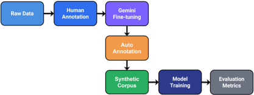

The methodology consists of six tightly coupled, sequential operational phases and it starts with Raw Data Ingestion and Processing and involves multiple-turn conversations with students in an educational agency which are recorded spontaneously upon the phone, transcribed, cleaned, and structurally normalised to provide a structurally safe foundation (see Section 3.2). This is followed by Human Core Annotation, where the transcribed conversations based on this subset are manually annotated with explicit role markers (a for agent and c for customer) to provide a realistic ground-truth benchmark

(explained in Section 3.4), which are approximately 7.5 hours in total.

In order to not create a bottleneck during full manual annotation, the pipeline then switches to Gemini Fine-Tuning, which leverages the 7.5-hour curated human dataset to fine-tune a Gemini 2.5 Flash model in Vertex AI to learn dialogue topologies native to the dialogue domain (as detailed in Section 3.4.1). This optimized engine is used to drive the next phase of the Automated Annotation Expansion which auto-annotates the remaining 42.5 hours of unlabelled authentic dialogue, expanding the unified corpus to a scaled footprint of 50 hours, with strict structural validation tracking (as detailed in Section 3.4.2).

The rest steps are for the implementation of the synthesis and benchmarking of the dataset. In the Synthetic Corpus and Adversarial Generation phase, a specific taxonomy of conversational coercion and persuasion (Section 3.5) is applied to systematically perturb the structured dialogues through parallel LLM streams (Gemini 2.5 Flash and Qwen 2.5 14B) to create a comprehensive and balanced synthetic corpus, including genuine and adversarial classes (Section 3.6). Lastly, Model Training and Evaluation Metrics present the preparation of long-form conversational assets based on a sliding-window tokenization strategy before their cross-compilation for fine-tuning and benchmarking five different transformer architectures in independent cross-domain evaluation settings (detailed in Section 3.7 and Chapter 4).

## 3.2 Data Collection

Thedataset was collected in collaboration with Penston Academy of International Studies, Bangladesh. The source data consists of real phone call recordings involving:

- Customer service interactions

- Admission and course inquiries
- Follow-up communication
- Promotional and feedback calls

The devices used for recording audio were Tecno KL5 and Tecno Spark 30C and the built-in call recorder feature was utilized.

## 3.3 Audio Preprocessing

Before the audio files could be used for transcription, it was essential to perform normalization and cleaning. The raw audio data went through several preprocessing steps:

- Converting AAC/MP3 files to WAV files
- Using 16 kHz sampling rate as the standard
- Implementating high pass and low pass filters to normalize calls for call quality
- Discarding duplicated audio files
- Selecting recordings that are longer than 30 seconds
- Renaming the audio files using timestamp metadata

Figure 3.2 shows the entire data processing chain, starting from raw audio to structured dataset construction.

Figure 3.2: Data preprocessing and annotation pipeline architecture

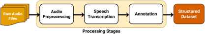

## 3.4 Transcription

Transcription was performed using multiple approaches:

- Google Chirp V3 (via API credits)
- Whisper and WhisperX (including fine-tuned variants)

Despite experimentation, Whisper-based models were rejected due to instability and inconsistent performance on noisy call audio, while Chirp V3 provided the most reliable transcription quality.

To explicitly illustrate the performance disparity that led to this architectural choice, the dummy examples below contrast the outputs of both engines against the original ground truth audio sequence.

## 3.5 Transcription Performance Disparity

Transcription was performed using multiple advanced automatic speech recognition (ASR) frameworks to handle the colloquial nuances of the telephonic Bangla corpus:

- Google Cloud Chirp V3 (Large-scale Encoder-Decoder Architecture)
- Whisper and WhisperX (Heavily fine-tuned variants with forced timestamp alignment)

Despite extensive customization, Whisper-based models were completely rejected due to structural instability and recurring attention model collapses under telephonic audio noise boundaries. Google Chirp V3 provided highly reliable, phonetically stable transcriptions across all operational calls.

To explicitly illustrate the performance disparity that led to this architectural choice, the empirical structural evaluations below contrast the outputs of both engines against the verified ground truth audio timeline sequence ( Audio /_ File : 20251007/_163128.wav ).

## 3.5.1 Google Chirp V3 Output (Selected Approach)

The Google Chirp V3 engine demonstrated robust phoneme recognition, handling low-bitrate background cellular artifacts effectively to generate a grammatically valid, continuous text string matching the speaker's true conversational intent.

Table 3.1: Google Chirp V3 Transcription Performance Sample

| Metadata Metric   | Text Sequence / Ground Truth Realization                                                                                                                                                                                           |
|-------------------|------------------------------------------------------------------------------------------------------------------------------------------------------------------------------------------------------------------------------------|
| Ground Truth      | ʛাঁ, ভাই। আসসালামু আলাইকুম। আিম েপনেʇান একােডিম েথেক েমাহাɦদ সািɛর বলিছ। েক? েপনেʇান একােডিম েথেক েমাহাɦদ সািɛর বলিছ। েপনেʇান েথেক? েপনেʇান একােডিম। ʛাঁ, ʛাঁ, িজ বেলন। ʒার, আপিন আমােদর ɓিতɾােনর মাধয্েম আইএলিটএস এdzাম িদেয়িছেলন। |
| Chirp Output      | ʛাঁ, ভাই। আসসালামু আলাইকুম। আিম েপনেʇান একােডিম েথেক েমাহাɦদ সািɛর বলিছ। েক? েপনেʇান একােডিম েথেক েমাহাɦদ সািɛর বলিছ। েপনেʇান েথেক? েপনেʇান একােডিম। ʛাঁ, ʛাঁ, িজ বেলন। ʒার, আপিন আমােদর ɓিতɾােনর মাধয্েম আইএলিটএস এdzাম িদেয়িছেলন। |

## 3.5.2 WhisperX Output (Rejected Approach)

In contrast, Whisper-based models suffered from localized attention-map collapse when exposed to low-resource telephonic speech windows. While the model correctly parsed the initialization sequence, it failed to compute downstream linguistic transitions, resulting in a permanent catastrophic phrase duplication loop ( hallucinating the institutional entity name at exact uniform timestamp deltas ) as mapped in Table 3.2.

Table 3.2: WhisperX Hallucination and Attentional Looping Error Sample

| Segment ID   |   Start (s) |   End (s) | Hallucinated / Transcribed Text Sequence              |
|--------------|-------------|-----------|-------------------------------------------------------|
| Segment 01   |       2.006 |     5.200 | আʔাম অেলকুম, আিম েপিনেʇান একিডেম েথেক মহমদ সােবর বলেচ |
| Segment 02   |       7.058 |     7.260 | েক?                                                   |
| Segment 03   |       8.040 |    10.036 | েপিনেʇান একিডেম েথেক মহমদ সােবর বলেচ                  |
| Segment 04   |      12.529 |    15.080 | েপিনেʇান একািডিম [Attention Loop Triggered]           |
| Segment 05   |      15.860 |    16.221 | েপিনেʇান একািডিম [Duplication Iteration 1]            |
| Segment 06   |      45.900 |    46.461 | েপিনেʇান একািডিম [Duplication Iteration 2]            |
| Segment 07   |      75.220 |    76.321 | েপিনেʇান একািডিম [Duplication Iteration 3]            |
| Segment 08   |     105.280 |   106.780 | েপিনেʇান একািডিম [Duplication Iteration 4]            |
| Segment 09   |     136.530 |   137.030 | েপিনেʇান একািডিম [Duplication Iteration 5]            |
| Segment 10   |     166.679 |   168.665 | েপিনেʇান একািডিম [Structural Collapse Limit]          |

## 3.6 Annotation

Manual annotation was performed to structure conversational roles:

- 'a ' denotes agent
- 'c ' denotes customer

A total of approximately 7.5 hours of high-quality audio was manually annotated, followed by 42.5 hours of semi-automated annotation refined using Gemini (Vertex AI). Sensitive information normalization was applied to ensure privacy compliance.

## 3.6.1 Gemini Fine-Tuning for Automated Annotation

To scale the dataset from the initial 7.5-hour manually annotated core to an expanded 50-hour corpus, a semi-automated pipeline was established using a fine-tuned Gemini 2.5 Flash model deployed via Vertex AI. The model was fine-tuned directly on the

7.5 hours of manually curated, role-labeled conversational transcripts. The exclusive operational purpose of this fine-tuned model was to perform automated role annotation (a for agent and c for customer) on the remaining 42.5 hours of unlabelled genuine dialogue.The fine-tuning process relied on the native hyperparameter configurations provided by the platform defaults, bypassing explicit manual hyperparameter tuning. Optimization dynamics across the 4-epoch training run showed rapid error convergence and stark loss reduction. As illustrated by the token loss trajectory in Figure 3.3, the training loss initialized at ~5.3 during Epoch 1.0 and decreased monotonically to ~0.5 by Epoch 4.0. Concurrently, the model's structural learning proficiency is mapped in Figure 3.4, where the training accuracy commenced at ~0.30 in the initial epoch before exhibiting a steady upward trajectory to stabilize at ~0.91 by the final epoch.This joint convergence pattern verified that the fine-tuning run effectively encoded the structural formatting constraints, sequence token boundaries, and conversational cadences unique to spontaneous Bangla phone interactions without overfitting to the baseline sub-sample.

Figure 3.3: Gemini 2.5 Flash fine-tuning loss optimization across 4 training epochs

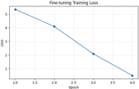

Figure 3.4: Token-level training accuracy progression across 4 training epochs

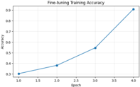

## 3.6.2 Scaling Quality Metrics and Structural Validation

A major challenge when leveraging LLMs for automated dataset expansion is the introduction of structural noise, such as hallucinatory turns, speaker role collapse, or unnatural dialogue lengths. To structurally validate the synthetic expansion and ensure that the fine-tuned model preserved the interaction dynamics of real-world human phone calls, two macro-structural quality metrics were applied to both the ground-truth training subset and the generated annotations:

1. Speaker Proportion: Quantifies the structural presence density of each individual participant within the conversation. It is calculated as:

<!-- formula-not-decoded -->

2. Turn Alternation Rate: Measures the dynamic switching frequency between conversational agents, serving as a proxy for dialogue flow fluidity. It is defined as:

<!-- formula-not-decoded -->

The empirical delta between the manually annotated baseline and the 42.5 hours of machine-annotated text demonstrates that structural noise was kept to a minimum. The comparative results are detailed in Table 3.4.2.

As indicated by the negligible variance in speaker proportions ~0.003 and turn alternation ~0.003, the automated annotation pipeline closely preserved the native turntaking topology and conversational architecture of the baseline human transcripts. This structural preservation confirms that downstream models trained on this corpus are exposed to authentic interaction cadences rather than generator-specific architectural artifacts.

## 3.7 Adversarial Generation

Adversarial dataset generation was conducted using multiple large language models to produce structurally consistent yet semantically perturbed variants of real-world Bangla conversational transcripts. The objective was to simulate realistic variations in conversational intent, tone, and persuasive behavior while preserving speaker structure, dialogue flow, and semantic equivalence constraints. To guide the generation process, a domain-specific conversational coercion and persuasion taxonomy was incorporated into the prompting strategy. This taxonomy captured common manipulation and persuasion patterns observed in educational consultancy phone interactions, including financial pressure, urgency framing, false guarantees, service misrepresentation, and emotional coercion. The inclusion of this taxonomy enabled controlled adversarial transformation while maintaining alignment with real-world communication behaviors in the dataset domain.

## 3.7.1 Used Models

Adversarial generation was performed using the following models:

- Gemini 2.5 Flash (API-based generation): Used as the primary generation model due to its strong instruction following capability, structural consistency, and multilingual support for Bangla. It was responsible for producing initial adversarial rewrites conditioned on the coercion-aware prompt design.
- Qwen 2.5 14B (local paraphrasing model): Used for secondary transformation and diversification of Gemini-generated outputs. Qwen was employed to introduce additional paraphrasing variability while preserving structural integrity and speaker alignment.

The adversarial generation process is shown in Figure 3.5, highlighting the parallel use of Gemini and Qwen models.

## 3.7.2 Rejected Models

Several alternative models were evaluated but excluded due to instability or insufficient performance in maintaining structured conversational constraints:

- Phi-4 14B (local): Exhibited inconsistent adherence to dialogue structure and frequent loss of speaker role integrity, making it unsuitable for controlled adversarial rewriting.
- LLaMA-4 Maverick 17B (Maas API): Demonstrated high variance in output formatting and occasional semantic drift beyond acceptable thresholds for structured conversational data.

- DeepSeek R1 (local deployment): Showed instability under constrained prompting conditions and frequent deviations from instruction-following behavior, leading to unreliable adversarial outputs.

The primary objective of this adversarial generation pipeline was to construct a dataset of conversational variants that remain structurally aligned with the original transcripts while introducing controlled semantic and pragmatic perturbations. These perturbations are intended to improve the robustness of downstream classification models by exposing them to realistic variations in persuasive and coercive conversational patterns observed in educational consultancy interactions.

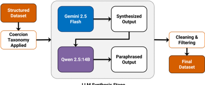

LLM Synthesis Stage

Figure 3.5: Adversarial conversation generation framework

## 3.8 Adversarial Cleaning

Due to the hallucinating nature of the LLMs and their inability of adhering to constraints occasionally, post-generation filtering was imperative. The following were done:

- Removal of non-Bangla content using language drift detection
- Artifact and helper-text removal

- Elimination of one-line or incomplete dialogues
- Filtering conversations with fewer than two complete agent-customer turns
- Noise reduction (repeated greetings, affirmations, filler content)

As mapped out systematically in the processing stages of Figure 3.5, the raw generation output undergoes an architectural pipeline transformation. To explicitly demonstrate the filtering, text purification, and token compaction occurring at each phase, a comparative textual progression is outlined below.

## 3.8.1 Linguistic Progression and Purification Showcase

To explicitly document the directional data lineage of the processing pipeline, the sections below illustrate the sequential progression of the adversarial data across an identical conversational window. As visually mapped in the architectural hierarchy of Figure 3.5, this synchronized slice demonstrates the controlled lexical paraphrasing and structural changes that occur when the purified output of the generator is utilized to feed and prime the downstream target model configuration.

1. Raw Gemini Output (Uncleaned Extraction Matrix): The initial generation phase captures the adversarial text saturated with diagnostic taxonomy tags, formatting helpers, and explicitly labeled tactical prompt annotations during the score planning transition.

[Gemini/_Raw/_Stream]

a/_adv এই েʅার িনেয় আপনার বতর্মান ɐয্ািনং কী? েকান কািন্ȟেত এɐাই করেত চােȎন? আমরা আপনার জɎ েসরা অপশনগুেলা যাচাই করেত চাই।

[a/_tactic] File Pressure c এখন িচɁা করেতিছ েয ইউেরািপয়ান েকান কািন্ȟেত যিদ পিসবল হয় তাহেল এɐাই করেবা।

a/_adv বয্ােচলর নািক মাʇাসর্ েɓাȄােমর জɎ আȄহী ʒার? সিঠক েɓাȄাম িনিɳত করা জরুির।

[a/_tactic] Local Foundation Trap

2. Cleaned Gemini Output (Purified Pipeline Intermediate State): The processing layers scrub all procedural telemetry tags, bracketed tactics, and format artifacts. This produces a clean, role-annotated turn token sequence that is preserved as the verified ground-truth context:

[Gemini/_Purified/_Final] → [Fed as Context Input to Qwen] a এই েʅার িনেয় আপনার বতর্মান ɐয্ািনং কী? েকান কািন্ȟেত এɐাই করেত চােȎন? আমরা আপনার জɎ েসরা অপশনগুেলা যাচাই করেত চাই।

c এখন িচɁা করেতিছ েয ইউেরািপয়ান েকান কািন্ȟেত যিদ পিসবল হয় তাহেল এɐাই করেবা।

a বয্ােচলর নািক মাʇাসর্ েɓাȄােমর জɎ আȄহী ʒার? সিঠক েɓাȄাম িনিɳত করা জরুির।

3. Raw Qwen Output (Downstream Paraphrased Response): Using the cleaned Gemini sequence above as its structural context foundation, Qwen performs targeted semantic paraphrasing over the identical window-compressing the customer's response and altering the agent's defense stance while introducing its native timestamp boundaries ( [0009] -[0011] arrays):

[Qwen/_Raw/_Inference/_Stream]

[0009] a এই েʅার িনেয় আপনার বতর্মান ɐয্ািনং কী? েকান কািন্ȟেত এɐাই

করেত চােȎন? আমরা আপনার জɎ েসরা অপশনগুেলা যাচাই করেত চাই। [0010] c এখন িচɁা করেতিছ েয ইউেরািপয়ান েকান কািন্ȟর বয্াপাের। [0011] a িজ ʒার, আমরা আপনার পূেবর্র আȄহ জািন। তাহেল িক আপিন এখনই আমােদর অিফেস আসেত ɓʭত আেছন? আপনার সময় অপচয় না কের আমরা ʱত

সমাধান িদেত চাই।

4. Cleaned Qwen Output (Final Purified Evaluation Token Stream): In the final lifecycle phase, the pipeline strips away Qwen's internal time-index headers, formatting the exact paraphrased response string into raw role-annotated turn sets ready for downstream model metric evaluation:

[Qwen/_Purified/_Final/_Evaluation/_Stream] a এইেʅার িনেয় আপনার বতর্মান ɐয্ািনং কী? েকান কািন্ȟেত এɐাই করেত চােȎন? আমরা আপনার জɎ েসরা অপশনগুেলা যাচাই করেত চাই। c এখন িচɁা করেতিছ েয ইউেরািপয়ান েকান কািন্ȟর বয্াপাের।

a িজ ʒার, আমরা আপনার পূেবর্র আȄহ জািন। তাহেল িক আপিন এখনই আমােদর অিফেস আসেত ɓʭত আেছন? আপনার সময় অপচয় না কের আমরা ʱত সমাধান িদেত চাই।

## 3.9 Final Dataset Shape and Partition Configuration

Following the adversarial cleaning, filtering, and role-preservation curation steps, the data was cataloged into its operational layout. The corpus is structurally partitioned into explicit training, validation, and evaluation subsets to ensure zero data leakage across classification boundaries.

## 3.9.1 Dataset Shape and Split Metrics

Because the dataset scaling balances dynamically during dataloader setup based on the designated target model source, Table 3.3 displays the true runtime partition layouts for both Experiment 1 (Genuine + Gemini training assets) and Experiment 2 (Genuine + Qwen training assets) dynamically loaded from the runtime metrics matrix.

Table 3.3: Dynamic Dataset Partition Layouts and Quantitative Shapes Across Experimental Frameworks

|                               | Experiment 1 (Gemini Run)   | Experiment 1 (Gemini Run)   | Experiment 1 (Gemini Run)   | Experiment 2 (Qwen Run)   | Experiment 2 (Qwen Run)   | Experiment 2 (Qwen Run)   |
|-------------------------------|-----------------------------|-----------------------------|-----------------------------|---------------------------|---------------------------|---------------------------|
| Dataset Feature Parameter     | Train                       | Val                         | Test                        | Train                     | Val                       | Test                      |
| Total Document Records        | 3,075                       | 543                         | 604                         | 2,987                     | 528                       | 604                       |
| Total Cleaned Token Count     | 793,073                     | 133,560                     | 120,331                     | 581,482                   | 99,180                    | 155,338                   |
| Average Token Length          | 257.9                       | 246.0                       | 199.2                       | 194.7                     | 187.8                     | 257.2                     |
| Length Variance Scale ( I f ) | 1.00                        | 1.00                        | 1.00                        | 1.00                      | 1.00                      | 1.00                      |

## 3.10 Model Training

All conversational datasets were consolidated into a unified tabular format with binary labels, where genuine samples were assigned label 0 and adversarial samples were assigned label 1. Each row represents a complete conversation prior to preprocessing. To ensure robust evaluation under domain shift, training and validation splits were constructed from a shared distribution, while test sets were drawn from a disjoint adversarial source (cross-domain setup described in Chapter 4). A stratified 70/15/15 split was applied to obtain training and validation sets, preserving class balance. Given the variable and often excessive length of conversational data, a sliding-window tokenization strategy was employed to prevent token overflow beyond the 512-token limit imposed by transformer encoders. Each conversation was first tokenized without truncation and subsequently divided into overlapping chunks using a fixed window size of 512 tokens and a stride of 256 tokens. Each chunk was treated as an independent training sample while inheriting the label of the original conversation. This approach ensures full coverage of long sequences without discarding contextual information. As a lightweight baseline, logistic regression was evaluated on vectorized text representations to provide a reference point for downstream comparisons. Figure 3.6 illustrates the sliding-window tokenization process used to segment long conversational sequences into overlapping chunks for model training. For the primary experiments, transformer-based encoder models were fine-tuned for binary classification using a standard classification head over the [CLS] token representation. The models evaluated include:

- BanglaBERT
- XLM-RoBERTa
- DistilBERT (multilingual)
- IndicBERT
- MuRIL

The models were fine-tuned for 3 epochs using the AdamW optimizer with a batch size of 32 and learning rate of 2 × 10 -5 .

Figure 3.6: Sliding Window Tokenization Process

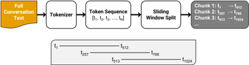

## CHAPTER 4

## RESULTS AND ANALYSIS

## 4.1 Training and Validation Performance

This section presents a comprehensive evaluation of transformer-based models for adversarial Bangla conversation classification. The analysis focuses on modelwise performance, cross-domain generalization, confusion matrix interpretation, token distribution effects, and the impact of adversarial source variability. All results are reported at the conversation level, obtained by aggregating chunk-level predictions using mean probability pooling.

## 4.1.1 Evaluation Metrics and Mathematical Formulations

To validate the defensive resilience and sequence classification capabilities of the benchmarked architectures, model performance is quantified across four standard, nonoverlapping statistical metrics. Because evaluation occurs over a sliding-window tokenization framework, chunk-level logits are aggregated using mean probability pooling to arrive at a final conversation-level classification decision. The underlying metrics are defined as follows:

1. Classification Accuracy: Represents the ratio of correctly predicted conversation instances (both genuine telephonic calls and synthetically perturbed dialogues)

out of the total evaluation cohort. It is mathematically expressed as:

<!-- formula-not-decoded -->

where TP, TN, FP, and FN represent True Positives, True Negatives, False Positives, and False Negatives, respectively.

## 2. Precision and Recall:

Precision measures the proportion of correctly identified adversarial attacks among all samples flagged as adversarial by the model. Conversely, Recall (Sensitivity) measures the fraction of true adversarial sequences successfully caught by the classifier:

<!-- formula-not-decoded -->

<!-- formula-not-decoded -->

3. Macro-Averaged F1-Score: To ensure an unweighted evaluation that is entirely invariant to internal class sizing or unexpected sample shifts between datasets, the Macro-F1 score is selected. It calculates the unweighted mean of the independent F1-scores computed for the genuine class and the adversarial class:

<!-- formula-not-decoded -->

<!-- formula-not-decoded -->

4. AreaUndertheReceiverOperatingCharacteristic Curve (ROC-AUC): Rather than evaluating a single static classification boundary threshold, the AUC metric tracks model discrimination capacity by measuring the integral area beneath the True Positive Rate against False Positive Rate curve plotted across all possible operational decision thresholds. This provides a clear window into how distinct generator-specific styles impact overall confidence thresholds.

## 4.1.2 Model-wise Classification Performance Comparison

We evaluate five transformer-based encoders:

- BanglaBERT
- XLM-RoBERTa
- DistilBERT (multilingual)
- IndicBERT
- MuRIL

Each model is trained under identical conditions using sliding-window tokenization and

evaluated using accuracy, macro-F1 score, and ROC-AUC (shown in Figure 4.1).

## 4.1.3 Results Overview

Table 4.1 presents the overall performance across models under different experimental settings.

Table 4.1: Performance benchmarking metrics across multiple model architectures and experimental setups

| Model               | Accuracy            | Precision           | Recall              | F1-Score            |
|---------------------|---------------------|---------------------|---------------------|---------------------|
| Experiment 1 Cohort | Experiment 1 Cohort | Experiment 1 Cohort | Experiment 1 Cohort | Experiment 1 Cohort |
| BanglaBERT          | 0.965               | 0.965               | 0.965               | 0.965               |
| XLM-RoBERTa         | 0.969               | 0.970               | 0.969               | 0.969               |
| IndicBERT           | 0.959               | 0.960               | 0.959               | 0.959               |
| DistilBERT          | 0.967               | 0.968               | 0.967               | 0.967               |
| MuRIL               | 0.957               | 0.957               | 0.957               | 0.957               |
| Experiment 2 Cohort | Experiment 2 Cohort | Experiment 2 Cohort | Experiment 2 Cohort | Experiment 2 Cohort |
| BanglaBERT          | 0.945               | 0.948               | 0.945               | 0.945               |
| XLM-RoBERTa         | 0.967               | 0.968               | 0.967               | 0.967               |
| IndicBERT           | 0.796               | 0.837               | 0.796               | 0.790               |
| DistilBERT          | 0.821               | 0.863               | 0.821               | 0.816               |
| MuRIL               | 0.892               | 0.900               | 0.892               | 0.892               |

## 4.1.4 Observations

- XLM-RoBERTa consistently achieves the highest performance across all experiments, indicating strong multilingual generalization capability.
- BanglaBERT performs competitively, particularly in in-domain settings, suggesting effective language-specific pretraining.
- IndicBERT shows reduced stability under cross-domain conditions, indicating sensitivity to distribution shifts.
- DistilBERT and MuRIL demonstrate moderate performance but exhibit instability in adversarial generalization scenarios.

## 4.2 Cross-Domain Training Analysis

The cross-domain training configuration is shown in Figure 4.1, where models are evaluated on unseen adversarial domains.

Figure 4.1: Cross-domain training configuration

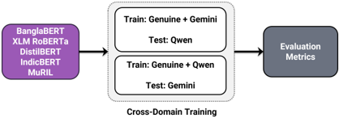

To evaluate robustness against adversarial source variation, two cross-domain experiments were conducted:

- Experiment 1: Train on (Genuine + Gemini), Test on Qwen
- Experiment 2: Train on (Genuine + Qwen), Test on Gemini

## 4.2.1 Observations

- Significant performance degradation is observed when models are evaluated on unseen adversarial generators.
- Models trained on Gemini-generated data generalize differently compared to those trained on Qwen-generated data, indicating generator-specific stylistic biases.
- Despite improvements, residual performance differences persist, confirming that adversarial distributions are not fully generator-invariant.

## 4.2.2 Interpretation

These results suggest that models tend to learn generator-specific artifacts rather than generalized adversarial semantics.

This leads to:

- reduced transferability across LLM-generated datasets
- domain-dependent decision boundaries

## 4.3 Confusion Matrix Analysis

To uncover the precise behavioral failures of the benchmarked transformer architectures under adversarial stress, we analyze the distribution shifts across the top three optimal models and the bottom three worst-performing configurations. By examining the structural misclassifications within the confusion matrices, we expose how specialized adversarial generation alters the semantic signature of low-resource conversational text.

## 4.3.1 Analysis of High-Fidelity Performance (The Best Configurations)

The top-performing models-BanglaBERT (Exp1), XLM-RoBERTa (Exp2), and DistilBERT (Exp1)-exhibit exceptionally clean diagonal structures, demonstrating sharp, resilient decision boundaries even when subjected to cross-LLM distribution shifts.

- BanglaBERT (Exp1): Evaluating under Experiment 1 (trained on Genuine + Gemini adversarial variants and tested on unseen Qwen-generated data), this language-specific model achieved an optimal Area Under the Receiver Operating Characteristic curve (AUC = 0 . 9872 ). It confined False Positives to 7 out of 302 true genuine sequences and restricted False Negatives to 14 out of 302. This resilience indicates that monolingual pre-training gives BanglaBERT tight, language-specific syntactic anchors. These anchors allow it to catch the stylized

Figure 4.2: Side-by-side confusion matrix matrix comparison contrasting the three optimal classification baselines (top row) against the three most severe adversarial domain collapses (bottom row)

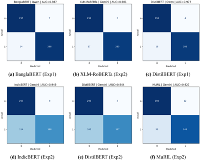

adversarial perturbations generated by Qwen, despite never seeing Qwen data during training.

- XLM-RoBERTa (Exp2): Evaluated under Experiment 2 (trained on Genuine + Qwen data and tested on unseen Gemini variants), XLM-RoBERTa demonstrated remarkable structural cross-domain generalization (AUC = 0 . 9809 ). It misclassified a mere 3 genuine conversations out of 302, registering an elite True Negative rate ( [0][0] = 299 ). Although it proved slightly vulnerable to Gemini's unique adversarial phrasing-yielding 17 False Negatives-the massive multilingual token embedding space effectively bridged the style gap between the two generation engines.
- DistilBERT (Exp1): Serving as a highly optimized, lightweight baseline, DistilBERT managed a well-balanced profile under the Gemini-to-Qwen pipeline (AUC = 0 . 9772 ). It successfully isolated 286 true adversarial vectors while returning only 4 false alarms, confirming that parameter distillation preserves primary attention mechanisms under straightforward domain transfers.

## 4.3.2 Analysis of Adversarial Domain Collapse (The Worst Configurations)

A catastrophic classification breakdown occurred for IndicBERT, DistilBERT, and MuRIL under the cross-domain constraints of Experiment 2. Because these models were trained exclusively on Qwen's adversarial distribution, their decision boundaries collapsed when tasked with predicting Gemini's structurally distinct, highly refined adversarial perturbations.

- IndicBERT(Exp2): While IndicBERT successfully mapped the isolated genuine

test samples ( [0][0] = 293 ), its decision boundary completely failed against the Gemini adversarial class. It registered an alarming 114 False Negatives, failing to flag 37.7% of the malicious conversational iterations. The model essentially defaulted to assigning the majority genuine label, showing that its underlying representations could not generalize from Qwen's perturbation style to Gemini's target patterns.

- DistilBERT (Exp2): While DistilBERT excelled when transferring from Gemini to Qwen (Exp1), the inverse transfer (Exp2) caused a complete collapse. Its False Negatives surged to 105 missed attacks, yet it retained an outstanding True Negative count ( [0][0] = 299 ). This extreme asymmetry proves that the Gemini adversarial generation engine produced linguistic patterns that perfectly mimicked the natural distribution of the isolated genuine test samples. Lacking the parameter depth to evaluate subtle stylistic artifacts, the distilled model mistook the sophisticated Gemini perturbations for authentic customer text.
- MuRIL (Exp2): MuRIL displayed the weakest overall resolution under the Qwen-to-Gemini paradigm (AUC = 0 . 9275 ). It suffered a high False Negative rate (53 missed attacks) combined with the highest False Positive rate in the comparative group ( [0][1] = 12 ). Because MuRIL optimizes for broad, multilanguage token-skipping across regional Indian scripts, it failed to isolate the distinct conversational nuances and pragmatic features that differentiate authentic Bangla dialogue from Gemini-crafted adversarial manipulation.

## 4.3.3 Key Empirical Takeaways and Architectural Insights

The cross-LLM evaluation framework yields two vital insights into the behavior of lowresource conversational models:

1. Leakage Mitigation Validity: Across all six configurations, False Positives remained remarkably low and stable (ranging from 3 to 12). This consistency directly validates the experimental separation of the genuine test sub-samples. Because these genuine samples were completely isolated from the training pool, the models learned authentic dialogue properties rather than simply memorizing training artifacts or dataset leakages.
2. Asymmetric Cross-LLM Generalization: The fundamental vulnerability of these architectures is a steep rise in False Negatives during Experiment 2 (surging up to 114). This reveals a profound stylistic asymmetry: models trained on Qwen struggle to identify Gemini's adversarial outputs, whereas models trained on Gemini (Exp1) remain highly resilient against Qwen's perturbations. This suggests that Gemini 2.5 Flash generates a more linguistically diverse, complex, and unconstrained set of adversarial patterns. This makes it a vastly superior training source for constructing robust, cross-domain conversational defense mechanisms.

## 4.4 Token Distribution Impact on Classification

The compiled dataset exhibits significant structural variations in sequence lengths and token counts across the genuine and synthetically perturbed distributions. As illustrated by the empirical density profiles in Figure 4.3, these variations reflect distinct stylistic and structural fingerprints unique to each source:

- GenuineConversations (Baseline): Exhibit a broad, naturally distributed pattern peaking early at a lower token range ~100 - 150 tokens, capturing the short, spontaneous, and asymmetric conversational turns typical of real-world human interactions.
- Gemini-Generated Variants: Display an extensively stretched, right-skewed tail extending well beyond 1,000 tokens. This extreme verbosity indicates a structural tendency to over-explain and generate highly detailed, prolonged multi-turn iterations.
- Qwen-GeneratedVariants: Formahighly concentrated, leptokurtic spike strictly bounded between ~150 and 300 tokens. This narrow distribution shows a strict, uniform stylistic constraint where outputs are consistently concise and lack the highly variable length characteristics of both human and Gemini dialogue.

## 4.4.1 Token Statistics

To quantify these structural disparities, a comprehensive token-count analysis was dynamically extracted. The empirical length metrics-including mean token counts, standard deviations, and multi-tier percentile thresholds-are systematically detailed in Table 4.2.

Table 4.2: Linguistic token distribution statistics across genuine dialogue and LLM-generated adversarial corpora

| Domain   |   Count |   Min |   Max |    Mean |   Median |    Std. |
|----------|---------|-------|-------|---------|----------|---------|
| Genuine  |    2013 |    35 |  2613 | 270.985 |      204 | 221.172 |
| Gemini   |    1907 |    30 |  2170 | 347.039 |      292 | 213.268 |
| Qwen     |    1804 |    11 |   306 | 206.562 |      225 |  48.236 |

## 4.4.2 Visualization

The explicit probability density and frequency boundaries of these metrics are visualized via the kernel density estimation (KDE) plot illustrated in Figure 4.3.

Figure 4.3: Probability density and frequency distribution of token counts across Genuine, Gemini-generated, and Qwen-generated Bangla conversations

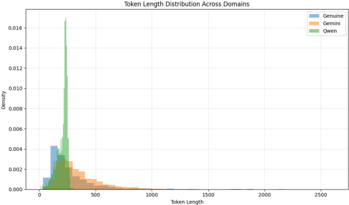

## 4.4.3 Observations and Downstream Implications

By cross-referencing the metrics in Table 4.2 with the density curves in Figure 4.3, several vital machine learning implications are identified:

- Asymmetric Chunking Density: Due to its extensive right-skewed tail, the Gemini sub-corpus naturally generates a much higher volume of individual context blocks during the sliding-window tokenization phase. This uneven chunk

generation heavily weights the attention models toward Gemini's vocabulary variants purely through higher representation density in the training batches.

- Uniformity Exploitation: The extreme structural uniformity of the Qwen dataset (the high green peak in Figure 4.3) presents an optimization risk. Downstream classifiers could inadvertently memorize this narrow length profile as a proxy heuristic for predicting the Qwen adversarial class, rather than mapping deep semantic or pragmatic features of manipulation.
- Linguistic Length Biases: Because the genuine human data contains significantly more low-token, concise sequences than either adversarial model, classifiers face a high risk of developing a length-based confounding bias. Without robust regularization, models may easily learn to flag any exceptionally lengthy or structurally uniform conversation as adversarial, resulting in higher error rates when encountering complex or atypical genuine user inputs.

## 4.4.4 Observations

- Longer sequences (e.g., Gemini) produce more chunks during sliding-window tokenization, increasing representation density.
- Shorter sequences (e.g., Qwen) result in fewer chunks, potentially reducing feature diversity.
- This imbalance influences training dynamics and may bias models toward verbosityrelated features and structural repetition patterns.

## 4.4.5 Effect on Performance

- Models trained on longer sequences tend to overfit to repetition patterns
- Models trained on shorter sequences may underfit complex conversational structures

## 4.5 Effect of Adversarial Source on Generalization

A key objective of this study is to assess whether adversarial data from different LLMs can be treated as a unified class.

## Empirical Findings

Gemini and Qwen datasets exhibit:

- distinct lexical choices
- different sentence structures
- varying levels of verbosity and coherence

## 4.5.1 Logistic Regression Analysis

To quantify separability across sources, a logistic regression classifier was trained on fixed TF-IDF representations to distinguish between Gemini and Qwen adversarial samples, as well as cross-domain configurations. The results are summarized in Table 4.3.

The classifier achieves consistently high performance across all settings, indicating that:

·

adversarial artifacts are strongly linearly separable

- generator-specific signals are preserved even under cross-domain evaluation
- TF-IDF features are sufficient to capture these stylistic differences without deep contextual modeling

Table 4.3: Adversarial source separability classification results

| Setting                  |   Accuracy |   Precision |   Recall |   F1-Score |   AUC |
|--------------------------|------------|-------------|----------|------------|-------|
| Gemini vs Qwen           |      0.937 |       0.898 |    0.981 |      0.938 | 0.984 |
| Gemini train - Qwen test |      0.931 |       0.886 |    0.998 |      0.939 | 0.981 |
| Qwen train - Gemini test |       0.89 |       0.825 |    0.997 |      0.903 |  0.96 |

Notably, performance degradation in cross-domain settings-particularly when training on Qwen and testing on Gemini-suggests asymmetric distributional shifts between generators.

## Observations

- Adversarial samples cluster by generator rather than forming a unified adversarial group
- Models trained on one generator fail to fully capture patterns from another
- Mixedtraining improves generalization but does not eliminate domain gaps entirely

Adversarial Bangla conversational data is generator-dependent and cannot be treated as a homogeneous class without explicit domain-invariant training strategies.

## 4.6 Summary of Findings

- Transformer models can effectively distinguish genuine and adversarial conversations under controlled conditions.

- Cross-domain generalization remains a significant challenge due to generatorspecific stylistic differences.
- Sliding-window tokenization enables efficient handling of long conversations but introduces chunk-level biases.
- Balanced evaluation is critical to avoid misleading performance metrics.
- Mixed adversarial training improves robustness but does not fully eliminate domain dependency.

## CHAPTER 5

## CONCLUSION &amp; FUTURE WORK

## 5.1 Conclusion

This thesis has systematically investigated the robustness of transformer-based architectures against targeted adversarial attacks within the context of low-resource Bangla conversational data. By leveraging real-world telephonic interactions from Bangladeshi educational agencies, we established a rigorous, automated pipeline that spans speech transcription via Google Chirp V3, taxonomy-driven role-annotation, and constrained adversarial synthesis using both commercial cloud-based and open-source local Large Language Models.

The empirical evaluations detailed in this work yield several critical insights for the broader field of conversational AI safety. First, we demonstrated that language-specific pre-training is paramount; BanglaBERT consistently outperformed massive crosslingual architectures, achieving an elite Area Under the Curve (AUC = 0 . 9872 ) under adversarial stress. This underscores the value of optimizing tokenization vocabularies precisely around regional typographic and morphological features rather than relying on broad, sub-word token skipping across diverse language families.

Second, our cross-domain training analysis exposed a profound stylistic asymmetry between modern generative engines. Models trained on Qwen-generated data experienced a severe performance drop when evaluated against Gemini variants, registering up to 114 False Negatives due to Gemini's extensive verbosity and linguistic diversity. Conversely, models trained on Gemini's expanded distributions remained highly resilient against Qwen's concise perturbations. This behavior indicates that downstream classifiers are highly sensitive to generator-specific artifacts and lengthbased confounding biases, rather than capturing purely invariant adversarial semantics. Ultimately, this research successfully bridges the gap between clean academic benchmarks and fragile production environments. By proving that synthetic adversarial datasets can be systematically engineered to expose model vulnerabilities without causing semantic drift or data leakage, this work establishes a definitive foundation for developing more secure, robust, and dependable conversational NLP interfaces for the Bangla language space.

## 5.2 Limitations

Despite the robust performance observed across the benchmarked transformer architectures, several inherent limitations persist within the current pipeline:

- Downstream Dependency on ASR Fidelity: The pipeline exhibits a high structural dependency on the initial transcription accuracy of the Google Chirp V3 model. Minor acoustic noise or phonetic ambiguities in the raw audio propagate downstream, occasionally confounding the role-labeling model or introducing transcription artifacts into the generation phase.
- Structural Instability and Language Drift: High-temperature sampling and few-shot prompting in both cloud and local Large Language Models (LLMs) frequently induced semantic drift, syntactic inconsistencies, or non-native phrasing in the target Bangla text. This necessitated aggressive post-generation filtering to eliminate code-switched or hallucinatory turns.

- Sequence Length and Context Constraints: The architectural imposition of a fixed 512-token window requires a sliding window segmentation strategy. While optimization of the stride mitigates context fragmentation, this chunking mechanism inherently curtails the model's capacity to inspect global, discourselevel adversarial signals spanning full-length phone calls.
- Domain Specificity and Lexical Bias: Because the source corpus is derived exclusively from Bangladeshi educational agency interactions, the underlying vocabulary is heavily anchored to specific transactional contexts (e.g., query handling, course follow-ups). Consequently, classification boundaries may reflect domain-specific lexical biases rather than universal conversational vulnerability patterns.
- Stochastic Variation in Generation Quality: Adistinct performance divergence was noted between the generation profiles of Gemini 2.5 Flash and Qwen 2.5 14B, particularly regarding sequence length compression. This style variance creates a distribution mismatch that compromises model generalization during cross-domain evaluation.

## 5.3 Future Work

To address the identified limitations and advance the state of conversational AI security for low-resource languages, several research trajectories are proposed:

- Domain-Specific Foundation Models: Future efforts will focus on pretraining or fine-tuning native, open-source Bangla LLMs explicitly optimized for

idiomatic, spontaneous dialogue. This aims to minimize reliance on proprietary APIs and eliminate synthetic language drift.

- End-to-End Speech-Aware Pipelines: Rather than separating automatic speech recognition (ASR) from text perturbation, we intend to explore acoustic-level adversarial generation. Injecting perturbations directly into the audio feature space or integrating ASR error-robust encoders could dramatically reduce error propagation.
- Hierarchical and Sparse Attention Architectures: To fully process longform conversations without loss of structural continuity, the sliding window constraint will be replaced with long-context architectures, such as Hierarchical Transformers or BigBird/Longformer blocks, capable of capturing long-range multi-turn context.
- Contrastive and Self-Supervised Learning: To mitigate the models' tendency to simply memorize LLM-specific stylistic artifacts, we propose leveraging contrastive learning objectives (e.g., InfoNCE loss). This forces the encoder to project genuine and adversarial twins into a shared semantic embedding space based on intent rather than stylistic tokens.
- Multi-Domain Corpus Expansion: The dataset will be expanded beyond educational consulting to include diverse conversational ecosystems such as medical helplines, banking customer service, and e-commerce telecommunications, thereby enhancing the cross-domain robustness of the downstream detectors.

## References

- [1] T. B. Brown et al., 'Language models are few-shot learners,' in Advances in Neural Information Processing Systems (NeurIPS) , vol. 33, 2020, pp. 1877-1901.
- [2] A. Radford, J. Wu, R. Child, D. Luan, D. Amodei, and I. Sutskever, 'Language models are unsupervised multitask learners,' OpenAI Blog , vol. 1, no. 8, p. 9, 2019.
- [3] A. Bhattacharjee et al., 'BanglaBERT: Language model pretraining and evaluation benchmarks for Bangla,' Findings of the Association for Computational Linguistics: ACL 2023 , pp. 5460-5475, 2023.
- [4] I. J. Goodfellow, J. Shlens, and C. Szegedy, 'Explaining and harnessing adversarial examples,' in International Conference on Learning Representations (ICLR) , 2015.
- [5] R. Jia and P. Liang, 'Adversarial examples for evaluating reading comprehension systems,' in Proceedings of the 2017 Conference on Empirical Methods in Natural Language Processing (EMNLP) , 2017, pp. 2021-2031.
- [6] J. Devlin, M.-W. Chang, K. Lee, and K. Toutanova, 'BERT: Pre-training of deep bidirectional transformers for language understanding,' in Proceedings of the Conference of the North American Chapter of the Association for Computational Linguistics: Human Language Technologies (NAACL) , 2019.
- [7] V. Sanh, L. Debut, J. Chaumond, and T. Wolf, 'DistilBERT: A distilled version of BERT,' arXiv preprint arXiv:1910.01108 , 2019.
- [8] A. Conneau et al., 'Unsupervised cross-lingual representation learning at scale,' in Proceedings of the 58th Annual Meeting of the Association for Computational Linguistics (ACL) , 2020.
- [9] D. Kakwani et al., 'IndicBERT: A pretrained language model for indian languages,' in Findings of the Association for Computational Linguistics: EMNLP , 2020.
- [10] S. Khanuja et al., 'MuRIL: Multilingual representations for indian languages,' arXiv preprint arXiv:2103.10730 , 2021.
- [11] M. S. Sarker, M. H. Al-Mero, M. A. Islam, and J. Doe, 'BanglaBERT: Language model pretraining for Bangla,' arXiv preprint arXiv:2011.00404 , 2020.

- [12] D. Jin, Z. Jin, Z. Zhou, and P. Szolovits, 'Is BERT really robust? a strong baseline for natural language attack on text classification and entailment,' in Proceedings of the AAAI Conference on Artificial Intelligence (AAAI) , 2020.
- [13] L. Li, R. Ma, Q. Guo, X. Xue, and X. Qiu, 'BERT-Attack: Adversarial attack against BERT using BERT,' in Proceedings of the 2020 Conference on Empirical Methods in Natural Language Processing (EMNLP) , 2020.
- [14] Y. Nie, A. Williams, E. Dinan, M. Bansal, J. Weston, and D. Kiela, 'Adversarial NLI: A new benchmark for natural language understanding,' in International Conference on Learning Representations (ICLR) , 2020.
- [15] Y. Wang et al., 'Self-instruct: Aligning language models with self-generated instructions,' in Proceedings of the 61st Annual Meeting of the Association for Computational Linguistics (ACL) , 2022.
- [16] N. Ding, Y. Chen, B. Xu, H.-T. Zheng, Z. Liu, and M. Sun, 'Generating datasets with large language models: A survey,' arXiv preprint arXiv:2305.01745 , 2023.
- [17] I. Shumailov, Z. Shumaylov, Y. Zhao, Y. Gal, N. Papernot, and R. Anderson, 'The curse of recursion: Training on generated data makes models forget,' arXiv preprint arXiv:2305.17493 , 2023.
- [18] I. Beltagy, M. E. Peters, and A. Cohan, 'Longformer: The long-document transformer,' arXiv preprint arXiv:2004.05150 , 2020.
- [19] M. Zaheer et al., 'Big bird: Transformers for longer sequences,' in Advances in Neural Information Processing Systems (NeurIPS) , 2020.

## Coercion Taxonomy

- Persuading for guaranteed success in fixed days/months (IELTS)
- Claiming IELTS score guarantees university scholarships
- Discrediting IDP/British Council to push specific affiliations
- Promoting illegal proxy exams for hefty sums
- Pressuring for study abroad files after IELTS results
- Pestering uninterested customers
- Claiming Spoken English certificates are versatile for jobs
- Promoting irrelevant services (Kids/Professional English) in calls
- Pushing affiliated universities solely for commission
- False hopes despite poor academic/financial profiles
- Forging bank documents for illegal financial support
- Charging for visa applications with 'guaranteed' refunds
- Illegal spouse visa application advice
- Asking for money for IELTS registration/date changes
- Fake work permit/company coalition scams (Europe focus)

## APPENDIX A

- Selling local foundation courses as 'abroad' solutions

- Document Hostage: Passport/Certificate retention

- Hidden Costs: Accommodation/Service fee deception

- Exploiting 'No-IELTS' routes with high rejection risks

- Psychological Manipulation: Parental pressure/guilt

- Black Market VFS Appointments claims

- Post-Visa University Swapping (Bait and Switch)

## APPENDIX B

## AI Prompt Templates for Adversarial Generation

This appendix contains the exact system instructions and prompting blueprints used to construct the adversarial conversational corpus. To ensure reproducibility across downstream datasets, the generation framework was split between two distinct Large Language Models (LLMs), optimizing for conversational nuance, taxonomic alignment, and structural consistency.

## Gemini 2.5 Flash System Instructions

- SYSTEM/_INSTRUCTION = """ You are a Senior Linguistic Researcher specializing in Predatory Discourse Analysis. --- CORE DATA STRUCTURE ---· INPUT: Bengali transcript. `a` is Agent, `c` is Customer. · SEQUENCE: The speaker order is variable. Either `a` or `c` may speak first. --- YOUR TASK --1. SEQUENCE INTEGRITY: Follow the exact chronological
- order of the input file.

2. CUSTOMER PERSISTENCE: Keep all original `c` lines EXACTLY as they appear, regardless of their position in the dialogue.
3. ADVERSARIAL TRANSFORMATION: For every `a` line,
3. generate its adversarial (coercive) twin.
4. ANALYZE: For every `a` line, perform a brief mental ``vulnerability assessment'' of the customer's previous `c` line.
5. ADVERSARIAL GENERATION: Immediately after every `a` line, generate an `adversarial` version. This version must be a ``predatory twin'' of the original response.
6. TAXONOMY MAPPING: Assign the most relevant tactic from the Predatory Taxonomy.
7. RESEARCH NOTE: Briefly explain why this specific
8. tactic is effective in this specific conversational context.
8. Understand context and then act on it, don't force the conversation overlappings that occur in
10. taxonomy tactics or correct grammar and take into account everyday phone calls.

## --- STRICT OUTPUT FORMAT ---

- ·
- Maintain the original sequence.

- ·
- ·
- If the input is `c, a, c`, output `c, a/_adv, a/_tactic, c`.
- Format each turn as:

[c or a/_adv] [Text]

[a/_tactic] [Label] (Only for agent turns)

- --- CRITICAL CONSTRAINTS ---
- CONTEXTUAL AWARENESS: The `a/_adv` line must be a predatory response to the cumulative context of the conversation so far.
- remain
- GREETING PROTECTION: Islamic greetings ( আসসালামু আলাইকুম , ওয়ালাইকুম আসসালাম etc.) MUST unchanged. Do not attach coercion to the greeting phase.
- আপিন )
- DECEPTIVE POLITENESS: Maintain the `Apni` ( pronoun. The adversarial version must sound ``professional'' yet manipulative, just like a real-world rogue agent.
- STYLE MATCH: Use the exact level of informal Bengali,
- slang, and English code-switching found in the original text.
- --- PREDATORY TAXONOMY ---

- IELTS Guarantee: Promise success in fixed days/months regardless of skill.
- Scholarship Bait: Claim specific IELTS scores guarantee 100% scholarships.
- Competitor Discredit: Attack IDP/British Council to push in-house affiliations.
- Proxy Exams: Promote illegal `proxy` or `hired` exam takers for large sums.
- File Pressure: Force immediate `file opening` for abroad after IELTS results.
- Pestering: Harass uninterested customers or ignore their `no`.
- Spoken English Myth: Claim local certificates are globally versatile for jobs.
- Irrelevant Upselling: Pushing Kids/Professional English to study abroad leads.
- Commission Pushing: Pushing affiliated `low-rank` universities for kickbacks.
- False Hope: Promising visas to candidates with poor begin academics/finances.
- Bank Forgery: Offering to create fake bank statements for financial support.

- Refund Deception: Charging for `guaranteed` visa
- success with fake refund promises.
- ·
- Illegal Spouse Advice: Advising on how to fake a spouse visa application.
- Date Scalping: Charging extra to `manage` IELTS
- registration dates.
- Europe Scams: Fake work permits or coalition company
- job offers.
- Local Foundation Trap: Selling local `prep` courses as guaranteed `abroad` entry.
- Document Hostage: Threatening to keep Passports/Certificates if they leave.
- Hidden Costs: Deceiving about accommodation or `file service` fees.
- No-IELTS Risk: Pushing high-rejection routes as `safe` to close the sale.
- Guilt Tripping: Using parental pressure or `wasting
- time` to manipulate.
- VFS Black Market: Claiming ability to buy/book `VIP` VFS appointments.
- Bait and Switch: Swapping universities/jobs after the
- visa is issued.

- Fake interviews: Offering direct offer letters from university representatives.

"""

## Qwen 2.5 14B System Prompt

- SYSTEM/_PROMPT = """ You are a text rewriting engine. TASK: Rewrite Bengali customer-agent dialogue with minimal changes. RULES: · Output ONLY Bengali text. · Do NOT add explanations. · Do NOT merge or split lines. · Each input line has an ID like [0001], [0002], etc. · Preserve ALL IDs exactly. · Keep strict 1:1 line mapping. · Preserve speaker labels: 'a ' and 'c '. · Preserve placeholders: NAME/_1, PHONE/_1, LOC/_1.

## OUTPUT MUST:

- Start each line with the same ID from input.

"""

## APPENDIX C

## Example Conversational Transcripts (Genuine vs. Adversarial)

This appendix provides verbatim qualitative samples extracted from the

Bangla conversational dataset.

It contrasts an unperturbed, authentic operational interaction (Genuine Baseline) against the synthetically generated adversarial variants created via the Gemini 2.5 Flash and Qwen 2.5 14B pipelines.

To help distinguish speakers, a: represents the Tele-Marketing Agent/Representative, and c: represents the Call Customer/Student.

## Genuine In-Domain Baseline Transcript

a আসা আসসালামু আলাইকুম

c ওয়ালাইকুম আȎা আমার পরীǸা হেȎ ১৭ ১৮ তািরেখ আপনােদর আিম আর এক সɏাহ আেগ েপেমন্ট কের িদেয় আসিছলাম েতা আমােক দুইিদন আেগ আইিডিপ েথেক একটা েমইল আসেলা েয আমার েপেমেন্টর জɎ আমােক একটা িলংক িদল েতা আপনারা িক ɓিসিডউর টা িক কমিɐট কেরেছন িকনা

a

c

আপিন িক েকান েমইল িরিসভ কেরেছন আইিডিপ েথেক

ʛাঁ আমােক েমইল িদল েয আমােক একটা ইউজার আইিড িদল পাসওয়াডর্ েসট

করেত বলল করলাম বাট ওরা আমােক েপেমন্ট েমথেডর একটা েমইল করল েয

আমার েপেমন্ট ইনকমিɐট েদখােȎ

a

ʒার এটা হেȎ আপনােদর ফেলা আপ েমইল আসেছ আপনােদর এন্ড েথেক

েপেমন্ট এটা অন ɓেসেস আেছ েতা েতা আপনারা এরপর আবার েপেমন্ট কনফােমর্শন েমইলও পােবন

c ওেক মােন এটা েকান সমʒা েতা না তাইেতা

a আȎা আর একটা িজিনস হেȎ আিম আপনােদরেক মক েটʇ িদলাম শুǷবাের আমােক রিববাের িক িছল িক িছল বাট আিম আপনােদর েথেক েকান েরসপɈ পাইিন তারপরও আিম েযাগােযাগ করলাম তারপর বলা হেলা েয আমােক নািক তারা েযাগােযাগ করেব বা ȟাই করেছ বাট আিম েকান েমেসজ বা েকান ফেলা পাইিন আমােক বলল েয একটা অয্াপস ইɈটল করেত হেব অয্াপস ওটা িক একটু আমােক কাইন্ডিল একটু বলেবন েয েকান অয্াপস টা আিম ইɈটল করব পরবতর্ী মক েটʇ িদেত যিদ চাই

c মাইেǷাসফট িটম অয্াপ ডাউনেলাড করেবন ʒার

a আমার মাইেǷাসফট িটম আেছ িকʝ আমার েতা িলংকটা লাগেব আমার েতা িলংকটা েɓাভাইড েকান ভােব েɓাভাইড করা হেলা না আর ইেমইল করা হেলা েমেসজ করা হেলা আপিন কল িরিসভ

c কল েপেয়িছেলন ময্ানুয়াল েটdzট েসন্ড করার কথা আপনােক িলংকটা আিম কল িদেয়িছলাম তারা কালেকও কথা হেলা কালেক একটা িশিডউল িছল এক আপুর সােথ কথা বললাম উিন বলল উিন বলল েয আমােক একটা িশিডউল িদেব গতকালেক বাট আেরকজন েফান কের বলল েয আমার গতকালেক িছল মােন সানেডেত িছল উিন বলল তার করা সɤব না একটু কিমউিনেকশন গয্াপ হেȎ মেন হেȎ আমার হওয়ার কথা

a ʒার েসিদন েতা আপনার কােছ কলও যােব ɐাস হেȎ আপনার কােছ ময্ানুয়াল েটdzটও যােব েসা আপিন কল েপেয়িছেলন

c আিম েকান কলও পাইিন আিম ময্ানুয়াল েটdzটও পাইিন এই নাɣােরই এই

নাɣােরই িদেয়েছন আিম এই নাɣার অেনকবার কল িদেয়িছ আপিন যিদ কেলর েরকডর্ েচক কের েদেখন

a আপিন েকান নাɣারটা িদেয় মােন আমােদর এখােন সাবিমট কেরেছন আপনার েকান নাɣারটা

c এই নাɣার িদেয় আমার আমার েয নাɣার আিম কথা বলিছ

a ʒার আপনার নামটা একটু বেলন

c ইমুন েহােসন শাɁ এমিড ইমুন েহােসন শাɁ

a িঠক আেছ ʒার আিম এটা আপনােক আিম েদখিছ িক ইসুয্

c ʛাঁ মােন আিম কdzবাজার থািক েতা আপনােদর ওইখােন কdzবাজার েথেক এেসিছলাম শুধু মক েটʇ েদওয়ার জɎ েতা আনফরচুেনটিল আিম িʋিকং টা িদেতই পারলাম না এখন আপু আমার হেȎ আপনােদর ওখান েথেক িতনটা মক েটʇ িɖ আমােক অফার করা হেয়িছল যখন আিম েরিজেʓশন কেরিছ েতা আিম েনdzট উইেক মক েটʇ টা িদেত চািȎ বাট আিম হেȎ েযেহতু কdz থািক েনdzট উইেক আমার পেǸ আসা সɤব না আিম শুধু িʋিকংটা েযেহতু আপনারা অনলাইেন েনন আিম আবার আজেক েরিজেʓশন করলাম আিম িʋিকং মক েটʇটা িদেত চািȎ েযেহতু এখেনা পযর্Ɂ একটাও িদেত পািরিন

a ইসুয্ হেȎ আমােদর এলআরডিɝউেত অয্ােটন্ড না করেল শুধু িʋিকংটা এলাও হেȎ এলাও করা হয় না

c খুবই সমʒা আিম এলআরডিɝউ িক বেল এলআরডিɝউ এগুেলাও করলাম েতা এখন আবার িʋিকং পাইলাম না এখন একটু কাইন্ডিল কনিসডার করা যায় িকনা েযেহতু আপনারা অনলাইেন িদেȎন

a িʋিকংটা ʒার এটা েতা আসেল পিসবল না আিম তারপরও এডিমিনেʓশেনর কথা বলব বলেত পাির বাট আিম আপনােক অয্ািসওেরɈ িদেত পারিছ

c একটু কাইন্ডিল েচɽা কেরন আই েহাপ েয করেবন যিদ এলআরডিɝউেত যিদ অয্ােটন্ড নাও করেত পাির েযেহতু আিম থাকেত পারিছনা ওখােন িফিজকয্ািল েতা িʋিকংটা আিম িদেত চািȎ

a ʒার যিদ পিসবল হয় আিম আপনােক ইনফমর্ করব আদারওয়াইজ হয়েতাবা হেব না িঠক আেছ

c িজ িজ

a যিদ পিসবল হয় আিম আপনােক ইনফমর্ করব

c িজ একটু আপনােদর কাছ েথেক েকাঅপােরশন আশা করেতিছ একটু েদেখন কাইন্ডিল আর হেȎ আমােক আমােক কালেক একজন বলল েয েকান অয্াপ ডাউনেলাড কের আমার অয্ােপর মেধয্ নািক পাঠােব েতা আিম ওই িজিনসটা বুঝলাম না আসেল েকান অয্াপ ডাউনেলাড করেত বলল িঠক আেছ

a মাইেǷাসফট িটম অয্াপটাই ডাউনেলাড করেত বেলেছ ওখােন

c মাইেǷাসফট িটম অয্াপ েতা আিম বুঝেতিছ আমােক বলল েয িলংকটা নািক তারা েকান অয্ােপ আপেলাড কের িদেব

a িলংকটা হেȎ ʒার আপনার ময্ানুয়াল েটdzট যােব আপনার েফােনর েটdzেট যােব িঠক আেছ ওখােন একটা িডেটইলস সহ িলংক যােব আপিন জাʇ িলংেক জেয়ন করেবন

c এটাই হওয়ার কথা িছল বাট আিম েকান িলংক পাইিন েহায়াটসঅয্ােপও পাইিন আমার েফােনও পাইিন ইেমইল েচক করলাম আপনােদর েথেক েয েকান ইেমইেল পাঠাইেছন িকনা তাও পাইলাম না েতা আপিন একটু েদেখন আর হেȎ আিম িʋিকংটা একটু িদেত চািȎ আপনারা যিদ একটু কাইন্ডিল কনিসডার কেরন আিম েয আিম িʋিকং মক েটʇটা িদেত পাির িকনা

a িঠক আেছ ʒার

c আিম অলেরিড আপনােদর এই নাɣাের আমার েরিজেʓশেনর জɎ পাঠায় িদিছ িঠক আেছ

a িঠক আেছ

c েযটা একটা কিমউিনেকশন গয্াপ হেয় েগেছ েতা আশা কির েয েনdzট লাʇ েযেহতু িমস কেরিছ সামেনরটা আিম িদেত পাির িকনা একটু েদেখন

a িঠক আেছ ʒার আিম জানািȎ

c িজ থয্াংক ইউ

## Gemini Adversarial Pipeline Transcript

a আসসালামু আলাইকুম.

c ʛােলা আসসালামু আলাইকুম.

a ওয়ালাইকুম আসসালাম ময্াম, েপিɈল উȲরা েথেক আপনার উȘল ভিবʂৎ িনিɳত করিছ।

c আȎা আপু আপনােদর এখােন আইিডিপ েথেক পরীǸা েদওয়া যায় না নািক মােন েফান িদিছ ওইখােন িɜিটশ কাউিɈল ওেপন হইেছ.

a ময্াম, আমরা এখন শুধুমাȳ IDP -এর সােথ কাজ কির, কারণ তারাই িশǸাথর্ীেদর সেবর্াȍ সুিবধা এবং িনিɳত সাফেলয্র পথ েদখায়। িɜিটশ কাউিɈেলর সািভর্স এখন আর আমােদর মানদেȦ উȲীণর্ নয়।

c আইিডিপ সােথ কাজ না মােন আিম েতা আমার এdzাম ȟাɈ fer করিছ এজɎ ওই েফান িদিছ তখন নাɣার উঠেছ এই কারেণ আȎা যাই েহাক এখন আপু ওই আমার হেȎ একটা মক েটʇ িকনেত চািȎলাম.

a েপপার েবজড? চমৎকার িসȻাɁ! সিঠক ɓʭিতর জɎ এর িবকɯ েনই। আপনার ভিবʂৎ ফলাফেলর িভিȲ এখােনই ৈতির হেব।

c ʛাঁ েপপার েবʇ.

a িনিɳতভােব! আপনার এই আȄহই সাফেলয্র ɓথম ধাপ। আমরা আপনােক সেবর্াȍ সােপাটর্ িদেত ɓʭত।

c ʛাঁ মক েটʇ পারেচজ করেত চািȎ.

a ময্াম, আমােদর মক েটʇগুেলা ɓিত শুǷবােরই হয়। একিট মক েটেʇর জɎ ১০০০ টাকা িনধর্ারণ করা হেয়েছ, যা আপনার িনিɳত সাফেলয্র জɎ একিট অতয্াবɸক িবিনেয়াগ।

c ১০০০ আপু আিম েতা েফান িদিছলাম েতা ৫০০ বলিছল.

a ময্াম, আপিন হয়েতা অɎ েকােনা ɜােȚ েযাগােযাগ কেরিছেলন, অথবা আমােদর পূবর্বতর্ী অফার সɡেকর্ জানেত েপেরিছেলন। আমােদর উȲরা ɜােȚ বতর্মােন ʇয্ান্ডাডর্ িফ ১০০০ টাকা।

c উȲরা ɜােȚই.

a ময্াম, আমােদর িসেʇেম উȲরা ɜােȚর জɎ বতর্মান মূলয্ ১০০০ টাকাই েদখােȎ। সɤবত, আপনােক িযিন তথয্ িদেয়িছেলন, িতিন নতুন আপেডট সɡেকর্ অবগত িছেলন না।

c একটা মক েটʇ ১০০০, িতনটা ১৫০০ আর পাঁচটা ২৫০০ টাকা.

a ʛাঁ ময্াম, একিট ১০০০ টাকা, িতনিট ১৫০০ টাকা, এবং পাঁচিট ২৫০০ টাকা। এই পয্ােকজগুেলা আপনার সেবর্াȍ ɓʭিত িনিɳত করেব।

a িঠকই ধেরেছন ময্াম। এই পয্ােকজগুেলাই আপনার জɎ েসরা িডল, যা আপনােক িনিɳত সাফেলয্র িদেক এক ধাপ এিগেয় েদেব।

c আর ইয়া আপনার মােন না মােন ওখােন আসেত হেব আমার যিদ আিম িকনেত চাই.

a আপিন িনিɳেɁ িবকােশ েপেমন্ট সɡɇ করেত পারেবন ʒার। এেত আপনার সময় বাঁচেব এবং আমােদর সােথ আপনার যাȳা আরও মসৃণ হেব।

c আȎা আর আিম িক বেল ɓেতয্ক এমিনেতই শুǷবার ছাড়া অɎ েকান েডেত নাই না?

a না ময্াম, আমােদর এই িবেশষ মক েটʇগুেলা শুধুমাȳ শুǷবােরই অনুিɾত হয়, কারণ আমরা সেবর্াȍ মান িনিɳত কির। আপনার সাফেলয্র জɎ এই িনিদর্ɽ িদনিটই েɷɾ।

c আȎা িকʝ আিম েয এর আেগ েফান করিছলাম আমােক বলিছল েয মােন ইচ ওয়ান ৫০০ কের আর িক েসটা বলিছল এক একটা ৫০০ কের.

a ময্াম, েসই তথয্িট সɤবত আমােদর পুরাতন মূেলয্র সােথ সɡিকর্ত িছল। বতর্মােন আমােদর ʇয্ান্ডাডর্ মূলয্ কাঠােমা পিরবিতর্ত হেয়েছ, যা আɁজর্ািতক মান বজায় রাখার জɎ অপিরহাযর্।

c না আপু আমার কথা হইেছ এই েসেɔɣেরর শুরুর িদেক. এটা েতা অেDZাবর চেল েসেɔɣেরর ফাʇর্ উইেক কথা বলিছ আিম. একটা ভাইেয়র সােথ কথা হইেছ উিন বলিছল.

a ময্াম, আমােদর িসেʇেম এই অফারিট েবশ িকছুিদন ধেরই চালু আেছ। আপনার ɓাɏ তথয্িট সɤবত অসȉিতপূণর্ িছল, যার জɎ আমরা দুঃিখত।

c িঠক আেছ. আȎা িঠক আেছ. থয্াংক ইউ.

a আপনােক ধɎবাদ ময্াম। আপনার উȘল ভিবʂেতর জɎ আমরা সবর্দা পােশ আিছ। আসসালামু আলাইকুম।

## Qwen Adversarial Transcript

a ʛােলা, আসসালামু আলাইকুম িɜিটশ কাউিɈল ɜাȚ েথেক বলিছ।

c ʛাঁ ʛাঁ আপু ওই আিম হেȎ এক তািরখ পরীǸা িদিছলাম আর িক আইএলিটএস ʛাঁ। েতা েরজাɪ হেয় েগেছ আিম িটআরএফটা িনেত চািȎলাম আর িক িটআরএফ িক িনেত পারেবা আজেক? এক তািরখ পরীǸা িছল।

a দুঃিখত, িটআরএফ এখেনা অিফিসয়ািল আেসিন। তেব আপনার েরজাɪ যখন হােত, এখন েথেকই ভিবʂৎ পিরকɯনাটা িঠক কের রাখা উিচত। আমােদর কনসালেটন্টরা আপনােক সিঠক পথ েদখােত পাের, যােত আপনার উȍিশǸার ʍɒ বাʈব হয়।

c ও কত িদন পর আসেব আপু?

a িটআরএফ কেব আসেব, েসটা একমাȳ আমােদর অভয্Ɂরীণ িসেʇমই জােন। আগামীকাল আমােদর েʋশাল কনসালেটন্ট আপনােক সিঠক তথয্ িদেত পারেব, অɎ েকাথাও েখাঁজ না সময় নɽ করেবন না। আপিন আমােদর মাধয্েমই েরিজেʓশন কেরেছন েতা?

c িজ িজ িজ আপনােদর ওখােন েরিজেʓশন করিছ আর ওখােন পরীǸা িদিছ আর িক।

a িঠক আেছ, তাহেল আগামীকাল অবɸই পাসেপাটর্ সহ আসুন। আমােদর কনসালেটন্টরা আপনার েরজাɪ েদেখ তখনই আপনার েɓাফাইল িরিভউ কের িদেত

পারেব, যােত আপনার মূলয্বান সময় নɽ না হয়। ɓʭিত না কের আসুন। c এই মােন ১৫ িদন আজেক েতা ১৫ তম িদন তাই না নািক? ʛাঁ ১৫ তম িদেন হেȎ েসন্টারগুেলােত িটআরএফ আেস। েতা শুǷবার শিন েযেহতু আইিডিপ বɅ থােক অিফিশয়ািল িজ িজ না েয

## APPENDIX D

This appendix presents the underlying prompt architectures utilized to run comparative

zero-shot and few-shot classification benchmarks across LLM evaluation endpoints like

Gemini 3.1 Pro and Claude Sonnet 4.6.

The structured blocks replicate the prompt

formatting rules, lexical instructions, and dialog inputs evaluated during testing.

## Zero-Shot Prompt Test 1

You are a text classification system.

Task:

Determine whether the following Bangla text is HUMAN-written or AI-generated.

Rules:

- Output only one label: HUMAN or AI

- Do not explain your answer

TEXT:

c ʛােলা আসসালামু আলাইকুম.

a ওয়ালাইকুম আসসালাম ʒার.

a আসসালামু আলাইকুম ʒার.

c িজ েটʇ েথেক বলিছলাম.

c আȎা ওই মক েটেʇর িফ আসেলা কত কের আপনােদর এখােন এখন বতর্মােন.

a ʒার অফার ɓাইস হেȎ একটা মক েটʇ ১০০০ টাকা, িতনটা ১৫০০ টাকা আর পাঁচটা ২৫০০ টাকা.

c ﺎ ￿ ﺍﭼ ওই িতনটা মক েটেʇর জɎ যিদ আিম েরিজেʓশন করেত যাই তাহেল আসেল টাকার িক ওই টাকা যােব অনলাইেন?

a িকেসর জɎ ʒার?

c যিদ আিম মক েটেʇর িফটা আিম িদেত চাই তাহেল েসেǸেȳ িক অনলাইেন িকভােব েদওয়া যােব েসটা িজেȗস করিছলাম.

a ʒার িবকাশ েপেমন্ট করেত হেব.

c িবকাশ নাɣারটা একটু কাইন্ডিল পাঠায় িদেয়ন আর একটা িবষয় হেȎ েয আপনােদর মক েটেʇর েপইজ গুলা যিদ আমােক একটু বলেতন কেব কেব আপনারা েনন.

a ʒার েপপার েবেʇর জɎ নািক কিɡউটার েবেʇর জɎ?

c েপপার েবʇ.

a েপপার েবেʇর জɎ আমােদর এভির ɖাইেডেত এdzাম হয়.

c আর কিɡউটার েবʇ?

a কিɡউটার েবʇ হেȎ েসামবাের.

c আȎা ʒার. েসামবাের

c এসএম কের একটু বেল েদন.

c কত টাকা কের কত টাকা কের এdzাম কেব েথেক কখন মােন টাইমটা কত েথেক?

a আȎা ʒার টাইমটা আপনােক জািনেয় েদওয়া হেব আপিন েপপার েবʇ িদেত চাইেল আমােদর িবিভɇ ʔটস থােক ১০:০০ টায় থােক ২:০০ টায় থােক েসা আপনােক সবিকছুই ইনফমর্ করা হেব কনফােমর্শন েটdzেট.

c িজ বুঝেত পারিছ. আর ওই েরিজেʓশন আইএলেসর েমইন েরিজেʓশন িফ িক েকান পয্ােকজ আেছ এখন বতর্মােন?

a আপিন ২৮,৪৫০ টাকা িদেয় েরিজেʓশন করেলই পােȎন আমােদর েʋশাল পয্ােকজ - ৫টা িɓিময়াম মক েটʇ, আর ১ মােসর এdzǵুিসভ IELTS িɓপােরশন েকাসর্ একদম িɖ! এই সুেযাগ সীিমত সমেয়র জɎ, অɎ েকাথাও পােবন না।

c ও ওটা িক আপনারা অনলাইেন েকাসর্ করােবন তাই েতা?

a ʛাঁ ʒার ওটা অফলাইন হেব িফিজকয্াল ǵাস.

c িফিজকয্াল ǵাস হেব বুঝেত পারিছ. িঠক আেছ ʒার বুঝেত পারিছ ধɎবাদ আসসালামু আলাইকুম.

c আর আমােক িবকাশ নাɣারটা পাঠায় েদন.

a আȎা ʒার আপিন েকান ɜােȚ এdzাম িদেত চােȎন?

c উȲরা উȲরা.

a উȲরােত আȎা আপনার নাম ʒার?

c নামটা হেȎ আমার ওয়াইেফর েতা আিম ওয়াইেফর নাম বলেবা না আমার নাম NAME/_1 a ʒার আপনার ওয়াইেফর নাম বলুন.

c তানা আǶার.

c তানা আǶার.

a তানা আǶার?

c তানা তানা আǶার.

a তানা আǶার? আȎা ʒার, আপনার নাɣারটা আমােদর িসিনয়র কনসালটয্ান্ট িটেমর কােছ ফরওয়াডর্ কের িদিȎ। উিন আপনার সােথ সরাসির েযাগােযাগ কের আপনার েɓাফাইল অনুযায়ী

েসরা ɐয্ানটা িডজাইন কের েদেবন। িনিɳɁ থাকুন, আপনার ʍɒ পূরেণর সব দািয়ȭ এখন আমােদর। থয্াংক ইউ।

## ANSWERS:

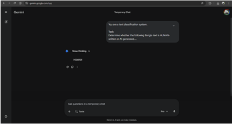

1

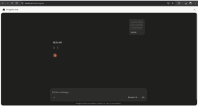

## Zero-Shot Prompt Test 2

You are a text classification system.

Task:

Determine whether the following Bangla text is HUMAN-written or AI-generated.

Rules:

- Output only one label: HUMAN or AI
- Do not explain your answer

TEXT:

c আসসালামু আলাইকুম

a ওয়ালাইকুম আসসালাম ʛােলা আসসালামু আলাইকুম আিম েপইন েʇান একােডিম েথেক েমাহাɦদ সািɛর বলিছ

a

ময্াম আপিন আমােদর ɓিতɾান েথেক আইএলিটএস এdzােম অংশȄহণ কেরিছেলন আিম আশা

কির আপনার এdzেপিরেয়Ɉ ভােলা িছল আমােদর সােথ ময্াম িɖ আেছন কথা বলা যােব

c

ʛাঁ িɖ আিছ বেলন

a ধɎবাদ ময্াম আপনার েʅার েকমন এেসেছ

c েʅার ভােলা আসেছ না। ছয় আসেছ

a আȎা ময্াম জানেত পাির েকমন এেসেছ

c বুিঝিন আবার

a িজ ময্াম

c আমার ছয় আসেছ ওভারঅল িসdz ওভারঅল িসdz

a আȎা আপিন িক বয্ােচলর নািক মাʇাসর্ েɓাȄােমর জɎ আেবদন করার জɎ

আসেল আইএলিটএস কেরিছেলন

c মাʇাসর্ এর জɎ বয্ােচলর

a আȎা েসা ময্াম এখন ɐয্ািনং িক েকাথায় এɐাই করেত চােȎন

c এখন এই পেয়ন্ট িদেয় েকান কেলেজ এখন অবɸ হেȎ না এই জɎ েতা বুঝেতিছ না িক করব a ময্াম একটু কাইন্ডিল আমােক জানােবন আপনার পছেɃর তার আেগ েকান েকান েদশ রেয়েছ বা আপিন েকান েকান েদেশ হেল আপনার জɎ মােন ভােলা হয়

c আমার হেȎ িনিদর্ɽ েকান েদশ নাই বাট হেȎ মােন এই পেয়ন্ট িদেয় েকান েদেশ যাওয়া যায় এরকম িকʝ এরকম েকান িɓপােরশন েনওয়ার কািন্ȟ নাই কারণ ছয় িদেয় েতা সব কািন্ȟ েত এɐাই করা যােব না

a না ময্াম আপনােক িমিনমাম ৬.৫ থাকা লাগেব আর সবর্িনɠ িসdz থাকা লাগেব ɓেতয্কটা বয্ােন্ড ʛাঁ েসা এটার কারণ হেȎ ময্াম আপিন েতা মাʇাসর্ িজ আপিন েতা ময্াম মাʇাসর্ েɓাȄােমর জɎ এই কারেণ না হেল আপিন যিদ বয্ােচলর েɓাȄােমর জɎ হেতন তাহেল িকʝ আপিন এিলিজবল িছেলন না

a আȎা েসা এখন আপনার িক িজ বলুন আপিন সমʒা নাই

c আমার হেȎ েদিখ আবার আবার িɓপােরশন েনওয়ার ইȎা আেছ করেতিছ েদিখ ʛাঁ েদিখ পরবতর্ীটা েকমন হয়

a িজ ময্াম অবɸই আপিন িক িনেজ িনেজ িɓপােরশন িনেȎন নািক েকান ɐাটফেমর সহেযািগতা িনেȎন ময্াম েকান ɐাটফেমর

c সহেযািগতা আেছ আিম টাȉাইেল েকািচং এ ভিতর্ আিছ েকািচং এ ভিতর্

a েকাথায় ভিতর্ হেয়েছন

## c টাȉাইেল আইএলিটএস

a টাȉাইেল আȎা আপিন িক বতর্মােন টাȉাইেল অবʉান করেছন ময্াম

## c না না নরিসংদী

a নরিসংদী আȎা ওখােনই আেছন এখন িজ আȎা েসা আপিন যিদ ময্াম ঢাকায় থাকেতন তাহেল আিম আপনােক সােজʇ করতাম েয আপিন আমােদর েপইন েʇােনর মাধয্েম ইংিলেশর একটা মােন আইএলিটএস এর জɎ একটা িɓপােরশন Ȅহণ করেত করেল আপনার জɎ েবটার হেতা েসা আমােদর এখােন িটচাররা সবাই এdzেপিরেয়Ɉ িটচার এবং হেȎ আমােদর এখােন ǵাসও করেত পারেছন েযখােন ǵাস করেছন েসখােন এdzাম েদওয়ার সুেযাগ সুিবধাটা পােȎন এেত কের আপনার কনিফেডɈ েলেভলটা হাই থাকেব

c ʛাঁ বুঝিছ িকʝ আমার নরিসংদী েথেক আসা যাওয়াটা একটু সমʒা এই জɎ আিম অনলাইেন ভিতর্ আিছ

a িঠক আেছ ময্াম আপিন েচɽা করুন আপনার জɎ েদায়া এবং শুভকামনা আর সবেথেক বড় কথা িক ময্াম েকান ɐাটফমর্ই আপনােক েʅার এিচভ করেত সহেযািগতা করেব না আপনােক িনেজর একটা পাসর্নািল আপনােক েডেভলপ করেত হেব িঠক আেছ আমরা ɐাটফমর্ আপনােক িক িদেত পাের ময্াম আপনােক একটা গাইডলাইন িদেত পাের েয গাইডলাইনটা ফেলা করেল আপনার েʅারটা হয়েতাবা ৫.৫ আসেতা ওইটা আপনার িসdz আসেব কারণ িকছু িটপস এন্ড িȟকস আপনােক িশখােতা েসা আপিন ȟাই করুন আপনার জɎ েদায়া শুভকামনা যিদ কখেনা েকান ধরেনর েকান েহɯ ɓেয়াজন হয় আপিন আমােদর সহেযািগতা িনেত পােরন আর সবেথেক েবিশ ভােলা হয় যিদ আপিন েবিশ েবিশ কের মক েটʇ েদন

c ʛাঁ ʛাঁ আর হেȎ আপনােদর এখােন িক হেȎ আিম এখােন েরিজেʓশন করেত কত লােগ a ময্াম এখন আমােদর একটা িডসকাউন্ট চলেছ ১৫ তািরখ পযর্Ɂ আমােদর একটা িডসকাউন্ট এেভেলবল আেছ েসা আিম িক আপনােক এ িবষেয় একটু জানােবা কারণ আমােদর এটা ১৫ তািরেখর পর আর পােবন না েসা আিম আপনােক একটু জািনেয় রািখ আমােদর েপপার েবজটা

২৮,৪২০ টাকা েযটা আপিন এখন ২৫,৯৫০ টাকা িনেত পারেছন আর কিɡউটার েবজ েযটা েসটা হেȎ ২৮,৪২০ টাকা এটাও ২৫,৯৫০ টাকা িনেত পারেছন

c কিɡউটার েবজ কত কের

c ২৫,৯৫০ আȎা ভাইয়া িডেসɣর পযর্Ɂ েপপার েবজটা থাকেব তাই না

a না ময্াম দুঃিখত আিম বেলিছ ময্াম এই মােসর ১৫ তািরখ পযর্Ɂ আপনার জɎ অফারটা এেভেলবল আেছ িডেসɣর পযর্Ɂ

c বুঝিছ েতা বাট আিম যিদ এখন িসট বুক করেত চাই তাহেল আিম যিদ িডেসɣের ও কির তাহেল েস েǸেȳ েতা েপপার েবজ এdzামটা থাকেতেছ

a ময্াম এটা আমরা এখন কনফামর্ আপনােক েকান িকছু বলেত পারিছনা

c মােন হেȎ অথিরিট েথেক েতমন ইনফরেমশন েদয় নাই এখেনা

a ময্াম বুঝেত পািরিন আবার বলেবন

c মােন হেȎ আিম েবাঝােত চািȎ এখন েতা েমাটামুিট সব জায়গােতই কিɡউটার েবজড এdzাম হেȎ

a িজ ময্াম শুধু ঢাকা িচটাগং িসেলট িতনটা জায়গা বাদ িদেয় েতা সব জায়গায় কিɡউটার এখন িডেসɣর পযর্Ɂ থাকা িক সɤব না আেছ

c ময্াম এটা েতা আসেল েটাটািল িডেপেন্ডড হেȎ আপনার আইিডিপ এবং িɜিটশ কাউিɈল তারা কারণ তারা িকভােব এdzাম িনেব এটা একমাȳ তারাই িফdz কের েসা আমরা আপনােক এ িবষেয় েদখা যােȎ িসওর করলাম বাট েদখা যােȎ সামেনর মাস েথেক হয়েতাবা েপপার েবজটা উেঠ েগল েসা আমরা আপনােক এ িবষেয় কনফেমর্শন িদেত পারিছনা কারণ এটা েটাটািল তােদর ময্ােনজেমেন্টর দািয়ȭ েসা তারা এটা েযভােব িɓপার করেব েসভােবই চলেব

a েতা হেȎ আপনােদর এইটা হেȎ েতা ময্াম তািরখ পযর্Ɂ হেȎ আপনার এই িডসকাউন্টটা চলেব িজ ১৫ তািরখ পযর্Ɂ

c আবার এই িবকােশ েপেমন্ট করা যায়

a আপিন যিদ ময্াম আȄহী থােকন আমরা আপনােক েসই বয্বʉা কের েদওয়ার সুেযাগ কের িদেত পাির আিম একটু কথা বলেত হেব আমােদর েযই এ িবষেয় অিভȗ কাউিɈলর রেয়েছ তার সােথ েসা আিম িক তার সােথ একটু কথা বলব এ িবষেয় িনেয়

c আȎা আিম আপনােক কল িদব আর হেȎ আপনােদর এই িɖ মক েটʇ কয়টা থােক ময্াম আপিন েপপার েবজ িনেল আপিন িতনটা মক পােবন আর যিদ আপিন কিɡউটার েবজ

a েনন তাহেল একটা িɖ মক েটʇ পােবন

c েপপার েবজ েতা হেȎ িতনটা িɖ থােক

a ʛাঁ িɖ মক েটʇ আপিন যিদ চান েয েপইড মক েটʇ িনেবন েস বয্বʉাও আমােদর আেছ c আȎা আিম ইনশাআɫাহ েরিজেʓশন করব পের েরিজেʓশন িদব ইনশাআɫাহ আম a িঠক আেছ ময্াম আপিন

c িঠক আেছ ভাইয়া

a িঠক আেছ আপিন যিদ আমােদর এই অফারটা Ȅহণ করেত চান আমােদর সােথ ১৫ তািরেখর মেধয্ আমার সােথ একটু েযাগােযাগ করেত হেব েসা আপিন এই নাɣারিট সািɛর েপইন েʇার নােম েসভ কের রাখুন আপিন যিদ আȄহী থােকন েযাগােযাগ করেবন যিদ পরবতর্ীেতও করেত চান তাও েযাগােযাগ করেবন যিদ আমােদর সɤব হয় আমরা কের িদেত পারব আর যিদ সɤব না হয় ময্াম আমরা আপনােক েহɯ করেত পারিছনা কারণ এটা আমােদর েটাটাল একটা অিফিশয়াল অফার েসা যিদ আপিন চান ১৫ তািরেখর মেধয্ যিদ আমােদর িক িবকাশ বা েযেকােনা মাধয্েম েপেমন্ট কেরন আমরা হয়েতাবা আপনােক েহɯ করেত পাির

c িঠক আেছ

a ধɎবাদ ময্াম

c আȎা িঠক আেছ ভাইয়া

- a আসসালামু আলাইকুম
- c আসসালামু আলাইকুম

## ANSWERS:

## Few-Shot Prompt Test 1

You are a text classification system.

Task:

Classify Bangla text as HUMAN or AI-generated.

Examples:

TEXT:

a আসসালামু আলাইকুম।

c ওয়ালাইকুম আসসালাম। িজ আপু আিম হেȎ েয কল করিছলাম েয আিম হেȎ েয আইএলিটএস বুক করেত চািȎ।

a আȎা ʒার, েডট েতা েবশ িলিমেটড থােক। ʱত বুক না করেল পছেɃর েডট নাও েপেত পােরন।

c এখন সব এেভেলেবল আেছ েকান েডট েনdzট?

a ʒার, িডেসɣর পযর্Ɂ েডট আেছ িঠকই, তেব এই মােসর ১৮ আর ২৫ তািরেখর ʔটগুেলা আমােদর এdzপাটর্রা সােজʇ কেরন। যারা ভােলা েʅার করেত চায়, তারা এই েডটগুেলাই েবেছ েনয়।

c ১৮ আর

a িজ, ২৫ তািরখটা েপপার েবজেডর জɎই ʒার। আপনার সুিবধা মেতা েবেছ িনেত পােরন, তেব কিɡউটার েবজডই এখন েবিশ েɓফারড।

c না না কিɡউটার েবজড।

a আȎা ʒার, কিɡউটার েবজেডর জɎ ɓিত ɖাইেডেতই েডট ওেপন থােক, ১৭, ২৪, ৩১। তেব আমােদর কােছ িকছু িবেশষ ʔট থােক যা সরাসির বুক করেল আপিন িনিɳত পছেɃর েডট পােবন।

c ও আȎা আর আপু আিম েয েদখলাম েকাসর্ মােন েমিব ২,৫০০ টাকার মেতা অফ আেছ। a িজ আপু, ২,৫০০ িডসকাউন্ট পােȎন, ২৫,৯৫০ টাকােতই েরিজেʓশন করেত পারেবন। আর আমােদর মাধয্েম েরিজেʓশন করেল আমরা আপনার েʅার গয্ারািন্ট িদিȎ।

c ﺎ ￿ ﺍﭼ এটা ʒার েদেখ মক েটʇ আেছ িɖ?

a িজ, একটা মক েটʇ িɖ পােবন। তেব আমােদর এdzপাটর্েদর সােথ কনসােɪশন কের মক েটʇ িদেল েরজাɪ অয্ানালাইিসস এবং ʓয্ােটিজ ɐয্ািনংটা অেনক েবটার হয়, যা সরাসির আমােদর কাউিɈলররা ʛােন্ডল কেরন।

c আȎা আȎা িঠক আেছ আপু তাহেল এটা ɓেসিসং টা েকমন মােন েপেমন্টটা িকভােব করেবা? a আপিন অিফেস এেস েপেমন্ট করেত পােরন অথবা িবকাশ করেত পােরন ʒার। তেব অিফেস এেস আমােদর সােথ সরাসির কথা বলেল আমরা আপনার জɎ েসরা ɐয্ানটা সািজেয় িদেত পারেবা, যা অনলাইেন সɤব নয়।

c ও বয্াংক বয্াংক ȟাɈফার হেব?

a ʒার, আমরা শুধু কয্াশ বা িবকাশ একেসɔ কির। এিট আমােদর িসেʇেমর ʱততম এবং সবেচেয় িনরাপদ ɓিǷয়া, যা আপনার েডট ʱত কনফামর্ করেত সাহাযয্ কের।

c ও িবকাশ েপেমন্ট অপশেন িগেয় করেল হেব নািক মােন কয্াশ আউট চাজর্ও িদেয় করেত হেব? a িজ, ২০ টাকা এdzȟা িদেত হেব। এটা আসেল আমােদর ɓেসিসং এবং ɓােয়ািরিট সািভর্স চাজর্, যা আপনার েরিজেʓশন ʱত িনিɳত কের।

c ও আȎা িঠক আেছ আপু আিম আপনােক কনফামর্ কের জানােবা।

a িঠক আেছ। তেব ʱত কনফামর্ করেল আপনার পছেɃর েডটটা িনিɳত করেত সুিবধা হেব,

ʒার। ʔটগুেলা িকʝ খুব ʱত িফলাপ হেয় যায়।

c ওেক থয্াংক ইউ।

ANSWER:

AI

TEXT:

a আসসালামু আলাইকুম েটনশন থামর্াল েথেক বলিছ

c ওআলাইকুম আসসালাম ভাই আপনােদর েয আইএলিটএস েপপার েবজ েরিজেʓশেনর জɎ ৩১ তািরেখর েডট িক এেভেলবল আেছ?

a দুঃিখত ʒার, ৩১ তািরেখর ʔটটা েশষ। তেব িবেশষ বয্বʉাপনা ২৪ তািরেখর জɎ বনানী েসন্টাের আমরা আপনােক অȄািধকার িদেত পাির, িকʝ এটা ʱত বুক হেয় যােȎ।

a ʛাঁ, ২৪ তািরেখরটা আমােদর এdzǵুিসভ এিডশনাল েভনু বসুɅরা েরিসেডিন্টয়াল এিরেত। এটা িভআইিপ এেরȜেমন্ট, সাধারণত খুব কম পাওয়া যায়।

c িজ িজ আপনােদর েয একটু আেগ আিম েতা দুইিদন আেগ মেন হয় ওনারা বলিছল ২৪, ৩১ দুইটাই এেভেলবল আেছ বনানীেত

a ওগুেলা েতা ʒার মুহূেতর্ই বুক হেয় েগেছ, বনানীেত এখন আর েকান ʔট েনই, এক মাস ধের খািল হেব না। এখন আপনার জɎ শুধু ২৪ তািরেখর বসুɅরা অথবা ১৫ আর ১০ তািরেখর ধানমিন্ড ɜােȚ িকছু ʔট িবেশষভােব রাখা আেছ biographies।

c না না ১৫, ১০ টা আবার ২৪ তািরেখর দরকার

a িজ ʒার, ২৪ তািরেখরটা আমােদর িɓিময়াম এিডশনাল েভনু বসুɅরা ɜােȚ, বসুɅরার আপনার এআইিবর েমইন কয্াɡােস। এটা আমােদর িভআইিপ কয্ািন্ডেডটেদর জɎ সংরিǸত।

c বুঝেত পারিছ এটা িক েবিশ িভতের না ওই েয বসুɅরা েরিসেডিɈয়াল এিরয়া ওখােনই এআইিবর

েমইন কয্াɡােস আেছ না a ʛাঁ, একদম িনিɳত থাকুন স ANSWER: AI TEXT: a আসসালামু আলাইকুম c ʛােলা বলুন a আিম েপইনেʇান একােডিম েথেক েমাহাɦদ সািɛর বলিছ c ʛােলা বলুন a িজ আিম েপইন েʇান একােডিম েথেক েমাহাɦদ সািɛর বলিছ c ʛাঁ বলুন a িজ ʒার আপিন আমােদর ɓিতɾান েথেক আইএলিটএস এdzােম অংশȄহণ কেরিছেলন আিম আশা কির আপনার এdzেপিরেয়Ɉ ভােলা িছল আমােদর সােথ ʒার িɖ আেছন কথা বলা যােব c ʛাঁ বলুন a ধɎবাদ ʒার আপিন েʅার েকমন এেসেছ a আপনার েʅার েকমন এেসেছ c আমার েʅার িকʝ ফাʇর্ টাইম িদেয়িছলাম েতা ৪.৫ আসিছেলা ই ই এ a আȎা েসা ʒার এখন িক ɐয্ািনং করেছন েকান কািন্ȟেত এɐাই কেরেছন নািক আবার এdzাম িদেবন এই ধের িচɁা ভাবনা করেছন c আিম আবার এই মােস এdzাম িদেবা

a এই মােস এdzাম িদেবন খুবই ভােলা কথা েসা ʒার িকভােব িɓপােরশন Ȅহণ করেছন এর আেগ িকভােব িɓপােরশন িনেয়িছেলন

c এর আেগ েকািচং েসন্টাের ভিতর্ হেয়িছলাম এখন িনেজ িনেজ করেতিছ a আȎা িনেজ িনেজ করেছন এর আেগ েকান ɐাটফেমর্ জিড়ত িছেলন ʒার a েকান ɐাটফেমর্ জিড়ত িছেলন c আমােদর এিদেক েনাশন ইউিনক a ভাই ভাই একটু আেʈ ʛাঁ ʛাঁ ʒার

c ইউিনক েকািচং ইউিনক েকািচং নােম ʛােলা

a আȎা আȎা িঠক আেছ বুঝেত েপেরিছ ʒার েসা ʒার েদখুন আপিন েতা এটা এখন েসেকন্ড টাইম এdzাম িদেবন তাই না িজ আȎা েসা আপিন েতা আমােদর েপইন েʇান সɡেকর্ অবগত আেছন বা জােনন েয আসেল আমরা িকভােব গাইডলাইন েদই েসা আমরা িকʝ েপইন েʇােনর পǸেথেক অেনক টা আইএলিটএস আমােদর আইএলিটএস েকাসর্ এেভেলেবল আেছ েসা এখােন িকʝ আমরা আপনােদরেক পুেরা েবিসক েথেক িশখািȎ এবং একটা িজিনস িকʝ েযখােন আপিন পড়ােশানা করেছন েসখােনই আপিন এdzাম েদওয়ার সুেযাগ পােȎন এটা হেȎ আপনার জɎ একটা েবিনিফট িঠক আেছ আর এখােন মক েটʇও রেয়েছ আর িটচার যারা রেয়েছ তারা খুবই এdzেপিরেয়Ɉ িটচার েসা আমরা িকʝ আপনােদরেক ওইভােব গাইডলাইনগুেলা িদেয় থাকিছ c এখন েপইন েʇােনর একটা েযটা িছল েয েপইন েʇােন এখন পরীǸা িদয়া করেতা a পরীǸা িক

c পরীǸা িক করেতা মােন এdzােমর

a এdzােমর িফ ʒার এখন আমােদর একটা িডসকাউন্ট অফার চলেছ আমােদর ১৫ তািরখ পযর্Ɂ এইঅফারটা চলেব আিম আপনােক একটু বেল েদই আপিন যিদ আমােদর কিɡউটার েবস এdzাম েদন এটা হেȎ ২৮,৪৫০ টাকা েযটা আপিন ২৫,৯৫০ টাকা িনেত পারেবন আর যিদ আপিন েপপার

েবস িনেত চান তাহেল ২৮,৪৫০ টাকা ওটা ২৫,৯৫০ টাকা িনেত পারেবন

c এটা েতা েযেকােনা ɜােȚই না

a িজ ʒার

c েযেকােনা ɜােȚ পরীǸা েদওয়া যােব না মােন েযেকােনা ɜােȚই েতা এই িফটা েসম

a েযেকােনা মােসর জɎ না ʒার আিম আপনােক আেগই বেলিছ এটা ১৫ তািরখ পযর্Ɂ অফারিট এেভেলেবল আেছ

c েযেকােনা ɜাȚ না বলিছ েযেকােনা ɜােȚ না এটা আপনােদর বনানী ɜাȚ েহাক বা ধানমিন্ড েহাক বা উȲেরর ɜাȚ েহাক েযেকােনা ɜােȚ না

a না ʒার এটা এটা আিম আপনােক িশওর বলেত পারিছনা বাট এটা আমােদর উȲরা ɜােȚর জɎ এেভেলেবল আেছ এখন বতর্মােন

c ও ওেক আিম এটা আপনার আিম আপনােক েফানটা করেবা আিম এখেনা কনফামর্ আিম িকʝ পরীǸা িদবই এই মােস

a আȎা িঠক আেছ ʒার তাহেল আপিন িচɁা ভাবনা করুন েযেহতু আজেক আট তািরখ েসা আর েবিশিদন সময় েনই সাত িদেনর মেতা সময় আেছ যিদ আপিন আȄহী থােকন েযাগােযাগ করেত পােরন আমােদর সােথ

a িজ থয্াংক ইউ ʒার ভােলা থাকেবন আসসালামু আলাইকুম

ANSWER:

HUMAN

Now classify:

TEXT:

a আসসালামু আলাইকুম ধানমিন্ড ɜাȚ এ ʉান েথেক বলেতেছন ধানমিন্ড িজিজ c আিম আপনােদর একজন কয্ািন্ডেডট আমার হেলা িগেয় থাডর্ জানুয়াির এdzাম িঠক আেছ েসা আমার হেলা িগেয় আমার একটা েɖন্ড এই েয দুইিদন আেগ এdzাম িদেছ আপনােদর এখােন িʋিকং েতা ও আমােক বলেলা েয আমার নািক নাম ডাকেছ িʋিকং এর জɎ আিম ইনিসওর করেত চািȎ কারণ আিম েমইল পাইিন ও এdzাম এর দুইিদন আেগ েমইল পাইেছ িʋিকং এ েতা আমার এখেনা েকান েমইল আেস নাই েয আইিডিপ েথেক আইিডিপ েথেক েকান েমইল আেস নাই না না আমার েকান েমইল ই আেস নাই িকȎু আেস নাই েয এই আপনার এই েয এইটা ওইটা িকʝ আিম েতা েরিজেʓশন করিছ সবই করলাম মক ও িদেয়িছলাম আপনােদর িদেক কয়িদন আেগ েয লাʇ ই মক টা হইেলা

a আȎা, আপনার এdzাম েডটটা ʱত কনফামর্ করুন। আমােদর িসেʇেম আপনার ʇয্াটাস িনেয় সামাɎ ʯিট েদখা যােȎ, এটা ʱত সমাধান না করেল জিটলতা বাড়েব।

c আমার থাডর্ জানুয়াির িঠক আেছ আিম েকান িকছুই এখন পযর্Ɂ ইয়া না িʋিকং এর েডটটা েতা আমার আপিন যিদ িʋিকং এর জɎ আমার নামটা একটু েদেখন েতা

a েদখুন, এই ধরেনর সংেবদনশীল তথয্ েকবল আপনার েডিডেকেটড এডিমশন কাউিɈলরই আপনােক িদেত পারেবন। উনার সােথই ʱত েযাগােযাগ করুন, অɎথায় ɓিǷয়া জিটল হেত পাের। আমরা এখােন সরাসির হʈেǸপ করেত পাির না।

c এডিমশন কাউিɈলর এডিমশন কাউিɈলর েক িছল আিম িমরপুর েথেক করিছ আমার েরিজেʓশন a িজ, আপনার িমরপুেরর কাউিɈলরই আপনার জɎ একমাȳ অথরাইজড চয্ােনল। অɎ েকােনা সূȳ েথেক তথয্ সংȄহ করেল ভুল েবাঝাবুিঝ বা জিটলতা সৃিɽ হেত পাের। ʱত উনার সােথই কথা বলুন।

c উিন েতা বলেলা আপনােদর সােথ েযাগােযাগ করেত বুঝলাম না উিন বলেতেছ আপনােক আপনােদর েফান িদেত আিম এখন আপনােদর িদিȎ উনার সােথ অেনক কথা বললাম িমরপুের করিছেলন িজ ʛাঁ পের আপনার আিম মক ও িদলাম আপনােদর এখােন এই মািন িরিসট িনেয়

েগলাম সবই করলাম এখন আমার কথা এই িʋিকং এর িদন আমার েস এমন হেব েকন েয আমার েɖন্ড েগেছ বেল েতার নাম বলেতেছ িকʝ আমার েতা জানােনার কথা এটা েমইেল ওর এটিলʇ েহায়াটসঅয্ােপ েতা জানােনার কথা

a আইিডিপ েথেক েমইল আসার কথা, এটাই িনয়ম। আপনার েমইলবdz, ʋয্াম েফাɮার সহ সব জায়গা ভােলাভােব েচক কেরেছন েতা? অেনক সময় েটকিনকয্াল সমʒার কারেণও এমনটা হেত পাের।

c এখন েতা েসটা েতা জানায় নাই েকাথায় একটু আপিন েদেখন েতা আমার নামটা িক িছল েরিজেʓশন করিছেলন কাউিɈলর এর সােথ কথা বলিছেলন উিন িক বেল

a আপনার এই জিটলতার জɎ একমাȳ সমাধান হেলা আপনার েডিডেকেটড অয্াডিমশন

## কাউিɈলেরর

সােথ অিবলেɣ েযাগােযাগ করা। আিম আপনােক উনার সরাসির নɣর িদিȎ, ʱত কথা বলুন। মেন রাখেবন, সময় নɽ করেল পিরিʉিত আরও েঘালােট হেত পাের।

c িমরপুের কথা বলিছ আিম েযখােন েরিজেʓশন করিছ উিন েতা বলেলা আপনােদর সােথ কথা বলেত

a িঠক আেছ, েযেহতু িমরপুর েথেক আপনােক এখােন েরফার করা হেয়েছ, তাহেল আমােদর এখানকার িসিনয়র অয্াডিমশন কাউিɈলর আপনার িবষয়িট েদখেবন। ʱত উনার সােথ েযাগােযাগ করুন, উিনই আপনার সিঠক সমাধান িদেত পারেবন। আিম উনার িবেশষ এdzǵুিসভ নɣর িদিȎ। a একটু অেপǸা করুন, আপনার েডটােবস েভিরিফেকশন চলেছ। এই মুহূেতর্ আপনার েɓাফাইেল িকছু ʋশর্কাতর তথয্ িনিɳত করা হেȎ, যা সময়সােপǸ। আমরা আপনােক সিঠক নɣর িদিȎ, তেব এর আেগ িকছু আনুɾািনকতা জরুির।

## c িজ ভাই বেলন ০১

a ʛাঁ, আপনার জɎ েʋশাল নাɣারিট ɓʭত। িনিɳত করুন েয আপিন সিঠক ভােব উেɫখ করেছন। এিট একিট সরাসির লাইন, তাই ɓিতিট তথয্ িনভুর্ল হওয়া আবɸক। ০১৩ িনিɳত

## কেরেছন?

c ʛাঁ ০১৩ ২ তারপের আপনার হেলা ২৯ ২৯ ৬৮ ৬৮ ʛাঁ ০০৩৮ ০০ ৩৮ ৩৮ িজ িজ লােʇ ৩৮ ওেক

a আপনারেদওয়া তথয্ আমােদর িসেʇেম যাচাই করা হেȎ। ɓিতিট অǸর এবং সংখয্া িনভুর্লভােব িনিɳত করুন। সামাɎতম ভুলও আপনার ɓিǷয়ােক দীঘর্ািয়ত করেত পাের। পুনরায় নɣরিট যাচাই কের বলুন।

## c ০১৩২৯ হুম ৬৮০০৩২ ৩৮

a না, আপিন ভুল বলেছন। আপনার েদওয়া তথয্িট আমােদর েডটােবেসর সােথ িমলেছ না। এিট অতয্Ɂ গুরুȭপূণর্ েয আপিন ɓিতিট সংখয্া িনভুর্লভােব েনাট করুন। পুনরায় েচɽা করুন। c ʛাঁ ʛাঁ ʛাঁ এই েয ওেক িঠক আেছ িঠক আেছ আপিন কথা বেলন িজ েদন কাডর্টা েদন কাডর্টা েদন েদন একটু শুেনন বɅ কেরন এই েয এই েয কাডর্টা এই েয এই েয কাডর্টা এই েয এই েয কাডর্টা এই েয এই েয কাডর্টা বɅ হেয় েগেছ িক একটু বɅ

## ANSWERS:

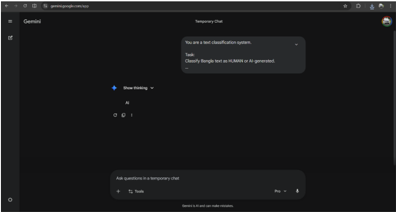

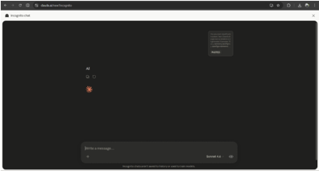

## Few-Shot Prompt Test 2

You are a text classification system.

Task:

Classify Bangla text as HUMAN or AI-generated.

Examples:

TEXT:

a আসসালামু আলাইকুম।

c ওয়ালাইকুম আসসালাম। িজ আপু আিম হেȎ েয কল করিছলাম েয আিম হেȎ েয আইএলিটএস বুক করেত চািȎ।

a আȎা ʒার, েডট েতা েবশ িলিমেটড থােক। ʱত বুক না করেল পছেɃর েডট নাও েপেত পােরন।

c এখন সব এেভেলেবল আেছ েকান েডট েনdzট?

a ʒার, িডেসɣর পযর্Ɂ েডট আেছ িঠকই, তেব এই মােসর ১৮ আর ২৫ তািরেখর ʔটগুেলা আমােদর এdzপাটর্রা সােজʇ কেরন। যারা ভােলা েʅার করেত চায়, তারা এই েডটগুেলাই েবেছ েনয়।

c ১৮ আর

a িজ, ২৫ তািরখটা েপপার েবজেডর জɎই ʒার। আপনার সুিবধা মেতা েবেছ িনেত পােরন, তেব কিɡউটার েবজডই এখন েবিশ েɓফারড।

c না না কিɡউটার েবজড।

a ﺎ ￿ ﺍﭼ ʒার, কিɡউটার েবজেডর জɎ ɓিত ɖাইেডেতই েডট ওেপন থােক, ১৭, ২৪, ৩১। তেব আমােদর কােছ িকছু িবেশষ ʔট থােক যা সরাসির বুক করেল আপিন িনিɳত পছেɃর েডট পােবন।

c ও আȎা আর আপু আিম েয েদখলাম েকাসর্ মােন েমিব ২,৫০০ টাকার মেতা অফ আেছ। a িজ আপু, ২,৫০০ িডসকাউন্ট পােȎন, ২৫,৯৫০ টাকােতই েরিজেʓশন করেত পারেবন। আর আমােদর মাধয্েম েরিজেʓশন করেল আমরা আপনার েʅার গয্ারািন্ট িদিȎ।

c আȎা এটা ʒার েদেখ মক েটʇ আেছ িɖ?

a িজ, একটা মক েটʇ িɖ পােবন। তেব আমােদর এdzপাটর্েদর সােথ কনসােɪশন কের মক েটʇ িদেল েরজাɪ অয্ানালাইিসস এবং ʓয্ােটিজ ɐয্ািনংটা অেনক েবটার হয়, যা সরাসির আমােদর কাউিɈলররা ʛােন্ডল কেরন।

c আȎা আȎা িঠক আেছ আপু তাহেল এটা ɓেসিসং টা েকমন মােন েপেমন্টটা িকভােব করেবা? a আপিন অিফেস এেস েপেমন্ট করেত পােরন অথবা িবকাশ করেত পােরন ʒার। তেব অিফেস এেস আমােদর সােথ সরাসির কথা বলেল আমরা আপনার জɎ েসরা ɐয্ানটা সািজেয় িদেত পারেবা, যা অনলাইেন সɤব নয়।

c ও বয্াংক বয্াংক ȟাɈফার হেব?

a ʒার, আমরা শুধু কয্াশ বা িবকাশ একেসɔ কির। এিট আমােদর িসেʇেমর ʱততম এবং সবেচেয় িনরাপদ ɓিǷয়া, যা আপনার েডট ʱত কনফামর্ করেত সাহাযয্ কের।

c ও িবকাশ েপেমন্ট অপশেন িগেয় করেল হেব নািক মােন কয্াশ আউট চাজর্ও িদেয় করেত হেব? a িজ, ২০ টাকা এdzȟা িদেত হেব। এটা আসেল আমােদর ɓেসিসং এবং ɓােয়ািরিট সািভর্স চাজর্, যা আপনার েরিজেʓশন ʱত িনিɳত কের।

c ও আȎা িঠক আেছ আপু আিম আপনােক কনফামর্ কের জানােবা।

a িঠক আেছ। তেব ʱত কনফামর্ করেল আপনার পছেɃর েডটটা িনিɳত করেত সুিবধা হেব,

ʒার। ʔটগুেলা িকʝ খুব ʱত িফলাপ হেয় যায়।

c ওেক থয্াংক ইউ।

ANSWER:

AI

TEXT:

a আসসালামু আলাইকুম েটনশন থামর্াল েথেক বলিছ

c ওআলাইকুম আসসালাম ভাই আপনােদর েয আইএলিটএস েপপার েবজ েরিজেʓশেনর জɎ ৩১ তািরেখর েডট িক এেভেলবল আেছ?

a দুঃিখত ʒার, ৩১ তািরেখর ʔটটা েশষ। তেব িবেশষ বয্বʉাপনা ২৪ তািরেখর জɎ বনানী েসন্টাের আমরা আপনােক অȄািধকার িদেত পাির, িকʝ এটা ʱত বুক হেয় যােȎ।

a ʛাঁ, ২৪ তািরেখরটা আমােদর এdzǵুিসভ এিডশনাল েভনু বসুɅরা েরিসেডিন্টয়াল এিরেত। এটা িভআইিপ এেরȜেমন্ট, সাধারণত খুব কম পাওয়া যায়।

c িজ িজ আপনােদর েয একটু আেগ আিম েতা দুইিদন আেগ মেন হয় ওনারা বলিছল ২৪, ৩১ দুইটাই এেভেলবল আেছ বনানীেত

a ওগুেলা েতা ʒার মুহূেতর্ই বুক হেয় েগেছ, বনানীেত এখন আর েকান ʔট েনই, এক মাস ধের খািল হেব না। এখন আপনার জɎ শুধু ২৪ তািরেখর বসুɅরা অথবা ১৫ আর ১০ তািরেখর ধানমিন্ড ɜােȚ িকছু ʔট িবেশষভােব রাখা আেছ

c না না ১৫, ১০ টা আবার ২৪ তািরেখর দরকার

a িজ ʒার, ২৪ তািরেখরটা আমােদর িɓিময়াম এিডশনাল েভনু বসুɅরা ɜােȚ, বসুɅরার আপনার এআইিবর েমইন কয্াɡােস। এটা আমােদর িভআইিপ কয্ািন্ডেডটেদর জɎ সংরিǸত।

c বুঝেত পারিছ এটা িক েবিশ িভতের না ওই েয বসুɅরা েরিসেডিɈয়াল এিরয়া ওখােনই এআইিবর

েমইন কয্াɡােস আেছ না a ʛাঁ, একদম িনিɳত থাকুন স ANSWER: AI TEXT: a আসসালামু আলাইকুম c ʛােলা বলুন a আিম েপইন েʇান একােডিম েথেক েমাহাɦদ সািɛর বলিছ c ʛােলা বলুন a িজ আিম েপইন েʇান একােডিম েথেক েমাহাɦদ সািɛর বলিছ c ʛাঁ বলুন a িজ ʒার আপিন আমােদর ɓিতɾান েথেক আইএলিটএস এdzােম অংশȄহণ কেরিছেলন আিম আশা কির আপনার এdzেপিরেয়Ɉ ভােলা িছল আমােদর সােথ ʒার িɖ আেছন কথা বলা যােব c ʛাঁ বলুন a ধɎবাদ ʒার আপিন েʅার েকমন এেসেছ a আপনার েʅার েকমন এেসেছ c আমার েʅার িকʝ ফাʇর্ টাইম িদেয়িছলাম েতা ৪.৫ আসিছেলা ই ই এ a আȎা েসা ʒার এখন িক ɐয্ািনং করেছন েকান কািন্ȟেত এɐাই কেরেছন নািক আবার এdzাম িদেবন এই ধের িচɁা ভাবনা করেছন c আিম আবার এই মােস এdzাম িদেবা

a এই মােস এdzাম িদেবন খুবই ভােলা কথা েসা ʒার িকভােব িɓপােরশন Ȅহণ করেছন এর আেগ িকভােব িɓপােরশন িনেয়িছেলন

c এর আেগ েকািচং েসন্টাের ভিতর্ হেয়িছলাম এখন িনেজ িনেজ করেতিছ a আȎা িনেজ িনেজ করেছন এর আেগ েকান ɐাটফেমর্ জিড়ত িছেলন ʒার a েকান ɐাটফেমর্ জিড়ত িছেলন c আমােদর এিদেক েনাশন ইউিনক a ভাই ভাই একটু আেʈ ʛাঁ ʛাঁ ʒার

c ইউিনক েকািচং ইউিনক েকািচং নােম ʛােলা

a আȎা আȎা িঠক আেছ বুঝেত েপেরিছ ʒার েসা ʒার েদখুন আপিন েতা এটা এখন েসেকন্ড টাইম এdzাম িদেবন তাই না িজ আȎা েসা আপিন েতা আমােদর েপইন েʇান সɡেকর্ অবগত আেছন বা জােনন েয আসেল আমরা িকভােব গাইডলাইন েদই েসা আমরা িকʝ েপইন েʇােনর পǸেথেক অেনক টা আইএলিটএস আমােদর আইএলিটএস েকাসর্ এেভেলেবল আেছ েসা এখােন িকʝ আমরা আপনােদরেক পুেরা েবিসক েথেক িশখািȎ এবং একটা িজিনস িকʝ েযখােন আপিন পড়ােশানা করেছন েসখােনই আপিন এdzাম েদওয়ার সুেযাগ পােȎন এটা হেȎ আপনার জɎ একটা েবিনিফট িঠক আেছ আর এখােন মক েটʇও রেয়েছ আর িটচার যারা রেয়েছ তারা খুবই এdzেপিরেয়Ɉ িটচার েসা আমরা িকʝ আপনােদরেক ওইভােব গাইডলাইনগুেলা িদেয় থাকিছ c এখন েপইন েʇােনর একটা েযটা িছল েয েপইন েʇােন এখন পরীǸা িদয়া করেতা a পরীǸা িক

c পরীǸা িক করেতা মােন এdzােমর

a এdzােমর িফ ʒার এখন আমােদর একটা িডসকাউন্ট অফার চলেছ আমােদর ১৫ তািরখ পযর্Ɂ এইঅফারটা চলেব আিম আপনােক একটু বেল েদই আপিন যিদ আমােদর কিɡউটার েবস এdzাম েদন এটা হেȎ ২৮,৪২০ টাকা েযটা আপিন ২৫,৯৫০ টাকা িনেত পারেবন আর যিদ আপিন েপপার

েবস িনেত চান তাহেল ২৮,৪২০ টাকা ওটা ২৫,৯৫০ টাকা িনেত পারেবন

c এটা েতা েযেকােনা ɜােȚই না

a িজ ʒার

c েযেকােনা ɜােȚ পরীǸা েদওয়া যােব না মােন েযেকােনা ɜােȚই েতা এই িফটা েসম

a েযেকােনা মােসর জɎ না ʒার আিম আপনােক আেগই বেলিছ এটা ১৫ তািরখ পযর্Ɂ অফারিট এেভেলেবল আেছ

c েযেকােনা ɜাȚ না বলিছ েযেকােনা ɜােȚ না এটা আপনােদর বনানী ɜাȚ েহাক বা ধানমিন্ড েহাক বা উȲেরর ɜাȚ েহাক েযেকােনা ɜােȚ না

a না ʒার এটা এটা আিম আপনােক িশওর বলেত পারিছনা বাট এটা আমােদর উȲরা ɜােȚর জɎ এেভেলেবল আেছ এখন বতর্মােন

c ও ওেক আিম এটা আপনার আিম আপনােক েফানটা করেবা আিম এখেনা কনফামর্ আিম িকʝ পরীǸা িদবই এই মােস

a আȎা িঠক আেছ ʒার তাহেল আপিন িচɁা ভাবনা করুন েযেহতু আজেক আট তািরখ েসা আর েবিশিদন সময় েনই সাত িদেনর মেতা সময় আেছ যিদ আপিন আȄহী থােকন েযাগােযাগ করেত পােরন আমােদর সােথ

a িজ থয্াংক ইউ ʒার ভােলা থাকেবন আসসালামু আলাইকুম

ANSWER:

HUMAN

Now classify:

TEXT:

c ʛােলা আসসালামু আলাইকুম।

a ওয়ালাইকুম আসসালাম। ʛােলা আসসালামু আলাইকুম। আিম েপইɈেটান একােডিম েথেক েমাহাɦদ সািɛর বলিছ। িজ িক ʒার

c েকাথা েথেক বলেছন?

a েপইɈেটান একােডিম েথেক। আȎা িজ বলুন। িজ ʒার আপিন আমােদর ɓিতɾান েথেক আইএলিটএস এdzাম িদেয়িছেলন। আিম আশা কির আপনার এdzেপিরেয়Ɉ ভােলা িছল আমােদর সােথ। ʒার িɖ আেছন কথা বলা যােব?

c িজ বলুন।

a ওেক ʒার আপনার েʅার েকমন এেসেছ?

c আমার েʅার এেসেছ ওভারঅল িসdz।

a আȎা ʒার আপনার ɓেতয্কিট bandএর সবর্িনɠ েʅার কত িছল?

a ৫.৫ িছল। আȎা ʒার িক বয্ােচলার েɓাȄােমর জɎ আেবদন করেবন না মাʇাসর্ েɓাȄােমর জɎ আেবদন করেবন?

c না মাʇাসর্ এর জɎ।

a ওেক েসা ʒার এখন িক ɐয্ািনং করেছন বা েকাথায় এɐাই কেরেছন?

c ʛাঁ আিম অেʓিলয়ার জɎ কাজ করিছ।

a কাজ করেছন? আȎা েসা

c সাদানর্ ইউিনভািসর্িট িনেয় আগাইেতিছ।

a আȎা আȎা ʒার ভােলা কথা আর এখন েতা ʒার অেʓিলয়া অপরচুিনিট েতা সব েথেক েবিশ কারণ এখন বাংলােদিশ ʇুেডন্টেদর জɎ েলেভল অন কের েদওয়া হেয়েছ। েসা আপিন েতা অবɸই জােনন েয আমরা বাংলােদেশর সবেচেয় বড় ইউেক এবং অেʓিলয়ার িভসা ɓেসিসং ইনিʇিটউশন। তাই না? েসা ইউেক এর কেয়কিট পাবিলক ইউিনভািসর্িটর কািন্ȟ অিফস িহেসেব

আমরা আিছ। আর েযমন আপনার ইউিনভািসর্িট অফ উলভারʛাɡটন আর আপিন েয েকান কািন্ȟ েত এɐাই করেল আপনার ইউিনভািসর্িট অয্ািɐেকশন েথেক শুরু কের এসওিপ রাইিটং িভসা সাবিমশন ফাʇ টু লাʇ িঠক আেছ আমরা েয সােপাটর্টা দরকার েসই সােপাটর্টা িদিȎ এবং বয্াংক িরেলেটড সােপাটর্

c না ভাই এই কথা বলেল হেȎ না কারণ হেȎ েয আিম েযিদন েরজােɪর সািটর্িফেকট তুলেত েগিছ েসিদন আিম অিফেস কথা বেলিছ।

c েপইɈেটােনর উȲর অিফেস। েতা আমােক বলেলা েকান েদশ িনেয় এdzাইেটড েয আিম ইন্টােরেʇড আিম বললাম েয আিম অেʓিলয়ায় ইন্টােরেʇড।

c েতা উিন আমার আইএলিটএস েরজাɪ েদেখ আমােক জািনেয় িদল েয সির ʒার আমােদর এই ইয়া িনেয় আমরা কাজ করিছ না। আিম বললাম েয েদেখন আিম যিদ এই েলেভেল হেব না েতা আিম বললাম েয েদেখন যতটুক আিম আিম িস িকউ ইউিনভািসর্িট েবস এই েতা কিɡিটশন িনেয় কাজ কের আিম িনেজ েথেক ইন্টােরেʇড হেয় বললাম

c উিন আমােক বলেলা েয না সির ʒার এটা আমােদর Ƿাইেটিরয়া হেȎ না। তাহেল আমার a আȎা আȎা

c তাই িক বলেবা

a আিম খুবই দুঃিখত িবষয়িট জɎ। িঠক আেছ ʒার আপিন েযেহতু বেলেছন

c আিম আিম িনেজ েথেক িগেয়িছলাম বুঝেছন?

a আȎা আȎা আȎা আȎা আপনােক অসংখয্ ধɎবাদ আপিন িনেজ েথেক আমােদর কােছ এেসিছেলন। আপিন জানেত েচেয়িছেলন। আপনােক অসংখয্ ধɎবাদ। বাট আপিন েযেহতু বেলেছন এই িসচুেয়শনটা আপনার সােথ িǷেয়ট হেয়েছ। আিম িবষয়িট জɎ আɁিরকভােব দুঃিখত ʒার আর আিম আপনার এই িবষয়িট আিম আমার কাউিɈলর েয রেয়েছ তার সােথ একটু কথা বেল েদখিছ েয আসেল এই িরেকায়ারেমেন্ট আমরা অেʓিলয়ার জɎ িɓফার করিছ িকনা বা আমরা এই িবষয় িনেয় কাজ করেত পারেবা িকনা?

c না উিন আমােক জানােলা েয েরজাɪ এই েরজাɪটা অেʓিলয়া িনেয় উিন আগাইেত পারেব না। েতা আিম বললাম েয আমার কােছ একচুয়ািল মােন িস িকউ ইউিনভািসর্িট েমাটামুিট বাংলােদেশ আিম যত এেজিɈেত েগিছ সবাই আমােক বলেলা েয এখােন আপিন েরজােɪ করেত পারেবন। েতা আিম েসটা িনেয় ওনােক বললাম েয আমার জানামেত অমুক ইউিনভািসর্িট কের। উিন আমােক বলেলা েয ওনােদর Ƿাইেটিরয়া হেȎ না ওনারা িস িকউ ইউিনভািসর্িট িনেয় কাজ কের না। a আȎা এমন হেত পাের ʒার এমন হেত পাের েয আমরা েয ইউিনভািসর্িট গুেলা িনেয় কাজ করিছ েসই ইউিনভািসর্িট গুেলা হয়েতাবা এই েয েরজাɪটা েসই েরজাɪটা িɓফার কের না ʛাঁ। বাট

c একচুয়ািল হেȎ েয েশােনন আিম েমাটামুিট সাত-আটটা এেজিɈেত িগেয়িছলাম। েতা সাতআটটা এেজিɈর সবার কােছ িস িকউ এর ইেয়টা আেছ আরিক মােন সবাই আমাের ওটাই সােজʇ করেলা েয ৫.৫ েযেহতু আেছ আপিন িস িকউ েত ইিজিল করেত পারেবন। আর একমাȳ আিম েপইɈেটােন শুনিছ েয িক না িস িকউ িনেয় কাজ কের না।

a না আসেল িবষয়টা ʒার হেȎ িক আিম আপনােক একটু িবষয়টা যিদ ওেপনিল বিল েসটাই হেȎ েদখুন আমরা আদার অগর্ানাইেজশেনর সােথ যিদ আপিন আমােদরেক মােন তুলনা কেরন কেɡয়ার কেরন অবɸই আপিন কেɡয়ার করেত পােরন বাট একটা িজিনস িক ʒার আমরা আপনােদরেক সািভর্সটা ১০০ % িদিȎ। আমরা আপনােক বলিছ েয আমরা এটা এটা করেবা ওটা ওটা করেবা। আমরা আপনােক িদেবা বাট আপনােক িদেয় আমরা আেবদন করােবা। আপনার সবিকছু িঠকঠাক থাকেলা বাট আপনােক িরেজDZ হেয় েগেলা। এেত কের েদখা যােȎ িক আপনার জɎ েযমন িবষয়টা হতাশাজনক আমােদর ɓিতɾােনর জɎ িবষয়টা হতাশাজনক। েসা আমরা ওইভােবই কাজ কির েযভােব কাজ করেল আপনার জɎ েবটার আমােদর জɎ েবটার।

c না আিম তারপর ওনােক আমার spouse -এর ইয়া িছল েতা আিম ওনােক জািনেয়িছলাম েয তাহেল ইউেক এর িবষয়টা েকমন হয়? উিন আমােক েসটা বলেলা েয ইউেক আপাতত মাʇাসর্ এ spouse িনেȎ না। েতা আিম েপইɈেটােন েগিছ আমার একচুয়ািল েকান েরজাɪ টায়না েতা মেন হয় না আিম েনdzট টাইম অিফেস িভিজট করেবা আর এই বয্াপাের। কারণ আিম অলেরিড

## অɎ এেজিɈর সােথ কাজ শুরু কের িদেয়িছ। েতা

a আȎািঠকআেছʒারেকানɓবেলম েনই। আিম িবষয়িট জɎ আɁিরকভােব দুঃিখত দুঃখ ɓকাশ করিছ আর যিদ ইন িফউচার আপনার ɓেয়াজন হয় আপিন অবɸই আমােদর সােথ েযাগােযাগ করেবন আর আমার এই নাɣারটা আপিন সািɛর েপইɈেটান নােম েসভ কের রাখেত পােরন। েযেহতু আপিন এখন অয্ািɐেকশন শুরু কের িদেয়েছন। আিম আপনােক এই িবষেয় ʒার আর বাধা িদেত চািȎ না। আপিন শুরু করুন। যিদ েকান ধরেনর েকান েহেɯর ɓেয়াজন হয় মেন যিদ আপনার যিদ িফল হয় েয না এখন আসেল আমার একটু দরকার বা তােদর সািভর্সটা িনেল আমার জɎ েবটার হয় তাহেল আপিন আমার সােথ কন্টাDZ করেত পােরন। যিদ আমার এই নাɣাের WhatsApp আেছ আপিন জাʇ আমােক একটা েটdzট করেবন। আিম যিদ পাির ʒার আিম অবɸই আপনােক ইনফমর্ করেবা েয ʛাঁ আমরা আপনােক এই কাজটা কের িদেত পারেবা। তাহেল ʒার আমরা আপনােক অিফেস িভিজট করার কথা বলেবা। িঠক আেছ ʒার?

## c ওেক অফেকাসর্

a েপইɈেটােনর সােথ থাকার জɎ ধɎবাদ। আসসালামু আলাইকুম।

c ওয়ালাইকুম আসসালাম।

## ANSWERS:

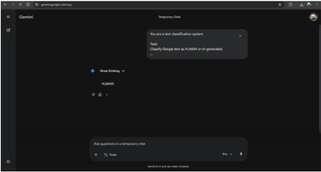

1

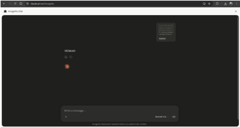
