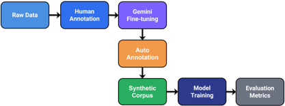
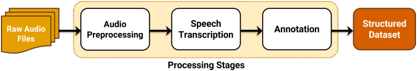
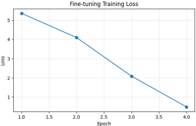
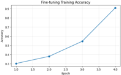
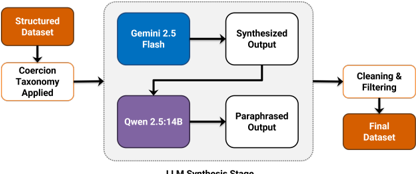
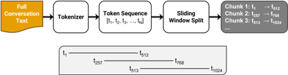
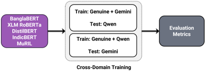
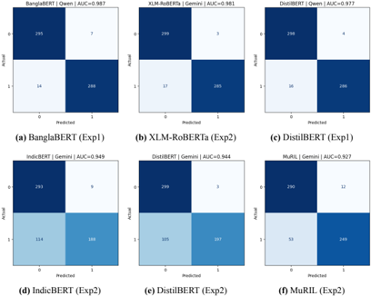
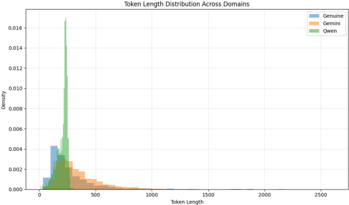

## **Task-Aware vs. Weight-Fidelity Sensitivity Proxies for** **Layer-Wise Mixed-Precision Quantization-Aware Training** **on Imbalanced Medical Imaging**

###### **By**

**Shariful Islam**

223009012

Department of Computer Science and Engineering

School of Science

Supervised by
**Arshiana Shamir**

Lecturer
Department of Computer Science and Engineering

School of Science
East Delta University

In partial fulfillment of the requirement for the degree of _Bachelor of Science_ in

_Computer Science and Engineering_

Septembher, 2026

##### **East Delta University** **Noman Society, East Nasirabad, Chittagong-4209, Bangladesh**

###### **Task-Aware vs. Weight-Fidelity Sensitivity Proxies for Layer-Wise** **Mixed-Precision Quantization-Aware Training on Imbalanced Medical** **Imaging**

This thesis is submitted in partial fulfillment of the requirement for the degree of Bachelor of

Science in Computer Science and Engineering.

By

**Shariful Islam**

223009012

Supervised by
**Arshiana Shamir**

Lecturer
Department of Computer Science and Engineering

School of Science
East Delta University

**Department of Computer Science and Engineering**

**School of Science**

###### **East Delta University** **Noman Society, East Nasirabad, Chittagong-4209, Bangladesh**

i

The undergraduate thesis titled “ **Task-Aware** **vs.** **Weight-Fidelity** **Sensitivity** **Proxies** **for**
**Layer-Wise Mixed-Precision Quantization-Aware Training on Imbalanced Medical Imag-**
**ing** ” submitted by Shariful Islam (ID - 223009012) has been accepted as satisfactory in fulfillment of the requirement for the degree of Bachelor of Science in Computer Science and
Engineering to be awarded by East Delta University.

###### Board of Examiners

***Board Chairman’s Name***

**Chairman**

*Board Chairman’s Designation*

School of Science

East Delta University

***Board Member Two’s Name***

**Member**

*Board Member Two’s Designation*

School of Science

East Delta University

***Board Member Three’s Name***

**Member**

*Board Member Three’s Name*

School of Science

East Delta University

**Arshiana Shamir**

**Supervisor**

Lecturer

School of Science

East Delta University

ii

# **DECLARATION**

It is hereby declared that the work contained in this thesis is original. The information derived from the

literature or work has been duly acknowledged and presented in the reference section. No part of this

thesis has been submitted elsewhere for the degree, diploma or other similar title of recognition.

**Date:**

**Shariful Islam**

**ID: 223009012**

iii

# **ACKNOWLEDGMENTS**

I would like to express my sincere gratitude to my supervisor, **Arshiana Shamir**, for the invaluable guid

ance, constructive feedback, and continuous support provided throughout this research. Their expertise

and encouragement were instrumental in completing this thesis.

I am also grateful to the faculty members of the Department of Computer Science & Engineering at

East Delta University for the knowledge and support they have provided throughout my undergraduate

studies.

I would like to acknowledge Kaggle for providing free cloud computing resources, which enabled the

computational experiments conducted in this research.

I am sincerely thankful to my friends for their encouragement, insightful discussions, and willingness

to help whenever I encountered challenges during this project. Their support made this journey signifi

cantly more manageable.

Finally, I would like to express my deepest gratitude to my family for their unwavering patience, en

couragement, and constant support throughout my academic journey.

iv

###### **TABLE OF CONTENTS**

**Declaration** **iii**

**Acknowledgments** **iv**

**List of Tables** **x**

**List of Figures** **xi**

**List of Abbreviations** **xii**

**Abstract** **xiii**

**1** **Introduction** **1**

1.1 Background and Motivation . . . . . . . . . . . . . . . . . . . . . . . . . . . . . . . . . . 1

1.2 Problem Statement . . . . . . . . . . . . . . . . . . . . . . . . . . . . . . . . . . . . . . . 2

1.3 Objectives . . . . . . . . . . . . . . . . . . . . . . . . . . . . . . . . . . . . . . . . . . . . 3

1.4 Scope and Non-Goals . . . . . . . . . . . . . . . . . . . . . . . . . . . . . . . . . . . . . . 3

1.5 Contributions . . . . . . . . . . . . . . . . . . . . . . . . . . . . . . . . . . . . . . . . . . 4

1.6 Thesis Organization . . . . . . . . . . . . . . . . . . . . . . . . . . . . . . . . . . . . . . 5

**2** **Literature Review** **6**

2.1 Neural Network Quantization: Background . . . . . . . . . . . . . . . . . . . . . . . . . . 6

2.2 Sensitivity Estimation for Mixed-Precision Allocation . . . . . . . . . . . . . . . . . . . . 6

2.3 Closely Related Work . . . . . . . . . . . . . . . . . . . . . . . . . . . . . . . . . . . . . 7

2.3.1 LCPAQ — Adaptive Quantization with Mixed-Precision Based on Low-Cost Proxy . . . 8

2.3.2 FlexiQ — Channel-Level Runtime-Adjustable Quantization . . . . . . . . . . . . . . . . 8

2.3.3 AMP-ViT - Adaptive Mixed-Precision Post-Training Quantization for Vision Trans

formers . . . . . . . . . . . . . . . . . . . . . . . . . . . . . . . . . . . . . . 9

2.4 Positioning of This Thesis . . . . . . . . . . . . . . . . . . . . . . . . . . . . . . . . . . . 9

2.5 Quantization for Medical Imaging . . . . . . . . . . . . . . . . . . . . . . . . . . . . . . . 9

2.6 Knowledge Distillation in Quantization-Aware Training . . . . . . . . . . . . . . . . . . . 11

v

2.7 Summary . . . . . . . . . . . . . . . . . . . . . . . . . . . . . . . . . . . . . . . . . . . . 11

**3** **Methodology** **12**

3.1 Fake-Quantization Framework . . . . . . . . . . . . . . . . . . . . . . . . . . . . . . . . . 12

3.2 Activation Range Estimation . . . . . . . . . . . . . . . . . . . . . . . . . . . . . . . . . . 14

3.3 Sensitivity Proxies and Bit-Allocation Policy . . . . . . . . . . . . . . . . . . . . . . . . . 16

3.3.1 Task-Aware Proxy: grad _×_ weight . . . . . . . . . . . . . . . . . . . . . . . . . . . . . . 16

3.3.2 Weight-Fidelity Proxy: SQNR . . . . . . . . . . . . . . . . . . . . . . . . . . . . . . . . 17

3.3.3 Bit-Allocation Policy . . . . . . . . . . . . . . . . . . . . . . . . . . . . . . . . . . . . 17

3.4 Size-Matched Random Baseline . . . . . . . . . . . . . . . . . . . . . . . . . . . . . . . . 19

3.5 Training Recipe and Knowledge Distillation . . . . . . . . . . . . . . . . . . . . . . . . . . 21

3.6 Handling of Vision Transformers (Swin-Tiny) . . . . . . . . . . . . . . . . . . . . . . . . . 23

3.7 Metrics and Conventions . . . . . . . . . . . . . . . . . . . . . . . . . . . . . . . . . . . . 25

3.8 Class Imbalance and the Choice of Loss . . . . . . . . . . . . . . . . . . . . . . . . . . . . 26

3.9 Quantization Configuration Summary . . . . . . . . . . . . . . . . . . . . . . . . . . . . . 27

3.10 Datasets . . . . . . . . . . . . . . . . . . . . . . . . . . . . . . . . . . . . . . . . . . . . . 29

3.10.1 HAM10000: Dermatoscopy Dataset . . . . . . . . . . . . . . . . . . . . . . . . . . . . . 29

3.10.2 APTOS 2019: Diabetic Retinopathy Dataset . . . . . . . . . . . . . . . . . . . . . . . . 30

3.10.3 Data Preprocessing Pipeline . . . . . . . . . . . . . . . . . . . . . . . . . . . . . . . . . 31

3.11 Architectures . . . . . . . . . . . . . . . . . . . . . . . . . . . . . . . . . . . . . . . . . . 32

3.11.1 ConvNeXt (Dense Convolutions) . . . . . . . . . . . . . . . . . . . . . . . . . . . . . . 32

3.11.2 EfficientNet (Depthwise-Separable Convolutions) . . . . . . . . . . . . . . . . . . . . . 33

3.11.3 Swin Transformer (Windowed Attention) . . . . . . . . . . . . . . . . . . . . . . . . . . 33

3.12 Training Hyperparameters . . . . . . . . . . . . . . . . . . . . . . . . . . . . . . . . . . . 34

3.13 Random Seeds and Reproducibility . . . . . . . . . . . . . . . . . . . . . . . . . . . . . . 35

3.14 The AdvProp Confound and Its Correction . . . . . . . . . . . . . . . . . . . . . . . . . . 36

3.14.1 Discovery . . . . . . . . . . . . . . . . . . . . . . . . . . . . . . . . . . . . . . . . . . 36

3.14.2 Why This Confounds the Result . . . . . . . . . . . . . . . . . . . . . . . . . . . . . . . 36

3.14.3 The Correction . . . . . . . . . . . . . . . . . . . . . . . . . . . . . . . . . . . . . . . . 37

3.15 Evaluation Protocol . . . . . . . . . . . . . . . . . . . . . . . . . . . . . . . . . . . . . . . 37

3.16 Computational and Time Budget . . . . . . . . . . . . . . . . . . . . . . . . . . . . . . . . 38

3.17 System Architecture and Chapter Summary . . . . . . . . . . . . . . . . . . . . . . . . . . 39

vi

**4** **Result And Discussion** **41**

4.1 Overview . . . . . . . . . . . . . . . . . . . . . . . . . . . . . . . . . . . . . . . . . . . . 41

4.2 HAM10000 Results — Convolutional Architectures . . . . . . . . . . . . . . . . . . . . . 41

4.2.1 Summary of Findings . . . . . . . . . . . . . . . . . . . . . . . . . . . . . . . . . . . . 41

4.2.2 Convolutional Architecture Results on HAM10000 . . . . . . . . . . . . . . . . . . . . . 42

4.2.3 Key Observations on HAM10000 CNNs . . . . . . . . . . . . . . . . . . . . . . . . . . 44

4.3 Convolutional Architecture Results on APTOS 2019 . . . . . . . . . . . . . . . . . . . . . 46

4.3.1 Summary of Findings . . . . . . . . . . . . . . . . . . . . . . . . . . . . . . . . . . . . 46

4.3.2 Key Observations on APTOS 2019 CNNs . . . . . . . . . . . . . . . . . . . . . . . . . . 46

4.4 Swin-Tiny Results — Vision Transformer . . . . . . . . . . . . . . . . . . . . . . . . . . . 49

4.4.1 Summary of Findings . . . . . . . . . . . . . . . . . . . . . . . . . . . . . . . . . . . . 49

4.4.2 Swin-Tiny on HAM10000 . . . . . . . . . . . . . . . . . . . . . . . . . . . . . . . . . . 49

4.4.3 Swin-Tiny on APTOS 2019 . . . . . . . . . . . . . . . . . . . . . . . . . . . . . . . . . 51

4.4.4 Analysis of Swin-Tiny Results . . . . . . . . . . . . . . . . . . . . . . . . . . . . . . . . 51

4.5 Cross-Dataset and Cross-Architecture Consistency . . . . . . . . . . . . . . . . . . . . . . 53

4.6 Hyperparameter Validation and Pilot Experiments . . . . . . . . . . . . . . . . . . . . . . . 54

4.6.1 Knowledge Distillation Temperature and Weight . . . . . . . . . . . . . . . . . . . . . . 54

4.6.2 Loss Function: Cross-Entropy and Focal Loss . . . . . . . . . . . . . . . . . . . . . . . 54

4.6.3 Activation Quantization Bit-Widths . . . . . . . . . . . . . . . . . . . . . . . . . . . . . 55

4.7 Results Summary . . . . . . . . . . . . . . . . . . . . . . . . . . . . . . . . . . . . . . . . 55

4.8 Revisiting the Research Questions . . . . . . . . . . . . . . . . . . . . . . . . . . . . . . . 56

4.8.1 Question 1: Does a task-aware proxy outperform weight-fidelity? . . . . . . . . . . . . . 56

4.8.2 Question 2: Does sensitivity-guided placement beat random placement? . . . . . . . . . . 57

4.8.3 Question 3: Does the proxy choice depend on architecture family? . . . . . . . . . . . . 58

4.9 Candidate Mechanism: Why SQNR Fails Hardest on Small EfficientNet Variants . . . . . . 58

4.9.1 Information Density and Layer Functional Importance . . . . . . . . . . . . . . . . . . . 59

4.9.2 Task-Aware Gradient Information . . . . . . . . . . . . . . . . . . . . . . . . . . . . . . 59

4.9.3 Alternative Explanations . . . . . . . . . . . . . . . . . . . . . . . . . . . . . . . . . . . 60

4.10 Class Imbalance and Macro-F1 . . . . . . . . . . . . . . . . . . . . . . . . . . . . . . . . . 60

4.11 Size-Matched Random Baseline: Implications . . . . . . . . . . . . . . . . . . . . . . . . . 61

4.12 Swin-Tiny and the Limits of Generalization . . . . . . . . . . . . . . . . . . . . . . . . . . 62

vii

4.12.1 Hypothesis A: Transformers Have a Flatter Loss Landscape . . . . . . . . . . . . . . . . 62

4.12.2 Hypothesis B: Weight-Only Quantization Hides the Effect . . . . . . . . . . . . . . . . . 63

4.13 Statistical Significance and Variance . . . . . . . . . . . . . . . . . . . . . . . . . . . . . . 63

4.14 Comparison to Related Work . . . . . . . . . . . . . . . . . . . . . . . . . . . . . . . . . . 63

4.15 Discussion Summary . . . . . . . . . . . . . . . . . . . . . . . . . . . . . . . . . . . . . . 64

**5** **CONCLUSION AND FUTURE WORK** **65**

5.1 Limitations and Threats to Validity . . . . . . . . . . . . . . . . . . . . . . . . . . . . . . . 65

5.1.1 No Knowledge-Distillation Ablation . . . . . . . . . . . . . . . . . . . . . . . . . . . . 65

5.1.2 No External Baseline Reimplementation . . . . . . . . . . . . . . . . . . . . . . . . . . 65

5.1.3 No Formal Statistical Significance Tests . . . . . . . . . . . . . . . . . . . . . . . . . . . 66

5.1.4 Tertile Bit-Allocation Is Coarse . . . . . . . . . . . . . . . . . . . . . . . . . . . . . . . 66

5.1.5 Single Transformer Backbone . . . . . . . . . . . . . . . . . . . . . . . . . . . . . . . . 67

5.1.6 Different Quantization Regimes for CNNs and Swin-Tiny . . . . . . . . . . . . . . . . . 67

5.1.7 SQNR Is Evaluated in a Different Experimental Setting . . . . . . . . . . . . . . . . . . 67

5.1.8 Scope of Evaluated Architectures . . . . . . . . . . . . . . . . . . . . . . . . . . . . . . 68

5.1.9 Dataset Characteristics and Generalization . . . . . . . . . . . . . . . . . . . . . . . . . 68

5.1.10 Limited Quantization Bit-Width Exploration . . . . . . . . . . . . . . . . . . . . . . . . 69

5.1.11 Unequal Quantized-Training Budget Across Conditions . . . . . . . . . . . . . . . . . . 70

5.1.12 Activation Quantization as a Confound . . . . . . . . . . . . . . . . . . . . . . . . . . . 70

5.1.13 Pretraining Recipe as an Uncontrolled Variable . . . . . . . . . . . . . . . . . . . . . . . 71

5.1.14 Metric Choices and Potential Biases . . . . . . . . . . . . . . . . . . . . . . . . . . . . . 71

5.1.15 Computational Cost of Sensitivity Computation . . . . . . . . . . . . . . . . . . . . . . 72

5.1.16 Reproducibility and Code Availability . . . . . . . . . . . . . . . . . . . . . . . . . . . . 72

5.2 Summary of Contributions . . . . . . . . . . . . . . . . . . . . . . . . . . . . . . . . . . . 73

5.2.1 Contribution 1: A Matched-Budget Random Ablation Methodology . . . . . . . . . . . . 73

5.2.2 Contribution 2: A Direct Comparison of Task-Aware and Weight-Fidelity Proxies . . . . 73

5.2.3 Contribution 3: Evidence for an Architecture-Dependent Proxy Gap . . . . . . . . . . . . 74

5.2.4 Contribution 4: Identification of a Pretraining-Recipe Confound . . . . . . . . . . . . . . 74

5.3 Key Empirical Findings . . . . . . . . . . . . . . . . . . . . . . . . . . . . . . . . . . . . 74

5.4 Implications for Practitioners . . . . . . . . . . . . . . . . . . . . . . . . . . . . . . . . . . 75

5.5 Directions for Future Work . . . . . . . . . . . . . . . . . . . . . . . . . . . . . . . . . . . 76

viii

5.6 Conclusion . . . . . . . . . . . . . . . . . . . . . . . . . . . . . . . . . . . . . . . . . . . 78

**References** **79**

**Appendix** **80**

ix

###### **LIST OF TABLES**

2.1 Comparison of related mixed-precision studies . . . . . . . . . . . . . . . . . . . . . . . . 10

3.1 Quantization mechanics . . . . . . . . . . . . . . . . . . . . . . . . . . . . . . . . . . . . 28

3.2 Mixed-precision allocation policy . . . . . . . . . . . . . . . . . . . . . . . . . . . . . . . 28

3.3 Training protocol . . . . . . . . . . . . . . . . . . . . . . . . . . . . . . . . . . . . . . . . 29

3.4 HAM10000 class distribution . . . . . . . . . . . . . . . . . . . . . . . . . . . . . . . . . 30

3.5 APTOS 2019 class distribution . . . . . . . . . . . . . . . . . . . . . . . . . . . . . . . . . 31

3.6 Architectures evaluated . . . . . . . . . . . . . . . . . . . . . . . . . . . . . . . . . . . . . 34

3.7 Training hyperparameters . . . . . . . . . . . . . . . . . . . . . . . . . . . . . . . . . . . 35

4.1 Quantization results on HAM10000 for convolutional architectures . . . . . . . . . . . . . 43

4.2 APTOS results for the six convolutional architectures. Metrics are reported as mean _±_

standard deviation across three random seeds (42, 7, and 123). Macro-F1 is the primary

evaluation metric. Compression ratio (CR) is defined as the FP32 model size divided

by the corresponding quantized model size. . . . . . . . . . . . . . . . . . . . . . . . . 47

4.3 Quantization results for Swin-Tiny on HAM10000 . . . . . . . . . . . . . . . . . . . . . . 50

4.4 Quantization results for Swin-Tiny on APTOS 2019 . . . . . . . . . . . . . . . . . . . . . 51

x

###### **LIST OF FIGURES**

3.1 Size-matched Random baseline construction . . . . . . . . . . . . . . . . . . . . . . . . . 20

3.2 Sensitivity proxies for mixed-precision allocation . . . . . . . . . . . . . . . . . . . . . . . 21

3.3 System architecture pipeline . . . . . . . . . . . . . . . . . . . . . . . . . . . . . . . . . . 40

4.1 Macro-F1 retention on HAM10000 CNNs . . . . . . . . . . . . . . . . . . . . . . . . . . . 44

4.2 AMPQ and AMPQ-SQNR Macro-F1 gap on HAM10000 . . . . . . . . . . . . . . . . . . . 45

4.3 Macro-F1 retention on APTOS 2019 . . . . . . . . . . . . . . . . . . . . . . . . . . . . . . 46

4.4 Swin-Tiny vs. CNNs on HAM10000 . . . . . . . . . . . . . . . . . . . . . . . . . . . . . . 50

4.5 Swin-Tiny vs. CNNs on APTOS 2019 . . . . . . . . . . . . . . . . . . . . . . . . . . . . . 51

xi

# **LIST OF ABBREVIATIONS**

**AMPQ** : Adaptive Mixed-Precision Quantization.

**AMPQ-SQNR** : Adaptive Mixed-Precision Quantization with SQNR sensitivity.

**APTOS** : Asia Pacific Tele-Ophthalmology Society.

**BitOPs** : Bit-Operations (∑ MACs _×_ _w_ bits _×_ _a_ bits).

**CE** : Cross-Entropy.

**CNN** : Convolutional Neural Network.

**CR** : Compression Ratio.

**DR** : Diabetic Retinopathy.

**FP32** : 32-bit Floating Point.

**GMACs** : Giga Multiply–Accumulate Operations.

**HAM10000** : Human Against Machine 10000 (dermatoscopy dataset).

**HAWQ** : Hessian-Aware Weight Quantization.

**INT8** : 8-bit Integer.

**KD** : Knowledge Distillation.

**KL** : Kullback–Leibler Divergence.

**Macro-F1** : Unweighted Mean of Per-Class F1 Scores.

**PTQ** : Post-Training Quantization.

**QAT** : Quantization-Aware Training.

**SQNR** : Signal-to-Quantization-Noise Ratio.

**STE** : Straight-Through Estimator.

**ViT** : Vision Transformer.

**pp** : Percentage Points

xii

# **ABSTRACT**

Layer-wise mixed-precision quantization-aware training (QAT) is a standard method for compressing

convolutional neural networks (CNNs) for resource-constrained deployment, yet one design choice re

ceives little scrutiny: the sensitivity proxy that allocates bits across layers. This thesis compares a

task-aware proxy (gradient norm times weight norm, grad _×_ weight) with a weight-fidelity proxy (Signal

to-Quantization-Noise Ratio, SQNR, adapted from post-training quantization of vision transformers) for

4/6/8-bit mixed-precision QAT. Both are evaluated against a uniform INT8 baseline and a size-matched

random bit-placement baseline that separates placement quality from compression budget, a control ab

sent from the three closest prior works. Experiments span six CNN backbones from two structurally dis

tinct families (ConvNeXt and EfficientNet), one vision transformer (Swin-Tiny), two class-imbalanced

medical datasets (HAM10000 dermoscopy and APTOS 2019 fundus photography), and three seeds;

Macro-F1 is the metric of record. Quantized models are trained with knowledge distillation from a full

precision teacher, warm-started from a converged FP32 checkpoint, and compared against a matched

compute FP32 reference. AMPQ (grad _×_ weight) retains 95.3–101.8% of full-precision Macro-F1 across

all six CNN architectures at 4.10-4.87 _×_ parameter compression, and outperforms the random place

ment on 11 of 12 architecture _×_ dataset combinations (the twelfth a tie inside the noise floor). Once a

pretraining-recipe confound in EfficientNet-B6 is corrected, AMPQ outperforms SQNR on all 12, with

the largest gaps on the smallest EfficientNet backbones, compatible with but not confirming the hypoth

esis that weight-fidelity proxies fail on small depthwise-separable kernels. On Swin-Tiny the proxies

tie on HAM10000 while AMPQ leads on APTOS 2019; one transformer backbone cannot support a

family-level claim.

**Keywords:** _Quantization-aware training; mixed-precision quantization; sensitivity proxy; medical im-_
_age classification; class imbalance;_

xiii

### **CHAPTER 1**

# **INTRODUCTION**

###### **1.1 Background and Motivation**

Deep convolutional neural networks have become the default tool for automated medical image classifi

cation, from dermoscopic skin-lesion triage to diabetic retinopathy screening from fundus photographs.

Their diagnostic accuracy, however, comes bundled with a computational cost that is increasingly at odds

with where such models are most needed: point-of-care devices, mobile clinics, and low-resource set

tings where GPU-backed inference servers are not available. Model quantization, representing weights

and activations with fewer bits than the 32-bit floating point format used during conventional training,

is one of the most effective and hardware-portable ways to close this gap, routinely delivering 4 _×_ com

pression and comparable inference speed-ups with standard 8-bit integer (INT8) representations.

Uniform INT8 quantization, however, treats every layer of a network identically, ignoring the fact that

different layers contribute unevenly to a model’s predictive performance and tolerate precision loss to

very different degrees. Mixed-precision quantization relaxes this assumption: layers identified as more

“sensitive” are kept at a higher bit-width (e.g., 8-bit), while layers identified as more “tolerant” are

pushed to a lower bit-width (e.g., 4-bit), yielding a smaller and cheaper model at a given accuracy

budget than uniform quantization can achieve. The entire value of this approach rests on one design

decision that the literature treats surprisingly casually: how is “sensitivity” measured?

Task-aware proxies use gradient information from the training objective, for example the product of a

layer’s gradient norm and weight norm, to estimate how much a perturbation to that layer’s weights

would move the loss. Weight-fidelity proxies, by contrast, ignore the task entirely and instead mea

sure how well a layer’s weight tensor can be reconstructed after quantization, typically via a signal-to

quantization-noise ratio (SQNR). Both families appear in the literature, generally in isolation: papers

that use a Hessian-trace or gradient-based proxy do not benchmark against SQNR, and papers that use

SQNR (most recently in post-training quantization for vision transformers) do not benchmark against

1

gradient-based proxies. No prior work, to the knowledge gathered during the literature review for this

thesis (Chapter 2), compares these two proxy families head-to-head across multiple modern CNN ar

chitecture families, under a properly budget-controlled ablation, on medical imaging data where class

imbalance makes the choice of evaluation metric itself consequential.

This thesis fills that gap. It investigates whether the choice between a task-aware and a weight-fidelity

sensitivity proxy matters for layer-wise mixed-precision quantization-aware training (QAT), and whether

any such effect depends on the structural family of the backbone architecture, specifically standard con

volutions (ConvNeXt), depthwise-separable convolutions (EfficientNet), and windowed self-attention

(Swin Transformer).

###### **1.2 Problem Statement**

Layer-wise mixed-precision QAT pipelines require a sensitivity ranking to decide bit-width allocation.

Prior work adopts a single proxy without comparing it against alternatives, and evaluates against base

lines that are not controlled for compression budget. When a sensitivity-guided method outperforms a

naive baseline, part of that improvement may come from the sensitivity-guided method using a different

total number of bits, not from the quality of its layer-by-layer placement. Existing mixed-precision quan

tization studies are evaluated almost exclusively on large-scale, class-balanced natural-image bench

marks such as ImageNet, where top-1 accuracy is an adequate summary statistic. Medical imaging

datasets are frequently and severely class-imbalanced (HAM10000’s benign nevus class accounts for

67% of samples), so accuracy alone can mask large drops in minority-class performance; Macro-F1 is

the more appropriate metric, yet mixed-precision quantization work rarely reports it.

This thesis addresses three specific, unresolved questions:

1. Does a task-aware sensitivity proxy (grad _×_ weight) produce a better compression–accuracy trade

off than a weight-fidelity-only proxy (SQNR) under matched training conditions (identical archi

tectures, identical bit-width choices, identical knowledge-distillation recipe)?

2. When the same total bit budget is held fixed and only the placement of bits across layers is var

ied, does sensitivity-guided placement provide a statistically discernible advantage over random

placement, and does this advantage generalize across architecture families?

2

3. Does the relative ranking of the two proxies depend on the architectural family of the backbone?

Specifically, does the presence of depthwise-separable convolutions (as in EfficientNet) change

which proxy is preferable, and does the pattern observed on convolutional networks extend to a

windowed-attention transformer (Swin-Tiny)?

###### **1.3 Objectives**

The objectives of this thesis are as follows:

1. To implement a from-scratch, architecture-agnostic mixed-precision QAT pipeline supporting

4/6/8-bit weight and activation quantization via a straight-through estimator (STE), applicable

to both convolutional and transformer backbones.

2. To implement and compare two layer-sensitivity proxies, grad _×_ weight (task-aware) and SQNR

(weight-fidelity), under an identical bit-allocation policy (tertile split with head/late-stage protec

tion).

3. To design and validate a matched-budget random-placement ablation that isolates the causal con

tribution of sensitivity-guided placement from the confounding effect of total compression bud

get.

4. To evaluate all methods on two independent, class-imbalanced medical imaging datasets (HAM10000

and APTOS 2019) across six CNN backbones spanning two architectural families, plus one

windowed-attention transformer, each run for three random seeds.

5. To characterize, as a hypothesis for future work, why one proxy may outperform the other, with

particular attention to depthwise-separable convolutional layers.

###### **1.4 Scope and Non-Goals**

This thesis targets the training-time compression–accuracy trade-off achievable with 4/6/8-bit weight

quantization and 8-bit activation quantization (weights-only precision variation is used for the trans

former backbone, for reasons discussed in Section 3.6). It does not claim, measure, or require spe

3

cialized mixed-precision inference hardware or kernels: the deployment target assumed throughout is

uniform INT8 execution (e.g., via ONNX Runtime), consistent with the constraint that most edge ac

celerators support 8-bit integer arithmetic natively but not arbitrary 4/6-bit arithmetic. Reported “com

pression” and “BitOPs” figures are therefore standard proxies for storage and compute cost (following

the HAQ/HAWQ convention), not measured wall-clock latency on real mixed-precision silicon. This

thesis does not propose a new sensitivity metric; it empirically arbitrates between two existing ones and

characterizes the conditions under which each is preferable.

###### **1.5 Contributions**

This thesis makes the following contributions:

1. A size-matched random-placement ablation that separates the value of sensitivity-guided bit place

ment from the effect of the total compression budget. The construction is not, on its own, method

ologically new — related size-matched controls appear in HAQ [Wang et al., 2019] and HAWQ

[Dong et al., 2019] — but no directly comparable prior work applies such a control while com

paring two sensitivity proxies head-to-head under identical QAT conditions.

2. A three-seed, multi-architecture comparison of a task-aware sensitivity proxy (grad _×_ weight) and

a weight-fidelity sensitivity proxy (SQNR) across two structurally distinct CNN families and one

transformer family, evaluated on two class-imbalanced medical imaging datasets.

3. The empirical finding that the weight-fidelity SQNR proxy underperforms the task-aware grad _×_ weight

proxy across all 12 CNN _×_ dataset combinations, with larger gaps on the two smallest Efficient

Net variants (B0 and B4). A hypothesis for the mechanism is discussed in Section 4.8 and offered

as a target for future work rather than an established explanation.

4. A preliminary extension to a windowed self-attention transformer (Swin-Tiny), showing that the

CNN result transfers only partially: on HAM10000 the AMPQ–Random and AMPQ–SQNR gaps

fall inside the pre-registered 0.5 pp noise floor (statistical ties), while on APTOS 2019 the CNN

ordering is recovered with modest positive gaps. The pattern is reported as scoping information

for a single backbone, not as a family-level claim about attention architectures.

4

###### **1.6 Thesis Organization**

This thesis follows a five-chapter structure. Chapter 2 reviews related work in mixed-precision quan

tization, sensitivity estimation, and quantization for medical imaging, and positions this thesis against

three closely related papers. Chapter 3 covers the full methodology: fake-quantization scheme, sensitiv

ity proxies, bit-allocation policy, size-matched random baseline, knowledge-distillation training recipe,

datasets, architectures, and evaluation protocol. Chapter 4 presents the empirical results across both

datasets and all seven architectures and discusses the findings in light of the three research questions

from Section 1.2. Chapter 5 states limitations, threats to validity, conclusions, and directions for future

work.

5

### **CHAPTER 2**

# **LITERATURE REVIEW**

###### **2.1 Neural Network Quantization: Background**

Quantization reduces the numerical precision used to represent a neural network’s weights and, op

tionally, its activations, trading numerical fidelity for reduced memory footprint and (on supporting

hardware) faster and cheaper arithmetic. Post-training quantization (PTQ) calibrates a pretrained full

precision model using a small unlabeled calibration set and applies no further gradient updates; it is

cheap but tends to degrade accuracy more severely at low bit-widths. Quantization-aware training (QAT)

instead simulates the effect of quantization during training or fine-tuning, typically via a straight-through

estimator (STE) that allows gradients to flow through the non-differentiable rounding operation, so the

network can adapt its weights to be robust to eventual precision loss. QAT is more expensive than PTQ

but consistently achieves higher accuracy at aggressive bit-widths, which is why it is the regime adopted

throughout this thesis.

Mixed-precision quantization generalizes uniform quantization by allowing the bit-width to vary by

layer (or, in finer-grained schemes, by channel). The central open problem this creates is: given a fixed

or flexible total bit budget, how should bit-width be allocated across layers? Nearly all mixed-precision

methods answer this with some notion of per-layer “sensitivity,” but they differ substantially in how

sensitivity is estimated and in how the allocation decision is made once sensitivity scores are available.

###### **2.2 Sensitivity Estimation for Mixed-Precision Allocation**

Second-order, Hessian-based sensitivity estimation has a long history in this literature. HAWQ [Dong

et al., 2019] and its successors HAWQ-V2 [Dong et al., 2020] and HAWQ-V3 [Yao et al., 2021] use the

top eigenvalue or trace of the loss Hessian with respect to each layer’s weights, estimated cheaply via the

Hutchinson stochastic trace estimator, as a proxy for how much perturbing that layer will increase the

6

loss; layers with larger Hessian trace are judged more sensitive and are protected with higher bit-widths.

HAQ [Wang et al., 2019] instead frames bit-width selection as a hardware-aware reinforcement-learning

search, using a simulated or measured latency/energy model as the reward signal rather than a closed

form sensitivity score. OMPQ [Ma et al., 2023] and BRECQ [Li et al., 2021] later showed that first

and second-order proxies can be combined with block-wise reconstruction objectives. Both HAWQ and

HAQ popularized the BitOPs accounting convention adopted in this thesis (BitOPs = ∑ MACs _× w_ bits

_× a_ bits), which this thesis uses without modification for cross-study comparability.

Gradient-based sensitivity - of which grad _×_ weight is a first-order instance, in the same family as

HAWQ-Lite - estimates sensitivity from the product of a layer’s gradient norm and weight norm,

computed over a small number of calibration batches. This is cheaper than a Hessian estimate (no

second-order information, no Hutchinson sampling) while still task-aware, in the sense that it depends

on the training loss rather than on the weight values alone. The grad _×_ weight proxy used in this thesis

is not a new sensitivity metric; it is a computationally cheap first-order stand-in for the HAWQ family,

used here specifically so that a controlled comparison against a weight-fidelity alternative (SQNR) is

tractable on a small compute budget.

Weight-fidelity sensitivity, of which SQNR is the representative instance studied here, sidesteps gradient

computation altogether: a layer’s sensitivity is estimated purely from how much its own weight tensor is

perturbed by quantizing it, measured as a signal-to-quantization-noise ratio in decibels. This is attractive

because it requires no forward or backward pass through the network and no calibration data with labels

- it can be computed from the weight tensor alone. Its central risk, examined empirically in this thesis,

is that it has no mechanism for detecting that a numerically “safe” layer (one that reconstructs well after

quantization) may nonetheless be functionally critical to the task.

###### **2.3 Closely Related Work**

Three papers, identified and analyzed during the literature review for this thesis, are the closest points of

comparison. Each is summarized below together with the specific limitations that motivate the design

of this thesis’s experiments.

7

**2.3.1** **LCPAQ** **—** **Adaptive** **Quantization** **with** **Mixed-Precision** **Based** **on** **Low-**

**Cost Proxy**

LCPAQ (Chen, Yang, Tian & Zhang, arXiv:2402.17706) proposes a three-module post-training mixed

precision pipeline: a hardware-aware module that formulates bit-width selection as an integer linear

program (ILP) under size, BitOPs, and latency constraints; an adaptive mixed-precision-quantization

module that ranks layer sensitivity via a randomized Hessian-trace estimate and selects a Pareto-efficient

bit-width assignment; and a low-cost proxy neural-architecture-search module, a small MLP that pre

dicts a candidate configuration’s accuracy without a full evaluation, used to search auxiliary hyperpa

rameters (per-channel vs. per-tensor quantization, batch-norm folding, and whether to apply knowledge

distillation) roughly 200 _×_ faster than brute-force search. LCPAQ is evaluated on ImageNet-1k with

ResNet-18/50 only, is fundamentally a post-training (not training-aware) method, never benchmarks

its Hessian-trace sensitivity proxy against any alternative proxy, and does not report a budget-matched

random-placement ablation — its own “random” comparison, where present, is not controlled for total

bit budget. It also does not evaluate on imbalanced or medical data.

**2.3.2** **FlexiQ — Channel-Level Runtime-Adjustable Quantization**

FlexiQ (EuroSys ’26) operates at channel granularity rather than layer granularity: within a layer, indi

vidual channels with small activation value ranges are assigned 4-bit precision while the remainder stay

at 8-bit, with the split ratio adjustable at inference time in response to workload conditions. FlexiQ con

tributes a bit-extraction technique that shifts to the highest-order bits of an 8-bit representation rather than

truly storing a separate 4-bit tensor, and a dual-bitwidth training loss that jointly supervises a low-bit and

a high-bit forward pass against a shared target — this loss term is the one adapted (in disabled/optional

form, see Section 3.5) into this thesis’s training recipe, alongside more conventional knowledge distilla

tion. FlexiQ’s sensitivity signal is activation value range, evaluated only against a channel-level greedy

baseline and an unmatched random baseline; it is never compared against gradient- or Hessian-based

proxies. Critically, FlexiQ’s reported speed-ups depend on a custom CUTLASS-based GEMM kernel

or a bespoke NPU design and do not manifest on standard PyTorch/ONNX Runtime inference - a

hardware dependency this thesis deliberately avoids by restricting its deployment claims to uniform

INT8-compatible storage and BitOPs metrics. FlexiQ is evaluated on ImageNet/CIFAR with CNNs and

8

vision transformers but not on medical imaging data, and reports no Macro-F1 or other imbalance-aware

metric.

**2.3.3** **AMP-ViT — Adaptive Mixed-Precision Post-Training Quantization for Vi-**

**sion Transformers**

AMP-ViT (WACV ’25) is a post-training quantization method specifically for vision transformers, com

bining symmetric quantization alignment (SymAlign) and per-head activation scale calibration (Au

toScale) with a greedy mixed-precision search driven by SQNR — the same weight-fidelity metric this

thesis adopts as its second sensitivity proxy, here transplanted from a ViT-only, post-training, balanced

ImageNet setting into a QAT, multi-CNN-family, class-imbalanced medical setting. AMP-ViT adopts

SQNR without comparing it to any task-aware alternative, is evaluated exclusively on vision trans

formers (no CNNs), and, being PTQ, cannot close large accuracy gaps the way QAT with distillation

can. This thesis’s central empirical question — whether AMP-ViT’s SQNR proxy generalizes to CNN

backbones, and specifically to depthwise-separable convolutional architectures — is a direct, previously

unanswered extension of AMP-ViT’s design choice.

###### **2.4 Positioning of This Thesis**

Table 2.1 summarizes how this thesis’s experimental design differs from the three papers reviewed above

along the dimensions most relevant to the research questions in Section 1.2.

###### **2.5 Quantization for Medical Imaging**

Model compression for medical image analysis is comparatively under-studied relative to quantization

on natural-image benchmarks, despite the practical motivation - point-of-care and low-resource de

ployment — being arguably stronger in this domain. Where prior compression work does touch medical

imaging, it typically reports top-1 accuracy or AUC without addressing that dermoscopy and fundus

photography datasets are frequently long-tailed (e.g., HAM10000’s seven diagnostic classes are dom

inated by benign nevi at roughly two-thirds of samples). Accuracy is not a reliable summary statistic

9

**Table 2.1:** Comparison of experimental design choices across the three most closely related papers and this thesis.

**Feature** **LCPAQ** **FlexiQ** **AMP-ViT** **This Thesis**

Training regime PTQ PTQ + optional FT

PTQ QAT + KD

Sensitivity proxy Hessian trace

Activation value range

SQNR
(weightfidelity)

grad _×_ weight vs. SQNR

_≥_ 2 proxies compared No No No Yes

Budget-matched random ablation No No No Yes

CNN families tested ResNet only 5 CNNs + 6
ViTs

None (ViT only)

ConvNeXt +
EfficientNet
- Swin

Medical / imbalanced data No No No Yes (2 datasets)

Macro-F1 reported No No No Yes

Hardware dependency ILP solver only

Custom
NPU/GEMM kernel

None None
(standard
PyTorch)

Multi-seed statistics Not reported Not reported Not reported 3 seeds, mean _±_ std

10

under such imbalance, since a trivial majority-class classifier can achieve high accuracy while failing on

clinically important minority classes. This thesis reports Macro-F1 — the unweighted mean of per-class

F1 scores — as the metric of record throughout, precisely because it does not reward majority-class bias,

and treats accuracy as a secondary, supporting statistic.

###### **2.6 Knowledge Distillation in Quantization-Aware Training**

Distillation from a full-precision teacher into a quantized student is a well-established technique for

narrowing the accuracy gap introduced by aggressive quantization; FlexiQ’s dual-bitwidth loss (Section

2.3.2) is one recent instance in the quantization literature. This thesis adopts a standard soft-label KL

divergence distillation loss between the quantized student and its full-precision counterpart (trained as

the FP32 baseline for that architecture and seed), combined with the conventional cross-entropy loss,

as described in Section 3.5. Distillation plays a stabilizing role in this work: as documented in Section

4.6, adding distillation resolved an earlier, spurious “architecture-family failure” result observed for the

grad _×_ weight proxy on ConvNeXt in single-seed, no-distillation pilot runs.

###### **2.7 Summary**

The literature establishes two viable but never-compared families of sensitivity proxy for mixed-precision

QAT, a well-understood but rarely budget-controlled evaluation methodology, and a near-total absence

of evaluation on class-imbalanced medical imaging data. This thesis directly addresses all three gaps,

and Chapter 3 now describes in full the methodology used to do so.

11

### **CHAPTER 3**

# **METHODOLOGY**

The comparison conducted in this thesis requires that the sensitivity proxy be the only component that

differs between the AMPQ, AMPQ-SQNR, and Random conditions. Every other element of the ex

perimental setup, including the quantization scheme, bit-allocation policy, training recipe, data splits,

and random-seed protocol, is fixed in advance and held constant across all seven architectures and

both datasets. This chapter specifies that shared configuration, beginning with the fake-quantization

framework, the two sensitivity proxies, and the tertile policy that converts either proxy’s layer ranking

into 4/6/8-bit assignments. Section 3.4 then develops the size-matched random baseline, which holds

the total bit budget fixed while permuting bit placement across layers. This isolates the quality of a

proxy’s placement decisions from the compression budget those decisions consume, a control absent

from all three of the closest prior works. The remainder covers the training recipe, evaluation metrics,

the two class-imbalanced medical datasets, architectures, and three-seed protocol. It also documents

a pretraining-recipe confound identified during the study and the correction applied, as this affects the

interpretation of the EfficientNet-B6 results.

###### **3.1 Fake-Quantization Framework**

During training, quantization is simulated via fake-quantization (also called simulated quantization):

weights and activations are clipped to a target range, rounded to an integer grid at the target precision,

then immediately dequantized back to floating point for gradient computation. This allows standard

backpropagation to proceed, with the non-differentiable rounding operation bypassed via a straight

through estimator (STE): gradients are routed as if the rounding operation were an identity function.

This is the standard approach in the quantization literature and avoids the need for custom CUDA ker

nels or specialized hardware to simulate the training-time forward pass. The quantizers used here are

implemented directly in PyTorch rather than through `torch.ao.quantization`, so that per-layer bit

widths can be reassigned programmatically between allocation policies.

12

The shared quantize–dequantize primitive for a tensor _X_, step size ∆, zero-point _z_, and integer bounds

[ _q_ min _,_ _q_ max] is:

Round

- _X_
_,_ _q_ min _,_ _q_ max

∆ [+] _[z]_

-
_−_ _z_ _×_ ∆ _._ (3.1)

_Q_ ( _X_ ) =

Clip

The STE is applied by returning:

so that:

everywhere.

_X_ ˆ = _X_ +( _Q_ ( _X_ ) _−_ _X_ ) _._ detach() _,_ (3.2)

_∂_ _Q_
(3.3)
_∂_ _X_ [=][ 1]

Weight quantization is performed per output channel and uses a symmetric scheme. Each output channel

_c_ of a convolutional or fully connected layer takes its own step size from the maximum absolute value

of its current weights:

with:

∆ _c_ = [max][(] _[|][W][c][|]_ [)] _zc_ = 0 _,_ (3.4)

2 [(] _[b][−]_ [1][)] _−_ 1 _[,]_

[ _q_ min _,_ _q_ max] = [ _−_ (2 [(] _[b][−]_ [1][)] _−_ 1) _,_ 2 [(] _[b][−]_ [1][)] _−_ 1] _,_ (3.5)

where _b_ is the layer’s assigned weight bit-width. The step size is recomputed from the live weight tensor

at every forward pass; it is neither a learned parameter nor a running statistic, so no learned step-size

(LSQ) mechanism is involved. The symmetric form with _zc_ = 0 keeps the integer grid centred on zero,

which is the usual choice for weight tensors, and per-channel granularity prevents a single wide-range

channel from determining the step size for the entire layer. Batch-normalization and layer-normalization

13

parameters, biases, and non-convolutional/non-linear operations are kept in FP32.

Activation quantization is performed per tensor and uses an asymmetric (unsigned) scheme. For an

activation tensor _A_ with tracked range [ _a_ min _,_ _a_ max]:

∆ = _[a]_ [max] _[ −]_ _[a]_ [min] _,_ (3.6)

2 _[b]_ _−_ 1

_z_ = Round

- _−a_ min

∆

_,_ (3.7)

with:

[ _q_ min _,_ _q_ max] = [0 _,_ 2 _[b]_ _−_ 1] _._ (3.8)

The zero-point is therefore a genuine non-zero integer offset that allows the quantization grid to cover

a one-sided post-activation distribution without wasting codes on unused negative values. Unlike the

weight step size, the activation range is a tracked statistic rather than a function of the current tensor

alone; Section 3.2 describes how it is maintained. Learnable activation scales are not used in this thesis,

although they remain an orthogonal refinement available for future work.

###### **3.2 Activation Range Estimation**

Activation ranges are estimated online during quantization-aware training rather than in a separate cal

ibration pass over a held-out calibration set. There is no pre-training calibration phase and no point

at which activation scales are frozen: each activation quantizer maintains a running range [ _a_ min _,_ _a_ max]

as a pair of buffers that are initialized from the first training batch it observes and updated on every

subsequent training batch.

For each batch, the quantizer computes a candidate range ( _c_ min _,_ _c_ max) from the incoming tensor. On the

first batch, the running buffers are set directly to that candidate; thereafter, they are updated using an

exponential moving average with momentum _m_ = 0 _._ 1:

14

_a_ min _←_ (1 _−_ _m_ ) _a_ min + _mc_ min _,_ (3.9)

_a_ max _←_ (1 _−_ _m_ ) _a_ max + _mc_ max _._ (3.10)

This corresponds to an effective averaging window of roughly the last ten batches. The momentum

is fixed in the implementation and was not tuned. Updates occur whenever the module is in training

mode; during evaluation, the buffers are held fixed and used as-is, so the reported validation metrics are

computed against ranges inherited from the most recent training epoch.

The candidate range is a clipped percentile rather than an exact min/max estimate, limiting the influence

of activation outliers on the step size. The implementation is parameterized by a single central-interval

width _p_ = 99 _._ 9, from which it derives the lower and upper quantile levels:

_q_ low = [50] _[−]_ _[p][/]_ [2]

_._ (3.11)
100

_[−]_ _[p][/]_ [2]

_,_ _q_ high = [50] [+] _[ p][/]_ [2]
100 100

For _p_ = 99 _._ 9, these correspond to the 0 _._ 05th and 99 _._ 95th percentiles of the batch. To keep the cost

of quantile computation bounded, tensors containing more than 16,384 elements are first reduced by

drawing 16,384 elements uniformly at random (with replacement), and the quantiles are computed on

this subsample. The subsample is redrawn every batch, so the exponential moving average aggregates

information across many independent draws.

This online scheme means that activation ranges co-adapt with the weights over the course of fine

tuning instead of being fixed in advance. The trade-off is that the ranges are never exactly stationary

and depend on batch ordering, which is one contributor to the seed-to-seed variance reported in Chapter

4. The scheme is applied identically across all quantized conditions (INT8, AMPQ, AMPQ-SQNR, and

Random), ensuring that it does not favour any of the compared allocation policies.

15

###### **3.3 Sensitivity Proxies and Bit-Allocation Policy**

This thesis compares two families of sensitivity proxy. Both are used to rank layers by importance; the

ranking is then translated into a bit-width assignment via a fixed, architecture-agnostic allocation policy.

The two proxies are:

**3.3.1** **Task-Aware Proxy:** **grad** _×_ **weight**

For each layer _ℓ_, the sensitivity score is computed as:

_×∥Wℓ∥_ 2 _,_ (3.12)
����2

_S_ grad _×_ weight( _ℓ_ ) =

_∂_ _L_
���� _∂Wℓ_

where _L_ is the cross-entropy loss with label smoothing used for training (Section 3.5), _[∂]_ _[L]_

_∂Wℓ_ [is the gradient]

of the loss with respect to the layer’s weight tensor, and _∥·∥_ 2 denotes the L2 norm (Frobenius norm for

matrices/tensors).

Gradients are accumulated over a small number of batches drawn from the training loader, and the

score is the mean of the per-batch products. The batch count is max(6 _,_ _N/_ 10), where _N_ is the number

of quantized modules in the architecture. Therefore, it is 6 batches for smaller models and increases

for deeper ConvNeXt variants. No separate calibration split is used: the batches come from the same

training loader used for fine-tuning, and gradients are computed at the current uniform 8-bit warm-started

parameter values rather than at the FP32 initialization.

Intuitively, grad _×_ weight estimates the first-order sensitivity of the loss to perturbations in a layer’s

weights: if both the gradient magnitude and the weight magnitude are large, small perturbations to

those weights are expected to move the loss significantly. Gradient-magnitude and gradient–weight

products of this type are established sensitivity heuristics in the mixed-precision literature and are not

a contribution of this thesis. The specific form used here is task-aware because it depends explicitly on

the training loss, which is the property under test in the comparison against SQNR.

16

**3.3.2** **Weight-Fidelity Proxy:** **SQNR**

For each layer _ℓ_, its weights are hypothetically requantized to a bit-width two bits below the layer’s

current assignment, floored at 4 bits:

_b_ probe = max(4 _,_ _b_ current _−_ 2) _._ (3.13)

Since sensitivity is computed on the uniform 8-bit warm-started model (Section 3.5), _b_ probe is 6 bits for

every layer in practice.

The signal-to-quantization-noise ratio is then:

dB _,_ (3.14)

_SQNR_ ( _ℓ_ ) = 10log10

- _∥Wℓ∥_ [2]

_F_
_∥Wℓ_ _−_ _Q_ ( _Wℓ_ ) _∥_ [2]

_F_

where _Q_ ( _·_ ) is the per-output-channel symmetric weight quantizer described in Section 3.1, evaluated at

_b_ probe, and _∥·∥F_ denotes the Frobenius norm.

Layers with higher SQNR (i.e., lower quantization noise relative to the signal) are more robust to weight

quantization and are therefore considered less sensitive. Because the allocator consumes scores in a sin

gle ascending-sensitivity order (Section 3.3.3), the implementation stores _−SQNR_ ( _ℓ_ ) as the sensitivity

score. The negation allows both proxies to use the same sorting rule, where lower scores correspond to

less sensitive layers.

Quantization noise in this proxy is treated as proportional to reconstruction error; no gradient or task in

formation is involved. The score depends only on the weight tensor, requiring neither a forward/backward

pass nor labelled data. SQNR-based weight-fidelity criteria of this form have been used in post-training

quantization for vision transformers, including AMP-ViT (Section 2.3.3).

**3.3.3** **Bit-Allocation Policy**

Once a sensitivity ranking is established, bit-width allocation follows a fixed deterministic rule.

17

Layers are first sorted into a single ascending order of sensitivity score. For grad _×_ weight, the score is

used directly; for SQNR, the stored score is _−SQNR_ (Section 3.3.2), ensuring that both proxies place

their least sensitive layers first under the same comparison.

The ordered layers are divided into tertiles at positions:

_⌊N/_ 3 _⌋_ and _⌊_ 2 _N/_ 3 _⌋,_ (3.15)

where _N_ is the number of quantized layers. The least sensitive third receives 4-bit weights, the mid

dle third receives 6-bit weights, and the most sensitive third receives 8-bit weights. Ties are broken

according to the sorting order and are not otherwise handled.

Two protection rules then raise, but never lower, the tertile assignment. Any module whose name con

tains “head” or “classifier” is raised to at least 8-bit, covering the classifier head as a whole rather than

only its first linear layer. Any module in the final stage (names containing `stages.3` for ConvNeXt and

Swin, or `blocks.5` / `blocks.6` for EfficientNet) is raised to at least 6-bit. The second rule reflects the

observation that the final stage carries the semantic representation immediately before pooling and is

applied uniformly to all sensitivity-guided conditions.

Activation bit-width is tied to the weight bit-width of the same layer:

_b_ act = max( _b_ weight _,_ 4) _._ (3.16)

Therefore, layers assigned 4-bit weights also use 4-bit activations, layers assigned 6-bit weights use 6-bit

activations, and only 8-bit layers use 8-bit activations. The INT8 baseline uses uniform 8-bit weights and

activations by construction. Normalization layers, biases, and pooling operations remain unquantized.

For Swin-Tiny, activation quantization is disabled entirely (Section 3.6).

This coarse tertile split, rather than a fine-grained per-layer optimization, is chosen for reproducibility

and generalizability. It avoids architecture-specific tuning of quantization boundaries and makes the

bit-width allocation transparent and auditable. The underlying assumption is that if two proxies produce

systematically different sensitivity rankings, these differences should propagate into different 4/6/8-bit

assignments and therefore different compression–accuracy trade-offs.

18

###### **3.4 Size-Matched Random Baseline**

A controlled random-placement baseline (”Random” in all result tables) is introduced to isolate the

effect of layer-wise precision allocation from the effect of the overall compression budget. Without such

a control, improvements achieved by a sensitivity-guided allocation strategy could arise simply because

it uses a different total number of bits rather than because it assigns those bits to more appropriate layers.

The baseline is constructed using the exact multiset of weight bit-widths produced by the Grad _×_ Weight

allocation policy after the protection rules described in Section **??** have been applied. The construction

proceeds as follows:

1. Record the final bit-width assigned to every quantized layer by the Grad _×_ Weight policy.

2. Randomly permute these bit-width assignments across all quantized layers while preserving the

histogram of 4-, 6-, and 8-bit allocations exactly.

3. Because layers contain different numbers of parameters, a random permutation alone generally

changes the total stored model size. Starting from the random permutation, multiset-preserving

pairwise swaps are therefore performed. Each swap exchanges the bit-width assignments of two

layers while leaving the overall histogram unchanged. A swap is accepted only if it reduces the

difference between the current stored model size and that of the sensitivity-guided allocation.

The stored model size is defined as

_S_ =

_L_
#### ∑

_ℓ_ =1

_Nℓbℓ,_

where _Nℓ_ denotes the number of parameters in layer _ℓ_ and _bℓ_ is its assigned weight bit-width. Swapping

continues until the stored model size differs from the target by less than 0 _._ 2% or until a predefined

iteration limit is reached.

19

**Figure** **3.1:** Construction of the size-matched Random baseline. AMPQ and Random use the same multiset of 4-, 6-, and 8-bit assignments, resulting in nearly identical stored model sizes. AMPQ assigns bit-widths according to layer sensitivity, whereas Random randomly permutes the same bit-widths across layers.

**Important Properties** Two properties of this construction should be noted.

First, the protection rules are intentionally not re-applied after randomization. Head and final-stage pro

tection are considered part of the sensitivity-guided allocation strategy. Reapplying these rules would

introduce prior knowledge into the Random baseline and therefore weaken its role as an unbiased con

trol.

Second, the baseline matches the bit-width histogram and the resulting stored model size (within 0 _._ 2%),

but it does not match BitOPs. BitOPs depend on the number of multiply–accumulate operations per

formed by each layer rather than the number of stored parameters. Since these quantities are generally

not proportional, the BitOPs reported for Random and AMPQ differ, as shown in Tables 4.1–4.4. Con

sequently, the Random baseline should be interpreted as a _size-matched_ rather than a _compute-matched_

control.

To ensure reproducibility, the random permutation is generated using a fixed random seed (42). There

fore, for a given architecture and dataset, the same random placement is used across all three experimen

tal seed runs. The reported variance for the Random baseline therefore reflects only training stochasticity

rather than repeated random sampling of layer assignments.

20

**Figure** **3.2:** Sensitivity metrics used for adaptive mixed-precision allocation. Grad _×_ Weight estimates layer importance using the product of parameter magnitude and gradient magnitude, whereas SQNR measures the signal-to-quantization-noise ratio of layer weights.

If sensitivity-guided allocation provides benefits beyond the overall precision budget, AMPQ should

consistently outperform the Random baseline. Conversely, if Random performs similarly to or better

than AMPQ, the loss landscape is relatively insensitive to the specific placement of mixed precision

under the chosen budget.

Figures 3.1 and 3.2 summarize the construction of the size-matched Random baseline and the two sen

sitivity metrics used in this work.

###### **3.5 Training Recipe and Knowledge Distillation**

Quantized models are trained as follows.

**FP32 reference.** For each architecture and dataset, an fp32 model is first fine-tuned from ImageNet

pretrained weights for 10 epochs (50 epochs for Swin-Tiny, which starts further from convergence on

these datasets). This model serves both as the baseline of record and as the distillation teacher for every

quantized condition within the same run.

**Quantized initialization.** Each quantized condition is initialized from the fine-tuned fp32 weights

with fake-quantization modules inserted in place of convolutional and linear layers.

21

**Warm-up for sensitivity-guided conditions.** AMPQ and AMPQ-SQNR are trained for one addi

tional epoch at uniform 8-bit weights and activations before mixed-precision assignment. This warm-up

uses the same loss as the main training loop (cross-entropy plus knowledge distillation). Sensitivity is

then measured on this warm-started model and the mixed-precision assignment is applied. The purpose

is to evaluate the sensitivity proxy at parameters that have already adapted to simulated quantization

rather than at the fp32 optimum. As a result, AMPQ and AMPQ-SQNR receive 5 total quantized

epochs, whereas INT8 and Random receive 4. This asymmetry is not controlled for and is discussed

as a limitation in Section 5.1.11.

**Main** **training** **loop.** All quantized conditions are trained for 4 epochs after initialization (or after

warm-up for AMPQ and AMPQ-SQNR). INT8 and Random are trained directly from the quantized

initialization. AMPQ and AMPQ-SQNR receive the additional uniform 8-bit warm-up epoch described

above prior to mixed-precision assignment.

**Distillation.** The quantized student is supervised by a soft-label KL-divergence term against the fp32

teacher in every quantized epoch. With student logits _zs_, teacher logits _zt_, temperature _T_, and weight _α_,

the objective is

_L_ = (1 _−_ _α_ ) CE( _zs,_ _y_ )+ _α T_ [2] KL

�softmax( _zt/T_ ) _∥_ softmax( _zs/T_ )� _,_

where CE denotes cross-entropy with respect to the hard labels _y_ . In implementation, the student dis

tribution is computed using `log` ~~`s`~~ `oftmax` for numerical stability, but the objective corresponds to the

standard KL divergence between softened teacher and student distributions. The temperature-squared

factor restores the gradient scale lost due to temperature smoothing. The hyperparameters are fixed to

_α_ = 0 _._ 5 and _T_ = 4, selected from preliminary single-seed experiments (Section 4.6) and kept constant

across all runs. The teacher is the fine-tuned fp32 model from the same architecture, dataset, and seed,

held in evaluation mode with gradients disabled.

**Loss.** Cross-entropy with label smoothing of 0.05 is used as the hard-label term for every condition,

including the fp32 baseline. Focal loss is not used in the experiments reported in this thesis (Section 3.8).

22

**Optimizer** **and** **schedule.** All models are trained using AdamW with peak learning rate 3 _×_ 10 _[−]_ [4]

and weight decay 0 _._ 05, scheduled by OneCycleLR (single cosine cycle, 10% of steps spent warming up,

then annealing to a small fraction of the peak). The schedule is instantiated per training call, so each

quantized condition receives its own complete cycle over its epoch budget.

**Mixed-precision arithmetic.** Training uses automatic mixed precision with gradient scaling where

CUDA is available. This affects the fp32 arithmetic used to simulate quantization but does not alter the

simulated weight or activation bit-widths themselves.

**Evaluation protocol.** After each epoch, validation loss, accuracy, and Macro-F1 are computed. Per

class F1 scores are not stored by the pipeline. Every condition runs for its full epoch budget without

early stopping. The reported result for a run is taken from the epoch with the highest validation accuracy,

and the Macro-F1 of record is taken from that same epoch. Because no separate test split is held out

(Section 3.10.3), model selection and performance reporting are both performed on the same validation

###### **3.6 Handling of Vision Transformers (Swin-Tiny)**

Vision transformers (ViTs) introduce additional challenges for mixed-precision quantization. Unlike

convolutional layers, which have localized receptive fields and typically tolerate per-channel weight

quantization, self-attention layers operate on global contexts and are often highly sensitive to quantiza

tion noise in the query, key, and value projections. Preliminary experiments (referenced in Section 4.6)

indicated that jointly quantizing both weights and activations in attention blocks led to severe and unre

coverable accuracy degradation, even when knowledge distillation was applied.

For Swin-Tiny, this thesis therefore adopts a _weight-only_ mixed-precision strategy.

   - Weights in all linear layers, including the attention projections (Q, K, V, and output), are quantized

to 4-, 6-, or 8-bit following the same sensitivity-proxy ranking and tertile assignment policy used

in the CNN experiments.

   - Activation quantization is disabled throughout the Swin backbone via a configuration flag. All

activation quantizers therefore act as identity mappings, and activations remain in fp32 during

23

both training and evaluation.

   - Linear layers in the MLP blocks and the final classifier head follow the same bit-allocation and

protection rules as the CNN architectures.

Swin-Tiny is trained at a resolution of 224 _×_ 224, rather than the 192 _×_ 192 used for the CNNs, because

the pretrained checkpoint employs 7 _×_ 7 window partitioning that requires spatial dimensions divisible

by the patch and window sizes. Its fp32 baseline is fine-tuned for 50 epochs, while its quantized con

ditions use the same 4-epoch schedule as the CNN experiments (with the additional warm-up epoch for

sensitivity-guided methods as described in Section 3.5).

Two caveats follow from this weight-only design.

First, because activations are never quantized, the Swin-Tiny experiments evaluate a strictly less con

strained quantization problem than the CNN experiments. As a result, cross-family comparisons of

accuracy retention between CNNs and Swin-Tiny are not directly like-for-like (see Section 5.1.6).

Second, BitOPs are computed using the same expression as for the CNNs,

#### ∑

_ℓ_

MACs _ℓ_ _·_ _b_ [(] _ℓ_ _[w]_ [)] _·_ _b_ [(] _ℓ_ _[a]_ [)] _[,]_

where _b_ [(] _[w]_ [)]

[(] _ℓ_ _[w]_ [)] and _b_ [(] _ℓ_ _[a]_ [)]

_ℓ_ denote the nominal weight and activation bit-widths of layer _ℓ_ . For Swin-Tiny, acti

vation quantization is disabled during training and evaluation; therefore, the reported BitOPs correspond

to a hypothetical deployment scenario in which activations are quantized to their nominal widths, not to

the arithmetic cost of the model as trained. This convention is applied consistently across all Swin-Tiny

allocation policies, so within-model comparisons remain valid, but absolute compute figures should be

interpreted with this caveat in mind.

Weight-only mixed precision yields parameter compression between 3 _._ 96 _×_ and 5 _._ 37 _×_ on Swin-Tiny

across datasets and allocation policies, with AMPQ achieving 5 _._ 37 _×_ on HAM10000 and 4 _._ 71 _×_ on

APTOS 2019 (Tables 4.3 and 4.4).

24

###### **3.7 Metrics and Conventions**

All experiments report the following metrics.

**Accuracy.** Classification accuracy, defined as the percentage of correctly classified samples.

**Macro-F1.** The unweighted arithmetic mean of per-class F1 scores, computed using `scikit-learn`

with `f1` ~~`s`~~ `core(average=’macro’,` `zero` `division=0)` . For a _K_ -class problem,

Macro-F1 = [1]

_K_

_K_
#### ∑

_i_ =1

_F_ 1 _i,_ _F_ 1 _i_ = [2] [(][precision] _[i][ ·]_ [recall] _[i]_ [)]

precision _i_ + recall _i_

_._

Macro-F1 is the metric of record throughout due to class imbalance in both datasets. Only the aggregate

Macro-F1 value is stored; individual per-class _F_ 1 _i_ values are not retained by the pipeline.

**F1 Retention (%).** Defined as the ratio of a quantized model’s Macro-F1 to the corresponding fp32

baseline Macro-F1, expressed as a percentage. This isolates the performance drop attributable to quan

tization under a fixed training protocol.

**Model Size (MiB).** The stored parameter footprint is computed as

1
#### 8 · 1024 [2] [∑]

_ℓ_

_Nℓbℓ,_

where _Nℓ_ is the number of parameters in layer _ℓ_ and _bℓ_ is its assigned weight bit-width. Unquantized

parameters (biases, normalization affine parameters, and any tensors not subject to mixed precision) are

counted at 32 bits. Sizes are reported in mebibytes (MiB); the abbreviation MB is used interchangeably

in tables and figures for the same quantity.

**GMACs.** Giga multiply–accumulate operations measured using forward hooks at the training input

resolution (192 _×_ 192 for CNNs, 224 _×_ 224 for Swin-Tiny). GMACs is precision-independent.

One limitation must be noted. The hook records spatial output dimensions for `nn.Conv2d` modules

25

but treats each `nn.Linear` module as producing a single output position. ConvNeXt implements its

pointwise convolutions as linear layers, and Swin-Tiny’s attention and MLP blocks are entirely linear.

Consequently, for these architectures the MAC counts omit token or spatial multiplicity and are substan

tially lower than published FLOP figures. EfficientNet, whose pointwise convolutions are implemented

as `nn.Conv2d`, is largely unaffected.

Therefore, GMACs are comparable across conditions _within_ an architecture (where the same undercount

applies uniformly), but are not comparable across architecture families and should not be interpreted

against published FLOP counts.

**BitOPs (G).** Giga bit-operations are computed as

#### ∑

_ℓ_

MACs _ℓ_ _·_ _b_ [(] _ℓ_ _[w]_ [)] _·_ _b_ [(] _ℓ_ _[a]_ [)] _[,]_

following the HAQ/HAWQ convention, with unquantized modules counted as 32 _×_ 32. Because BitOPs

are derived from the MAC counts above, they inherit the same within-architecture-only comparability.

For Swin-Tiny, activation quantization is disabled during training (Section 3.6), but BitOPs are computed

using each layer’s nominal activation bit-width. The reported Swin-Tiny BitOPs therefore describe a hy

pothetical fully quantized deployment rather than the arithmetic cost of the trained model. Comparisons

between allocation policies within Swin-Tiny remain valid under this convention.

**Compression Ratio.** Defined as the fp32 model size divided by the quantized model size. At uni

form bit-widths this is inversely proportional to the weight precision and provides a direct measure of

storage efficiency.

###### **3.8 Class Imbalance and the Choice of Loss**

HAM10000 is severely class-imbalanced (benign nevi constitute approximately 67% of samples), and

APTOS 2019 is moderately imbalanced. Two responses to imbalance are possible: modify the loss to

emphasize minority classes, or retain a standard loss and adopt an imbalance-aware evaluation metric.

This thesis takes the latter approach.

26

All reported runs — fp32, INT8, AMPQ, AMPQ-SQNR, and Random — are trained using cross-entropy

loss with label smoothing of 0.05. No class weighting or reweighting scheme is applied. Focal loss (Lin

et al., ICCV 2017) and inverse-frequency class weights were implemented in a separate exploratory

study on the same dermatoscopy datasets, but they are not part of the pipeline that produced the results

reported in Chapter 4. Observations from that exploration are summarized in Section 4.6.2.

Consequently, imbalance handling occurs at evaluation time rather than during optimization. Macro

F1 weights each class equally regardless of support, so a model that collapses onto the majority class

is penalized heavily even if the training loss does not explicitly discourage such collapse. Reporting

Macro-F1 as the primary metric therefore maintains visibility of minority-class performance. However,

the models are not explicitly optimized for Macro-F1 itself.

Because the loss function is identical across all five conditions, this choice affects the absolute level

of reported scores rather than the controlled comparisons between allocation strategies, which are the

primary object of study.

###### **3.9 Quantization Configuration Summary**

The configuration used throughout this thesis is summarized below. To improve clarity, the design

choices are grouped into quantization mechanics, allocation policy, and training protocol. All elements

are held constant across architectures and datasets so that the bit-allocation strategy is the only controlled

variable across AMPQ, AMPQ-SQNR, INT8, and Random conditions.

27

**Table** **3.1:** Quantization operators used in all experiments, including per-channel symmetric weight quantization, per-tensor activation quantization with online EMA range tracking, and STE-based fake quantization.

**Component** **Configuration**

Weight granularity Per-output-channel, symmetric (zero-point = 0).

Weight step size max( _|Wc|_ ) _/_ (2 _[b][−]_ [1] _−_ 1), recomputed each forward pass.

Activation granularity Per-tensor, asymmetric unsigned; disabled for Swin-Tiny.

Activation range

estimation

Online EMA (momentum 0.1) of 0.05th/99.95th percentiles,

subsampled to 16,384 elements; never frozen.

Fake quantization Clip _→_ round _→_ dequantize (STE-based).

Bit-width choices Weights: _{_ 4 _,_ 6 _,_ 8 _}_ ; Activations: max( _b_ [(] _[w]_ [)] _,_ 4).

The mechanics above apply uniformly to every quantized layer. Once these operators are in place, the

remaining degrees of freedom lie in how the available bit-widths are assigned across layers. Table 3.2

summarizes the allocation strategy and the controls used to evaluate it.

**Table** **3.2:** Layer-wise bit-allocation strategy comparing Grad _×_ Weight and SQNR sensitivity proxies under a tertile-based assignment rule with protection constraints and a size-matched Random baseline.

**Component** **Configuration**

Sensitivity proxy 1 Grad _×_ Weight; batches = max(6 _,_ _N_ qmods _/_ 10).

Sensitivity proxy 2 SQNR at probe precision _b_ probe = max(4 _,_ _b_ _−_ 2); in practice 6

bit.

Allocation rule Tertile split of ascending sensitivity (low _→_ 4-bit, mid _→_ 6-bit,

high _→_ 8-bit).

Layer protection Head _≥_ 8-bit; final-stage modules _≥_ 6-bit.

Random baseline Multiset-preserving swaps; size matched within 0.2%; no pro

tection re-applied.

With the quantization operators and the bit-allocation policy fixed, the final component is the training

procedure. Every quantized condition, including the uniform-precision INT8 baseline and the size

28

matched Random control, is trained under the same protocol so that observed differences in performance

reflect the allocation choice rather than differences in optimization. Table 3.3 lists these settings.

**Table** **3.3:** Optimization and supervision settings shared across all quantized conditions, including knowledge distillation, AdamW with OneCycleLR, and consistent model-selection criteria.

**Component** **Configuration**

Knowledge distillation KL divergence, _α_ = 0 _._ 5, _T_ = 4, scaled by _T_ [2] .

Loss Cross-entropy (label smoothing 0.05) + KL.

Optimizer AdamW (lr 3 _×_ 10 _[−]_ [4], wd 0.05), OneCycleLR (pct ~~s~~ tart=0.1).

Warm-up 1 epoch at uniform 8/8 (AMPQ variants only).

Main training 4 epochs (all quantized conditions).

FP32 baseline 10 epochs (CNNs), 50 epochs (Swin-Tiny).

Model selection Best validation-accuracy epoch; no held-out test split.

Taken together, these three groups - mechanics, allocation, and training - define a fully controlled

experimental framework. The only deliberate variation across the AMPQ, AMPQ-SQNR, INT8, and

Random conditions is the layer-wise bit assignment; all other hyperparameters, architectural protections,

and evaluation conventions remain identical.

###### **3.10 Datasets**

This section describes the clinical datasets used to evaluate the mixed-precision quantization strategies:

the HAM10000 dermatoscopy dataset for skin lesion classification, and the APTOS 2019 dataset for

diabetic retinopathy detection.

**3.10.1** **HAM10000:** **Dermatoscopy Dataset**

HAM10000 is a large, publicly available collection of dermatoscopic images of skin lesions, curated

by Tschandl, Rosendahl, and Kittler (2018) and hosted on Kaggle. It contains 10 _,_ 015 dermatoscopic

images categorized into seven diagnostic classes. Table 3.4 lists the distribution of these classes.

29

**Table 3.4:** HAM10000 class distribution showing severe long-tail imbalance.

**Class** **Diagnosis** **Count** **Proportion**

nv Benign nevus 6 _,_ 705 66 _._ 9%

mel Melanoma 1 _,_ 113 11 _._ 1%

bkl Benign keratosis-like lesion 1 _,_ 099 11 _._ 0%

bcc Basal cell carcinoma 514 5 _._ 1%

akiec Actinic keratosis / Intra-epidermal carcinoma 327 3 _._ 3%

vasc Vascular lesion 142 1 _._ 4%

df Dermatofibroma 115 1 _._ 1%

The dataset exhibits extreme class imbalance: the benign nevus class ( `nv` ) accounts for approximately

67% of all samples, while vascular lesions and dermatofibromas combined constitute only 2 _._ 5%. This

long-tail distribution makes raw classification accuracy a highly misleading performance metric, as a

naive model could achieve 66 _._ 9% accuracy by predicting the majority class for every image. This

imbalance motivates the selection of Macro-F1 as the primary metric of record throughout this study.

All 10 _,_ 015 images are resized to 192 _×_ 192 pixels (except for Swin-Tiny, see Section 3.6) and partitioned

into an 85% training set (8 _,_ 512 images) and a 15% validation set (1 _,_ 503 images) using stratified sam

pling. Given the limited absolute sample size of the minority categories, no separate test set is held out.

The validation set is instead used for both epoch selection (Section 3.5) and final evaluation, following

standard practice in medical deep-learning literature.

Consequently, the reported figures are validation-selected rather than strictly held-out estimates, and

their absolute levels should be interpreted with this selection protocol in mind. This selection rule is

applied identically to all conditions, maintaining a controlled comparison.

**3.10.2** **APTOS 2019:** **Diabetic Retinopathy Dataset**

The APTOS 2019 dataset, provided by the Aravind Eye Hospital in India via Kaggle, consists of high

resolution fundus (retinal) photographs collected from diabetic retinopathy screening programs. It con

tains 3 _,_ 662 training images annotated into five severity levels. Table 3.5 lists the severity classes.

30

**Table 3.5:** APTOS 2019 class distribution showing moderate class imbalance.

**Class** **Severity Level** **Count** **Proportion**

0 No Diabetic Retinopathy (DR) 1 _,_ 805 49 _._ 3%

1 Mild DR 370 10 _._ 1%

2 Moderate DR 999 27 _._ 3%

3 Severe DR 193 5 _._ 3%

4 Proliferative DR 295 8 _._ 1%

While APTOS 2019 is less skewed than HAM10000, it still displays a pronounced concentration of

samples in the normal category (“No DR”), which accounts for 49 _._ 3% of the dataset. All 3 _,_ 662 labeled

images are used as provided, with no manual quality filtering or duplicate removal. The dataset is resized

to 192 _×_ 192 pixels and partitioned into a stratified 85 _/_ 15 train/validation split (3 _,_ 112 training and 550

validation images), matching the protocol established for HAM10000.

**3.10.3** **Data Preprocessing Pipeline**

Both datasets are processed through an identical, standardized pipeline implemented using `torchvision.transforms` :

1. **Color-space Standardization:** Images are loaded and converted to three-channel RGB. A small

number of grayscale photographs present in the APTOS dataset are expanded across three identi

cal channels to maintain compatibility with the pretrained backbones.

2. **Resizing:** Images are resized to 192 _×_ 192 pixels using bilinear interpolation. The Swin-Tiny

model is trained and evaluated at 224 _×_ 224 pixels to satisfy its 7 _×_ 7 window partitioning con

straints (Section 3.6).

3. **Data** **Augmentation:** During training, spatial data augmentations are applied to prevent over

fitting under the low epoch budget. These include random horizontal flips ( _p_ = 0 _._ 5), random

vertical flips ( _p_ = 0 _._ 5), and color jitter (brightness, contrast, and saturation factors are each sam

pled uniformly from _±_ 0 _._ 1). Vertical flips are clinically appropriate for both modalities, as neither

31

dermatoscopic nor retinal fundus images have a canonical orientational alignment. Validation

images bypass these augmentations and undergo resizing only.

4. **Normalization:** Pixel values are mapped to [0 _,_ 1] and normalized using standard ImageNet statis

tics (mean = [0 _._ 485 _,_ 0 _._ 456 _,_ 0 _._ 406], std = [0 _._ 229 _,_ 0 _._ 224 _,_ 0 _._ 225]). Normalizing with ImageNet co

efficients rather than dataset-specific statistics preserves the input distribution expected by the

pretrained weights.

5. **Batching:** Data loaders batch samples into groups of 32 using two worker threads. Training

batches are shuffled dynamically; validation batches are evaluated sequentially.

6. **Reproducible Splits:** The stratified 85 _/_ 15 split is performed dynamically on class labels with the

random seed initialized to the specific run’s seed. This ensures that the train/validation partitions

are identical across all evaluation conditions within a single seed (satisfying the requirements of

the AMPQ-versus-Random comparison) but are re-shuffled across independent runs. Cross-seed

variations in the reported figures thus capture the compound variance of optimization stochasticity

and partition composition.

###### **3.11 Architectures**

Six convolutional neural network (CNN) backbones from two structurally distinct families, together

with one vision transformer, are evaluated.

**3.11.1** **ConvNeXt (Dense Convolutions)**

ConvNeXt [1] modernizes ResNet-era convolutional architectures using design principles inspired by

Vision Transformers, including larger kernel sizes (7 _×_ 7 instead of 3 _×_ 3), inverted bottleneck blocks

(1 _×_ 1 _→_ large-kernel convolution _→_ 1 _×_ 1), and GELU activations.

Three variants are evaluated: ConvNeXt-Tiny, ConvNeXt-Base, and ConvNeXt-Large. All models use

ImageNet-1k pretrained weights from the `timm` library (checkpoint tag `fb` `in1k` ), corresponding to the

standard supervised training recipe without AdvProp.

32

**3.11.2** **EfficientNet (Depthwise-Separable Convolutions)**

EfficientNet [2] is a family of CNNs designed via compound scaling, which uniformly scales network

width, depth, and input resolution to optimize the accuracy–FLOPs trade-off. Unlike ConvNeXt, Effi

cientNet employs depthwise-separable convolutions: each layer is decomposed into a depthwise convo

lution (one spatial kernel per input channel) followed by a pointwise (1 _×_ 1) convolution.

Depthwise kernels contain fewer parameters than dense kernels, making EfficientNet parameter-efficient

but potentially more sensitive to quantization noise due to reduced redundancy within individual kernels.

Three EfficientNet variants are evaluated: B0 (smallest), B4, and B6 (largest). During pilot experiments,

EfficientNet-B6 was inadvertently loaded from a checkpoint tagged `tf` `efficientnet` `b6.ap` ~~`i`~~ `n1k`,

where “ap” denotes AdvProp (adversarial propagation). The remaining architectures used standard

ImageNet-1k pretraining without AdvProp. This mismatch introduced a spurious interaction effect in

which SQNR appeared to outperform AMPQ exclusively on EfficientNet-B6.

Before the reported runs in Chapter 4, the checkpoint was corrected to `tf` ~~`e`~~ `fficientnet` ~~`b`~~ `6.aa` `in1k`

(AutoAugment, without AdvProp). All results presented in this thesis use the corrected checkpoint. The

discovery and correction are documented in Section **??** .

**3.11.3** **Swin Transformer (Windowed Attention)**

Swin-Tiny [3] is a hierarchical vision transformer that replaces global self-attention with local windowed

attention, reducing memory and computational cost. Swin-Tiny contains 12 transformer blocks grouped

into four stages, beginning with a 96-dimensional embedding.

Input images are tokenized via a patch embedding layer with `patch` `size` = 4. At the required input

resolution of 224 _×_ 224, this produces 56 _×_ 56 = 3 _,_ 136 tokens. The 7 _×_ 7 attention window constrains

the admissible input resolutions, which is why Swin-Tiny is trained at 224 _×_ 224, whereas the CNN

architectures use 192 _×_ 192.

For Swin-Tiny, weight-only quantization is employed (Section 3.6); activations remain in fp32 through

out.

33

**Implementation Details.** All architectures use `timm` implementations with pretrained weights from

the library’s model zoo. Each model is fine-tuned on HAM10000 and APTOS before any quantization

is applied.

**Table 3.6:** Architectures evaluated, with parameter counts (including task-specific classifier heads) and
GMACs at the stated input resolution. GMACs are corrected values (see §3.x); the original hand-written
MAC counter undercounted `nn.Linear` -implemented pointwise convolutions and Swin’s attention matmuls (Table **??** ).

**Architecture** **Family** **Params (M)** **GMACs** **Pretraining**

ConvNeXt-Tiny Dense convolution 27.8 3.27 ImageNet-1k (fb ~~i~~ n1k)

ConvNeXt-Base Dense convolution 87.6 11.28 ImageNet-1k (fb ~~i~~ n1k)

ConvNeXt-Large Dense convolution 196.2 25.24 ImageNet-1k (fb ~~i~~ n1k)

EfficientNet-B0 Depthwise-separable 4.0 0.283 ImageNet-1k (ra ~~i~~ n1k)

EfficientNet-B4 Depthwise-separable 17.6 1.104 ImageNet-1k (ra2 ~~i~~ n1k)

EfficientNet-B6 Depthwise-separable 40.7 2.469 ImageNet-1k (tf ~~e~~ fficientnet ~~b~~ 6.aa ~~i~~ n1k)

Swin-Tiny Windowed attention 27.5 4.49 ImageNet-1k (ms ~~i~~ n1k)

As explained in Section 3.7, the MAC counter treats each `nn.Linear` module as producing a single

output position. Consequently, ConvNeXt pointwise layers and Swin-Tiny transformer blocks omit

token or spatial multiplicity, resulting in GMAC counts substantially lower than published FLOP values.

These figures are included for traceability against the result tables rather than as architecture-comparable

complexity measures.

###### **3.12 Training Hyperparameters**

All quantized models are trained using the procedure described in Section 3.5. The optimization and

distillation settings are held constant across architectures and datasets to ensure controlled comparison

between allocation strategies. Table 3.7 lists the fixed hyperparameters.

34

**Table 3.7:** Optimization and supervision hyperparameters shared across all quantized conditions.

**Parameter** **Value**

Batch size 32

Optimizer AdamW

Peak learning rate 3 _×_ 10 _[−]_ [4]

Weight decay 0.05

Learning-rate schedule OneCycleLR ( `pct` ~~`s`~~ `tart` = 0 _._ 1)

Label smoothing 0.05

Distillation temperature _T_ 4

Distillation loss weight _α_ 0.5

Warm-up epochs (AMPQ variants) 1

Main training epochs (quantized) 4

FP32 baseline epochs 10 (CNNs), 50 (Swin-Tiny)

Loss CE + KL divergence

Activation range estimation EMA (momentum 0.1, percentile-based)

Mixed-precision arithmetic AMP with gradient scaling

###### **3.13 Random Seeds and Reproducibility**

All experiments are run with three random seeds: 42, 7, and 123. Each seed is set once per run via

`torch.manual` ~~`s`~~ `eed`, `np.random.seed`, and Python’s `random.seed`, and it controls:

   - Initialization of the task-specific classifier head (the backbone is loaded from pretrained weights).

   - The stratified train/validation split, since the seed is passed as `random` ~~`s`~~ `tate` (Section 3.10.3).

   - Data shuffling in each epoch and the augmentation draws.

   - The activation-range subsampling draws (Section 3.2).

The seed does not control the Random baseline’s layer permutation, which uses a fixed internal seed so

35

that all three runs share one placement (Section 3.4).

Each seed is executed as a separate notebook run over the full architecture _×_ method matrix, yielding

one Macro-F1, accuracy, and model-size measurement per (architecture, dataset, seed, method) tuple.

Results are reported as mean _±_ std across the three seeds. With _n_ = 3, the standard deviation is a rough

indication of run-to-run spread rather than a basis for inference; no significance tests are performed

(Section 5.1.3).

###### **3.14 The AdvProp Confound and Its Correction**

**3.14.1** **Discovery**

Early experiments (conducted in June 2026) compared AMPQ and AMPQ-SQNR across all six CNN

architectures on HAM10000. The results showed SQNR outperforming AMPQ on EfficientNet-B6 but

not on the other five architectures. This apparent “architecture-dependent” effect was unexpected and

initially interpreted as evidence of a genuine interaction: “task-aware proxies fail on the most efficient

depthwise-separable architecture.”

However, a deeper investigation into the source of the pretrained checkpoints revealed the problem:

the EfficientNet-B6 checkpoint used was `tf` `efficientnet` `b6.ap` ~~`i`~~ `n1k` (AdvProp-trained), while

all other architectures (ConvNeXt-Tiny/Base/Large, EfficientNet-B0/B4, Swin-Tiny) used checkpoints

trained with standard ImageNet-1k recipes ( `fb` ~~`i`~~ `n1k`, `ra` `in1k`, `ra2` `in1k`, and the default `swin` ~~`t`~~ `iny` `patch4` `window7`

weights respectively). AdvProp is an orthogonal training technique (training on adversarially perturbed

images alongside clean ones) that can modify the loss landscape, weight distributions, and layer-by-layer

redundancy structure in ways not controlled for in the original comparison.

**3.14.2** **Why This Confounds the Result**

A sensitivity proxy that ranks layers by importance is directly probing the trained model’s structure.

If the pretraining recipe differs, the underlying redundancy structure can shift: a layer that is “safe to

quantize” under standard pretraining might become critical under AdvProp (or vice versa). Because

SQNR is a weight-only metric (measuring reconstruction fidelity of the weights post-quantization) and

36

AMPQ is task-aware (using gradients), they may respond differently to shifts in the loss landscape

induced by AdvProp. This made it impossible to isolate the effect of the sensitivity proxy itself from the

effect of the pretraining recipe.

**3.14.3** **The Correction**

To remedy this, the EfficientNet-B6 checkpoint was reinitialized from `timm` ’s `tf` ~~`e`~~ `fficientnet` ~~`b`~~ `6.aa` `in1k`

(“aa” = AutoAugment, a standard ImageNet-1k recipe without AdvProp), and all experiments on B6

were re-run with seeds 7, 42, and 123. Every row of Table 4.1 (HAM10000) and Table 4.2 (APTOS)

comes from the corrected checkpoint, as recorded in the per-seed result files (Appendix A), and con

firms that once pretraining is matched, AMPQ outperforms AMPQ-SQNR on EfficientNet-B6 as well,

consistent with the other five architectures.

This confound is documented as a reproducibility note rather than a headline contribution: when cross

architecture studies rely on pretrained checkpoints from different sources, matching the pretraining

recipe is as important as matching the architecture.

###### **3.15 Evaluation Protocol**

For each (architecture, dataset, method, seed) combination:

1. Load a `timm` -pretrained backbone (with a matched pretraining recipe across all architectures, per

Section 3.14) and attach a task-specific classifier head.

2. Fine-tune in fp32 for 10 epochs (50 for Swin-Tiny). This model is the FP32 row of the result

tables and the distillation teacher for every quantized condition in the same run.

3. Replace `Conv2d` and `Linear` modules with fake-quantized equivalents, initialized from the fine

tuned weights at uniform 8/8 bits for weights and activations.

4. For AMPQ and AMPQ-SQNR only: run one warm-up epoch at 8/8 bits with CE + KD, then com

pute the sensitivity proxy on max(6 _,_ _N_ qmods _/_ 10) training batches and apply the tertile allocation

with the protection rules of Section **??** . For INT8 the 8/8 configuration is kept; for Random the

grad _×_ weight bit multiset is permuted under the size-matching procedure of Section 3.4.

37

5. Run 4 QAT epochs with CE + KL distillation loss. Activation ranges are tracked online through

out (Section 3.9); there is no separate calibration stage.

6. Evaluate on the validation split after every epoch: loss, accuracy, and Macro-F1. Retain the epoch

with the highest validation accuracy and record its Macro-F1, together with the configuration’s

model size (MiB), GMACs, and BitOPs.

7. Aggregate results across the three seeds to obtain mean _±_ std.

###### **3.16 Computational and Time Budget**

All experiments were conducted on the GPU hardware available through Kaggle notebooks (P100 and

T4 accelerators). A single training call (one architecture, dataset, condition, seed) takes roughly 20–60

minutes depending on model size. The reported experimental matrix spans:

   - 6 architectures (CNN) +1 (ViT) = 7 architectures

   - _×_ 2 datasets (HAM10000, APTOS)

   - _×_ 5 reported conditions (FP32, INT8, AMPQ, AMPQ-SQNR, Random)

   - _×_ 3 seeds

This gives 7 _×_ 2 _×_ 5 _×_ 3 = 210 reported result rows. The number of training calls behind them is larger,

because the reported rows are not all independent trainings: within each (architecture, dataset, seed) run

the FP32 model is trained once and reused as both the FP32 row and the distillation teacher, the two

sensitivity-guided conditions each consume an extra warm-up epoch, and an additional fp32 continu

ation is trained as a fair-reference check and adopted as the FP32 row only when it does not decrease

Macro-F1.

Epoch counts also differ by condition and architecture (10 fp32 epochs for CNNs, 50 for Swin-Tiny, 4

quantized epochs throughout plus 1 warm-up for AMPQ and AMPQ-SQNR), so wall-clock cost is not

uniform across the matrix. The complete set of runs, including pilot experiments and the checkpoint

correction of Section 3.14, was executed over approximately six weeks of calendar time (June–July

38

2026) within Kaggle’s per-session limits, which is also why the seed replication was split across three

separate notebook executions (Section 3.13).

###### **3.17 System Architecture and Chapter Summary**

Chapter 3 has specified the complete pipeline. Figure 3.3 shows the flow: a pretrained backbone from

`timm` is loaded and fine-tuned in fp32, its `Conv2d` and `Linear` layers are replaced by fake-quantized

`QConv2d` / `QLinear` modules with per-output-channel symmetric weight quantization and per-tensor

asymmetric activation quantization (Section 3.9); the sensitivity-guided conditions are warm-started for

one epoch at uniform 8/8 bits under cross-entropy plus distillation (Section 3.5); either the grad _×_ weight

(Section 3.9) or the SQNR (Section 3.9) proxy is computed to rank layers; the tertile split (Section 3.9)

assigns 4/6/8 weight bits with activations at max(weight bits _,_ 4), raising the classifier head to at least 8

bits and the final stage to at least 6; four QAT epochs then follow with knowledge distillation from the

fine-tuned FP32 teacher (Section 3.5); evaluation is on the stratified 15% validation split, with the best

validation-accuracy epoch reported.

The size-matched random baseline (Section 3.4) uses the same bit multiset as grad _×_ weight AMPQ,

permuted across layers by a swap loop that drives the stored size to within 0 _._ 2% of AMPQ’s, without

re-applying the protection rules. Metrics (Section 3.7) are Macro-F1, Accuracy, Model Size (MiB),

GMACs, and BitOPs, computed identically across all five conditions (FP32, INT8, AMPQ, AMPQ

SQNR, Random). All experiments are run for three random seeds (42, 7, 123; Section 3.13). One

pretraining-recipe confound (AdvProp weights on EfficientNet-B6 only) was identified and corrected

during development (Section 3.14); all reported results in Chapter 4 use the corrected `aa` `in1k` check

point. The evaluation protocol (Section 3.15) and compute budget (Section 3.16) are documented for

reproducibility.

39

**Figure 3.3:** System architecture diagram displaying the complete end-to-end training, mixed-precision allocation, and evaluation pipeline.

40

### **CHAPTER 4**

# **RESULT AND DISCUSSION**

###### **4.1 Overview**

This chapter presents the complete empirical results across all seven architectures and two datasets

and discusses them in light of the three research questions introduced in Section 1.2. Sections 4.2–4.4

present the raw result tables for the HAM10000 CNNs, APTOS CNNs, and Swin-Tiny on both datasets.

Section 4.5 examines cross-dataset and cross-architecture consistency, while Section 4.6 reports the

hyperparameter validation experiments. Sections 4.8–4.14 return to the research questions, propose a

candidate mechanism for the observed AMPQ–SQNR performance gaps, and compare the findings with

related work.

All reported results are presented as mean _±_ standard deviation across three random seeds (42, 7, and

123).

The overall pattern is summarized through three groups of figures: per-architecture F1-retention bar

charts (Figure 4.1 for HAM10000 and Figure 4.2 for APTOS), the AMPQ-minus-Random and AMPQ

minus-SQNR gap chart (Figure 4.3), and the size–F1 Pareto scatter plots (Figures 4.4a and 4.4b). Fig

ures 4.7a and 4.7b present architecture-by-method retention heatmaps, while Figure 4.8 highlights the

transformer-versus-CNN dataset asymmetry observed for Swin-Tiny.

###### **4.2 HAM10000 Results — Convolutional Architectures**

**4.2.1** **Summary of Findings**

On HAM10000, the six convolutional architectures—ConvNeXt-Tiny, ConvNeXt-Base, ConvNeXt

Large, EfficientNet-B0, EfficientNet-B4, and EfficientNet-B6—all use matched standard ImageNet-1k

41

pretraining following the AdvProp confound correction described in Section 3.14. The results show the

following overall pattern:

   - **AMPQ** **(Grad** _×_ **Weight)** achieves 95.5–101.8% Macro-F1 retention at 4.10–4.87 _×_ parameter

compression and 17.9–23.2 _×_ BitOPs reduction.

   - **Uniform INT8 quantization** achieves 94.0–102.3% Macro-F1 retention at 3.85–3.98 _×_ parame

ter compression and a fixed 16 _×_ BitOPs reduction by definition of the method.

   - **AMPQ-SQNR (weight-fidelity)** underperforms AMPQ on all six architectures, with the Macro

F1 retention gap ranging from +1.34 percentage points (pp) for ConvNeXt-Tiny to +11.60 pp for

EfficientNet-B0 in favor of AMPQ.

   - **AMPQ versus Random:** AMPQ outperforms the matched-budget Random baseline on four of

the six architectures. On ConvNeXt-Base, the two methods are effectively tied ( _−_ 0 _._ 04 pp), which

falls well within the 0.5 pp noise floor. On ConvNeXt-Large, AMPQ trails Random by _−_ 0 _._ 58 pp,

which is marginally outside the noise floor but remains within the seed-to-seed variation observed

for both conditions.

These findings use the corrected `aa` `in1k` pretraining recipe for EfficientNet-B6, following the AdvProp

confound described in Section 3.14.

**4.2.2** **Convolutional Architecture Results on HAM10000**

Table 4.1 presents the primary results for all six convolutional backbones evaluated on HAM10000. The

reported metrics are mean _±_ standard deviation across three random seeds (42, 7, and 123). Figure 4.1

presents the corresponding Macro-F1 retention percentages with error bars.

42

**Table 4.1:** Quantization results on HAM10000 across six convolutional architectures. Metrics reported as mean _±_ standard deviation across three runs.

**Architecture** **Method** **Macro-F1** **Accuracy** **Size (MB)** **BitOPs (G)** **CR**

ConvNeXt-T FP32 85.42 _±_ 0.98 90.42 _±_ 0.53 106.15 246.91 1.00

INT8 84.95 _±_ 1.07 90.02 _±_ 0.88 26.72 15.43 3.97

AMPQ 84.30 _±_ 1.59 89.49 _±_ 0.44 24.60 _±_ 0.30 12.05 _±_ 0.16 4.31 _±_ 0.05

AMPQ-SQNR 83.16 _±_ 2.26 88.87 _±_ 0.84 20.57 9.51 5.16

Random 79.04 _±_ 2.44 86.09 _±_ 1.10 24.61 _±_ 0.28 10.14 _±_ 1.33 4.31 _±_ 0.05

ConvNeXt-B FP32 86.81 _±_ 2.37 91.22 _±_ 0.70 334.07 504.22 1.00

INT8 85.92 _±_ 1.56 90.95 _±_ 0.78 84.00 31.51 3.98

AMPQ 84.57 _±_ 2.62 89.73 _±_ 0.89 68.59 _±_ 0.28 21.72 _±_ 0.08 4.87 _±_ 0.02

AMPQ-SQNR 81.85 _±_ 0.26 87.05 _±_ 1.41 62.76 18.32 5.32

Random 84.59 _±_ 3.20 89.64 _±_ 1.60 68.60 _±_ 0.30 18.16 _±_ 0.66 4.87 _±_ 0.02

ConvNeXt-L FP32 87.61 _±_ 0.20 91.57 _±_ 0.17 748.60 994.60 1.00

INT8 86.59 _±_ 1.31 91.20 _±_ 0.37 187.87 62.16 3.98

AMPQ 83.70 _±_ 2.90 89.16 _±_ 1.71 153.65 _±_ 1.25 44.51 _±_ 0.06 4.87 _±_ 0.04

AMPQ-SQNR 76.58 _±_ 9.48 85.43 _±_ 2.89 141.57 42.27 5.29

Random 84.20 _±_ 1.04 89.69 _±_ 0.40 153.69 _±_ 1.18 34.75 _±_ 2.09 4.87 _±_ 0.04

EffNet-B0 FP32 79.60 _±_ 3.59 87.74 _±_ 1.44 15.32 289.48 1.00

INT8 79.36 _±_ 2.77 87.62 _±_ 0.69 3.98 18.09 3.85

AMPQ 78.81 _±_ 1.20 87.09 _±_ 0.33 3.74 15.97 _±_ 0.20 4.10 _±_ 0.01

AMPQ-SQNR 69.64 _±_ 2.88 82.41 _±_ 1.23 3.54 12.22 _±_ 0.10 4.33

Random 71.40 _±_ 3.05 83.79 _±_ 1.35 3.73 _±_ 0.01 13.59 _±_ 0.32 4.10 _±_ 0.01

EffNet-B4 FP32 74.50 _±_ 3.17 85.34 _±_ 0.84 66.99 1130.79 1.00

INT8 70.01 _±_ 3.03 83.72 _±_ 1.27 17.19 70.67 3.90

AMPQ 73.41 _±_ 3.46 85.01 _±_ 0.77 15.79 _±_ 0.66 62.60 _±_ 1.36 4.25 _±_ 0.18

AMPQ-SQNR 65.90 _±_ 3.77 81.24 _±_ 1.58 15.06 48.34 _±_ 0.06 4.45

Random 63.58 _±_ 2.97 81.24 _±_ 1.22 15.79 _±_ 0.68 53.28 _±_ 3.14 4.25 _±_ 0.19

EffNet-B6 FP32 79.62 _±_ 1.09 87.56 _±_ 0.35 155.46 2528.26 1.00

INT8 81.42 _±_ 2.04 88.53 _±_ 0.83 39.66 158.02 3.92

AMPQ 81.08 _±_ 2.22 88.16 _±_ 1.10 37.21 _±_ 0.04 141.35 _±_ 0.41 4.18

AMPQ-SQNR 79.61 _±_ 0.40 87.09 _±_ 0.94 34.75 111.28 _±_ 0.12 4.47

Random 78.72 _±_ 3.13 86.16 _±_ 0.46 37.17 _±_ 0.05 121.02 _±_ 1.37 4.18 _±_ 0.01

43

**Figure** **4.1:** Macro-F1 retention across the six convolutional architectures on HAM10000. Error bars represent standard deviation across three random seeds.

**4.2.3** **Key Observations on HAM10000 CNNs**

   - **AMPQ retention.** AMPQ retains 95.5–101.8% of FP32 Macro-F1 across the six architectures.

EfficientNet-B6 slightly exceeds its FP32 baseline in absolute terms (F1 0.811 vs. 0.796); this

is consistent with regularization-like effects sometimes observed with quantization on smaller

validation sets and lies within the seed-to-seed variance of the FP32 baseline itself. It is also

consistent with the best-epoch selection rule of Section 3.5: the quantized conditions receive

their own selection over four epochs, and on an architecture where the FP32 fine-tune is already

saturated, this can favour the quantized run.

   - **AMPQ vs. AMPQ-SQNR.** AMPQ outperforms AMPQ-SQNR on all six architectures. The gap

ranges from +1.34 pp on ConvNeXt-Tiny to +11.60 pp on EfficientNet-B0. The two smallest

EfficientNet variants (B0 and B4) show gaps above +10 pp, while the three ConvNeXt variants

show gaps between +1.34 pp and +8.13 pp. EfficientNet-B6 shows a +1.82 pp gap. Figure 4.2

presents this comparison directly.

44

**Figure** **4.2:** Macro-F1 difference between AMPQ and AMPQ-SQNR across the six convolutional architectures on HAM10000. Positive values indicate higher Macro-F1 for AMPQ.

   - **AMPQ vs. Random.** AMPQ outperforms Random on four of the six architectures: ConvNeXt

Tiny (+6.18 pp), EfficientNet-B0 (+9.32 pp), EfficientNet-B4 (+13.08 pp), and EfficientNet-B6

(+2.97 pp). On ConvNeXt-Base, the two methods are effectively indistinguishable ( _−_ 0 _._ 04 pp),

which is within the 0.5 pp noise floor. On ConvNeXt-Large, AMPQ trails Random by _−_ 0 _._ 58 pp,

which is just outside this noise floor but remains well within the _±_ 2 _._ 9 pp and _±_ 1 _._ 0 pp seed spreads

of the two conditions. Therefore, this difference is not interpreted as a meaningful reversal.

Overall, Random does not meaningfully outperform AMPQ on any HAM10000 architecture.

   - **INT8 baseline.** Uniform INT8 achieves 94.0–102.3% Macro-F1 retention at 3.85–3.98 _×_ parame

ter compression. It is stronger than either mixed-precision method on ConvNeXt-Large (98.84%

vs. 95.53% for AMPQ and 87.40% for AMPQ-SQNR) and ConvNeXt-Base, while remaining

competitive on ConvNeXt-Tiny and EfficientNet-B0. Conversely, INT8 is clearly weaker than

AMPQ on EfficientNet-B4 (93.99% vs. 98.54% retention). Uniform INT8 sacrifices flexibility

in BitOPs for a fixed precision, whereas AMPQ trades a slightly larger parameter footprint on

ConvNeXt for substantially fewer BitOPs. For example, on ConvNeXt-Large, AMPQ requires

44.5 GBitOPs compared with 62.2 GBitOPs for INT8 at similar Macro-F1 retention.

45

###### **4.3 Convolutional Architecture Results on APTOS 2019**

**4.3.1** **Summary of Findings**

Table 4.2 presents the primary quantization results for the six convolutional architectures evaluated on

the APTOS 2019 dataset. The reported metrics are mean _±_ standard deviation across three random

seeds (42, 7, and 123), with Macro-F1 used as the primary evaluation metric. Figure 4.3 shows the

corresponding Macro-F1 retention relative to the FP32 baseline.

**Figure 4.3:** Macro-F1 retention across the six convolutional architectures on APTOS 2019. Error bars represent standard deviation across three random seeds.

**4.3.2** **Key Observations on APTOS 2019 CNNs**

The results show a consistent advantage for the sensitivity-guided AMPQ strategy over the size-matched

Random baseline and the SQNR-based allocation strategy. While the magnitude of the advantage varies

across architectures, AMPQ generally provides a favourable trade-off between predictive performance,

model size, and computational cost.

   - **AMPQ** **vs.** **Random.** AMPQ achieves higher Macro-F1 than the Random baseline on all

six architectures. The improvement ranges from +2 _._ 67 percentage points on EfficientNet-B6

to +14 _._ 01 percentage points on EfficientNet-B0. The largest improvements are observed for

46

**Table 4.2:** APTOS results for the six convolutional architectures. Metrics are reported as mean _±_ standard deviation across three random seeds (42, 7, and 123). Macro-F1 is the primary evaluation metric.
Compression ratio (CR) is defined as the FP32 model size divided by the corresponding quantized model size.

**Architecture** **Method** **Macro-F1** **Accuracy** **Size (MB)** **BitOPs (G)** **CR**
ConvNeXt-T FP32 77.08 _±_ 3.75 87.80 _±_ 1.14 106.14 246.91 1.00
INT8 74.80 _±_ 4.70 86.82 _±_ 2.31 26.72 15.43 3.97
AMPQ 73.47 _±_ 4.06 85.91 _±_ 2.58 24.76 _±_ 0.29 12.24 _±_ 0.15 4.29 _±_ 0.05
AMPQ-SQNR 71.65 _±_ 2.33 85.23 _±_ 0.79 20.57 9.51 5.16
Random 63.43 _±_ 3.01 80.53 _±_ 1.61 24.75 _±_ 0.29 10.12 _±_ 0.67 4.29 _±_ 0.05
ConvNeXt-B FP32 77.54 _±_ 3.93 87.58 _±_ 1.85 334.06 504.22 1.00
INT8 77.31 _±_ 4.45 88.18 _±_ 1.94 84.00 31.51 3.98
AMPQ 75.51 _±_ 3.86 87.20 _±_ 1.72 69.32 _±_ 1.02 23.63 _±_ 0.08 4.82 _±_ 0.07
AMPQ-SQNR 69.94 _±_ 4.43 84.17 _±_ 1.39 62.67 _±_ 0.14 18.39 _±_ 0.01 5.33 _±_ 0.01
Random 69.50 _±_ 6.11 83.86 _±_ 2.31 69.31 _±_ 1.00 19.09 _±_ 1.32 4.82 _±_ 0.07
ConvNeXt-L FP32 74.44 _±_ 6.42 86.97 _±_ 2.65 748.59 994.59 1.00
INT8 73.81 _±_ 2.74 86.89 _±_ 1.96 187.87 62.16 3.98
AMPQ 75.06 _±_ 3.68 86.82 _±_ 1.86 155.10 _±_ 2.41 47.38 _±_ 2.71 4.83 _±_ 0.08
AMPQ-SQNR 70.43 _±_ 2.72 84.32 _±_ 1.04 141.20 _±_ 0.32 42.33 _±_ 0.05 5.30 _±_ 0.01
Random 68.72 _±_ 3.72 82.50 _±_ 1.98 155.01 _±_ 2.42 43.42 _±_ 4.48 4.83 _±_ 0.08
EffNet-B0 FP32 68.00 _±_ 4.50 82.05 _±_ 1.49 15.31 289.47 1.00
INT8 66.74 _±_ 1.95 82.35 _±_ 1.99 3.97 18.09 3.85
AMPQ 67.59 _±_ 1.76 82.50 _±_ 1.82 3.73 _±_ 0.01 15.99 _±_ 0.23 4.10 _±_ 0.01
AMPQ-SQNR 52.63 _±_ 0.40 76.36 _±_ 1.59 3.53 12.34 _±_ 0.08 4.33
Random 53.51 _±_ 1.47 77.42 _±_ 0.73 3.73 _±_ 0.01 13.95 _±_ 0.05 4.10 _±_ 0.01
EffNet-B4 FP32 64.02 _±_ 6.49 80.76 _±_ 3.83 66.98 1130.79 1.00
INT8 60.19 _±_ 3.28 78.18 _±_ 2.36 17.19 70.67 3.90
AMPQ 61.87 _±_ 1.78 80.53 _±_ 1.77 16.01 _±_ 0.12 63.57 _±_ 0.58 4.18 _±_ 0.03
AMPQ-SQNR 52.32 _±_ 4.14 75.23 _±_ 0.82 15.05 48.31 4.45
Random 47.86 _±_ 0.06 72.58 _±_ 1.99 16.02 _±_ 0.11 53.30 _±_ 0.76 4.18 _±_ 0.03
EffNet-B6 FP32 68.48 _±_ 3.54 82.73 _±_ 1.64 155.44 2528.25 1.00
INT8 69.37 _±_ 5.03 83.86 _±_ 1.94 39.65 158.02 3.92
AMPQ 69.21 _±_ 2.59 84.09 _±_ 1.04 37.24 _±_ 0.01 140.27 _±_ 0.32 4.17
AMPQ-SQNR 64.74 _±_ 0.83 81.67 _±_ 0.66 34.75 110.66 _±_ 0.04 4.47
Random 66.54 _±_ 3.18 81.89 _±_ 1.55 37.19 _±_ 0.05 121.42 _±_ 2.85 4.18 _±_ 0.01

47

EfficientNet-B0 and EfficientNet-B4, with gains of +14 _._ 01 and +14 _._ 01 percentage points, re

spectively. The improvement is also substantial for ConvNeXt-Tiny (+10 _._ 05 percentage points),

while the differences are smaller for ConvNeXt-Base (+6 _._ 01 percentage points), ConvNeXt

Large (+6 _._ 34 percentage points), and EfficientNet-B6 (+2 _._ 67 percentage points).

- **AMPQ** **vs.** **AMPQ-SQNR.** AMPQ outperforms AMPQ-SQNR on all six architectures. The

Macro-F1 advantage ranges from +1 _._ 82 percentage points on ConvNeXt-Tiny to +14 _._ 97 per

centage points on EfficientNet-B0. The largest gaps occur for EfficientNet-B0 and EfficientNet

B4, where AMPQ achieves substantially higher Macro-F1 than the SQNR-based allocation. This

indicates that the task-aware sensitivity criterion used by AMPQ provides a more effective basis

for allocating limited precision than the weight-fidelity-oriented SQNR criterion.

- **AMPQ preserves competitive performance relative to FP32.** AMPQ retains between approx

imately 95 _._ 0% and 101 _._ 0% of the FP32 Macro-F1 across the six architectures. AMPQ slightly

exceeds the FP32 mean Macro-F1 on ConvNeXt-Large (0 _._ 751 vs. 0 _._ 744), while EfficientNet-B6

remains almost unchanged (0 _._ 692 vs. 0 _._ 685). Given the standard deviations across the three seeds,

these differences should be interpreted as evidence of limited performance degradation rather than

as statistically significant improvements over FP32.

- **INT8 provides a strong uniform baseline.** Uniform INT8 achieves compression ratios between

approximately 3 _._ 85 _×_ and 3 _._ 98 _×_ across the six architectures. It achieves higher Macro-F1 than

AMPQ on ConvNeXt-Base (0 _._ 773 vs. 0 _._ 755) and EfficientNet-B6 (0 _._ 694 vs. 0 _._ 692), while AMPQ

performs better on ConvNeXt-Tiny, ConvNeXt-Large, EfficientNet-B0, and EfficientNet-B4. No

tably, AMPQ provides a higher Macro-F1 than INT8 on ConvNeXt-Large while reducing BitOPs

from 62 _._ 16 G to 47 _._ 38 G.

- **AMPQ** **reduces** **computational** **cost** **while** **maintaining** **similar** **model** **size.** Compared with

the Random baseline, AMPQ produces nearly identical model sizes because both methods use

size-matched mixed-precision allocations. However, AMPQ generally achieves lower BitOPs

while obtaining higher Macro-F1. For example, on ConvNeXt-Large, AMPQ achieves 47 _._ 38 G

BitOPs compared with 43 _._ 42 G for Random, while improving Macro-F1 from 0 _._ 687 to 0 _._ 751. On

EfficientNet-B4, AMPQ improves Macro-F1 from 0 _._ 479 to 0 _._ 619 while increasing BitOPs only

from 53 _._ 30 G to 63 _._ 57 G.

48

   - **Architecture-dependent** **behaviour.** The magnitude of the AMPQ advantage varies substan

tially across architectures. The strongest improvements over Random and AMPQ-SQNR occur

on EfficientNet-B0 and EfficientNet-B4, whereas the differences are smaller on EfficientNet-B6

and ConvNeXt-Tiny. This suggests that the effectiveness of mixed-precision allocation depends

not only on the compression budget but also on the sensitivity characteristics of the underlying

architecture.

###### **4.4 Swin-Tiny Results — Vision Transformer**

**4.4.1** **Summary of Findings**

Swin-Tiny was evaluated on both HAM10000 and APTOS 2019 using weight-only mixed-precision

quantization as described in Section 3.6. The reported metrics are mean _±_ standard deviation across the

same three random seeds (42, 7, and 123). Figure 4.4 and Figure 4.5 compare the Macro-F1 retention

of Swin-Tiny with the convolutional architectures on HAM10000 and APTOS 2019, respectively. The

corresponding quantitative results are reported in Tables 4.3 and 4.4.

**4.4.2** **Swin-Tiny on HAM10000**

Figure 4.4 shows the Macro-F1 retention of Swin-Tiny relative to the CNN backbones on HAM10000.

49

**Figure** **4.4:** Macro-F1 retention of Swin-Tiny compared with the convolutional architectures on
HAM10000.

**Table 4.3:** Quantization results for Swin-Tiny on HAM10000. Metrics are reported as mean _±_ standard deviation across three random seeds (42, 7, and 123). Macro-F1 is the primary evaluation metric.

**Method** **Macro-F1** **Accuracy** **Size (MB)** **BitOPs (G)** **CR**
FP32 82.33 _±_ 2.56 88.98 _±_ 0.62 105.00 42.89 1.00
INT8 81.45 _±_ 1.84 88.11 _±_ 0.73 26.50 2.68 3.96
AMPQ 80.50 _±_ 2.42 87.98 _±_ 0.54 19.56 _±_ 0.83 1.94 _±_ 0.08 5.37 _±_ 0.22
AMPQ-SQNR 80.03 _±_ 2.59 87.56 _±_ 0.83 22.34 1.52 4.70
Random 80.34 _±_ 2.82 88.16 _±_ 0.47 19.55 _±_ 0.82 1.67 _±_ 0.19 5.38 _±_ 0.22

On HAM10000, the FP32 Swin-Tiny model achieves a Macro-F1 of 0 _._ 823 _±_ 0 _._ 026. Among the quan

tized configurations, INT8 achieves the highest Macro-F1 at 0 _._ 815 _±_ 0 _._ 018, corresponding to 98 _._ 99%

retention. AMPQ achieves 0 _._ 805 _±_ 0 _._ 024 and 97 _._ 79% retention, while AMPQ-SQNR and Random

achieve 97 _._ 21% and 97 _._ 58% retention, respectively. Thus, the three mixed-precision configurations pro

duce closely matched Macro-F1 retention on HAM10000, with only small differences in their mean

performance.

AMPQ reduces the model size to 19 _._ 56 _±_ 0 _._ 83 MB compared with 26 _._ 50 MB for INT8 and 22 _._ 34 MB

for AMPQ-SQNR. Its reported BitOPs are 1 _._ 94 _±_ 0 _._ 08 G, compared with 1 _._ 52 G for AMPQ-SQNR and

1 _._ 67 _±_ 0 _._ 19 G for Random. Since the Swin-Tiny experiments use weight-only quantization with fp32

activations, these BitOPs represent the theoretical accounting convention described in Section 3.6 rather

than the actual arithmetic performed by the weight-only configuration.

50

**4.4.3** **Swin-Tiny on APTOS 2019**

Figure 4.5 shows the Macro-F1 retention of Swin-Tiny relative to the CNN backbones on APTOS 2019.

**Figure 4.5:** Macro-F1 retention of Swin-Tiny compared with the convolutional architectures on APTOS
2019.

**Table 4.4:** Quantization results for Swin-Tiny on APTOS 2019. Metrics are reported as mean _±_ standard deviation across three random seeds (42, 7, and 123), with Macro-F1 as the primary evaluation metric.

**Method** **Macro-F1** **Accuracy** **Size (MB)** **BitOPs (G)** **CR**
FP32 75.52 _±_ 4.65 87.35 _±_ 1.85 104.99 42.89 1.00
INT8 73.93 _±_ 3.31 85.98 _±_ 1.44 26.50 2.68 3.96
AMPQ 74.37 _±_ 5.66 86.14 _±_ 2.24 22.28 _±_ 0.36 2.07 _±_ 0.22 4.71 _±_ 0.08
AMPQ-SQNR 73.25 _±_ 4.93 85.83 _±_ 2.32 22.62 _±_ 0.24 1.55 _±_ 0.03 4.64 _±_ 0.05
Random 72.71 _±_ 3.75 85.08 _±_ 1.25 22.28 _±_ 0.37 1.72 _±_ 0.15 4.71 _±_ 0.08

**4.4.4** **Analysis of Swin-Tiny Results**

Throughout this section, gaps are quoted in points of F1 _retention_ (each condition’s Macro-F1 as a

percentage of the FP32 baseline in the same run). Sections 4.7 and 4.8 quote the same comparisons

in points of _raw_ Macro-F1; because the Swin-Tiny FP32 baselines are below 1.0, the raw gaps are

numerically smaller than the retention gaps for the same underlying data.

51

- **HAM10000:** **within noise.** The AMPQ–Random gap is +0.21pp of retention (Macro-F1 0.8050

vs. 0.8034, i.e. +0.16pp raw), and the AMPQ–SQNR gap is +0.58pp of retention (0.8050 vs.

0.8003, +0.47pp raw). Both are negligible against per-seed standard deviations of _±_ 2.4pp for

AMPQ and _±_ 2.6pp for SQNR. INT8 uniform quantization is the strongest option here at 98.99%

retention (versus 97.79% for AMPQ), reflecting that on this well-adapted transformer the flat

8-bit budget is not costing anything measurable.

- **APTOS:** **AMPQ** **has** **a** **real,** **if** **modest,** **edge.** AMPQ retains 98.43% F1 vs. Random 96.36%

(+2.07pp retention, +1.66pp raw) and vs. AMPQ-SQNR 96.98% (+1.45pp retention, +1.12pp

raw). Both gaps sit above the 0.5pp noise floor and match the direction seen on the CNN back

bones, though they remain smaller than the per-seed spread ( _±_ 2.6pp for AMPQ, _±_ 3.1pp for

Random). AMPQ-SQNR is the smallest-BitOPs configuration in the table (1.55G vs. AMPQ

2.07G) under the nominal-activation convention of Section 3.6, so the choice between AMPQ

and AMPQ-SQNR here is a Pareto trade-off on paper: +1.45pp retention for +33% nominal

BitOPs.

- **What this does and does not say about transformers.** The two dataset outcomes admit a simple

reading: when the loss landscape is broad and the network has slack (HAM10000, larger training

set, better-adapted teacher), all three placement strategies land in the same neighbourhood; when

the landscape is tighter (APTOS, smaller and harder five-way task), task-aware placement recov

ers a measurable advantage. This pattern is compatible with, but does not confirm, the flatter

transformer-loss-landscape hypothesis discussed in Section 4.12. A single transformer backbone

across two datasets remains too narrow a base for a family-level claim, so this is reported as a

supporting data point rather than a replication of the CNN result.

- **On** **Swin-Tiny** **alone,** **AMPQ-SQNR** **is** **not** **the** **best** **proxy.** AMPQ _≥_ AMPQ-SQNR on both

Swin-Tiny datasets. On HAM10000, the difference remains within the observed seed-to-seed

variation, while on APTOS 2019 AMPQ achieves a 1.45pp higher F1 retention than AMPQ

SQNR. These results therefore do not support a consistent advantage of the weight-fidelity proxy

for the attention-based architecture.

52

###### **4.5 Cross-Dataset and Cross-Architecture Consistency**

To assess robustness across datasets and architectures, we examine which patterns hold, and where the

exceptions sit:

   - **AMPQ** _**>**_ **AMPQ-SQNR** **on** **12/12** **CNN** _×_ **dataset** **combinations.** Gap sizes range from

+1.34pp (ConvNeXt-Tiny, HAM10000) to +21.99pp (EfficientNet-B0, APTOS). The two small

est EfficientNet backbones (B0, B4) show the largest gaps on both datasets. Figure 4.3 ( `fig03` ~~`p`~~ `roxy` ~~`g`~~ `ap.png` )

summarises this comparison.

   - **AMPQ** _**>**_ **Random on 10/12 CNN** _×_ **dataset combinations.** APTOS shows a 6/6 clean sweep;

HAM10000 shows 4/6 wins and 2/6 non-wins (ConvNeXt-Base _−_ 0 _._ 04pp, a tie inside the 0.5pp

noise floor; ConvNeXt-Large _−_ 0 _._ 58pp of retention, marginally outside the floor but well in

side the _±_ 2.9pp and _±_ 1.0pp seed spreads of the two conditions). No architecture on either

dataset shows Random substantively beating AMPQ. The larger APTOS gaps (up to +21.93pp

on EfficientNet-B4) reflect that with only 3.6k images and a harder five-way task, the sensitivity

signal has more to bite on than with the 10k-image HAM10000 nevus-dominated distribution.

   - **Swin-Tiny:** **dataset-dependent.** AMPQ _≥_ Random and AMPQ _≥_ AMPQ-SQNR on both Swin

datasets, but on HAM10000 all three gaps sit inside noise; on APTOS AMPQ shows a +2.07pp

advantage over Random and +1.45pp over AMPQ-SQNR, both outside noise. This is direction

ally consistent with the CNN pattern, but the sample ( _n_ = 1 transformer backbone _×_ 2 datasets)

is too narrow for a family-level claim.

   - **INT8 remains competitive on well-adapted, redundant regimes.** On ConvNeXt-Large HAM10000

and Swin-Tiny HAM10000, uniform INT8 matches or exceeds all three mixed-precision config

urations. This is a legitimate result, not a weakness of AMPQ: at 3.96 _×_ compression uniform

INT8 keeps every layer at full 8-bit precision, and where the task has enough redundancy the uni

form budget can dominate the mixed budget on retention. Mixed-precision wins on the compute

side (BitOPs), and on architectures where the total bit budget matters (small EfficientNet variants,

APTOS overall).

The overall picture: on CNNs, task-aware sensitivity is the safer bet across the board, and matters most

53

where the network is small or the task is hard. On the one transformer backbone we tested, the CNN

advantage is preserved on the harder dataset and washes out on the easier one.

###### **4.6 Hyperparameter Validation and Pilot Experiments**

**4.6.1** **Knowledge Distillation Temperature and Weight**

Early single-seed experiments tested the impact of knowledge distillation on the quantized models.

Without KD, ConvNeXt-Tiny showed a large Macro-F1 drop ( _∼_ 10pp) on HAM10000. With KD ( _T_ = 4,

_α_ = 0 _._ 5), the drop shrank to _∼_ 1.5pp. These hyperparameters ( _α_, _T_ ) were held constant across all final

runs. No systematic sweep over _α_ or _T_ was performed, and the reported runs contain no no-KD arm, so

KD’s contribution cannot be separated from the rest of the recipe in the final results (Section 5.1.1).

**4.6.2** **Loss Function:** **Cross-Entropy and Focal Loss**

Pilot work on the same dermatoscopy data examined whether the loss needed to be changed to handle

HAM10000’s imbalance. Runs that combined plain cross-entropy with a very short training budget

produced models biased towards the majority class (benign nevi), with high accuracy and low Macro

F1, and focal loss with inverse-frequency class weights was implemented as a remedy in that separate

exploratory codebase.

The pipeline that produced the results in this thesis does not use focal loss. It uses cross-entropy with

label smoothing 0.05 for every condition, and the majority-class collapse does not appear in these runs:

HAM10000 Macro-F1 reaches 0.80–0.88 across the architectures at 0.85–0.92 accuracy (Table 4.1). The

apparent difference between the pilot observation and the final results is therefore not attributable to the

loss function, since the loss was not changed; the FP32 fine-tuning budget, augmentation, learning-rate

schedule, and best-epoch selection all differ between the two settings. No controlled cross-entropy

versus-focal comparison was run under the final recipe, so this section reports what was observed rather

than an ablation, and the choice of cross-entropy should be read as a fixed property of the pipeline rather

than as a validated preference.

54

**4.6.3** **Activation Quantization Bit-Widths**

Under the reported recipe, activation bit-widths are tied to weight bit-widths as _b_ act = max( _b_ weight _,_ 4)

(Section 3.3.3), so mixed-precision conditions do quantize some activations to 4 and 6 bits rather than

holding all activations at 8 bits. Pilot experiments that quantized activations aggressively while leaving

weights at higher precision were unstable, with accuracy loss that distillation did not recover; the cou

pling to the weight bit-width is the response to that, since it keeps the activation precision of a layer

from falling below the precision its weights already require. The exception is Swin-Tiny, where ac

tivation quantization is disabled entirely (Section 3.6) after preliminary attempts to quantize attention

activations degraded accuracy sharply.

Two caveats follow. First, because the activation and weight bit-widths move together, the reported

comparisons cannot separate the effect of weight precision from that of activation precision; a layer that

AMPQ places at 4-bit differs from the same layer under Random in both respects. Second, activation bit

widths are not held constant across the compared conditions, so the AMPQ-versus-Random comparison

is matched on stored size (Section 3.4) but not on activation precision per layer. This is recorded as a

limitation in Section 5.1.12.

###### **4.7 Results Summary**

This chapter has presented the full empirical results across 12 CNN _×_ dataset combinations and one

transformer backbone (Swin-Tiny) evaluated on both datasets, spanning three random seeds each. Key

findings are summarized below:

   - **AMPQ outperforms AMPQ-SQNR across CNNs.** On CNNs, AMPQ (task-aware grad _×_ weight)

outperforms AMPQ-SQNR (weight-fidelity) on all 12 architecture _×_ dataset combinations. The

gap ranges from +1 _._ 3pp on ConvNeXt-Tiny (HAM10000) to +22 _._ 0pp on EfficientNet-B0 (AP

TOS) in points of F1 retention, with the two smallest EfficientNet variants (B0, B4) showing the

largest gaps on both datasets.

   - **AMPQ maintains high Macro-F1 retention under substantial compression.** AMPQ achieves

95.5–101.8% Macro-F1 retention on HAM10000 and 95.3–101.1% on APTOS at 4.10–4.87 _×_

55

parameter compression and 17.8–23.2 _×_ BitOPs reduction across all six CNN backbones.

   - **AMPQ** **generally** **outperforms** **size-matched** **random** **placement.** Under the matched-budget

random ablation, AMPQ beats a size-matched random placement on 10 of 12 CNN _×_ dataset

combinations. The two exceptions are ConvNeXt-Base and ConvNeXt-Large on HAM10000

( _−_ 0 _._ 04pp and _−_ 0 _._ 58pp of retention, respectively): the first is a tie inside the 0.5pp noise floor,

while the second is marginally outside it but well within the seed spread of both conditions. No

CNN case shows Random meaningfully beating AMPQ.

   - **Swin-Tiny** **shows** **dataset-dependent** **behaviour.** On Swin-Tiny (HAM10000), the AMPQ–

Random and AMPQ–SQNR gaps are +0 _._ 16pp and +0 _._ 47pp of raw Macro-F1 (+0 _._ 21pp and

+0 _._ 58pp of retention), respectively, both constituting a statistical tie. On Swin-Tiny (APTOS),

AMPQ leads both baselines by +1 _._ 66pp and +1 _._ 12pp of raw Macro-F1 (+2 _._ 07pp and +1 _._ 45pp

of retention), respectively, above the noise floor though still inside the per-seed spread.

   - **The EfficientNet-B6 pretraining confound was corrected.** A pretraining-recipe confound (Ad

vProp `ap` ~~`i`~~ `n1k` weights on EfficientNet-B6 only) was discovered and corrected mid-study. Pre

correction, SQNR appeared to beat AMPQ on B6; post-correction (Section 3.14, `aa` ~~`i`~~ `n1k` weights),

AMPQ beats SQNR on B6 like every other CNN, and no CNN _×_ dataset case remains where

SQNR wins.

###### **4.8 Revisiting the Research Questions**

This thesis set out to answer three interrelated questions (Section 1.2). We now review what the evidence

shows:

**4.8.1** **Question 1:** **Does a task-aware proxy outperform weight-fidelity?**

On convolutional networks: yes, consistently. AMPQ (grad _×_ weight) outperforms AMPQ-SQNR on all

12 CNN _×_ dataset combinations, with retention gaps ranging from +1 _._ 3pp (ConvNeXt-Tiny, HAM10000)

to +22 _._ 0pp (EfficientNet-B0, APTOS). The direction is the same across three seeds, two datasets, six

architectures, and two structural families (dense and depthwise-separable), which makes a chance ex

56

planation unlikely; with _n_ = 3 per cell and no significance testing (Section 5.1.3), the evidence is the

consistency of the sign rather than a formal rejection of the null.

On the Swin-Tiny transformer: qualified yes. On APTOS, AMPQ beats SQNR by +1 _._ 12pp of raw

Macro-F1 (+1 _._ 45pp of retention), outside the 0.5pp noise floor. On HAM10000 the gap is +0 _._ 47pp raw

(+0 _._ 58pp retention), inside the noise floor and a statistical tie. The direction is consistent with the CNN

pattern but the effect size on this backbone is small.

**Verdict:** Question 1 is answered affirmatively for CNNs. Swin-Tiny agrees directionally on APTOS

and ties on HAM10000; no reversal.

**4.8.2** **Question 2:** **Does sensitivity-guided placement beat random placement?**

On convolutional networks: **yes** **on** **APTOS** **(unanimous),** **largely** **yes** **on** **HAM10000.** AMPQ beats

matched-budget Random on all six CNN architectures on APTOS (retention gaps +3 _._ 90pp to +21 _._ 93pp)

and on four of six architectures on HAM10000 (+2 _._ 97pp to +13 _._ 08pp). Of the two HAM10000 Con

vNeXt exceptions, ConvNeXt-Base ( _−_ 0 _._ 04pp) is a tie inside the 0.5pp noise floor, and ConvNeXt-Large

( _−_ 0 _._ 58pp) sits marginally outside it but well inside the _±_ 2 _._ 9pp and _±_ 1 _._ 0pp seed spreads of the two con

ditions.

The APTOS pattern is unambiguous: with a smaller, harder-to-learn dataset, the specific placement

of bits matters and sensitivity-guided placement is consistently better than random placement at the

same stored size. On HAM10000, the mid-sized ConvNeXt variants have enough dataset redundancy

that placement quality matters less; the small ConvNeXt-Tiny and every EfficientNet variant still show

AMPQ ahead. Random is never meaningfully better than AMPQ on any of the 12 CNN _×_ dataset

combinations.

**Verdict:** Question 2 is answered affirmatively — sensitivity-guided placement produces a measurable,

dataset-dependent advantage over random placement at the same stored-size budget, with the strongest

signal on the smaller APTOS dataset. Two qualifications on the scope of the control: the match is on

stored size rather than BitOPs (Section 3.4), and Random uses a single fixed placement in all three seeds,

so its variance reflects training stochasticity under one draw rather than an average over placements.

57

**4.8.3** **Question 3:** **Does the proxy choice depend on architecture family?**

On CNNs: the proxy ranking (AMPQ _>_ SQNR) does not reverse across families, but the _magnitude_

of AMPQ’s advantage is family-dependent. The three ConvNeXt architectures (dense convolutions)

show AMPQ–SQNR gaps of +1 _._ 3 to +8 _._ 1pp on HAM10000 and +2 _._ 3 to +7 _._ 2pp on APTOS. The

three EfficientNet architectures (depthwise-separable convolutions) show gaps of +1 _._ 8 to +11 _._ 6pp on

HAM10000 and +6 _._ 4 to +22 _._ 0pp on APTOS. The two largest gaps in the entire study (EfficientNet-B0

on APTOS at +21 _._ 99pp, EfficientNet-B4 on APTOS at +15 _._ 29pp) occur on the _smallest_ depthwise

separable variants, not the largest.

On transformers (Swin-Tiny): the AMPQ–SQNR gap is +0 _._ 58pp of retention on HAM10000 (within

noise) and +1 _._ 45pp on APTOS (just above noise). Both are smaller than the CNN gaps. With one

backbone this is a single data point, not a family-level measurement.

**Verdict:** Question 3 is answered affirmatively for magnitude, with a qualification. The ranking itself is

stable across families, but the size of AMPQ’s advantage varies by family _and by scale within a family_ :

the two smallest depthwise-separable backbones show the largest gaps in the study, while EfficientNet

B6 — the largest depthwise-separable model — shows gaps comparable to the ConvNeXt range (+1 _._ 8pp

HAM10000, +6 _._ 6pp APTOS, against ConvNeXt’s +1 _._ 3 to +8 _._ 1pp and +2 _._ 3 to +7 _._ 2pp). The effect

is therefore better described as “small depthwise-separable backbones amplify the proxy gap” than as

“depthwise-separable backbones amplify it uniformly.” The transformer arm is too narrow to extend this

conclusion to attention architectures.

###### **4.9 Candidate Mechanism: Why SQNR Fails Hardest on Small Efficient-** **Net Variants**

The two largest AMPQ–SQNR gaps in this study occur on EfficientNet-B0 (+11 _._ 6pp HAM10000,

+22 _._ 0pp APTOS) and EfficientNet-B4 (+10 _._ 1pp HAM10000, +15 _._ 3pp APTOS) - the two smallest

depthwise-separable backbones. EfficientNet-B6 (the largest depthwise-separable model) shows much

smaller gaps (+1 _._ 8pp HAM10000, +6 _._ 4pp APTOS), comparable to ConvNeXt. The pattern is not

“SQNR fails on all EfficientNets uniformly”; it is “SQNR fails hardest on small, parameter-efficient

58

depthwise-separable models.” The thesis proposes the following mechanistic account:

**4.9.1** **Information Density and Layer Functional Importance**

Depthwise-separable convolutions decompose a standard convolution into two stages:

1. **Depthwise:** one kernel per input channel, with kernel size 3 _×_ 3 or 5 _×_ 5.

2. **Pointwise:** 1 _×_ 1 convolution to mix channels.

The depthwise kernels are much smaller (e.g., 32 _×_ 1 _×_ 3 _×_ 3 _≈_ 288 parameters for 32 input channels)

than dense kernels in ConvNeXt (which use 7 _×_ 7 kernels and often larger channel widths). Because in

formation is compressed into smaller kernels, each kernel’s role is potentially more functionally critical:

there is less redundancy, and losing a depthwise kernel via aggressive quantization can disproportion

ately degrade the network’s representational capacity.

SQNR, measuring weight reconstruction fidelity in isolation, cannot detect this functional criticality: a

depthwise kernel that is small and compact (hence reconstructs well under quantization) may nonethe

less be irreplaceable to the task. Conversely, a dense kernel that is large and redundant might tolerate

quantization noise that would devastate a small depthwise kernel, and SQNR can only see the recon

struction error magnitude, not the underlying redundancy structure.

**4.9.2** **Task-Aware Gradient Information**

AMPQ (grad _×_ weight) sidesteps this problem because it directly observes the loss landscape: a layer

with large gradient _×_ weight product is one where small perturbations (such as quantization noise)

move the loss significantly. This captures functional criticality implicitly: if a small depthwise kernel

has large gradients, AMPQ will protect it, regardless of whether its weights compress well. If a large

dense kernel has small gradients, AMPQ will allow it to be quantized aggressively, even if it could

technically compress better without loss.

The finding that AMPQ’s advantage over SQNR is largest on the smallest EfficientNet variants is com

patible with — but does not confirm — the hypothesis that small depthwise-separable kernels are func

59

tionally critical to the task loss in a way that a weight-only reconstruction metric cannot detect. Direct

evidence for this mechanism (e.g., per-layer rank disagreement between the two proxies as a function of

kernel size) is not provided in this thesis and is listed as future work in Section 5.5.

**4.9.3** **Alternative Explanations**

Other potential explanations merit consideration:

   - **Activation ranges in depthwise layers:** Depthwise convolutions might produce activations with

unusual statistical properties (e.g., higher dynamic range or skew) that the percentile-based EMA

range tracking of Section 3.2 handles poorly. Because activation bit-widths are tied to weight bit

widths ( _b_ act = max( _b_ weight _,_ 4)), a layer that SQNR sends to the bottom tertile also loses activation

precision, so this explanation is not independent of the weight-precision one. This thesis does not

log per-layer activation statistics and cannot test the hypothesis directly.

   - **Quantization sensitivity of pointwise layers:** EfficientNet’s pointwise (1 _×_ 1) convolutions re

ceive 4-bit weights under AMPQ-SQNR when they fall into the bottom tertile, whereas Con

vNeXt’s larger kernels may tolerate the same treatment better. This would predict SQNR to fail

because it underprotects pointwise rather than depthwise layers. Distinguishing the two would

require comparing the proxies’ per-layer rankings against layer type, which the stored results do

not support.

The task-aware gradient explanation is the most straightforward account of the empirical finding, but the

alternatives above are not excluded by the evidence collected here.

###### **4.10 Class Imbalance and Macro-F1**

Both datasets in this thesis are class-imbalanced (HAM10000 more severely than APTOS). Macro-F1,

the unweighted mean of per-class F1 scores, is blind to class size and thus does not reward majority-class

bias. Comparing Macro-F1 against Accuracy exposes a cost of quantization that Accuracy alone would

mask:

60

   - EfficientNet-B0 on HAM10000 achieves 87.1% Accuracy with AMPQ but only 78.8% Macro-F1,

and the corresponding FP32 model shows the same shape (87.7% vs. 79.6%). The gap between

the two metrics is what a nevus-dominated label distribution produces when the rarer classes are

classified less reliably than the majority one.

   - The gap widens under AMPQ-SQNR, which reaches 82.4% Accuracy but 69.6% Macro-F1 on

the same backbone: a 5.3pp drop in Accuracy from FP32 against a 10.0pp drop in Macro-F1.

The weight-fidelity proxy’s failure on this architecture is therefore visible in the imbalance-aware

metric well before it is visible in Accuracy.

Because the pipeline stores only the aggregate Macro-F1 and Accuracy, these statements are inferences

from the divergence between two aggregate metrics, not measurements of individual class performance.

Which classes lose most under quantization is not determined by the data collected here; per-class F1

and confusion matrices were not retained, and recovering them would require re-running the experiments

with additional logging (Section 5.1.14).

Imbalanced classification is common in medical imaging, and the choice of metric determines whether a

quantization method is deemed successful. Macro-F1 is reported throughout as the metric of record be

cause prior mixed-precision quantization work has been evaluated almost exclusively on class-balanced

natural-image benchmarks, where Accuracy and Macro-F1 largely agree and the distinction does not

arise.

###### **4.11 Size-Matched Random Baseline: Implications**

The fact that Random (matched-budget placement) comes close to AMPQ on the two larger ConvNeXt

backbones on HAM10000 raises a question about the value of the proxy: if a sensitivity proxy sometimes

fails to beat a random placement using the same total bits, what is it buying?

The answer is nuanced. First, AMPQ beats Random on 10 of 12 CNN combinations; the remaining

two are both ConvNeXt on HAM10000, one a tie inside the 0.5pp noise floor and the other a 0.58pp

retention deficit at the boundary of it, and neither is a substantive loss. Second, the margin is architecture

dependent: it is larger on the two smallest EfficientNet backbones (B0 and B4, where the total bit budget

appears to matter more because there is less parameter redundancy to absorb bad placement) and smaller

61

on ConvNeXt, where the loss landscape appears more isotropic with respect to layer-wise precision.

Third, the APTOS results show that when the dataset is smaller and harder (5-way severity classification

on 3.6k images), the AMPQ–Random gap widens dramatically — up to +21 _._ 93pp on EfficientNet-B4

- indicating that the value of task-aware placement scales with how much the network is being asked

to learn per image.

This supports a two-stage practice: first fix the total bit budget to match a target model size, then use a

sensitivity proxy (such as AMPQ) to place those bits across layers. On large, redundant backbones with

an easy dataset the second stage may buy nothing measurable, but it is never harmful in these results

and it is worth a great deal on small networks and hard datasets — precisely the regime that motivates

compression in the first place.

###### **4.12 Swin-Tiny and the Limits of Generalization**

The Swin-Tiny results are weaker and more dataset-dependent than the CNN results. Across three

seeds and the same experimental protocol, AMPQ _≥_ AMPQ-SQNR and AMPQ _≥_ Random on both

datasets, but the margins collapse into noise on HAM10000 (+0.47pp and +0.16pp of raw Macro-F1)

while remaining measurable on APTOS (+1.12pp and +1.66pp raw). Two hypotheses could account for

the attenuation relative to the CNNs:

**4.12.1** **Hypothesis A: Transformers Have a Flatter Loss Landscape**

Vision transformers use global or semi-global attention (in Swin’s case, windowed), which may provide

more redundancy across layers than convolutional networks. If the attention heads and projection matri

ces can dynamically reweight information flow, then the loss landscape with respect to layer-wise pre

cision assignment might be relatively flat: many different bit-width assignments yield similar accuracy.

Under this hypothesis the task-aware signal from AMPQ buys little over SQNR or Random, because the

network is flexible enough to adapt to any layer-wise precision choice within reason. The dataset split

observed here is consistent with a landscape that is flat when the network has slack (HAM10000, 10k

images, a well-adapted teacher) and tightens when it does not (APTOS, 3.6k images, a harder five-way

task).

62

**4.12.2** **Hypothesis B: Weight-Only Quantization Hides the Effect**

The Swin-Tiny setup uses weight-only quantization (Section 3.6) because activation quantization caused

irreversible collapse. Weight-only quantization is a different regime from the joint weight+activation

quantization used for CNNs. It is possible that AMPQ’s advantage over SQNR is amplified when both

weights and activations are quantized, and that fp32 activations give the network enough flexibility to

absorb a poor proxy choice.

Distinguishing between these hypotheses would require either (a) a second transformer architecture

(e.g., DeiT, ViT, or a larger Swin) replicated across three seeds, or (b) a revisited Swin-Tiny setup with

mixed-precision activations (if a solution to the activation-quantization instability can be found). Neither

is in scope for the present thesis, but both are valuable directions for future work.

###### **4.13 Statistical Significance and Variance**

With three seeds per condition, the thesis is powered to detect effects on the order of 2–3pp Macro-F1,

but smaller effects (0.5–1pp) fall into the regime where seed-to-seed noise is comparable to the effect

size. This is visible in the two HAM10000 ConvNeXt cases where AMPQ and Random are within

0.6pp of each other: ConvNeXt-Base ( _−_ 0 _._ 04pp) is a tie inside the pre-registered 0.5pp noise floor, and

ConvNeXt-Large ( _−_ 0 _._ 58pp of retention, equivalently 0.5pp of raw Macro-F1) sits at the boundary of

that floor and well inside the seed spread of both conditions, so neither is read as a reversal. Despite

this, the consistency of the AMPQ _>_ SQNR pattern across all 12 CNN _×_ dataset combinations, with all

12 gaps above the noise floor, suggests the effect is real. The Swin-Tiny results across two datasets are

self-consistent: statistical ties on HAM10000 for both baselines, out-of-noise wins on APTOS for both

baselines. A single transformer backbone, however, is too narrow a base for a family-level claim; the

Swin-Tiny results are reported as an initial data point rather than a replication.

###### **4.14 Comparison to Related Work**

How do the thesis’s findings relate to the three closely related papers reviewed in Chapter 2?

63

   - **vs. LCPAQ:** LCPAQ uses Hessian-trace sensitivity (a second-order proxy) on ResNet-18 for PTQ

on ImageNet. This thesis uses first-order grad _×_ weight (cheaper, simpler) for QAT on imbalanced

medical data, and directly compares it to an alternative (SQNR) that LCPAQ never benchmarks.

The thesis’s matched-budget random ablation is absent from LCPAQ, preventing a clean attribu

tion of benefit to the sensitivity signal vs. the total budget.

   - **vs.** **FlexiQ:** FlexiQ operates at channel granularity (finer than the layer granularity here) and

targets runtime adaptability on custom hardware. FlexiQ’s sensitivity signal is activation value

range, which is orthogonal to both AMPQ and SQNR. FlexiQ does not report Macro-F1 or medi

cal data, so direct comparison is difficult. The thesis’s finding that depthwise-separable architec

tures amplify proxy choice effects could inform FlexiQ’s channel-granularity approach.

   - **vs.** **AMP-ViT:** AMP-ViT adopts SQNR for vision transformers without comparing to task-aware

alternatives. This thesis finds SQNR to be weaker than task-aware methods on CNNs (12/12 com

binations), while on Swin-Tiny the two proxies are indistinguishable within noise on HAM10000

and both outperform Random on APTOS. The thesis’s extension of SQNR to CNNs (a first-ever,

direct-proxy comparison) is a new data point for the quantization literature, even if SQNR does

not emerge victorious.

###### **4.15 Discussion Summary**

Chapter 4 has interpreted the empirical findings in light of the original research questions, proposed

a mechanistic account of why SQNR fails on the smaller EfficientNet backbones (information density

and the blindness of weight-fidelity metrics to task-loss information), highlighted the importance of

imbalance-aware metrics like Macro-F1, characterized the architecture- and dataset-dependent value of

sensitivity-guided placement, and discussed the dataset-dependent Swin-Tiny result (ties on HAM10000,

AMPQ wins on APTOS). The discussion reveals that the thesis’s primary contribution is not the supe

riority of AMPQ (though the evidence for CNNs is strong) but rather the budget-controlled, multi

architecture, multi-dataset empirical methodology and the identification of conditions under which one

proxy outperforms another.

64

### **CHAPTER 5**

# **CONCLUSION AND FUTURE WORK**

###### **5.1 Limitations and Threats to Validity**

Before presenting the final conclusions, this chapter discusses the principal limitations and threats to

validity of the study. These limitations provide the appropriate context for interpreting the empirical

findings presented in Chapter 4 and define the scope of the conclusions drawn from them.

**5.1.1** **No Knowledge-Distillation Ablation**

Every quantized configuration (INT8, AMPQ, AMPQ-SQNR, and Random) is trained with KL-divergence

distillation from the FP32 teacher using _α_ = 0 _._ 5 and _T_ = 4. Section 4.6.1 reports pilot evidence that

knowledge distillation contributes to training stability at 4–6-bit precision. However, the thesis does not

include a controlled no-KD ablation comparing AMPQ, AMPQ-SQNR, and Random under otherwise

identical conditions.

Consequently, the AMPQ–SQNR and AMPQ–Random differences reported in Chapter 4 should be in

terpreted as differences under the adopted KD training recipe. The extent to which these differences

would persist without knowledge distillation is not established, nor can the individual contribution of

the sensitivity proxy be completely separated from the stabilizing effect of the training recipe. A con

trolled no-KD ablation on a representative architecture, such as EfficientNet-B4, would provide a useful

extension of this work.

**5.1.2** **No External Baseline Reimplementation**

The three closely related methods reviewed in Chapter 2 (LCPAQ, FlexiQ, and AMP-ViT) are not reim

plemented in this study, and no HAWQ, HAWQ-V3, or OMPQ results are included in the result tables.

65

The quantitative comparisons presented in this thesis are therefore primarily internal, comprising FP32,

INT8, AMPQ, AMPQ-SQNR, and Random under the same experimental framework.

As a result, the conclusions establish the relative behaviour of the evaluated methods under the pro

posed experimental protocol rather than providing a direct benchmark against every existing mixed

precision quantization method. Reimplementation and evaluation of additional external baselines would

strengthen the comparative scope of the study.

**5.1.3** **No Formal Statistical Significance Tests**

Each experimental condition is evaluated using three random seeds, resulting in a relatively small sam

ple size for formal statistical inference. The comparisons in Chapter 4 therefore use an adopted 0.5 pp

Macro-F1 noise threshold to distinguish small observed differences from larger empirical gaps. Dif

ferences below this threshold are interpreted as being within the observed noise range rather than as

meaningful performance differences.

No formal statistical significance test, such as a Wilcoxon signed-rank test or paired _t_ -test, is reported in

this thesis. Consequently, the observed differences should not be interpreted as formal evidence of statis

tical significance. A supplementary statistical analysis using the per-seed results across the architecture–

dataset combinations could provide additional evidence regarding the consistency and significance of the

observed AMPQ advantages.

**5.1.4** **Tertile Bit-Allocation Is Coarse**

The bit-allocation policy described in Section 3.3.3 ranks layers by sensitivity and assigns the top, mid

dle, and bottom thirds to 8-bit, 6-bit, and 4-bit precision, respectively, while keeping the classifier head

at 8-bit. This provides a simple and consistent allocation strategy for comparing the sensitivity proxies

under a fixed experimental framework. More sophisticated optimization-based allocators, such as the

ILP-based strategy used by HAWQ-V3 and the mixed-integer optimization employed by OMPQ, could

potentially identify different layer-wise allocations.

Therefore, the proxy comparisons in this thesis should be interpreted specifically under the adopted

tertile allocation policy. A solver-based allocation strategy could alter the magnitude of the observed

66

AMPQ–SQNR differences, although determining whether it would systematically favour either proxy is

beyond the scope of the present study. Evaluating AMPQ and AMPQ-SQNR under more fine-grained

optimization-based allocation is a promising direction for future work.

**5.1.5** **Single Transformer Backbone**

The transformer experiments presented in Sections 4.4 and 4.12 cover a single architecture, Swin-Tiny,

evaluated on the two datasets. Consequently, the results do not provide sufficient evidence for broad

family-level conclusions about transformer or attention-based architectures.

The observed dataset-dependent behaviour—ties between the mixed-precision methods on HAM10000

and a measurable AMPQ advantage on APTOS 2019—is therefore interpreted as an initial observation

rather than a general property of transformer architectures. Evaluating additional transformer back

bones would be necessary to determine whether the observed pattern generalizes across attention-based

architectures.

**5.1.6** **Different Quantization Regimes for CNNs and Swin-Tiny**

The CNN experiments use joint weight and activation quantization, whereas the Swin-Tiny experiments

use weight-only quantization as described in Section 3.6. Activation quantization was not retained for

Swin-Tiny because preliminary experiments resulted in substantial accuracy degradation.

Consequently, direct numerical comparisons between the CNN and Swin-Tiny results should be inter

preted with caution, since architecture family and quantization regime vary simultaneously. The Swin

Tiny experiments are therefore used primarily to examine whether the relative ordering of the evaluated

sensitivity proxies extends beyond the CNN setting, rather than as a strictly controlled architecture

family comparison.

**5.1.7** **SQNR Is Evaluated in a Different Experimental Setting**

SQNR is adopted from prior work on vision-transformer quantization and is evaluated in this thesis

within the proposed mixed-precision QAT framework. Its application to CNNs therefore represents an

67

evaluation of the proxy under a different architecture and training regime from its original use.

Accordingly, the finding that AMPQ outperforms AMPQ-SQNR on the evaluated CNN configurations

should be interpreted as evidence within the experimental setting of this thesis, rather than as a general

conclusion that SQNR is inferior as a quantization criterion. A direct reproduction of the original SQNR

based PTQ setting would provide a complementary comparison but is outside the scope of the present

study.

**5.1.8** **Scope of Evaluated Architectures**

This thesis evaluates six CNN architectures spanning two architectural families, together with one trans

former architecture. While this provides coverage across multiple architectures and structural families,

the evaluated models remain a finite sample. Several architectural settings are therefore outside the

scope of the present study.

First, older and widely deployed architectures such as ResNet, MobileNet, and SqueezeNet are not

evaluated. In particular, the generalization of the observed CNN results to these architectures remains

untested.

Second, the transformer evaluation is limited to Swin-Tiny, representing a single transformer family and

model scale. Generalization to larger Swin variants, pure-attention architectures such as DeiT and ViT,

or other attention mechanisms is therefore not established.

Third, hybrid architectures combining convolutional and attention-based components are not evaluated.

Future work should extend the architecture scope to include additional CNN families, transformer ar

chitectures, and hybrid models. The present results provide a consistent empirical signal across the eval

uated CNN architectures, while the transformer results should be interpreted as preliminary evidence

rather than a family-level conclusion.

**5.1.9** **Dataset Characteristics and Generalization**

The thesis evaluates two medical imaging datasets with distinct but specific characteristics. Both datasets

are relatively small in absolute terms, containing approximately 10,000 and 3,600 images, respectively.

68

Consequently, the generalization of the observed results to substantially larger medical imaging datasets

remains untested.

Both datasets also exhibit class imbalance, with HAM10000 being particularly imbalanced. The be

haviour of the evaluated quantization strategies on balanced or near-balanced medical datasets is there

fore not established.

In addition, the datasets represent two imaging modalities: dermatoscopy and fundus photography. The

generalization of the findings to other medical imaging modalities, such as CT, MRI, and X-ray imaging,

is outside the scope of this study.

The preprocessing pipeline is fixed across all experiments, using a 192 _×_ 192 input resolution for CNNs

and 224 _×_ 224 for Swin-Tiny, together with random horizontal and vertical flips and mild colour jitter as

described in Section 3.10.3. More extensive augmentation strategies, including rotation, elastic defor

mation, lesion-specific colour constancy, and stronger colour augmentation, are not evaluated and could

potentially influence the relative performance of the quantization methods.

The strength of the experimental design therefore lies primarily in its depth across methods, architec

tures, datasets, and random seeds rather than in broad coverage of medical imaging domains. Applica

tion of the findings to other medical imaging settings should be accompanied by validation on the target

dataset and modality.

**5.1.10** **Limited Quantization Bit-Width Exploration**

The experiments in this thesis use 4-, 6-, and 8-bit weight precision. Other bit-width configurations, such

as 2/4/6-bit or 1/2/4-bit schemes, are not investigated. Similarly, finer-grained bit allocation strategies,

such as per-channel or other sub-layer-level assignments, are outside the scope of the present study.

The relative behaviour of AMPQ and SQNR may differ at substantially lower precision levels, where

quantization error becomes more pronounced. Evaluating the proposed sensitivity comparison under

more aggressive bit-width configurations would therefore provide a useful extension, particularly for

highly resource-constrained and ultra-low-power deployment scenarios.

69

**5.1.11** **Unequal Quantized-Training Budget Across Conditions**

The compared conditions do not receive exactly the same quantized-training schedule. INT8 and Ran

dom are trained for four quantized epochs, whereas AMPQ and AMPQ-SQNR receive an additional

uniform 8-bit warm-up epoch before their mixed-precision assignments are applied, resulting in five

epochs in total (Section 3.5). The warm-up is part of the sensitivity-guided procedure, since the proxy

is evaluated after the model has adapted to fake quantization. However, this additional epoch is not

independently controlled for, so part of any observed AMPQ-over-Random difference could potentially

be attributable to the additional training rather than to the placement strategy itself.

Two observations limit the extent of this concern. First, the warm-up epoch is shared by AMPQ and

AMPQ-SQNR and therefore cannot explain the AMPQ–SQNR differences, which constitute the primary

proxy comparison in this study. Second, the warm-up uses uniform 8-bit precision before the final

mixed-precision assignment is applied, rather than simply providing an additional epoch under the final

configuration. Nevertheless, a fully controlled comparison would provide INT8 and Random with a

matched fifth epoch. Since this control was not performed, the AMPQ–Random comparison should

be interpreted as evaluating the complete sensitivity-guided training procedure, including its warm-up

stage, rather than isolating the placement strategy alone.

**5.1.12** **Activation Quantization as a Confound**

For the CNN architectures, activation bit-widths are coupled to the weight bit-width of the corresponding

layer according to _b_ act = max( _b_ weight _,_ 4) (Section 3.3.3). For Swin-Tiny, activations remain in FP32 as

described in Section 3.6. This introduces two considerations for interpreting the results.

First, because weight and activation precision change together in the CNN experiments, the reported

comparisons cannot independently attribute an observed performance difference to weight precision or

activation precision. A layer assigned 4-bit weights by AMPQ also receives the corresponding lower

activation precision, so the AMPQ–Random comparison is matched on stored model size (Section 3.4)

but not on per-layer activation precision.

Second, this coupling was adopted following pilot experiments in which aggressive activation quantiza

tion produced unstable training and accuracy degradation (Section 4.6.3). A future quantization recipe

70

that enables stable independent control of low-bit activation precision could therefore produce different

relative behaviour between the evaluated proxies and would allow the effects of weight and activation

precision to be studied separately.

Finally, the BitOPs reported for Swin-Tiny are calculated using nominal activation bit-widths rather

than the arithmetic actually performed, since its activations remain in FP32 (Section 3.6). The resulting

BitOPs values therefore represent a hypothetical fully quantized arithmetic estimate and should not

be interpreted as measured computational cost or directly compared with the CNN BitOPs figures as

equivalent deployment measurements.

**5.1.13** **Pretraining Recipe as an Uncontrolled Variable**

Although the pretraining-recipe issue described in Section 3.14 was identified and corrected, it highlights

a broader reproducibility consideration: the choice of pretrained checkpoint can influence downstream

quantization results. Different pretrained checkpoints or training recipes for the same architecture may

produce different baseline behaviour and sensitivity patterns.

To reduce this source of variation, the specific pretrained checkpoints used in the experiments (e.g.,

`fb` `in1k` and `aa` ~~`i`~~ `n1k` ) are documented in the experimental configuration. Reproducing the experiments

therefore requires using the same checkpoint variants rather than relying only on the architecture name.

Future studies should likewise record and pin the exact pretrained checkpoint and model-library versions

used during experimentation.

**5.1.14** **Metric Choices and Potential Biases**

Macro-F1 is used as the primary evaluation metric because both datasets exhibit class imbalance. How

ever, Macro-F1 has its own limitations. Since it gives equal weight to every class, performance on rare

classes can have a substantial influence on the overall metric. Consequently, changes in a small minority

class can affect Macro-F1 more strongly than they would affect Accuracy or weighted F1.

Alternative class-balanced metrics, such as macro-averaged recall, macro-averaged precision, and weighted

F1, could provide complementary views of model behaviour. The experimental pipeline stores aggregate

Macro-F1 and Accuracy, but does not retain per-class F1 scores or confusion matrices for all reported

71

runs (Sections 3.5, 3.7, and 4.10). Consequently, the present results cannot determine which individual

classes are most affected by each quantization strategy without rerunning the experiments with addi

tional per-class logging.

Macro-F1 nevertheless remains an appropriate primary metric for the present study because it prevents

the evaluation from being dominated by the majority class. Future work should report per-class metrics

and confusion matrices alongside Macro-F1 to provide a more complete assessment of quantization

effects under class imbalance.

**5.1.15** **Computational Cost of Sensitivity Computation**

The thesis does not directly measure the wall-clock time or computational overhead required to obtain

the AMPQ and AMPQ-SQNR sensitivity scores. SQNR is computed from weight reconstruction char

acteristics without requiring gradient information, whereas AMPQ relies on gradient-based sensitivity

information and therefore introduces additional computation during sensitivity estimation.

The exact computational overhead of the two proxy calculations is not quantified in the present ex

periments. This is relevant for practical deployment scenarios in which the cost of determining a bit

allocation is itself an important consideration. Future work should report wall-clock time, memory con

sumption, and other computational costs associated with each sensitivity computation to provide a more

complete comparison of the two proxy strategies.

**5.1.16** **Reproducibility and Code Availability**

All experiments were conducted in PyTorch using the documented model architectures, datasets, pre

processing procedures, hyperparameters, and random seeds described throughout this thesis. The exper

imental configuration and implementation details are sufficiently documented to support independent

reproduction of the methodology. However, the implementation code and experiment notebooks are not

publicly released. Consequently, exact reproduction requires an independent reimplementation based on

the methodological and experimental details provided in this thesis.

The absence of a public implementation limits direct verification of the reported results and may in

troduce minor differences arising from implementation-specific details. Nevertheless, the use of fixed

72

random seeds, consistent experimental procedures, and explicit reporting of the principal training and

quantization configurations provides a basis for methodological reproducibility.

###### **5.2 Summary of Contributions**

This thesis makes four main contributions:

**5.2.1** **Contribution 1:** **A Matched-Budget Random Ablation Methodology**

The thesis employs a matched-budget random baseline in which the same bit-width multiset produced by

the sensitivity-guided method is randomly reassigned across layers while maintaining the same stored

size budget. This control separates the effect of sensitivity-guided placement from the effect of the over

all compression budget. Under this evaluation, sensitivity-guided placement produces a clear advantage

on most CNN configurations, although the magnitude is strongly architecture- and dataset-dependent,

ranging from statistical ties on the larger ConvNeXt backbones on HAM10000 to a +21 _._ 9 pp retention

advantage on EfficientNet-B4 on APTOS. For the Swin-Tiny transformer, the placement advantage is

within noise on HAM10000 but remains measurable on APTOS.

**5.2.2** **Contribution** **2:** **A** **Direct** **Comparison** **of** **Task-Aware** **and** **Weight-Fidelity**

**Proxies**

The thesis provides a direct comparison between a task-aware sensitivity proxy (AMPQ, based on

grad _×_ weight) and a weight-fidelity proxy (AMPQ-SQNR, based on SQNR) under the same mixed

precision QAT framework. The comparison spans six CNN architectures from two architectural families

and two imbalanced medical imaging datasets. The task-aware proxy outperforms the weight-fidelity

proxy on all 12 CNN _×_ dataset combinations, with the magnitude of the advantage varying substan

tially across architectures and datasets. The Swin-Tiny results provide an additional transformer-based

evaluation, where AMPQ also matches or exceeds AMPQ-SQNR on both datasets.

73

**5.2.3** **Contribution 3:** **Evidence for an Architecture-Dependent Proxy Gap**

The results show that although the ranking of AMPQ over AMPQ-SQNR does not reverse across the

evaluated CNN families, the magnitude of the proxy gap is architecture-dependent. The largest gaps

occur on the smaller depthwise-separable EfficientNet variants, particularly EfficientNet-B0 and B4,

whereas EfficientNet-B6 shows gaps closer to the ConvNeXt range. This pattern suggests that weight

fidelity proxies may be less effective when parameter redundancy is limited and individual layers have

greater functional importance. This interpretation is presented as a hypothesis supported by the observed

empirical pattern rather than as an established causal mechanism.

**5.2.4** **Contribution 4:** **Identification of a Pretraining-Recipe Confound**

The thesis identifies and documents a pretraining-recipe confound involving EfficientNet-B6, where the

use of AdvProp-pretrained weights initially affected the comparison between AMPQ and AMPQ-SQNR.

After correcting the pretrained checkpoint to match the intended pretraining recipe, the AMPQ–SQNR

comparison became consistent with the remaining CNN experiments. This finding highlights the im

portance of controlling pretrained-weight provenance and training recipes when comparing quantization

methods across architectures.

###### **5.3 Key Empirical Findings**

   - **Task-aware sensitivity consistently outperforms weight-fidelity sensitivity on CNNs.** Across

all six convolutional architectures and both medical imaging datasets, task-aware sensitivity (grad _×_ weight)

consistently outperforms weight-fidelity sensitivity (SQNR), with gaps ranging from +1 _._ 3 pp

(ConvNeXt-Tiny on HAM10000) to +22 _._ 0 pp (EfficientNet-B0 on APTOS) in Macro-F1 reten

tion.

   - **AMPQ maintains high Macro-F1 retention under substantial compression.** AMPQ achieves

95.5–101.8% Macro-F1 retention on HAM10000 and 95.3–101.1% on APTOS at 4.10–4.87 _×_

parameter compression and 17.8–23.2 _×_ BitOPs reduction, demonstrating that mixed-precision

quantization can provide substantial compression while maintaining strong classification perfor

74

mance on the evaluated imbalanced medical imaging datasets.

   - **Sensitivity-guided placement provides a dataset- and architecture-dependent advantage over**

**random placement.** A matched-budget random baseline is close to AMPQ on the two larger Con

vNeXt backbones on HAM10000, but AMPQ leads on the remaining 10 of 12 CNN _×_ dataset

combinations, with margins of up to +21 _._ 9 pp of retention. The sensitivity signal is therefore

consistent in direction across the evaluated CNNs, while its magnitude depends strongly on ar

chitecture and dataset.

   - **The** **largest** **AMPQ–SQNR** **gaps** **occur** **on** **smaller** **EfficientNet** **variants.** The two smallest

depthwise-separable EfficientNet backbones, B0 and B4, show the largest AMPQ–SQNR gaps in

the study, exceeding those observed for the dense-convolution ConvNeXt variants. The largest

EfficientNet, B6, falls back within the ConvNeXt range. A candidate mechanism is discussed in

Section 4.9 as a hypothesis for future investigation.

   - **Swin-Tiny** **shows** **dataset-dependent** **behaviour.** On the single evaluated vision transformer,

AMPQ, SQNR, and Random are statistically tied within the 0.5 pp noise floor on HAM10000. On

APTOS, AMPQ shows a modest out-of-noise advantage of +1 _._ 45 pp over SQNR and +2 _._ 07 pp

over Random in F1 retention. Because only one transformer backbone was evaluated, these results

do not support a family-level claim about transformers.

   - **Macro-F1 provides a more informative primary metric for the imbalanced datasets studied.**

The divergence between Macro-F1 and Accuracy demonstrates that Accuracy alone can obscure

differences in overall class-balanced performance. Macro-F1 is therefore retained as the primary

evaluation metric throughout the thesis.

###### **5.4 Implications for Practitioners**

For practitioners implementing mixed-precision QAT on medical imaging models, this thesis offers the

following guidance:

   - **Prefer** **a** **task-aware** **sensitivity** **proxy** **for** **weight** **allocation.** The results support the use of a

task-aware proxy such as grad _×_ weight for mixed-precision weight allocation. SQNR is cheaper

75

to compute, but under the evaluated QAT recipe it consistently underperforms the task-aware

proxy on CNNs, with the largest differences observed on the smaller EfficientNet variants.

   - **Consider** **knowledge** **distillation** **as** **part** **of** **the** **quantization** **recipe.** Pilot experiments mo

tivated the use of knowledge distillation for stabilizing low-bit quantized training, and all final

quantized configurations therefore use the same distillation recipe. Because no controlled no-KD

ablation was performed, the results do not establish the independent contribution of KD; practi

tioners should therefore treat it as a component of the evaluated training recipe rather than as a

separately validated requirement.

   - **Use Macro-F1 when evaluating imbalanced classification tasks.** When class distributions are

imbalanced, Macro-F1 provides a more informative primary metric than Accuracy alone because

it gives equal weight to the per-class F1 scores. The divergence between Macro-F1 and Accu

racy observed in the experiments demonstrates why relying exclusively on Accuracy can obscure

differences in class-balanced performance.

   - **Validate** **the** **method** **on** **the** **target** **dataset** **and** **architecture.** The observed proxy gaps vary

substantially across datasets and architectures. In particular, the magnitude of the AMPQ advan

tage is considerably larger on APTOS than on HAM10000 for several architectures, while the

Swin-Tiny results also exhibit dataset-dependent behaviour. Consequently, the reported results

should be treated as evidence for the evaluated settings rather than as a guarantee of performance

on unseen datasets or architectures.

###### **5.5 Directions for Future Work**

The findings and limitations of this thesis motivate several directions for future investigation:

   - **Expand** **transformer** **evaluation.** Evaluate additional transformer architectures and scales, in

cluding larger Swin variants, DeiT, ViT, and hybrid architectures, across multiple random seeds.

This would determine whether the dataset-dependent Swin-Tiny pattern observed in this thesis

generalizes to other transformer families.

   - **Expand** **CNN** **evaluation.** Include additional architectures such as ResNet, MobileNet, Shuf

fleNet, and GhostNet to assess whether the observed architecture-dependent proxy gaps extend

76

beyond the six CNN architectures evaluated in this thesis.

- **Quantization-aware** **architecture** **search.** Investigate whether the observed relationship be

tween architecture structure and proxy sensitivity can be incorporated into neural architecture

search objectives. In particular, the sensitivity of smaller depthwise-separable architectures may

provide useful information for designing architectures that are both computationally efficient and

robust to mixed-precision quantization.

- **Develop hybrid sensitivity proxies.** Develop sensitivity measures that combine task-aware and

weight-fidelity information, such as SQNR weighted by gradient magnitude, and evaluate whether

such hybrid proxies can provide more reliable layer rankings across architecture families and

datasets.

- **Decouple weight and activation precision.** Develop stable low-bit activation quantization meth

ods that allow activation precision to be varied independently of weight precision. The resulting

framework could determine whether the proxy rankings observed in this thesis remain consistent

when weight and activation precision are treated as separate optimization variables.

- **Evaluate** **hardware-level** **performance.** Measure actual inference latency, memory usage, and

energy consumption on hardware supporting mixed-precision computation, including mobile

NPUs and specialized accelerators. This would establish whether the theoretical BitOPs reduc

tions observed in this thesis translate into practical deployment benefits.

- **Investigate robustness to class imbalance.** Evaluate whether the degree of class imbalance in

teracts with sensitivity-proxy choice. Experiments across datasets with different imbalance ratios

could determine whether more severely imbalanced classification tasks systematically produce

larger differences between task-aware and weight-fidelity proxies.

- **Evaluate** **alternative** **bit-width** **and** **allocation** **strategies.** Extend the evaluation beyond the

fixed 4/6/8-bit configuration and tertile allocation policy used in this thesis. Comparing alter

native bit-width sets and optimization-based allocation strategies would help determine whether

the observed proxy rankings remain stable under finer-grained or more aggressive compression

budgets.

- **Quantify sensitivity-computation overhead.** Measure the wall-clock and computational cost of

obtaining AMPQ and SQNR sensitivity scores. Such measurements would allow the accuracy

77

benefits of task-aware sensitivity to be evaluated alongside the additional cost of computing the

proxy.

###### **5.6 Conclusion**

This thesis compared a task-aware sensitivity proxy (grad _×_ weight) with a weight-fidelity proxy (SQNR)

for layer-wise mixed-precision QAT under a size-matched random ablation across two class-imbalanced

medical imaging datasets and seven evaluated architectures. Within the scope established in Section 5.1,

the empirical results show that grad _×_ weight outperforms SQNR on all 12 CNN _×_ dataset combinations,

with the largest gaps observed on EfficientNet-B0 and EfficientNet-B4. On Swin-Tiny, the same ranking

is observed, although the magnitude of the advantage is dataset-dependent and falls within the noise floor

on HAM10000.

The results further show that sensitivity-guided placement provides a measurable advantage over matched

budget random placement in most CNN configurations, while the magnitude of this advantage depends

strongly on both architecture and dataset. These findings support the use of task-aware sensitivity as

a practical alternative to weight-fidelity-based allocation under the evaluated quantization recipe, while

also demonstrating that the effectiveness of a sensitivity proxy cannot be separated from the architecture,

dataset, and allocation strategy in which it is applied.

All conclusions are conditional on the experimental scope of this thesis, including the fixed 4/6/8-bit ter

tile allocation policy, the knowledge-distillation training recipe, the evaluated datasets and architectures,

and the use of three random seeds without formal statistical significance testing. The results therefore

provide empirical evidence for the evaluated settings rather than a universal ranking of sensitivity prox

ies.

Overall, the central finding of this thesis is that task-aware sensitivity provides a consistent advantage

over weight-fidelity sensitivity for mixed-precision quantization across the evaluated CNN architec

tures, with the strongest benefits emerging on smaller and more challenging configurations. The study

also demonstrates the importance of budget-matched controls and cross-architecture evaluation when

assessing whether a sensitivity proxy provides genuine placement benefit rather than merely exploiting

a different compression budget.

78

# **BIBLIOGRAPHY**

[1] Z. Liu, H. Mao, C.-Y. Wu, C. Feichtenhofer, T. Darrell, and S. Xie, “A ConvNet for the 2020s,” in _Proceed-_

_ings of the IEEE/CVF Conference on Computer Vision and Pattern Recognition (CVPR)_, 2022, pp. 11 976–

11 986.

[2] M. Tan and Q. V. Le, “EfficientNet: Rethinking model scaling for convolutional neural networks,” in _Pro-_

_ceedings of the 36th International Conference on Machine Learning (ICML)_, 2019.

[3] Z. Liu et al., “Swin Transformer: Hierarchical vision transformer using shifted windows,” in _Proceedings_

_of the IEEE/CVF International Conference on Computer Vision (ICCV)_, 2021, pp. 10 012–10 022.

79

# **APPENDIX**

Please remove the texts in red which are given only as a guide.

Add your contents of Appendix A here.

Sample appendix table generated from a CSV located inside the “ **Data** ” folder:

|Lambda (nm)|Freq (GHz)|Fx (N)|Fy (N)|Fz (N)|
|---|---|---|---|---|
|900 910 920 925 935 945 950 960 970 975 985 995 1000 1010 1020 1025 1035 1045 1050 1060 1070 1075 1085 1095 1100 1110 1120 1125 1135 1145 1150 1160|3.33102731111111E+05 3.29442261538461E+05 3.25861367391304E+05 3.24099954594594E+05 3.20633644919786E+05 3.17240696296296E+05 3.15571008421052E+05 3.12283810416666E+05 3.09064389690721E+05 3.07479444102564E+05 3.04357825380710E+05 3.01298952763819E+05 2.99792458000000E+05 2.96824215841584E+05 2.93914174509803E+05 2.92480446829268E+05 2.89654548792270E+05 2.86882734928229E+05 2.85516626666666E+05 2.82823073584905E+05 2.80179867289719E+05 2.78876705116279E+05 2.76306412903225E+05 2.73783066666666E+05 2.72538598181818E+05 2.70083295495495E+05 2.67671837500000E+05 2.66482184888888E+05 2.64134324229074E+05 2.61827474235807E+05 2.60689093913043E+05 2.58441774137931E+05|-7.27750809131353E-27 -6.94753195909497E-27 -5.76867713953762E-27 -4.85602215925446E-27 -2.75076809305700E-27 -5.51605709472948E-28 3.02266104451174E-28 1.77235646993647E-27 2.22010440236449E-27 2.20171099140502E-27 1.54031922601928E-27 7.58360017938414E-28 3.15459244070197E-28 -5.77928510581362E-28 -1.50889114428486E-27 -1.98584179972264E-27 -2.65375243616473E-27 -3.22655818033515E-27 -3.43252825906890E-27 -3.67062796641032E-27 -4.27833621806800E-27 -4.81688865644167E-27 -6.32567443728466E-27 -8.34322595924544E-27 -9.18392984565363E-27 -1.06159994851164E-26 -1.16101920246293E-26 -1.20885031455819E-26 -1.30889696801816E-26 -1.40348615074172E-26 -1.44939246241262E-26 -1.49722451574818E-26|1.19806593459016E-26 1.00305940953516E-26 7.47543272755342E-27 6.00872376402158E-27 3.19511370574894E-27 6.17793995819234E-28 -3.24219945386168E-28 -1.27673241652977E-27 -5.11490881554168E-28 2.59915858149160E-28 3.66742719192550E-27 7.57148432888581E-27 9.53391273299819E-27 1.36012708670451E-26 1.75448837768818E-26 1.94320027756565E-26 2.26200435598978E-26 2.52948430686488E-26 2.64385912026783E-26 2.83332170633999E-26 2.99232655349534E-26 3.07749665856607E-26 3.22450720416608E-26 3.32558610109740E-26 3.31848001790250E-26 3.18548988315779E-26 2.89194393223562E-26 2.72794016037567E-26 2.50893148307704E-26 2.42111739593475E-26 2.44783718861175E-26 2.49083454395668E-26|1.32540003147009E-26 1.47816645622576E-26 1.52968614628834E-26 1.48887183167661E-26 1.28250021067077E-26 7.90552789598682E-27 4.81092491517000E-27 -3.83792188278552E-27 -1.40107842636784E-26 -1.89734542097851E-26 -2.82834280342847E-26 -3.59765103941052E-26 -3.90991329024128E-26 -4.41688045172995E-26 -4.80155047021101E-26 -4.97846888760788E-26 -5.19419381854442E-26 -5.40235840001983E-26 -5.48771331972864E-26 -5.65587686533859E-26 -5.77419084226616E-26 -5.80250928735932E-26 -5.83744458950297E-26 -5.70779017424532E-26 -5.53889826477717E-26 -4.98890059846742E-26 -4.11513575635968E-26 -3.62641399279767E-26 -2.83609832554195E-26 -2.27761349313002E-26 -2.11114787423393E-26 -1.89008801022480E-26|

80

|Lambda (nm)|Freq (GHz)|Fx (N)|Fy (N)|Fz (N)|
|---|---|---|---|---|
|1170 1175 1185 1195 1200 1210 1220 1225 1235 1245 1250 1260 1270 1275 1285 1295 1300 1310 1320 1325 1335 1345 1350 1360 1370 1375 1385 1395 1400|2.56232870085470E+05 2.55142517446808E+05 2.52989416033755E+05 2.50872349790794E+05 2.49827048333333E+05 2.47762361983471E+05 2.45731522950819E+05 2.44728537142857E+05 2.42746929554655E+05 2.40797155020080E+05 2.39833966399999E+05 2.37930522222222E+05 2.36057053543307E+05 2.35131339607843E+05 2.33301523735408E+05 2.31499967567567E+05 2.30609583076923E+05 2.28849204580152E+05 2.27115498484848E+05 2.26258458867924E+05 2.24563638951310E+05 2.22894020817843E+05 2.22068487407407E+05 2.20435630882352E+05 2.18826611678832E+05 2.18030878545454E+05 2.16456648375451E+05 2.14904987813620E+05 2.14137469999999E+05|-1.52561366695458E-26 -1.53108872248510E-26 -1.54216482941018E-26 -1.54744484978788E-26 -1.54790592014637E-26 -1.54412990041261E-26 -1.53391472146991E-26 -1.53115747468952E-26 -1.51698872207432E-26 -1.50642196251679E-26 -1.50719606699199E-26 -1.49910602710754E-26 -1.49262214588390E-26 -1.49548664005269E-26 -1.50233263654650E-26 -1.49829423595643E-26 -1.49789148899667E-26 -1.49408451829107E-26 -1.47947867425852E-26 -1.46820010780026E-26 -1.43779411361546E-26 -1.39884343886625E-26 -1.37892281423421E-26 -1.33265612192063E-26 -1.28858603393574E-26 -1.27116919060524E-26 -1.22509095696423E-26 -1.18474117318359E-26 -1.16863588930242E-26|2.57205185318458E-26 2.60542889371091E-26 2.68200323780050E-26 2.74798656527700E-26 2.78672474804436E-26 2.84100930614701E-26 2.89052659488951E-26 2.90889074898461E-26 2.94047950457979E-26 2.97043313503781E-26 2.99055370987502E-26 3.02051488028500E-26 3.05193140685772E-26 3.06239575593367E-26 3.08596009947282E-26 3.10218426638108E-26 3.10472987752610E-26 3.10253718936328E-26 3.09103662695935E-26 3.08201934087122E-26 3.05725890894803E-26 3.02378861405807E-26 3.00681788211884E-26 2.96174799113830E-26 2.92298319206518E-26 2.90506016614660E-26 2.84802818121122E-26 2.80124900870299E-26 2.77801432183068E-26|-1.77757529639192E-26 -1.74573141683768E-26 -1.69668931662325E-26 -1.67542871380733E-26 -1.67238968200868E-26 -1.67050175672574E-26 -1.67271440776046E-26 -1.68785640788534E-26 -1.70771146536908E-26 -1.75727540666694E-26 -1.78206142391468E-26 -1.83047803657857E-26 -1.85005852801323E-26 -1.83326894645770E-26 -1.81182397197571E-26 -1.75266639062562E-26 -1.70651367523573E-26 -1.60472717055406E-26 -1.50355238397274E-26 -1.45559046593750E-26 -1.36624888400275E-26 -1.28382778535198E-26 -1.24577540094601E-26 -1.16750056819776E-26 -1.09262654236669E-26 -1.05937258207489E-26 -9.86241163416778E-27 -9.09250229015751E-27 -8.69634918372681E-27|

81

Sample plot generated using data from a CSV file inside the “ **Data** ” folder:

82
