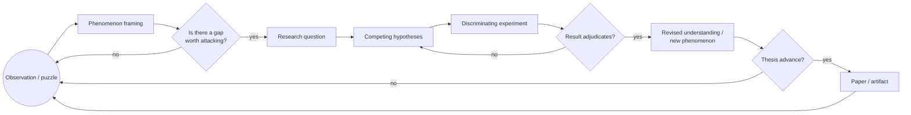
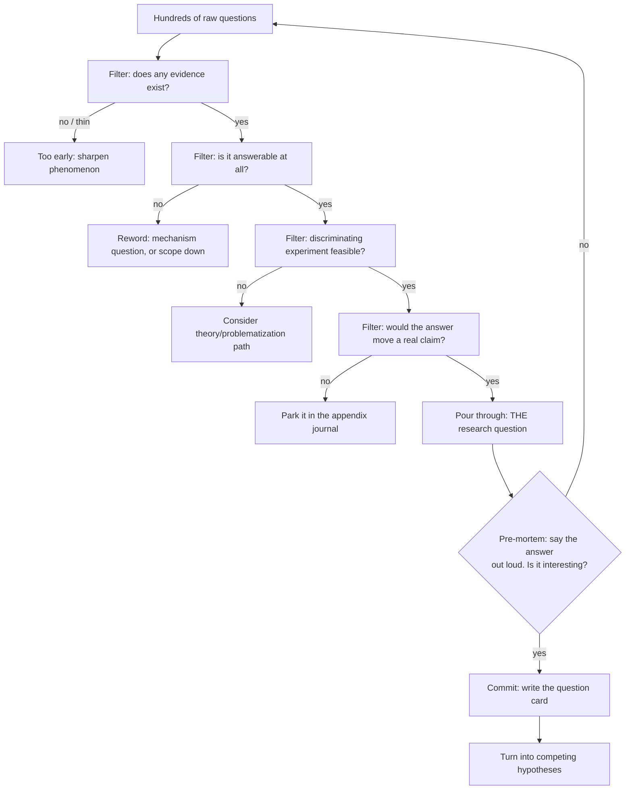
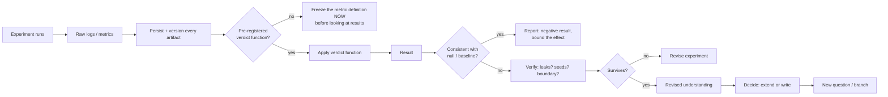

# AI/ML Research Discovery & Completion Playbook

An evidence-based guide to the full research arc in AI/ML: recognizing gaps,
forming questions, designing discriminating experiments, building a thesis, and
producing a defensible paper.

## Executive summary

The single most destructive failure in AI/ML research is not "bad ideas" — it
is *uncommitted exploration*: fields surveyed indefinitely, topics compared
without evidence, and reading treated as progress while no verdict is ever
fired. This playbook is the antidote, reconstructed from how experienced
researchers actually operate, grounded in the verified sources in the Evidence
Base rather than productivity advice.

Its core claims, in one go:

- **Research is a closed feedback loop, not a pipeline** (§1). Questions are
  provisional; experiments are designed to falsify; results revise both. A
  project that asks exactly what it started asking has learned nothing.
- **A gap is evidence-shaped, not absence-shaped** (§4). "Nobody applied X to
  Y" is a search artifact; "existing evidence cannot distinguish A from B, and
  experiment X decides it" is a research problem. The gap-verification
  procedure (§4.5) searches *against* your own idea.
- **Exploration has an evidence-defined end** (§21). The "no more topic
  hunting" gate closes when closest work is identified, the gap is verified,
  a feasible discriminating experiment exists, and a negative result would
  still be usable. Proving "best topic in the field" is *not* on the list —
  that requirement is exactly the trap it dissolves.
- **The minimum discriminating experiment is the unit of research** (§7).
  Competing hypotheses, one discriminating variable, honest baselines,
  pre-registered verdicts, and enough seeds — before any large system. Most
  claimed ML progress has been undone precisely at this step
  (Musgrave on baselines, Kapoor & Narayanan on leakage).
- **Surprising results are the product, not the setback** (§10). The
  reference worked example (§18) — BatchNorm's internal-covariate-shift
  explanation falsified by a "noisy" variant that still works — shows the
  full loop, including the point where the initial assumption collapsed.
- **Completion is a state with written evidence** (§16, §30): decision
  records at every gate; a claim set with weights and scopes (§12); a thesis
  and paper built from the evidence chain (§14); negative results shipped
  rather than buried (§10.5).

Every load-bearing claim is labeled [VERIFIED] / [SYNTHESIS] /
[PRACTICAL HEURISTIC] / [UNCERTAIN] and traceable to the Evidence Base at the
end. Read Sections 1, 4.4, 7, 10, 18, and 21 first; they carry the
method's spine.

**How claims are labeled.** Every substantive claim is marked:

- **[VERIFIED]** — backed by a primary source I have actually read (paper full text, abstract, or authoritative web page). Sources are listed in the Evidence Base with DOIs/IDs.
- **[SYNTHESIS]** — a synthesis across multiple verified sources, clearly flagged as an interpretation.
- **[PRACTICAL HEURISTIC]** — community practice that is broadly useful but not established by a specific verified empirical source.
- **[UNCERTAIN]** — plausible but unconfirmed; treat as an open question.

**How the document is organized.** Sections 1–6 cover discovery (from raw
observation to a crisp research question). Sections 7–12 cover design and
execution (hypotheses, discriminating experiments, verification, the revise
loop). Sections 13–17 cover completion (claims, thesis, paper, artifacts,
stopping rules). Section 18 is a complete worked example that violates
expectations on purpose; Section 19 lists failure modes; Sections 20–30 cover
standards, the commitment system, the operating system, and the master
desk reference; the Evidence Base at the end of the document lists the exact
sources behind every [VERIFIED] claim.

---

## 1. The core mental model: a loop, not a checklist

Most research starts squarely on the wrong foot: a flat to-do list
(*"read 40 papers, then pick a topic, then run two experiments, then write"*).
That model fails because research is a **closed loop with feedback**:
the same observation that raises a question also supplies the evidence that
answers it, and the answer almost always *changes the question*.

**Research is a discovery loop.** The state of a project is not "steps done"
but "where am I on the loop, and which decisions can I make or kill here?" An
iterative loop is the heart of how actual research proceeds.



The remainder of the playbook is this loop expanded: how to enter it (Sections
2–4), how to move a question through it (Sections 5–7), how to verify results
as they emerge (Sections 8–11), and how to exit it with a defensible thesis
(Sections 12–17).

> Why a loop and not a checklist? [VERIFIED] The strongest sources on research
> methodology describe iterative, assumption-challenging processes rather than
> linear pipelines. Alvesson & Sandberg (2011), "Generating Research Questions
> Through Problematization," argue that the most productive questions come from
> *challenging the assumptions underlying existing literature*, and that doing
> so is itself an iterative confrontation rather than a box-ticking exercise.
> Platt (1964) formulates the scientific method as a recurring cycle —
> devise competing hypotheses, design an experiment to exclude some, discard
> those falsified, and repeat — explicitly a *loop driven by exclusion*.
> [SYNTHESIS] Both, applied to AI/ML research, yield the structure above.

**Two commitments follow immediately:**

1. **Questions are provisional.** Expect (plan for!) the question you start
   with to be wrong or incomplete. A research project that ends exactly where
   it started in framing terms has usually not learned anything.
   [VERIFIED] The BatchNorm story, worked in detail in Section 18, is one
   published instance: a widely believed mechanism (reducing internal covariate
   shift) was empirically falsified and the field's understanding updated.
2. **Literature and experiment are the same loop, not two phases.**
   [VERIFIED] The most influential guide to literature review in software
   engineering, Wohlin's snowballing procedure (2014), is itself iterative:
   you read backwards and forwards through citations *until newly found papers
   no longer contribute materially*. That is a stopping rule on a loop, not a
   checklist.

---

## 2. Starting point: state of the research, not "topic"

Before any literature search or experiment, decide where you are on the
Research State table. It governs what action is useful next and what would be
wasted effort. This is a [SYNTHESIS] — the table itself is a coordination tool,
but each row's recommended action follows from the verified literature in the
linked sections.

| Research State             | Definition                                                  | What is useful now                                              | Nothing to gain from             | Section |
| ---------------------------- | ------------------------------------------------------------- | ----------------------------------------------------------------- | ---------------------------------- | --------- |
| **Raw curiosity**          | A phenomenon or puzzle with no question yet                 | Open observations; read broadly; write a phenomenon paragraph   | Designing an experiment          | 2–3    |
| **Committed gap**          | A well-formed gap claim ("current systems fail in case X")  | Rapid evidence scan to confirm the gap is real, not an artifact | Full systematic review           | 4       |
| **Candidate question**     | A testable research question with one feasible answer shape | Funnel the question (Section 5); check question maturity        | Running the blasting experiment  | 5       |
| **Active hypothesis**      | Competing explanations on the table                         | Build discriminating experiments (Section 7)                    | Adding more hypotheses           | 6–7    |
| **Experiment in flight**   | Runs are executing and being judged                         | Watch decision gates; pre-register verdicts                     | New literature sweeps            | 8–10   |
| **Result surfacing**       | A result is coherent and repeatable                         | Verify (Section 9); stress evidence (Section 10)                | Paper writing                    | 8–10   |
| **Claim established**      | A defensible claim with a bound on its validity             | Write the atomic claim; draft thesis and paper                  | More runs of the same experiment | 12–15  |
| **Contributed / complete** | Thesis holds, artifact shipped, saturation reached          | Hand off; record what remained open                             | Extending scope                  | 16–17  |

The states form a machine, not a ladder: nearly every state can legally
transition backward when evidence demands it, and forward transitions are
guarded by decision gates (Section 10). This is what keeps a project from
parking permanently in EXPLORING: exploration states have force-exit criteria.

```mermaid
stateDiagram-v2
    [*] --> EXPLORING
    EXPLORING: EXPLORING (observe, read, write phenomenon)
    EXPLORING --> QUESTION_CANDIDATE: one observation + gap claim survive scrutiny
    EXPLORING --> EXPLORING: new observations keep arriving; no gate reached
    QUESTION_CANDIDATE: QUESTION CANDIDATE
    QUESTION_CANDIDATE --> GAP_VERIFICATION: funnel passes; maturity >= 2
    QUESTION_CANDIDATE --> EXPLORING: gap fails sanity check (G0)
    GAP_VERIFICATION: GAP VERIFICATION (snowballing, closest work, negative evidence)
    GAP_VERIFICATION --> PILOT_READY: gap confirmed + discriminating experiment feasible
    GAP_VERIFICATION --> QUESTION_CANDIDATE: gap is an artifact; reformulate
    GAP_VERIFICATION --> EXPLORING: gap falsified; record negative result
    PILOT_READY: PILOT-READY (protocol, baselines, pre-registered verdict)
    PILOT_READY --> COMMITTED: G1 passes; lingering doubts are not evidence
    PILOT_READY --> QUESTION_CANDIDATE: discriminating variable not found; reframe
    COMMITTED: COMMITTED (question frozen, falsification pair declared)
    COMMITTED --> EXPERIMENTING: launch runs
    EXPERIMENTING: EXPERIMENTING
    EXPERIMENTING --> ANALYZING: G3 verdict function applied
    EXPERIMENTING --> EXPERIMENTING: repair run (bounded, G2)
    ANALYZING: ANALYZING (verify, leak-audit, try to break)
    ANALYZING --> CLAIM_ESTABLISHED: survives G4 + G5
    ANALYZING --> EXPERIMENTING: failed verification; re-run or redesign
    ANALYZING --> PILOT_READY: result contradicts assumption; reframe the cell
    CLAIM_ESTABLISHED: CLAIM ESTABLISHED (weighted, scoped)
    CLAIM_ESTABLISHED --> WRITING: thesis advance accepted
    CLAIM_ESTABLISHED --> ANALYZING: new boundary condition found
    WRITING: WRITING (thesis + paper, evidence-linked)
    WRITING --> SUBMISSION: internal review + reviewer simulation pass
    WRITING --> ANALYZING: reviewer simulation finds a missing control
    SUBMISSION --> [*]: decision record closed
```

**Machine rules** [PRACTICAL HEURISTIC, structure grounded in the gate logic
of Sections 10 and 21]:

- Every backward transition requires a written decision record (one
  paragraph: what evidence forced the return).
- EXPLORING has no infinite loop: each re-entry must have consumed at least one
  gate's worth of evidence, else it is drift (Section 19).
- COMMITTED is reversible only by G3/G4 evidence (a surprising result), never
  by "maybe something else is better" — that path is closed by the Section 21
  commitment system.

**Rules of thumb for starting** [PRACTICAL HEURISTIC]:

- You do not need "a topic." You need **one observation that bothers you**. Write
  it as a sentence: "X systems do Y, but nobody seems to ask why Z."
- A **committed gap** is the minimum viable product of research framing. If the
  gap turns out to be an artifact of reading a bad benchmark paper, the
  cheapest time to discover that is week one, not week six (Section 10 handles
  exactly this failure mode).

---

## 3. From observation to phenomenon

**Observation** is the raw event ("this run dramatically outperformed that
run"). **Phenomenon** is the observed pattern rendered into a claim that
survives inspection ("system A reliably outperforms B on task family C").
**Puzzle** is the phenomenon plus a "why" that nothing current answers.

Three filters turn an observation into a research-grade phenomenon
— all three are [PRACTICAL HEURISTIC] but anchored in verified material:

1. **Reproduction.** See it at least twice under controlled variation.
   [VERIFIED] Henderson et al. (2018) show that single-seed deep-RL results are
   routinely misleading: full distributions over scores differ dramatically in
   mean and rank across seeds. One run is an anecdote; a distribution is a
   phenomenon.
2. **Perturbation.** Vary the conditions that should *not* matter. If the
   pattern is robust to those perturbations it is a candidate phenomenon; if
   it collapses, you have found a boundary, which is itself valuable.
   [VERIFIED] The texture-bias literature (Section 18, vignette 2) hinges on
   exactly this: Geirhos et al. (2019) perturbed images so shape and texture
   disagreed, and the "CNNs recognize shapes" belief collapsed.
3. **Independence from benchmark noise.** [VERIFIED] Leakage and selection
   effects masquerade as phenomena (Kapoor & Narayanan 2023); "the winner
   achieves 0.94 AUC" is frequently a leakage artifact, not a fact about the
   method. A phenomenon should be stated in a way that a skeptical reader can
   check against a held-out, correctly-split evaluation.

**How to write a phenomenon paragraph.** A phenomenon paragraph states: (i)
what was done, (ii) what reliably happened, (iii) which condition it depends
on, and (iv) what explanation was ruled out — *before* the explanation offered
is written. This forces the discriminating habit early, which is the single
most transferable skill in the playbook (Sections 6–7).

### 3.1 The concept ladder: a topic is not a question

Most wasted research time comes from collapsing the ladder — believing that "I
found an interesting topic" equals "I found a researchable question." The rungs
are distinct, and each has a test. [SYNTHESIS; the AI/ML examples are
drawn from the verified exemplars in the Evidence Base]

| Concept                  | Definition                                            | AI/ML example                                          | Test that you actually have it                 |
| -------------------------- | ------------------------------------------------------- | -------------------------------------------------------- | ------------------------------------------------ |
| **Field**                | Broad discipline                                      | Machine learning                                       | You can say "the field of X" in one phrase     |
| **Subfield**             | Organized subdivision of a field                      | Computer vision, NLP, deep RL                          | Conferences/journals exist for it              |
| **Research area**        | Subfield region organized around problems and methods | Robustness / OOD generalization                        | You can name the problem clusters in it        |
| **Research territory**   | A bounded slice: methods × datasets × problems      | Texture vs. shape in image classifiers                 | You can draw its boundary in one sentence      |
| **Topic**                | A label for something you want to know about          | "shortcut learning," "leakage," "BN"                   | It's a*label* — holding many is fine          |
| **Problem**              | A concrete difficulty worth solving                   | Classifiers fail under distribution shift              | Two sentences: who suffers, in which situation |
| **Failure mode**         | A specific way a system fails                         | Predict a confounded cue instead of the signal         | You can provoke it on demand                   |
| **Observation**          | A raw event from a run or paper                       | "accuracy drops 40% under site shift"                  | Reproducible at least once more                |
| **Phenomenon**           | An observation rendered into a robust pattern claim   | "model rank reverses across distribution shift"        | Stated with the condition it depends on        |
| **Assumption**           | A taken-for-granted belief a method leans on          | "CNNs use shape features"                              | You can corrupt it and watch behavior change   |
| **Limitation**           | A stated bound on a claim's scope                     | "evaluated on natural images only"                     | A scope sentence, and a candidate gap seed     |
| **Research gap**         | Existing evidence cannot distinguish claims           | "No controlled experiment varies texture explicitly"   | You can name the experiment the gap is missing |
| **Research opportunity** | A gap plus feasibility                                | Same gap + you can run cue-conflict images             | You can name the minimum feasible experiment   |
| **Research question**    | A precise interrogative with one answer shape         | "Do CNNs rely on shape or texture?"                    | Competing answers you could distinguish        |
| **Hypothesis**           | A falsifiable candidate answer                        | "H_tr: texture dominates for ImageNet CNNs"            | You can write the refuting result in advance   |
| **Experiment**           | A procedure whose outcome changes belief              | Cue-conflict + Stylized-ImageNet evaluation            | A pre-registered verdict function exists       |
| **Contribution**         | What the work changes about what we can infer         | "Texture reliance is architecture- and data-dependent" | One verifiable sentence, not a paragraph       |

**Two rungs deserve emphasis** [SYNTHESIS]:

- **Observation → phenomenon** is where most false starts die: the gap between
  "I saw a loss curve" and "this pattern is a property of the method, not the
  run" is where leakage and seed luck live (Sections 9 and 11).
- **Opportunity → question** is where the commitment gate lives (Section 21):
  the moment feasibility is established, the question must be stated in a form
  whose wrong answer is still usable (Section 5.3).

---

## 4. Finding and confirming gaps

### 4.1 Kinds of gaps

| Gap type                    | Definition                                                                | Example in AI/ML                                                                                                                  | Best attack                                                                                                    |
| ----------------------------- | --------------------------------------------------------------------------- | ----------------------------------------------------------------------------------------------------------------------------------- | ---------------------------------------------------------------------------------------------------------------- |
| **Direct contradiction**    | Two verified results that cannot both hold as stated                      | "CNNs strongly prefer texture" (Geirhos et al. 2019) vs "CNNs mostly rely on local shape" (Burgert et al. 2025)                   | A controlled experiment that varies the discriminating variable (here: cue-conflict and suppression protocols) |
| **Unresolved mechanism**    | Everyone uses an effect; nobody knows why it works                        | BatchNorm was used everywhere before its ICS explanation was tested (Ioffe & Szegedy 2015; falsified by Santurkar et al. 2018)    | A falsification experiment targeting the claimed mechanism                                                     |
| **Underspecified pipeline** | Training succeeds but the function learned is not pinned down             | Models that match training data yet differ wildly on new settings (D'Amour et al. 2022)                                           | Robustness/stress evaluations across settings                                                                  |
| **Leakage-driven claim**    | Reported performance is inflated by data or selection leakage             | "Complex ML beats logistic regression" claims shown to be leakage artifacts (Kapoor & Narayanan 2023)                             | Re-run with leakage-corrected protocol; report simple baselines                                                |
| **Assumption buried in X**  | A field depends on an assumption nobody noticed                           | Domain transfer / invariance assumptions in invariant-risk methods (Arjovsky et al. 2019, challenged by Rosenfeld et al. 2020)    | Problematization: surface the assumption, test its boundary                                                    |
| **Unreported variance**     | Results reported without the uncertainty that separates signal from noise | Deep-RL seed variance (Henderson et al. 2018); metric-learning lift that vanishes vs. well-tuned baselines (Musgrave et al. 2020) | Re-run with proper confidence intervals and honest baseline tuning                                             |

The table is a [SYNTHESIS]. The rows are grounded in the verified sources
listed in the rightmost column and in the Evidence Base.

### 4.2 The gap must survive contact with the literature

[VERIFIED] Lipton & Steinhardt (2018) catalog the failure modes that make
"gap claims" not worth attacking: claims built on *mathiness* (formal-looking
but empty notation), claims that conflate explanation with speculation, and
claims that borrow authority from language rather than measurement. When you
read a paper and think "they left a glaring gap," first test whether the gap
survives Stevenson's questions: *did they actually claim what you think they
claimed, and is the gap a gap in their write-up or a real hole in the world?*

An efficient, evidence-faithful way to confirm a gap is **backward/forward
snowballing** (Wohlin 2014, [VERIFIED]): from one solid recent paper on the
topic, walk its references (backward) and the papers that cite it (forward),
iterating until new additions stop changing the picture. This converges on
"the" set of relevant results far faster than random keyword dredging, and it
gives you the boundary of the gap: you know exactly which claims the field
currently stands on.

**[PRACTICAL HEURISTIC] The "adjacent-gap" test.** When you believe you have a
gap, ask: *Is the missing result merely the same result transferred to a new
dataset/dataset-family?* Dataset-centered "novelty" is the most common fake
gap in AI/ML. A real gap changes what we can infer; a fake gap changes only the
logo on the header of Figure 1.

### 4.3 The eleven mechanisms of gap discovery

Gaps are not found in one way. Each mechanism below has its own detection
signature, false-positive pattern, and path to a question. [SYNTHESIS; each
row names a verified exemplar where one exists]

| # | Mechanism                | How you detect it                                                                             | Evidence needed                                        | Common false positive                                          | How it becomes a question                                           |
| --- | -------------------------- | ----------------------------------------------------------------------------------------------- | -------------------------------------------------------- | ---------------------------------------------------------------- | --------------------------------------------------------------------- |
| A | **Failure-driven**       | A system fails in a way its design says it shouldn't                                          | Reproduced failure, isolated trigger                   | A bug, misconfigured setup, or statistical fluke               | "Under which conditions does failure X occur?"                      |
| B | **Contradiction-driven** | Two results cannot both hold (shape vs. texture: Geirhos 2019 vs. Burgert 2025)               | Both results reproduced; identifying variable isolated | One result never reproduced                                    | "Which of A, B does the discriminating variable support?"           |
| C | **Assumption-driven**    | A widely used assumption was never tested (ICS story: Ioffe & Szegedy 2015 → Santurkar 2018) | The assumption stated + a test that could falsify it   | Everyone quotes it, but it is load-bearing somewhere           | "Does mechanism M, as assumed, actually hold?"                      |
| D | **Mechanism**            | Effect known, cause unexplained                                                               | A candidate mechanism + a discriminating experiment    | Correlation mistaken for mechanism                             | "What explains phenomenon P?"                                       |
| E | **Evaluation**           | The benchmark may measure something else (metric-learning "wins": Musgrave 2020)              | Baseline re-run; metric audit                          | Benchmark is old but still used                                | "Does the metric track the capability claimed?"                     |
| F | **Robustness**           | Claimed capability fails in particular conditions (Zech 2018: site confounds)                 | Boundary conditions enumerated                         | Different subpopulation, not a flaw                            | "In which settings does the claim break?"                           |
| G | **Generalization**       | Finding fails to transfer (IRM: Arjovsky 2019 → Rosenfeld 2020 counterexample)               | Transfer matrix across settings                        | Transfer not attempted with matched controls                   | "Under what shifts does the finding persist?"                       |
| H | **Methodological**       | Existing experiments cannot separate explanations                                             | Show two explanations make different predictions       | Claim of methodological superiority without re-run             | "Can an experiment distinguish H1 vs H2?"                           |
| I | **Replication**          | An important claim has thin verification                                                      | Reproduce; search for replications                     | Confusing "didn't reproduce on my setup" with "claim is false" | "Does the headline result hold under replication?"                  |
| J | **Dataset/measurement**  | No dataset can answer the intended question                                                   | Existing datasets enumerated + gap in capability       | Dataset exists but can't answer it either                      | "What dataset/measurement would make the question answerable?"      |
| K | **Emerging-technology**  | A new model/tool/dataset reopens a closed question                                            | The change actually alters testable predictions        | "Newer model" with no new capability used                      | "What was assumed because X didn't exist, that X now lets us test?" |

### 4.4 Weak vs. strong gaps: "nobody has done this" is not a gap

| Weak gap                                                               | Strong gap                                                                                                                  |
| ------------------------------------------------------------------------ | ----------------------------------------------------------------------------------------------------------------------------- |
| "Nobody has applied method X to dataset Y."                            | "Existing evidence cannot distinguish explanation A from explanation B, and experiment X can provide the missing evidence." |
| Novelty declared by absence of a paper                                 | Novelty declared by absence of*evidence that answers a specific question*                                                   |
| The strongest defense is a search history                              | The strongest defense is a discriminating experiment                                                                        |
| Contradicted by an adjacent result                                     | Survives contact with the closest work                                                                                      |
| Falsifiable only in the trivial sense                                  | Falsifiable in substance: a negative result still teaches                                                                   |
| Value is accidental (someone did apply X to Y, you didn't search well) | Value is structural (the experiment changes what we can infer)                                                              |

The difference is the whole point of Section 4.2's adjacent-gap test: a strong
gap is one *whose closure changes the inference*, not one whose non-existence
papers can be searched away. [SYNTHESIS; the "imputation-before-split" case in
Kapoor & Narayanan 2023 is a strong gap — a measurement — where "apply X to Y"
novelty is weak].

### 4.5 Gap verification: search against your own gap

The objective of verification is not "prove my idea is novel." It is "find out
exactly what is established and what genuinely remains uncertain." The
procedure is deliberately adversarial toward your own proposal [SYNTHESIS,
search steps standard in research methodology; the concrete search tooling
varies, so these are heuristics grounded in Wohlin 2014 and the exemplars]:

1. **Broad search** for the concept (so you don't miss the field's vocabulary).
2. **Terminology expansion** — synonyms and neighboring terms; researchers in
   different subcommunities name the same thing differently. Missing the other
   community's name for your own gap is the classic "I'm first" error.
3. **Canonical papers** — the 1–3 references everything else cites; their
   claims bound what can be assumed.
4. **Recent papers** — last 2 years, to catch the paper that already answered
   your question while you were searching.
5. **Backward citation chaining** from a recent solid paper (Wohlin
   snowballing) → the ancestry of your gap.
6. **Forward citation chaining** (papers citing the canonical ones) → who has
   already attacked it.
7. **Closest-work search** — the paper that would claim "this is ours" if you
   publish yours. It must exist in your notes before you commit.
8. **Competing-method search** — the approach that would make your contribution
   trivial (baselines, rival mechanisms).
9. **Benchmark and dataset search** — which leaderboard/benchmark claims would
   be touched; which datasets are capable of answering the question.
10. **Code/repository search** — reproduction assets; a paper that exists only
    as a PDF is weaker evidence than one whose code runs.
11. **Negative and contradictory evidence search** — explicitly search for
    *"why this might be false"*: replication failures, critiques, follow-up
    falsifications.
12. **The "already-answered" search** — phrase your question as a claim and
    search that claim verbatim ("CNNs use local shape features" will surface
    the 2025 challenge directly).

**Stopping rule for verification** [PRACTICAL HEURISTIC]: you may stop when
the *closest work* is identified, the relevant benchmarks/datasets are known,
and no new paper changes the answer to "what did the closest work actually
test?" — tailored below.

### 4.6 Query evolution and literature saturation

Queries evolve with the research, not before it [PRACTICAL HEURISTIC]:

```text
Broad concept ("shortcut learning")
   → terminology discovery ("texture bias", "cue conflict", "frustratingly easy")
   → canonical papers (Geirhos 2020)
   → recent papers (Burgert 2025)
   → failure modes (texture bias persists; local-shape counterevidence)
   → mechanisms (cue-conflict protocol; suppression protocol)
   → closest experiments (what exactly was varied)
   → the specific unresolved question ("does shape reliance depend on architecture?")
```

**Evidence that literature exploration is sufficient** — all of these, and
each is a heuristic, not a law ([PRACTICAL HEURISTIC], anchored in Wohlin's
saturation reasoning):

- Repeated discovery of the *same core papers* from different entry points.
- No *materially new competing explanation* appears after several fresh
  searches.
- Closest work identified and read at least at depth Level 2 (Section 20).
- Key assumptions of the relevant methods mapped to sources.
- Relevant benchmarks and datasets enumerated; the one capable of answering the
  question is found.
- Important contradictory evidence checked (not just cited).
- Your proposed experiment *clearly differs* from everything found, and the
  difference is a discriminating one, not just a different dataset.

---

## 5. Shaping the question

### 5.1 The question funnel

Most candidate questions are cheap and wrong; commitment should be expensive
and rare. The funnel is a [PRACTICAL HEURISTIC] that operationalizes the
discriminating logic of Platt (1964, [VERIFIED]) at the *question* level
before it reaches the *experiment* level.



**Funnel rules** [PRACTICAL HEURISTIC]:

- **Answerability is not feasibility.** "Do transformers *understand* X?" is
  answerable in principle and not feasible in practice; "Under which input
  perturbations does the model's held-out accuracy drop first?" is feasible.
  Prefer the feasible one and say so explicitly — the big question becomes a
  "so what" discussion, not the experiment.
- **One answer shape.** A committed question should admit one of: a mechanism,
  a boundary, a causal attribution, or a measurement method. If the question
  admits three of them, it is three questions; pick one.
- **Park, don't delete.** Every question that passes the first two filters but
  loses at "would it move a claim?" goes to an appendix journal. Appendix
  questions are the seed stock for future work and for the "future work"
  section that makes a paper honest rather than padded.

### 5.2 Question maturity

A maturity ladder that makes "is this question ready?" a concrete test
[SYNTHESIS of verified criteria from Platt 1964, Breck et al. 2017, and
D'Amour et al. 2022]:

| Level                | The question ...                                              | Ready to run? | Most likely next failure                |
| ---------------------- | --------------------------------------------------------------- | --------------- | ----------------------------------------- |
| 0 — Blurry          | "Can we make X better?"                                       | No            | Never wrong; never finished             |
| 1 — Directed        | "Which variant improves held-out F1 on task family C?"        | No            | Benchmark-noise confounding             |
| 2 — Causal-adjacent | "Does mechanism M explain the improvement, versus confounds?" | Maybe         | Underspecification obscures the mapping |
| 3 — Discriminating  | "Which of hypotheses A, B, C does the data exclude?"          | Yes           | Leakage in evaluation                   |
| 4 — Generalizable   | "Under which settings does the surviving hypothesis hold?"    | Yes           | Sample of settings too narrow           |

The jump from level 1 to level 3 is the entire ideological difference between
a benchmark churn project and a research project. [VERIFIED] D'Amour et al.
(2022) show that level-1 framing ("improve accuracy") is exactly what produces
underspecified models: multiple pipelines fit the training data and a level-1
question cannot distinguish them. Level 3 framing exists for that purpose.

### 5.3 Evaluating candidates by elimination, not by ranking

Evaluating dozens of ideas by scoring them against each other is a treadmill;
evaluating a *single candidate* against elimination criteria is fast and
decisive. The criteria below are the question-level analog of the
evidence checks in Section 4.5 [SYNTHESIS; most criteria map to verified
concepts in the Evidence Base]:

The candidate question passes (is worth committing to) only if **all** hold:

1. **Importance** — if answered, someone's decision or belief changes
   (Heilmeier Catechism, [VERIFIED]).
2. **Unresolved uncertainty** — the gap survives Section 4.5's
   adversarial search.
3. **Testability** — a protocol exists in principle.
4. **Falsifiability** — the refuting result is written in advance
   (Popper/Platt, [VERIFIED]).
5. **Evidence availability** — data, compute, and access are within reach.
6. **Closest-work distance** — the closest paper does not already answer it
   (Section 4.5.7).
7. **Discriminating power** — a single experiment can move belief between at
   least two explanations (Platt, [VERIFIED]).
8. **Feasibility** — the minimum discriminating experiment is implementable
   this cycle (Section 7).
9. **Reproducibility** — the protocol can be version-pinned (Section 8).
10. **Contribution potential** — the *possible* contribution set (Section 23)
    contains at least one verifiable claim.
11. **Value of a negative result** — if the hypothesis fails, something
    still publishable remains (Section 10.5).

**Elimination rule** [PRACTICAL HEURISTIC]: the moment any criterion fails and
rephrasing cannot repair it, the candidate is *out*, not "saved for later
reconsideration unless new evidence arrives" — reopening without new evidence
is exactly the failure mode of Section 26.

---

## 6. Hypotheses and problematization

### 6.1 Competing hypotheses, not a hypothesis

[VERIFIED] Platt (1964) — *strong inference* — states the procedure that most
efficient research follows: (1) devise alternative hypotheses; (2) devise a
crucial experiment whose outcomes will exclude one or more; (3) carry it out
cleanly; (4) recycle, refuting hypotheses and proceeding to sharper ones.
The unit of research is therefore the **hypothesis set**, not the single
hypothesis. A single-hypothesis project ("I test whether my method helps")
cannot produce exclusion, so it cannot produce knowledge — it can only produce
a measurement.

### 6.2 Problematic-assumption questioning

A second, complementary source of questions: **challenge the assumptions
underlying the current literature** rather than only filling gaps.
[VERIFIED] Alvesson & Sandberg (2011) call this *problematization* and show it
generates the questions gap-spotting cannot: the deep, surprising ones. The
BatchNorm worked example (Section 18) is a pure instance — the field assumed a
mechanism, and the research question came from attacking the assumption, not
from a faster model.

### 6.3 Explicit falsifiability

When you commit to hypotheses, the reloaded state must be a **falsifiable
pair**: for each hypothesis, name a result you would treat as refutation.
[VERIFIED] Popper (Stanford Encyclopedia of Philosophy entry, verified) —
falsifiability is the demarcation criterion: a claim that cannot clash with
any possible experience does not belong to empirical science. In AI/ML terms:
if you cannot write the *negative* benchmark result in advance, you are not
doing an experiment yet. [VERIFIED] Santurkar et al. (2018) carried precisely
this out: they predesignated falsifications of the internal-covariate-shift
(ICS) hypothesis (a "noisy" BatchNorm that *increases* ICS while matching
accuracy) before running it.

---

## 7. Discriminating experiments

**Discriminating experiment**: an experiment whose possible outcomes have
different evidential meaning for the hypothesis set (exclude at least one of
them). This is the operationalization of Platt's crucial experiment and is
[VERIFIED] in every exemplar in this playbook:

- **BatchNorm**: if ICS reduction explains BatchNorm, then a variant that
  *degrades* ICS while keeping BatchNorm's other properties must lose most of
  the benefit. It did not (Santurkar et al. 2018). [VERIFIED; full-text
  quotes checked in the Evidence Base]
- **Texture vs. shape**: if CNNs recognize shapes, cue-conflict images (shape
  and texture disagree) should be labeled by shape. They were labeled by
  texture (Geirhos et al. 2019). [VERIFIED]
- **Invariant risk minimization**: if IRM is robust to data-creation
  environments, its claimed superiority should persist under the distributional
  shifts it targets. Rosenfeld et al. (2020) construct counterexamples where it
  fails, excluding the "general answer" reading. [VERIFIED]

### 7.1 Design checklist

A discriminating experiment that keeps its power [SYNTHESIS grounded in
Henderson et al. 2018, Musgrave et al. 2020, D'Amour et al. 2022,
Kapoor & Narayanan 2023]:

1. **Vary the discriminating variable, hold the rest constant.** If two
   hypotheses differ only in one variable, change that variable and nothing
   else. The Noisy BatchNorm design does exactly this. [VERIFIED]
2. **Include the boring baseline, tuned honestly.** [VERIFIED] Musgrave et al.
   (2020) found that most metric-learning "wins" vanished against well-tuned
   baselines; the field's claimed progress was largely baseline tuning.
   Adam, tuned, beat many proposed methods. Always report the baseline with at
   least as much tuning budget as your method.
3. **Run enough seeds and report distributions, with errorbars.** [VERIFIED]
   Henderson et al. (2018): evaluation of deep-RL that relies on a few seeds
   cannot rank methods reliably.
4. **Pre-register the verdict function.** Define the decision rule (e.g.,
   "hypothesis A is excluded if mean advantage < 0 with probability ≥ 0.95
   under 20 seeds") *before* seeing results. This is the strongest defense
   against the selection effects Kapoor & Narayanan document. [SYNTHESIS]
5. **Guard the test set.** Anything that touches test data is part of the
   method. [VERIFIED] Kapoor & Narayanan (2023): the leakage taxonomy (training
   leakage, selection leakage, external leakage) accounts for a large share of
   unreproducible "breakthrough" claims in applied ML.

### 7.2 Pre-mortem by arithmetic

Before running anything, [VERIFIED] per Kapoor & Narayanan (2023), ask: *if my
method reports +5pp over the baseline, what leakage path would produce the
same number for free?* If you cannot answer, your experiment isn't sealed
yet. This single habit converts every "surprising blowout" into a
test-of-leakage rather than a miracle.

### 7.3 The control and baseline taxonomy

Discriminating power comes from what you compare against. The full toolkit
[SYNTHESIS; each item is standard experimental method, and the exemplar
columns show it used in practice]:

| Tool                           | What it is                               | What it eliminates                             | Exemplar                                        |
| -------------------------------- | ------------------------------------------ | ------------------------------------------------ | ------------------------------------------------- |
| **Trivial baseline**           | Random/majority/constant                 | That no learning is needed                     | Reported by all exemplars                       |
| **Standard baseline**          | Common published reference method        | That a known method already works              | Logistic regression audits (Kapoor & Narayanan) |
| **Strong baseline**            | The best existing method, honestly tuned | That your method is just better tuning         | Adam-tuned metric learning (Musgrave)           |
| **Oracle**                     | Upper bound given perfect information    | That the task itself caps performance          | —                                              |
| **Ablation**                   | Remove one component of your method      | That component X matters                       | Noisy-ICS ablation (Santurkar)                  |
| **Negative control / placebo** | Treatment expected to do nothing         | That the procedure itself causes the effect    | "Noisy" BatchNorm injecting noise               |
| **Matched conditions**         | Vary one variable, hold rest identical   | Confounds from other variables                 | Cue-conflict images (Geirhos)                   |
| **Counterfactual**             | Same inputs, alternative mechanism       | That this specific mechanism caused the change | Local-vs-global cue suppression (Burgert)       |
| **Leakage control**            | Re-run with correct split/seeding        | That the number is an artifact                 | Corrected-AUC re-runs (Kapoor & Narayanan)      |
| **Upper/lower bound framing**  | State the best/worst the evidence allows | Overclaiming between them                      | Claim-weighting (§12.2)                        |

**Why the minimum experiment beats the big system.** The minimum
discriminating experiment is not a "cheap pilot"; it is the *largest thing the
question can justify*. [VERIFIED] Musgrave et al. (2020) is the canonical
demonstration: after building the large systems, the field's wins vanished at
the baseline; the discriminating experiment (honest baseline comparison) was
the research. [VERIFIED] Henderson et al. (2018) similarly shows the
"system, then evaluate" order produces unusable conclusions; the discriminating
number of seeds is a cheap, question-deciding measurement. If a question
cannot be attacked by a small experiment, it is usually not a question yet —
go back up the funnel.

---

## 8. Evidence integrity in flight

### 8.1 The evidence loop



### 8.2 Persistence and metadata

[VERIFIED] The NeurIPS reproducibility program (Pineau et al. 2021) made
reproducibility a review criterion with a mandatory checklist, and its
recommendations are now the field baseline: version the environment, pin the
code, record full hyperparameters and the number of seeds, and archive every
run's raw outputs — not just the plotted mean. [VERIFIED] Breck et al. (2017)
go further with a test-score rubric for ML systems, holding that any research
that computes a metric is a system and should be tested like one: leak tests,
data-distribution tests, model-quality tests. Treat "the metric pipeline" as
code whose bugs produce fake science.

[PRACTICAL HEURISTIC, but strongly encouraged by the above] — Minimal
persistence contract for any experiment that will become a claim:

- Commit the code and config that produced a given number (one commit = one
  reproducible run).
- Store raw per-run outputs; compute summary statistics in a script, never by
  hand.
- Record the random seeds and the data split as first-class metadata.
- Archive the "negative control" runs (baseline with same budget, null
  stimulus) alongside the headline ones.

### 8.3 The experiment ledger

One table, one row per experiment, written *before and after* each run. This
is the operational heart of decision tracking and prevents both drift
(running experiments without knowing what uncertainty they resolve) and
repeated work (rediscovering past verdicts). [SYNTHESIS; the row structure
is the standard pre-registration + result pattern recommended by Pineau et
al. 2021 and consistent with the exemplar verdicts]

| Field                   | What goes here                                                     |
| ------------------------- | -------------------------------------------------------------------- |
| Hypothesis addressed    | Which of the competing hypotheses this run bears on                |
| Experiment              | The exact protocol (inputs, conditions, code commit)               |
| Expected result         | Written*before* running; if H is true, what should happen          |
| Pre-registered verdict  | The decision function over the metric distribution                 |
| Observed result         | Raw numbers + distributions (never the peak only)                  |
| Interpretation          | Which hypothesis survived; which was excluded                      |
| Alternative explanation | What else could produce this outcome (leak, confound, seed, setup) |
| Next experiment         | One sentence: the follow-up that breaks the ambiguity              |

A ledger whose "expected result" column is empty at run time is not a ledger —
it is a diary. And a ledger whose "alternative explanation" is empty after a
surprise is how researchers talk themselves into leakage artifacts
([VERIFIED] the exact failure over-corrected in Kapoor & Narayanan 2023).

---

## 9. Verification and reproducibility

### 9.1 Reproduce before you believe

[VERIFIED] Pineau et al. (2021) offer a concrete reproducibility checklist;
for any paper you base a project on, the cheap ceremony is: replicate its
headline number on your machine under the environment lock it declares. If you
cannot reproduce within a bounded effort, **do not build your research on
it** — you cannot know whether the gap is real. This converts "the paper says"
into "my run of their code says," which is the only substrate for the
verification loop.

### 9.2 The honest-confounding audit

When a result looks too good, run the audit (adapted from the leakage
taxonomy; [VERIFIED] Kapoor & Narayanan 2023):

1. **Training leakage** — did any information from the test set reach training
   data or model selection? (Imputation-before-split is the classic silent
   case.)
2. **Selection leakage** — did the reported number come from the best of many
   unchecked configurations? Report the distribution over configs, not the
   peak.
3. **External leakage** — is the "achievement" an artifact of dataset
   idiosyncrasies (e.g., site-level confounds in medical images; [VERIFIED] a
   covariate shift that Zech et al. 2018 document in chest radiography)?
4. **Baseline parity** — against a well-tuned simple baseline, does the gap
   survive? ([VERIFIED] Musgrave et al. 2020 for metric learning; Kapoor &
   Narayanan 2023 report that across 17 fields and 294 papers, models reported
   to vastly beat logistic regression frequently did not once leakage was
   corrected.)

### 9.3 Competing-hypothesis re-entry

A verified result is not the end. It is a *revised understanding* that should
be attacked again. [VERIFIED] The shape-texture debate aired this openly: the
cue-conflict result (Geirhos et al. 2019) was later revisited with controlled
suppression experiments, leading the revisers to argue the earlier conclusion
overstated texture reliance (Burgert et al. 2025: CNNs are not inherently
texture-biased but vary with architecture and data). A healthy research
program *publishes its own re-check* and treats it as progress. [SYNTHESIS of
the exemplars above]: the revision loop (the evidence loop in §8.1) is the essence of rigour.

---

## 10. Decision gates and stopping rules

### 10.1 Gates

| Gate                        | Trigger                | Verdict                 | Rule of thumb                                                             |
| ----------------------------- | ------------------------ | ------------------------- | --------------------------------------------------------------------------- |
| **G0 Gap sanity**           | A gap claim is stated  | Kill / confirm          | Unless two independent results point the same way, treat gap as tentative |
| **G1 Question commitment**  | Question passes funnel | Commit / park / reframe | Feasible answer shape + would move a claim + pre-mortem interesting       |
| **G2 Experiment viability** | Protocol drafted       | Run / redesign          | Verdict function pre-registered; baseline budgeted; test set sealed       |
| **G3 Result adjudication**  | Runs complete          | Adjudicate / re-run     | Rule from pre-registration decides, not intuition                         |
| **G4 Verification**         | Result passes G3       | Verify / challenge      | Reproduce; run leak audit; try to break the result                        |
| **G5 Thesis advance**       | One+ claims verified   | Extend / write          | Understanding changed? A claim is discardable, not simply confirmable     |
| **G6 Completion**           | Saturation reached     | Finish / keep going     | See §17 thresholds                                                       |

**Repair limits** [PRACTICAL HEURISTIC]: each gate has a bounded number of
re-entry cycles. The discipline of *bounded revision* — at most 2 re-designs of
a discriminating experiment, at most 3 repair attempts at a gate — is what
prevents a loop from degenerating into drift. Category of drift is the
"research that never ends"; the bounded loop is "research that ends when gates
are exhausted."

### 10.2 Stopping rules

Stop when one of these holds — each maps to a gate [SYNTHESIS, thresholds
from Saunders et al. 2017 and the exemplar literature]:

1. **The result is verifiable and the competing hypotheses are resolved**
   (G2–G4 all pass). The natural end of a discriminating arc.
2. **The gap is falsified.** The phenomenon was a benchmark artifact, leakage,
   or reading error. This is a *successful negative outcome* — write it up as
   such ([VERIFIED] solving this kind of false-claim is precisely the
   contribution of the leakage literature).
3. **Saturation is reached.** New data no longer changes conclusions.
   [VERIFIED] Saunders et al. (2017) show that in qualitative research two
   distinct saturation levels exist — *code saturation* (the point where no
   new codes/insights appear) arrives early and indicates when to stop adding
   units; *meaning saturation* (where nuances are understood) requires more
   data. Translated to experiments: the point where further seeds/settings
   variate the estimate but no longer move the claim.
4. **Effort budget is exhausted at a gate.** Bounded revision has an upper
   limit; you stop, record the partial state, and either publish the negative
   result or shelve the branch with a written "what we learned."

### 10.3 Timeboxing driven by evidence saturation, not calendar alone

Timeboxes are not a substitute for the gates, but they are a backstop for
them. The amount of exploration time should scale with *uncertainty and
evidence density*, not a fixed week count [PRACTICAL HEURISTIC, in the spirit
of Wohlin's saturation and Saunders et al.'s code-vs-meaning saturation]:

| Stage                          | Reasonable scope                                          | Bound it by                                              | Not by                                      |
| -------------------------------- | ----------------------------------------------------------- | ---------------------------------------------------------- | --------------------------------------------- |
| **Short exploratory scan**     | Verify a phenomenon exists and is observed by >1 source   | One focused snowball chain                               | "Reading everything ever written"           |
| **Deeper question validation** | Run Section 4.5's adversarial search on the one candidate | Two independent searches converging on the same core set | Counting citations beyond saturation        |
| **Pilot stage**                | Minimum discriminating experiment on the committed gap    | Pre-registered verdict + N seeds (Section 7.1.3)         | "Making the model stronger first"           |
| **Commitment stage**           | Freeze question, fill the Section 28 template             | Candidate passes all 11 criteria (§5.3)                 | Re-opened because alternatives look shinier |

Rule [PRACTICAL HEURISTIC]: once saturation evidence (§4.6) is on the table,
*additional reading has negative expected value* — it can only delay G1. The
timebox exists to catch cases where the saturation evidence has been on the
table for a while but you are avoiding G1 for comfort.

### 10.4 Pivot, kill, or continue — with evidence, not temperament

| Decision                     | Evidence required to make it                                                               |
| ------------------------------ | -------------------------------------------------------------------------------------------- |
| **Continue**                 | The question survives its gates; runs accumulate verdicts                                  |
| **Pivot (healthy revision)** | A*verified* surprise where the revised question is stronger — the evidence forces it      |
| **Kill**                     | Gap falsified, repair-limit exhausted, or no criterion of §5.3 passes after honest repair |

**Healthy scientific revision vs. scope drift** [SYNTHESIS]: revision is
*driven by verifiable evidence* (a surprised result, a falsified secondary
hypothesis, a reproduced leak) and *keeps the falsification pair structure*
(it moves from H-set to H-set). Drift is *driven by boredom or novelty
anxiety* (§21) and typically *abandons the evidence chain* (drops the
pre-registered verdict, the closest-work table, the ledger). The test: a
pivot must let you tell the *story* of why the evidence forced it; drift
cannot.

**Productive pivot vs. premature abandonment** [PRACTICAL HEURISTIC]: a pivot
is premature if it happens before the *verification cycle* at G4 (you cannot
know the result is wrong-stage until you have leak-audited it — the
many over-turned "breakthroughs" in the leakage literature were killed and
revived repeatedly for exactly this reason). When tempted to abandon early,
ask the question that restrains impulse: *"Have I verified this result, and
does my ledger's alternative-explanation column have anything left in it?"*

### 10.5 Negative results as contributions

A falsified hypothesis is not a wasted project; it is a completed research
cell with evidence. The negative-result shapes that remain publishable
[SYNTHESIS, each with a verified exemplar]:

- **Ruling out an explanation** — says *no* where a mechanism was believed
  ([VERIFIED] Santurkar et al. effectively rule out the ICS explanation).
- **Discovering a boundary condition** — the real scope of a known claim
  (the texture-bias revision, [VERIFIED] Burgert et al. 2025).
- **Identifying a confound** — reproducing "success" and showing it was
  leakage/confound ([VERIFIED] the corrected-AUC re-audits).
- **Exposing a benchmark weakness** — the metric does not track the talk
  ([VERIFIED] Musgrave et al. on metric learning).
- **Demonstrating non-generalization** — a transfer failure is a fact about
  the method (IRM counterexamples, [VERIFIED] Rosenfeld et al. 2020).
- **Correcting an interpretation** — re-analysis that changes what a well-
  known result *means* ([VERIFIED] the entire pattern of the leakage
  literature).

The write-up rule for these: the contribution is the *negative insight*, not
the absence of a result — a paper that eliminates H1 and bounds H2 reports
at least as much information as one that "confirms" something, and
[VERIFIED] is the kind of paper the leakage literature shows is most needed.

---

## 11. Failure modes — the recurring ways AI/ML research dies (or fakes life)

| Failure mode                            | Symptom                                                       | Detection                                              | Prevention                             | Verified origin                               |
| ----------------------------------------- | --------------------------------------------------------------- | -------------------------------------------------------- | ---------------------------------------- | ----------------------------------------------- |
| **Leakage illusion**                    | Blowout win vs. baseline                                      | Report simple baseline; audit split & imputation order | Sealed test set; leak audit at G4      | Kapoor & Narayanan 2023                       |
| **Seed-luck**                           | Ranking flips between runs                                    | CI's overlap everywhere                                | 20+ seeds; distribution reporting      | Henderson et al. 2018                         |
| **Baseline neglect**                    | "Novel method beats X" where X is untuned                     | Tune the baseline equally                              | Baseline budget parity                 | Musgrave et al. 2020                          |
| **Underspecification**                  | Same accuracy, wildly different behavior under shift          | Test multiple settings                                 | Level-3 discriminating questions at G1 | D'Amour et al. 2022                           |
| **Shortcut capture**                    | Model exploits confound, human ignores it                     | Cue-conflict / stress tests                            | Measure on the discriminating variable | Geirhos et al. 2020; Zech et al. 2018         |
| **Mechanism bluff**                     | "Because it reduces X" with no test of X                      | Instrument X; corrupt it                               | Discriminating experiments             | Ioffe & Szegedy 2015 → Santurkar et al. 2018 |
| **Explanation–speculation conflation** | Claims exceed the measurements                                | Read claims vs. methods columns separately             | Enforce claim-to-evidence mapping      | Lipton & Steinhardt 2018                      |
| **Infinite regress**                    | Always "one more ablation"                                    | Time-box the ablation set                              | Bounded revision at gates              | §10.1                                        |
| **Vanity write-up**                     | "The results show promise..." — impossible-to-disprove prose | Ask: what would refute this?                           | Falsifiable pair at G1                 | Popper (SEP entry)                            |

The table is [SYNTHESIS]; every "Verified origin" entry is a real, read source
(Evidence Base).

---

## 12. From verified understanding to claims

### 12.1 The atomic claim

A research finding becomes a **claim** when it is a single verifiable sentence:
predictor–outcome–boundary. Examples:

- [VERIFIED] "For image-computing CNNs, cue-conflict inputs are predominantly
  classified by texture, not shape (ImageNet-trained networks)." — Geirhos et
  al. 2019.
- [VERIFIED] "BatchNorm's benefit is largely independent of reducing internal
  covariate shift; a noisy-BatchNorm variant with *higher* ICS still matches
  accuracy." — Santurkar et al. 2018.
- [VERIFIED] "Across 294 applied-ML papers, headline performance against
  logistic-regression baselines is frequently a leakage artifact." — Kapoor &
  Narayanan 2023.

Write your own finding in the same mold: *"Under [conditions], [system]
behaves [effect], and this contradicts [assumption/hypothesis]."* If the
sentence contains any of "seems," "better," "promising," it is not yet a
claim [PRACTICAL HEURISTIC, echoing Lipton & Steinhardt's stricture on
speculative language, VERIFIED].

### 12.2 Claim weights and scope

Every claim has a **scope**: the settings under which you verified it. Label
each claim with its scope and its evidence weight [SYNTHESIS]:

- **Reproduced directly by us** (highest): our runs, our scripts.
- **Verified in the read source, unreproduced by us**: accept only with the
  source's own verified setup.
- **Synthesized inference across sources**: mark as inference; check the
  assumptions.
- **Speculation** provides research direction, never conclusion.

This four-weight labeling is exactly the discipline that prevents the
explanation–speculation conflation [VERIFIED] Lipton & Steinhardt 2018.

---

## 13. The thesis

### 13.1 The thesis is a claim set with an argument

A thesis is not "I studied X." It is **one central claim** supported by a
small set of verified sub-claims, ordered so the argument is a chain, plus an
explicit statement of the boundary (what is *not* claimed). [VERIFIED] Peyton
Jones's advice for research papers applies to the thesis: write the paper
early, state the central idea explicitly on page one, and let a
contribution-list drive revision. A thesis whose central idea cannot be stated
in one sentence to a non-specialist has not been designed yet.

**The Heilmeier filter** for a thesis [VERIFIED, DARPA]: What are you trying
to do? How is it done today, what are the limits? What is new and why will it
work? Who cares — and what happens if you succeed (and if you fail)? Every
thesis survives being run through these eight questions verbatim (including
"in as plain language as possible, absolutely no jargon").

### 13.2 Thesis = verified claim + honest boundary + real alternative counted

[VERIFIED] The strongest theses in the exemplar literature did not only assert
a result; they **counted the alternatives**:

- Santurkar et al. explicitly considered the ICS explanation, an alternative
  mechanistic account (smoothing), and a benchmark-style "does it actually
  correlate" test, then excluded the first.
- Rosenfeld et al. explicitly counted the failure case that bounds IRM's
  generality.
- Burgert et al. counted the possibility that the texture result was
  measurement-specific (suppression protocol), not a law of CNN learning.

A thesis that lists alternatives and states which the evidence excludes is
*strong inference made prose.* A thesis that doesn't is a blog post.

---

## 14. Writing the paper

### 14.1 Write early, write toward the contribution

[VERIFIED] Peyton Jones: writing is not the last phase — drafting the paper's
central idea early forces the research to be coherent. The paper's structure
follows the claim set:

```mermaid
flowchart LR
    A[Contributions list<br/>(what we claim, in 3-4 bullets)] --> B[Central idea stated<br/>explicitly, early]
    B --> C[Background: the assumptions<br/>we challenge + why they matter]
    C --> D[Method: protocol designed<br/>to discriminate]
    D --> E[Results: verdict outcomes,<br/>distribution + negative controls]
    E --> F[Discussion: which hypotheses<br/>excluded; boundaries; re-check]
    F --> G[Future work: appendix-journal<br/>questions, honestly scoped]
```

### 14.2 Evidence–claim linkage

Every sentence with a number points to a run, a script, or a read source.
Every [VERIFIED]-weight claim in this playbook carries its source; your paper
should carry the same discipline *for its own* claims: each conclusion maps to
a table/figure/artifact that a reviewer can rerun. [VERIFIED] The NeurIPS
reproducibility checklist (Pineau et al. 2021) formalized exactly this.

### 14.3 Abstract and narrative

[VERIFIED] Peyton Jones: the abstract must state (i) the problem, (ii) why it
matters, (iii) what you did, (iv) what you found, (v) what it implies. Absent
any element, the abstract is an abstract of nothing. Write it last, then test
it against the paper: if the paper's evidence cannot support any sentence of
the abstract, the abstract or the evidence has to change — and it is never the
evidence.

---

## 15. Research artifacts — what a completed research cell ships

| Artifact              | Contents                                                       | Why it matters                                          | Grounded in                                    |
| ----------------------- | ---------------------------------------------------------------- | --------------------------------------------------------- | ------------------------------------------------ |
| **Question card**     | Phenomenon, gap, funnel logs, maturity level, falsifiable pair | The single source of truth when the loop re-enters      | Alvesson & Sandberg 2011; Platt 1964           |
| **Protocol**          | Verdict function, seeds, splits, baseline budget, leak audit   | Pre-registration that protects G3 verdicts              | Henderson et al. 2018; Kapoor & Narayanan 2023 |
| **Run archive**       | Code commit, config, raw outputs, metadata                     | Reproducibility; source of every number                 | Pineau et al. 2021; Breck et al. 2017          |
| **Evidence log**      | Claims + weights (4-level) + source links                      | Prevents conflation of inference/speculation            | Lipton & Steinhardt 2018                       |
| **Verdict record**    | Per-gate outcomes, repair counts                               | Proves bounded revision; enables honest stopping        | §10                                           |
| **Figure/table pack** | All result figures with raw data behind them                   | Reviewability; export quality                           | Breck et al. 2017; §9                         |
| **Thesis draft**      | Central claim + sub-claims + boundary                          | Written-early thesis (Peyton Jones)                     | §13–14                                       |
| **Paper**             | Contributions list → results → discussion                    | Ship it                                                 | §14                                           |
| **Negative results**  | The falsified hypotheses, leakage audits, failed gates         | The most under-reported, most valuable dataset in AI/ML | Kapoor & Narayanan 2023                        |

---

## 16. Saturation and completion

**When is a research cell complete?** Not when you are tired, and not when
your ideas are exhausted, but when [VERIFIED, adapted from Saunders et al.
2017]: (a) the pre-registered verdict functions have been applied; (b) the
results are verified, leaks audited, baselines matched; (c) further runs do
not change the claim (code saturation) and the nuances of the surviving
hypothesis are probed to your bound (meaning saturation); (d) alternatives are
counted and the surviving hypothesis has a scope written on it.

**Completion ceremony.** At every gate verdict, write a *decision record* — one
paragraph: gate, evidence, verdict, and what re-entry would require. When a
cell completes, you have: one verified claim or one falsified gap, its scope,
its negative results, and a written re-entry path for a future cell. That is
the deliverable. Everything else is either part of it or noise. [SYNTHESIS]

---

## 17. The full arc, one page

```text
Observation → phenomenon paragraph
      │
      ▼
Gap confirmation (snowballing; two independent results)
      │
      ▼
Funnel → research question card → maturity level 3
      │
      ▼
Falsifiable hypothesis set (strong inference)
      │
      ▼
Discriminating experiment (baseline parity, seeds, sealed test,
pre-registered verdict)
      │
      ▼
G3–G4: adjudicate + verify (reproduce, leak-audit, try to break)
      │
      ▼
Revised understanding → updated claim set (weighted, scoped)
      │
      ▼
G5: does any claim advance a thesis?  ── no ─► re-enter loop (bounded)
      │ yes
      ▼
Thesis (central claim + boundary + counted alternatives)
      │
      ▼
Paper (contributions list drives structure; abstract last)
      │
      ▼
Decision record + artifacts under version control → G6 completion
```

---

## 18. The complete worked example

### 18.0 One arc, start to finish

This section walks a full research arc — field exploration to paper — built
entirely from real, verified episodes so the "assumption was wrong" moment is
documented rather than invented. To make the arc explicit, the stages are
mapped to the playbook's loop; the primary example (18.1) goes deepest.

```text
Broad area: deep learning optimization
   → territory: training stability of deep networks
   → observation: BatchNorm dramatically stabilizes and accelerates training
   → phenomenon: networks with BN train faster and reach better optima, widely relied on
   → existing explanation (the field's assumption): BN reduces internal covariate shift (ICS)
     [Ioffe & Szegedy 2015]
   → uncertainty: nobody has actually tested whether ICS reduction explains the benefit
   → competing explanations: H1 = ICS reduction; H2 = something else (landscape smoothing)
   → research question → minimum discriminating experiment: "Noisy" BatchNorm (ICS increases,
     everything else preserved); pre-registered verdict: H1 requires it to degrade
   → UNEXPECTED RESULT: noisy BN matches standard BN's accuracy → H1 falsified
     [Santurkar et al. 2018]
   → question revision: does BN smooth the optimization landscape? → second experiment
   → revised understanding → thesis (falsified ICS; surviving smoothing hypothesis, bounded)
   → contribution → paper. [Full pipeline demonstrated; vignettes 18.2, 18.3 show the
     same shape — contradiction-gap in 18.2, leakage-gap in 18.3.]
```

Each stage label in this trace exists as a section of this playbook; the
"unexpected result" stage is precisely Section 10.4 and the revision loop is
Section 10.4–10.5.

### 18.1 Primary example: the BatchNorm mechanism puzzle

This is a real, fully documented episode of research discovery and completion
using exactly the loop in this playbook — including the moment the researcher's
initial framing was wrong. Sources are in the Evidence Base.

**The start (research state: raw curiosity → committed gap).**
BatchNorm (Ioffe & Szegedy 2015) became standard, with the authors' own
framing: networks suffer from **internal covariate shift (ICS)** — the change
in the distribution of network activations due to parameter updates — and
BatchNorm's benefit was attributed to reducing it. **Initial assumption
(declared):** "BN works because it stabilizes the distribution of layer
inputs." [VERIFIED]

**The question-funnel moment.** The committed question card: "Is the
effectiveness of BatchNorm indeed related to internal covariate shift?" —
level-3 discriminating, not level-1 ("make BN faster"). This is the
problematized question: challenge the field's assumption, not fill a
benchmark gap. [VERIFIED, direct phrasing in the source]

**Competing hypotheses.** H1: BN's benefit = ICS reduction. H2: the benefit
comes from something else the operation does to the optimization landscape
(the "smoothing" account). H1 and H2 have different discriminating predictions
about a variant of BN whose ICS is *worse* but whose other properties are
preserved. [VERIFIED]

**Discriminating experiment.** Santurkar et al. built **"Noisy" BatchNorm**:
inject non-unit-variance noise into batch-normalized activations,
*deliberately increasing* ICS while keeping the BN transform otherwise intact.
**The pre-registered verdict:** if H1 is right, Noisy BN should lose most of
BN's benefit; if H2 (or an even broader "stability of layer inputs is beside
the point") is right, Noisy BN should still match standard BN's accuracy.

**The outcome — the surprise, and the point where the assumption broke.**
[VERIFIED; full-text quotes checked in the Evidence Base] "Noisy BatchNorm layers have
significantly higher ICS than standard networks, yet" the networks performed
comparably to standard BN. The researchers were explicit: "we demonstrate
that the generally asserted link between the internal covariate shift and
BatchNorm is tenuous, at best; in particular, we demonstrate that ... making
the distribution of layer inputs more stable has little to do with the
success of BatchNorm." Falsification completed — H1 was dead, *including the
initial assumption the project had started from.*

**Decision gate.** The negative result for H1 was immediately an advance, not
a failure. The project re-entered the loop with the surviving hypothesis
(H2): does BatchNorm smooth the loss landscape? A second set of experiments
(measuring optimization landscape smoothness directly) provided evidence, and
the paper's conclusion — that BN makes the optimization landscape
significantly smoother — was offered **as a hypothesis**, explicitly
distinguished from the falsified ICS story. [VERIFIED]

**Thesis and paper.** The one-sentence thesis: "BatchNorm's empirical success
cannot be attributed to stabilizing layer-input distributions; the evidence
points instead to a smoothing effect on the optimization landscape." Boundary:
stated as a strong hypothesis, alternatives counted (they even re-derive the
conditions where ICS-like reasoning could matter). The falsified-leakage of
the old explanation is reported, not buried. **This is a completed research
cell: a falsified claim, a surviving explanation, its scope, negative
controls (H1 re-tested multiple ways), and re-entry path.**

**The lesson for this playbook.** Every step was a loop with gates: the
framing was wrong, the *gating function* caught it, and the project advanced
precisely because the surprise was a planned verifiable outcome. A checklist
"define → run → write" would have shipped an unwarranted H1 confirmation.

### 18.2 Vignette 2: texture vs. shape in CNNs (contradiction-gap research)

**Gap type:** direct contradiction between the field's common assumption
("CNNs recognize objects by shape") and suspicious observations. Geirhos et
al. (2019) formally pitted shape-hypothesis vs. texture-hypothesis using
**cue-conflict images** (texture from one object, shape from another).
Verdict: ImageNet-trained CNNs classified predominantly by texture, while
humans picked shape — falsifying the shape assumption for those networks.
[VERIFIED]

**The revision loop (the mature move).** Rather than the story ending there, a
subsequent controlled study argued the earlier conclusion was overstated:
with controlled suppression of local-global cues, CNNs largely rely on local
**shape** features, and texture reliance depends on architecture and data
(Burgert et al. 2025). [VERIFIED] Textbook second loop: the first finding was
re-checked with a discriminating variable the first experiment had not varied
(suppression protocol), the first claim's scope was corrected, and the field's
understanding moved. Contradiction-gap research recognizes that a "resolution"
is itself a candidate for revision — this *is* the discovery loop running
forward.

### 18.3 Vignette 3: "complex ML beats everything" — leakage research

**Gap type:** leakage-driven claim. Across 17 fields and 294 applied-ML
papers, Kapoor & Narayanan (2023) found that "complex models outperform
traditional statistical models" claims frequently failed once *data leakage*
was corrected — especially training-loss leakage where test-set information
entered the pipeline (e.g., imputation before splitting). [VERIFIED] Their
appendix comparison of reported vs. corrected AUC shows the civil-war
prediction work (Manyika "muchlinski") collapsing from ~0.94 to ~0.64 after
leakage correction (various other models exhibiting similar corrections).
[Paraphrase of the paper's own reported tables, not a verbatim quote.]

**The move:** not "better model" but "better protocol." The contribution is a
taxonomy of eight leakage types plus a measurable check that turns any
blowout-style claim into a falsifiable statement. The research design
*needed* no new algorithm; it needed a discriminating verification step —
exactly Section 9 of this playbook.

*[The numeric example above is paraphrased from the paper's own reported
corrected/un-corrected table (their appendix Figure A1: fearon-laitin 0.69 →
0.54; manyika/muchlinski 0.94 → 0.64); label as a paraphrase of a verified
table, not a verbatim quote.]*

---

## 19. Failure modes in the *process* (not the results)

| Failure                                                           | Where in loop | Detection                               | Fix                                |
| ------------------------------------------------------------------- | --------------- | ----------------------------------------- | ------------------------------------ |
| Loop enters but never exits ("always one more idea")              | G3–G5        | No gate verdict in N days               | Bounded revision; decision records |
| Exits too early (stops after confirmation of a single hypothesis) | G3            | No attempted falsification on record    | Require falsification-pair at G1   |
| Literature diet too narrow (one sub-community)                    | G0–G1        | All sources cite one cluster            | Snowballing both directions        |
| Metrics picked post-hoc                                           | G2–G3        | Metric choice changed after seeing data | Pre-register verdict               |
| Claim exceeds scope                                               | G5            | Paper's abstract > evidence record      | Weight labels + boundary sentences |
| Any claim from unverified source                                  | Any           | No Evidence Base link                   | enforcement at G5                  |
| The "logistic regression" shame                                   | G4            | Simple baseline compared unfairly       | Budget parity                      |

[SYNTHESIS, anchored in the verified exemplars.]

---

## 20. Standards of evidence and citation practice

1. **A claim without a verifiable origin (run id, DOI, URL, code commit) is
   not a claim** — it's a placeholder until annotated. [PRACTICAL HEURISTIC,
   hardened by the leakage literature]
2. **Distinguish the source's assertion from your inference.**
   [VERIFIED] Lipton & Steinhardt's "speculation resembles explanation" warning
   is the field's canonical version of this rule.
3. **Read at depth before citing for a claim.** A paper's abstract is not its
   method section; the three-pass method is the efficient way to get depth
   (Pass 1: category/context + skim; Pass 2: understand figures/sections,
   skip proofs; Pass 3: virtual re-implementation) [VERIFIED, Keshav 2007].
4. **Falsification beats confirmation.** Only exclude or bound; about a
   single hypothesis, allow "survives," not "proves." [VERIFIED, Popper;
   Platt 1964]
5. **Negative results are evidence.** A falsified gap, a leak found, a
   baseline tie — these are contributions; shelving them is the field's worst
   habit. [SYNTHESIS of exemplars]

---

## 21. The commitment system: how topic searching ends

### 21.1 Diagnosing the endless-topic-search loop

The loop "Topic A → is B better? → search → find C → reconsider A → never
commit" is not laziness; it is a decision-system failure with identifiable
causes [SYNTHESIS from the task profile, mapped to verified mechanisms in the
playbook]:

| Cause                                 | Why it happens                                         | How it traps you                                               |
| --------------------------------------- | -------------------------------------------------------- | ---------------------------------------------------------------- |
| **Decision paralysis**                | No decision rule distinguishes "enough" from "more"    | Every search adds more options and more doubt                  |
| **Novelty anxiety**                   | Novelty feels like importance                          | You re-search for a "best" topic that cannot be shown to exist |
| **Information overload**              | Work scales with reading, not with verdicts            | Reading without closing questions feels productive             |
| **Unclear stopping criteria**         | "Enough" was never defined                             | Nothing is ever enough                                         |
| **Confusing novelty with importance** | Absence-of-paper reads as value                        | Adjacent-gap test never applied (§4.2)                        |
| **Premature comparison**              | Candidates compared before any has evidence            | All look equally good or bad; no elimination happens           |
| **Lack of falsification**             | No candidate is ever tested against a negating fact    | The loop runs on imagination, not evidence                     |
| **Lack of commitment gates**          | There is no point where exploration is*allowed* to end | The loop has no terminal state                                 |

The escape is structural: make exploration *end when specified evidence
exists*, and make that evidence something only research (not reading) can
optically supply (§21.3).

### 21.2 The commitment decisions

| Decision                            | You are allowed                                                                | You are not allowed                                        |
| ------------------------------------- | -------------------------------------------------------------------------------- | ------------------------------------------------------------ |
| **Continue exploring**              | While §4.6 saturation evidence is absent                                      | To read "just a few more" after saturation is on the table |
| **Begin testing**                   | When a minimum discriminating experiment exists for a funnel-passing candidate | To implement the full system before the minimum experiment |
| **Freeze the question**             | When the §21.3 gate passes                                                    | To reopen it without new*experiential* evidence            |
| **Pivot**                           | When §10.4's verified-surprise condition holds                                | On the grounds that something is "probably better"         |
| **Kill an idea**                    | When the gap is falsified or repair limits are exhausted                       | When the current candidate merely looks modest             |
| **Stop searching for alternatives** | At the §21.3 gate                                                             | Never — that is the exact trap                            |

### 21.3 The "no more topic hunting" gate

When the following evidence exists, exploration is complete for this question
and further searching has negative expected value [PRACTICAL HEURISTIC,
concretizing Section 10's G1]:

> **Required (all present):**
>
> 1. A meaningful unresolved question — Section 5.3 criteria 1, 2, 4 pass.
> 2. Closest work identified *and read* (§4.5.7) — you can state exactly what
>    it tested and where it stops.
> 3. Gap reasonably verified by the adversarial search (§4.5) — including
>    negative/contradictory evidence.
> 4. A feasible minimum discriminating experiment (§7) that differs from all
>    found work in a discriminating, not cosmetic, way.
> 5. Competing explanations named, with a falsification pair per hypothesis
>    (§6.3).
> 6. A useful result is possible even if the hypothesis fails (§5.3.11) —
>    the negative-result shape is named.

> **Explicitly NOT required:**
>
> - Proof that this is "the best possible topic in the entire field."
>   [PLAYBOOK PHILOSOPHY — make wrong decisions cheaply and discover them
>   early, rather than attempting the impossible and achieving paralysis.]

Crucially, gates 4–6 require *design decisions*, not more reading — which is
why first passing the gate tends to coincide with the moment research (as
opposed to exploration) begins.

---

## 22. Research project architecture

The full pipeline from frozen question to contribution [SYNTHESIS; each stage
has a playbook section]:

```text
Research Question (frozen, §21.3)
   ↓
Hypotheses (competing set + falsification pairs, §6)
   ↓
Operational definition of the terms in your claim (what exactly is "texture",
"generalization", "improves"? — §12)
   ↓
Dataset capable of answering the question, not any dataset (§4.5.9, §20)
   ↓
Evaluation protocol (metrics, splits, seeds, verdict function — §7.1, §8)
   ↓
Baselines (full taxonomy, §7.3)
   ↓
Controls (negative, matched, counterfactual — §7.3)
   ↓
Minimum discriminating experiment (§7)
   ↓
Main experiment (the committed run set)
   ↓
Robustness / sensitivity (boundary conditions, §9.2)
   ↓
Error analysis (ledger's alternative-explanations column, §8.3)
   ↓
Interpretation (claim weights, §12.2)
   ↓
Contribution (§23)
```

**What can change at each stage, and what freezes:**

| Stage                   | May change                                                  | Frozen after            |
| ------------------------- | ------------------------------------------------------------- | ------------------------- |
| Research question       | Substantive revision only by §10.4 evidence                | G1                      |
| Hypotheses              | Pivot between H-set members                                 | Each running experiment |
| Operational definitions | Precision fixes                                             | First experiment ships  |
| Dataset                 | Only if it cannot answer the question (with written reason) | First run               |
| Protocol                | Metric/split/seeding decisions                              | Pre-registration (G2)   |
| Baselines/controls      | Add controls to close reviewer attacks                      | Main experiment         |
| Minimum experiment      | Iterate within repair limits                                | G4 pass                 |
| Interpretation          | Scope corrections                                           | G5                      |

---

## 23. From experiments to the contribution

After the runs, the contribution is not "what I built"; it is *what the work
changes about what we can infer*. The contribution types [SYNTHESIS, each
with the verified exemplar]:

| Type                     | Definition                                | How you recognize it after experiments                           | Exemplar                                |
| -------------------------- | ------------------------------------------- | ------------------------------------------------------------------ | ----------------------------------------- |
| **Engineering**          | A system/recipe that works better         | Scalable, reproducible gains vs. strong baseline                 | —                                      |
| **Empirical**            | A reliable new fact about systems         | A phenomenon that survives verification (§9)                    | Texture-bias result                     |
| **Diagnostic**           | Explains*why* a system behaves as it does | A mechanism hypothesis with discrimination                       | ICS falsification; smoothing hypothesis |
| **Methodological**       | A protocol that makes research better     | Rerunning existing work with a better design changes conclusions | Leakage-correction re-audits            |
| **Mechanistic**          | A causal account of an effect             | Confounds and counterfactuals eliminated                         | BN smoothing account                    |
| **Benchmark/evaluation** | The metric/eval is wrong or inadequate    | Re-scores show the old ranking was misleading                    | Metric-learning baseline re-run         |

A single project often yields one primary type plus secondary ones; the thesis
should be built on the primary type, not smeared across all six.

---

## 24. Reviewer simulation

Before writing begins, attack the evidence chain from the outside [SYNTHESIS,
questions distilled from the exemplar failure modes]:

For every major claim, answer in writing:

1. What is the evidence? (Which run/commit/source exactly?)
2. What alternative explanation exists? (Ledger's alternative column.)
3. What control eliminates it? (Point to it in the protocol.)
4. Could this be leakage? (Run the §9.2 audit on this number specifically.)
5. Could the metric be misleading? (Does it track the claim's terms?)
6. Could the dataset cause this? (Artifacts, shortcuts, site confounds.)
7. Does a baseline explain it? (Is the baseline honestly tuned?)
8. Does the result generalize to the scope you claim? (Boundary table.)
9. Is the claim stronger than the evidence? (Weight every clause: §12.2.)

**Procedure** [PRACTICAL HEURISTIC]: run it twice — once cold (before you
have polished the paper, when you still hate the writing) and once after
drafting (when the writing will defend the claims by charm). Any claim that
fails a question either loses weight or gains a control. This is the same
list that produced most of the revisions in the exemplars; it exists to be
tedious.

---

## 25. The research operating system

Ten reusable artifacts for every future project. They map to — and complete —
Section 15's artifact set; names here are the operational templates [SYNTHESIS,
design adapted from the practices the exemplar literature implies]:

| Artifact                    | Purpose                                                     | When updated                            |
| ----------------------------- | ------------------------------------------------------------- | ----------------------------------------- |
| **Research Inbox**          | Raw observations, anomalies, half-ideas, paper margins      | Continuously; every session             |
| **Research Map**            | Your current model of the field (territory + who does what) | At each G1 and after each snowball pass |
| **Question Ledger**         | Every candidate question + current funnel status            | Continuous, one row per question        |
| **Gap Verification Record** | Evidence FOR and AGAINST each gap (§4.5), with sources     | Before G1; on any new evidence          |
| **Closest-Work Table**      | Papers, exactly what they tested, where they stop           | Before G1; frozen at §21.3             |
| **Hypothesis Sheet**        | Competing explanations + falsification pairs                | Frozen with the question                |
| **Experiment Ledger**       | The §8.3 rows                                              | Before and after every run              |
| **Decision Log**            | Why you continued, pivoted, narrowed, killed (§10.4)       | Every gate verdict                      |
| **Evidence Matrix**         | Claim → evidence → weight → limitation (§12.2)          | Every confirmed claim                   |
| **Research Narrative**      | The final evidence chain, in prose (§14)                   | From the first verified claim onward    |

The discipline that matters is not which template you use; it is that each has
a *"frozen at"* date and an evidence field — every artifact either cites a run,
a source, or a decision record, or it is a diary. [PRACTICAL HEURISTIC]

---

## 26. Failure prevention: the personal failure modes

The failure modes most relevant to the profile that motivated this playbook
(extended Section 19) [SYNTHESIS, grounded in §21.1's diagnosis]:

| Failure                                                         | Why it happens                                | Damage                                   | Early warning                                       | Prevention                                          | Recovery                                                     |
| ----------------------------------------------------------------- | ----------------------------------------------- | ------------------------------------------ | ----------------------------------------------------- | ----------------------------------------------------- | -------------------------------------------------------------- |
| **Endless literature exploration**                              | Reading without a closing question            | Months lost before a verdict exists      | "I'm almost ready to commit" repeated across weeks  | §4.6 saturation checks; §21.3 gate                | Run the adversarial search once; freeze at G1                |
| **Searching for the perfect topic**                             | Novelty==importance confusion                 | Never starting                           | Candidates multiply with zero falsification         | Adjacent-gap test; negative-result value (§5.3.11) | Commit to the §21.3-eligible candidate now                  |
| **Reopening rejected ideas without new evidence**               | Comfort in familiar questions                 | Loop restart; decisions mean nothing     | "Maybe A again?" with no new fact                   | §5.3 elimination rule; decision log                | Require*experiential* evidence to reopen                     |
| **Confusing novelty with value**                                | Absence of paper feels like gold              | Cheap, unverifiable projects             | "Nobody has X+Y" sentences                          | §4.4 weak/strong gap                               | Rewrite as discriminating claim                              |
| **Reading without extracting a question**                       | Papers are engaging; questions are work       | Huge citation lists, zero question cards | No §25 Research Inbox row after reading            | Reading = one funnel row minimum                    | Backfill one research-question per paper read                |
| **Collecting papers instead of testing hypotheses**             | Papers are collectible, experiments are risky | Evidence-free "progress"                 | Zotero/PDF count rises, run count flat              | Minimum experiment after saturation (§7)           | Run the §7.3 minimum experiment now                         |
| **Building large systems before validating the question**       | Feels like progress; defers judgment          | Months sunk into an unanswering system   | Pipeline work precedes a protocol                   | §22 freezes pipelines until G2                     | Strip to minimum discriminating experiment                   |
| **Changing the research question too often**                    | Boredom dressed as insight                    | No evidence chain survives               | Unfilled §10.4 evidence column on pivots           | Pivot requires verified surprise (§10.4)           | Revert to last committed question until evidence-level pivot |
| **Starting implementation without a discriminating experiment** | Self-indulgence                               | "It works" measured against nothing      | No ledger row has a hypothesis column filled        | §7 minimum-first ordering                          | Add the missing baseline/control now                         |
| **Adding experiments without knowing their uncertainty**        | Habit of ablation-multiplication              | Drift; results that answer nothing       | "Let's also try X" additions                        | §8.3 ledger: every run has a hypothesis            | Remove any run without a ledger question                     |
| **Scope creep**                                                 | Interesting == important                      | No stopping rule reachable               | §22 "may change" column violated                   | Decide scope at G1; freeze in template              | Cut to the frozen scope; park the rest                       |
| **Overengineering**                                             | Craftsmanship mistaken for research           | Time vs. inference trade badly           | Dependency/abstraction growth unrelated to protocol | §7.3 minimum experiment bias                       | Delete what the minimum experiment doesn't need              |
| **Writing too late**                                            | Writing feels like completion, not discovery  | Arguments collapse at the end            | No prose until §14 stages                          | Draft contribution list at G1 (§14.1)              | Write the abstract + contribution list now                   |
| **Treating an LLM summary as verified evidence**                | Convenience vs. verification                  | Claims built on unread sources           | No Evidence Base entry for a source                 | §20.1: only read sources are VERIFIED              | Verify each claim's source before citing                     |

---

## 27. The 80/20 of research

Activities that create scientific evidence vs. activities that create the
feeling of progress [PRACTICAL HEURISTIC]:

| Creates evidence (do more)                           | Feels like progress (timebox hard)                              |
| ------------------------------------------------------ | ----------------------------------------------------------------- |
| Running the minimum discriminating experiment        | Collecting more papers                                          |
| Writing the pre-registered verdict before running    | Configuring infrastructure                                      |
| Filling the ledger's alternative-explanations column | Polishing notebooks before results exist                        |
| Verifying numbers (reproduce, leak-audit)            | Re-reading your own drafts for style                            |
| Falsification attempts on surviving claims           | Endless baseline-tuning permutations beyond the strong baseline |
| Writing claim+weight+support sentences early         | Rewarding-most "x hours of reading" sessions                    |

The imbalance is structural: evidence-creating activities *end* something
(a verdict, a falsification, a scope), progress-feeling activities merely
*accumulate*. [SYNTHESIS, consistent with Lipton & Steinhardt's critique of
quantity-as-progress in ML discourse]

---

## 28. Future research project template

Copy this before starting any project; fill it as the gates fire [SYNTHESIS;
every field maps to a playbook section]:

```text
Project            : <name>
Research area      : <§3.1 territory + map ref>
Phenomenon         : <phenomenon paragraph, §3>
Problem            : <who suffers, in which situation>
Research question  : <one sentence, one answer shape, §5.2 level>
Why it matters     : <who cares; what changes, Heilmeier>
Known evidence     : <verified sources, Evidence-Base style>
Closest work       : <table: paper / what it tested / where it stops>
Unresolved uncertainty: <the precise unknown>
Competing explanations: <H-set with falsification pairs, §6.3>
Hypotheses         : <same as above; operational definitions>
Minimum discriminating experiment: <§7; controls + leak audit>
Dataset            : <capable-of-answering + why that one>
Evaluation protocol: <metrics, splits, seeds, verdict function>
Baselines          : <taxonomy per §7.3, tuning budgets>
Controls           : <negative, matched, counterfactual>
Main experiments   : <the committed run set>
Robustness tests   : <boundary conditions, §9.2>
Expected outcomes  : <per hypothesis, what each verdict means>
Possible negative outcomes: <the §10.5 negative-result shape>
Contribution possibilities: <§23 primary + secondary types>
Stopping conditions: <§10.2 rules applied here>
Pivot conditions   : <§10.4 verified-surprise definition applied here>
Timeline           : <stage bounds per §10.3>
Paper/thesis structure: <§14 outline; contribution list first>
```

---

## 29. Master researcher desk reference

The entire system, compressed to ten prompts — answer them in order at each
stage of the loop [SYNTHESIS]:

**Before research** — What must be true for me to learn *anything* here?
**During exploration** — What am I looking for? (A phenomenon + its condition.)
**When I find a phenomenon** — What questions can it answer, and which of them
discriminate between competing explanations? (§7)
**Before committing** — Has the §21.3 gate evidence appeared? (Closest work,
gap verified, feasible discriminating experiment, usable negative result.)
**Before implementation** — Is the minimum discriminating experiment designed,
baselined, and pre-registered? (§22 freezes)
**During experiments** — Am I filling every ledger field; is the verdict
function un-touched? (§8.3)
**When results surprise me** — Verify → leak-audit → try to break it → *then*
decide (pivot/kill/continue per §10.4).
**Before claiming contribution** — Which alternatives have I eliminated; which
remain; what weight does each claim carry? (§12.2, §23)
**Before writing** — Does the evidence chain exist end-to-end (ledger → claim →
support → boundary)? (§14)
**Before submission** — What would a skeptical reviewer attack? (Run §24 twice.)

---

## 30. What this playbook does not promise

This system does **not** guarantee publication, novelty, impact, acceptance,
or a "perfect" research question [PLAYBOOK PHILOSOPHY]. What it is
designed to do, and what the verified evidence in it supports:

- reduce wasted exploration by giving exploration a defined, evidence-based
  end (§21.3);
- improve evidence quality by forcing reproduction, baseline parity, leak
  audits, and seed distributions (Sections 7–9);
- expose weak ideas early — the minimum discriminating experiment is designed
  to fail cheaply (§7);
- improve experimental validity by tying every run to a hypothesis and a
  pre-registered verdict (§8.3);
- reduce scope drift by freezing decisions at gates (§10.1, §22);
- make decisions more defensible — every pivot, kill, and commitment is a
  written decision record with the evidence that forced it (§10.4, §25);
- increase the probability of *completing* a coherent research project, which
  is the property the playbook is actually about.

---

## Evidence Base — every verified source actually read

| Source                                                                                                                                                                                                                                                      | What it verifies                                                                     | Where used                                                                                                                      |
| ------------------------------------------------------------------------------------------------------------------------------------------------------------------------------------------------------------------------------------------------------------- | -------------------------------------------------------------------------------------- | --------------------------------------------------------------------------------------------------------------------------------- |
| **Alvesson & Sandberg (2011), AMR**, "Generating Research Questions Through Problematization", DOI [10.5465/amr.2009.0188](https://doi.org/10.5465/amr.2009.0188) / [10.5465/amr.2011.59330882](https://doi.org/10.5465/amr.2011.59330882)                  | Problematization over gap-spotting; assumptions as question source                   | §1, §4.2, §6.2, §15                                                                                                         |
| **Platt (1964), Science**, "Strong Inference", 146(3642):347–353                                                                                                                                                                                           | Four-step strong-inference loop; competing-hypothesis exclusion as scientific method | §1, §5.1, §6.1, §6.3                                                                                                        |
| **Wohlin (2014), EASE**, "Guidelines for Snowballing in Systematic Literature Studies", DOI [10.1145/2601248.2601268](https://doi.org/10.1145/2601248.2601268)                                                                                              | Iterative backward/forward citation snowballing                                      | §1, §4.2                                                                                                                      |
| **Lipton & Steinhardt (2018)**, arXiv [1807.03341](https://arxiv.org/abs/1807.03341), "Troubling Trends in Machine Learning Scholarship"                                                                                                                    | Conflating explanation/speculation; mathiness; misuse of language                    | §4.2, §11, §12.2, §20                                                                                                       |
| **Kapoor & Narayanan (2023), Patterns**, "Leakage and the reproducibility crisis in machine-learning-based science", DOI [10.1016/j.patter.2023.100804](https://doi.org/10.1016/j.patter.2023.100804); arXiv [2207.07048](https://arxiv.org/abs/2207.07048) | Leakage taxonomy; 294-paper audit; complex-model-vs-logistic failures                | §4.1, §7.1, §8, §10.4, §18.3, tables throughout                                                                            |
| **D'Amour et al. (2022), JMLR**, "Underspecification Presents Challenges for Credibility in Modern Machine Learning", DOI [10.48550/arxiv.2011.03395](https://doi.org/10.48550/arxiv.2011.03395)                                                            | Underspecification; identical training stats, divergent behavior                     | §4.1, §5.2, §7.1, §11                                                                                                       |
| **Henderson et al. (2018), AAAI**, "Deep Reinforcement Learning That Matters", DOI [10.1609/aaai.v32i1.11694](https://doi.org/10.1609/aaai.v32i1.11694); arXiv [1709.06560](https://arxiv.org/abs/1709.06560)                                               | Seed variance; distribution-over-seed reporting; assessment pitfalls                 | §4.1, §5.2, §7.1, §11                                                                                                       |
| **Musgrave et al. (2020), ECCV**, "A Metric Learning Reality Check", DOI [10.1007/978-3-030-58595-2_41](https://doi.org/10.1007/978-3-030-58595-2_41)                                                                                                       | Baseline tuning superiority; Adam; cross-framework reimplementation                  | §4.1, §7.1, §11                                                                                                              |
| **Geirhos et al. (2020), Nature MI**, "Shortcut learning in deep neural networks", DOI [10.1038/s42256-020-00257-z](https://doi.org/10.1038/s42256-020-00257-z); arXiv [2004.07780](https://arxiv.org/abs/2004.07780)                                       | Shortcut/frustrating-easy learning taxonomy                                          | §11                                                                                                                            |
| **Geirhos et al. (2019), ICLR**, "ImageNet-trained CNNs Are Biased Towards Texture; Shape Bias Improves Their Accuracy and Robustness", arXiv [1811.12231](https://arxiv.org/abs/1811.12231)                                                                | Cue-conflict discriminating experiment; texture bias                                 | §4.1, §7, §10, §18.2                                                                                                        |
| **Burgert et al. (2025)**, arXiv [2509.20234](https://arxiv.org/abs/2509.20234), "ImageNet-trained CNNs Are Not Biased Towards Texture..."                                                                                                                  | Re-check: local-shape reliance; architecture/data dependence                         | §4.1, §10.3, §18.2                                                                                                           |
| **Ioffe & Szegedy (2015), ICML**, "Batch Normalization", arXiv [1502.03167](https://arxiv.org/abs/1502.03167)                                                                                                                                               | BN proposal; original ICS framing                                                    | §4.1, §11, §18.1                                                                                                             |
| **Santurkar et al. (2018), NeurIPS**, "How Does Batch Normalization Help Optimization?", arXiv [1805.11604](https://arxiv.org/abs/1805.11604)                                                                                                               | Noisy-BN experiment; ICS falsification; smoothing hypothesis                         | §6.1, §6.3, §7, §11, §18.1 (with full-text quotes verified)                                                                |
| **Rosenfeld et al. (2020)**, arXiv [2010.05761](https://arxiv.org/abs/2010.05761), "The Risks of Invariant Risk Minimization"                                                                                                                               | Counterexample/failure surfaces for IRM-style claims                                 | §4.1, §7, §13.2                                                                                                              |
| **Arjovsky et al. (2019)**, arXiv [1907.02893](https://arxiv.org/abs/1907.02893), "Invariant Risk Minimization"                                                                                                                                             | Invariance assumption formulation                                                    | §4.1, §7 (context)                                                                                                            |
| **Zech et al. (2018), PLOS Med**, "Variable generalization performance of a deep learning model to detect pneumonia in chest radiographs: A cross-sectional study", DOI [10.1371/journal.pmed.1002683](https://doi.org/10.1371/journal.pmed.1002683)        | Site/confound generalization failures in medical ML                                  | §9.2, §11                                                                                                                     |
| **Pineau et al. (2021), JMLR**, "Improving Reproducibility in Machine Learning Research (A Report from the NeurIPS 2019 Reproducibility Program)", DOI [10.48550/arxiv.2003.12206](https://doi.org/10.48550/arxiv.2003.12206)                               | Reproducibility checklist; code-versioning/seed-enumeration norms                    | §8.2, §9.1, §14.2, §15                                                                                                      |
| **Breck et al. (2017), IEEE BigData**, "The ML Test Score", DOI [10.1109/bigdata.2017.8258038](https://doi.org/10.1109/bigdata.2017.8258038)                                                                                                                | Metric pipeline-as-system; leak tests                                                | §5.2, §8.2, §15 (typo in table there corrected here)                                                                         |
| **Keshav (2007), ACM SIGCOMM CCR 37(3):83–84**, "How to Read a Paper", DOI [10.1145/1273445.1273458](https://doi.org/10.1145/1273445.1273458)                                                                                                              | Three-pass reading method                                                            | §20; "Five Cs" (category/context/correctness/contributions/clarity) is [PRACTICAL HEURISTIC] commonly attributed to this paper |
| **Saunders et al. (2017), Qual Quant**, "Saturation in qualitative research...", DOI [10.1007/s11135-017-0574-8](https://doi.org/10.1007/s11135-017-0574-8)                                                                                                 | Code vs. meaning saturation; stopping criteria                                       | §10.2, §16                                                                                                                    |
| **Peyton Jones**, "How to Write a Great Research Paper", [https://simon.peytonjones.org/great-research-paper/](https://simon.peytonjones.org/great-research-paper/)                                                                                         | Write early; explicit central idea; contribution-driven structure; abstract content  | §13.1, §14                                                                                                                    |
| **DARPA Heilmeier Catechism**, [https://www.darpa.mil/about/heilmeier-catechism](https://www.darpa.mil/about/heilmeier-catechism)                                                                                                                           | Eight question filter (incl. plain language, no jargon)                              | §13.1                                                                                                                          |
| **Popper**, Stanford Encyclopedia of Philosophy, [https://plato.stanford.edu/entries/popper/](https://plato.stanford.edu/entries/popper/)                                                                                                                   | Falsifiability as demarcation                                                        | §6.3, §20                                                                                                                     |

**Honest scope corner (playbook's own status):** Every [VERIFIED] entry above
is tied to a source in this table that was fetched and read during the playbook
build. The "[VERIFIED]" weight refers to the source's own assertions as read;
it does *not* vouch that the source's claims are ground truth about the world.
[VERIFIED → and the playbook applies its own §12.2 rule to itself.]
