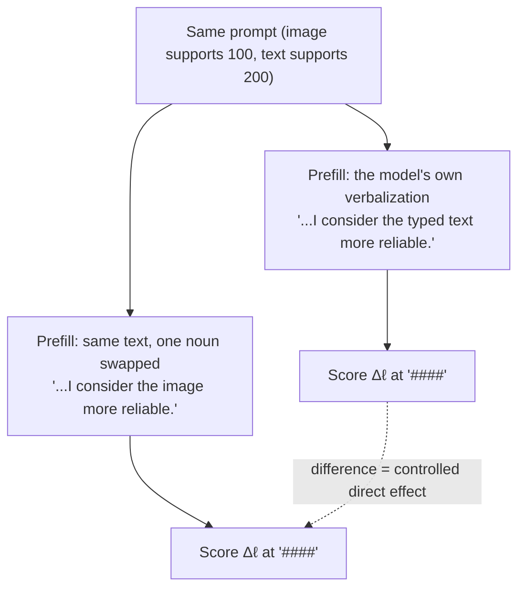
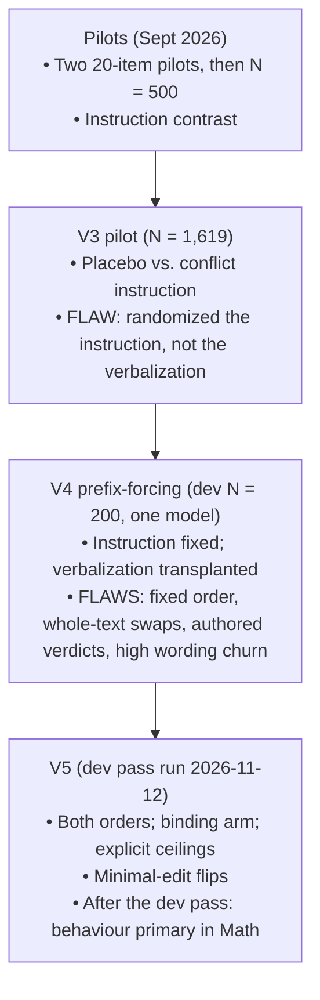
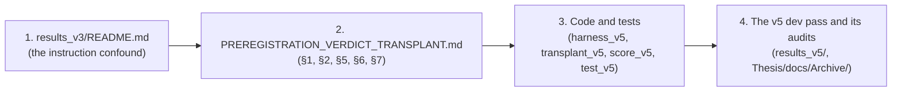

# Thesis Conceptual Foundation & Research Understanding FAQ
## *Does the Verdict Decide? Testing Whether Stated Source Reliability Steers Vision-Language Models under Image–Text Conflict*

> **Principal Researcher:** Mohammad Zahed Hossen (Technical Lead, Final-Year BSc CSE)
> **Target Horizon:** 2026–2027
> **Parent Field:** Multimodal / Vision-Language Learning and Systems (**FROZEN**)
> **Document Purpose:** A step-by-step conceptual reference, historical account and roadmap for the researcher, the defence committee and AI collaborators.
> **Status:** AI-generated (originally by Gemini 3.8 Flash), then audited line by line on 2026-11-11 against the code, the raw v4 dev rows, the pre-registration and the primary papers. It is a reference aid, **not ground truth**. Code and raw outputs in [`Experiment/`](../../../Experiment/) supersede it. The audit was done by an AI session inside this project; it is not an outside review.
> **Updated 2026-11-14** after the v5 dev pass (run 2026-11-12) and the pre-freeze decisions D1–D5 (2026-11-13). Changed passages are marked *[Updated 2026-11-14]*; the new material is in [Q4, part 6](#6-the-v5-dev-pass-and-the-pre-freeze-decisions-new-2026-11-14). v5 numbers are dev data on spent items, not findings.
> **Companion:** `Thesis Understanding FAQ (Opus 4.6).md` is the compact, citation-dense version. The two were harmonized in the same audit and share the numbers in [Q4, part 3](#3-audited-dev-numbers-shared-with-the-companion-faq).

---

### Epistemic Conventions & Trust Hierarchy

Following [`AGENTS.md`](../../../AGENTS.md) and [`CLAUDE.md`](../../../CLAUDE.md):
* `[Verified]`: checked against stored rows, code, or the paper itself.
* `[Inferred]`: a conclusion drawn from verified facts.
* `[Hypothesis]`: a testable claim awaiting the confirmatory run.
* `[Unknown]`: cannot be stated without new data.

#### Workspace Trust Hierarchy
1. **Raw rows:** [`Experiment/results_v5/`](../../../Experiment/results_v5/) (v5 dev pass, with manifests and gate reports), [`Experiment/results_v4/*.jsonl`](../../../Experiment/results_v4/), `Experiment/results_v3/full_experiment_results v3.0.json`.
2. **Code:** [`harness_v5.py`](../../../Experiment/harness_v5.py), [`transplant_v5.py`](../../../Experiment/transplant_v5.py), [`score_v5.py`](../../../Experiment/score_v5.py), [`analyze_v5.py`](../../../Experiment/analyze_v5.py).
3. **Design specification:** [`Docs/PREREGISTRATION_VERDICT_TRANSPLANT.md`](../../../Docs/PREREGISTRATION_VERDICT_TRANSPLANT.md) (draft, not frozen).
4. **Literature:** the primary PDFs in `Docs/Paper/`, then the dossier [`lit-dossier-verdict-transplant.md`](../../../Docs/Paper/lit-dossier-verdict-transplant/lit-dossier-verdict-transplant.md).
5. **Historical or stale:** AI-generated narratives in [`Docs/`](../../../Docs/) and legacy designs in [`Archive/`](../../../Archive/). READMEs can also go stale.

---

## Table of Contents

- [Module 1: The Core Scientific Paradigm & Task Mechanics](#module-1-the-core-scientific-paradigm--task-mechanics)
  - Q1: What is the scientific puzzle, and how does the task work step by step?
  - Q2: The thesis in plain English, the version history, and a reading roadmap
- [Module 2: Historical Evolution, Title Transition & Archival Audit](#module-2-historical-evolution-title-transition--archival-audit)
  - Q3: Old title vs. new title
  - Q4: How the research evolved, and what the model says vs. what it answers
  - Q5: Where the old title came from, and why the pilots could not test the question
  - Q6: Is the refined question a downgrade? What to do now
- [Module 3: Experimental Stimuli, Datasets, and Model Scale](#module-3-experimental-stimuli-datasets-and-model-scale)
  - Q7: Why GSM8K/SVAMP and ChartQA?
  - Q8: Why not build a new architecture?
  - Q9: Base paper, prompt engineering, and why a small model
- [Module 4: Open Risks, Repository Cross-Reference & Invariants](#module-4-open-risks-repository-cross-reference--invariants)

---

# Module 1: The Core Scientific Paradigm & Task Mechanics

---

### Q1: What is the core scientific puzzle, why is CoT faithfulness in question, and how does the task work step-by-step from first principles?

**Question context:**
*I want to understand the scientific puzzle from the ground up so I can lead the project and direct decisions.*

**Answer:**

#### Step 1: Why stated reasoning might not be the real reason
When a person says *"I took an umbrella because the sky was overcast"*, we assume the judgement came first and produced the action.

When a Vision-Language Model (VLM) such as `Qwen2.5-VL-3B-Instruct` writes a Chain-of-Thought (CoT), it produces tokens left to right, each conditioned on the ones before:
$$P(w_t \mid w_1, w_2, \dots, w_{t-1})$$

Later tokens *can* depend on earlier ones. Whether they do, for a particular kind of statement, is an empirical question. This is the **faithfulness** question studied by Lanham et al. (2023) and Turpin et al. (2023):
> Does the reasoning the model writes reflect what actually determines its answer, or would the answer have been the same without it?

```
       [ Input tokens ]
              │
              ▼
   ┌──────────────────────┐
   │      Transformer     │
   └──────────────────────┘
        │            │
        ▼            ▼
┌──────────────┐   ┌─────────────────────────────┐
│ Whatever else│   │ Written verdict:            │
│ drives the   │   │ "I consider the text more   │
│ answer       │   │  reliable"                  │
└──────────────┘   └─────────────────────────────┘
        │                        │
        │ this alone?            │ or does this contribute?
        ▼                        ▼
 ═══════════════════════════════════════════════
            FINAL ANSWER (#### 200)
 ═══════════════════════════════════════════════
```

#### Step 2: The conflict scenario
In ordinary benchmarks the image and the text agree. Here they are made to disagree:
* **Image:** shows a math problem, or a chart, supporting answer $A$ (say 100).
* **Typed text:** a different problem, or a report, supporting answer $B$ (say 200).

The answer the model gives shows which source it followed.

#### Step 3: The verdict
Asked to compare the sources first, the model writes a short verbalization that includes a reliability sentence, for example:
> *"The image and the typed text present different problems. I consider the typed text more reliable."*

It is natural to assume that this sentence is why the model then solves the text problem. **The thesis tests that assumption.**

#### Step 4: Testing it by intervention (what v5 actually does)
Observation cannot settle it: the sentence and the answer might both follow from something else. So we intervene on the sentence, using **prefix-forcing (prefilling)**:

1. **Donor stage.** The model generates freely under the non-binding instruction. Its own verbalization *v* is kept.
2. **`own` condition.** The same prompt is presented again, and the assistant turn is prefilled with *v*, unchanged.
3. **`flip` condition.** The same prompt, prefilled with *v* in which only the source noun phrases inside the reliability sentence are swapped ("typed text" ↔ "image").
4. **Measurement.** After the prefill and a forced `####`, the two candidate answers are teacher-forced and their length-normalized log-probabilities compared: Δℓ, image minus text. A generated answer is also recorded. *[Updated 2026-11-14]* Which of the two decides depends on the regime: in GSM8K/SVAMP the generated answer is primary and Δℓ secondary; in ChartQA-Conflict (exploratory) Δℓ is primary (pre-freeze D1). The flowchart below shows the Δℓ route.



How to read the outcome, carefully:
* **If reversing the verdict moves Δℓ toward the newly named source,** the forced verdict has a **controlled direct effect (CDE)** on the answer at that fixed instruction, order and wording.
* **If it does not,** that alone does not show the verdict is a rationalization. The instruction may dominate (which is why the binding arm exists), the prompt-level ceiling may be weak, or the wording noise may be too large to tell.

Three limits apply to either result ([prereg §1](../../../Docs/PREREGISTRATION_VERDICT_TRANSPLANT.md#L37-L44)):
* It is a **controlled direct effect**, not mediation and not a natural indirect effect.
* It is **off-policy**: a forced verdict is not one the model chose, so the effect may not transfer to free generation.
* It is a **population average** over items. It does not say what happens on any individual item.

#### Step 5: Pitfalls that shaped the design
1. **Instruction confounding (pilots and v3).** Changing the prompt from "solve" to "check for conflict and state reliability" changes the answer, but that is the effect of the instruction.
2. **Evidence order (a literature finding, not a v4 result).** With the instruction fixed, placing the image after conflicting text raised image-matching answers for `Qwen2.5-VL-3B` by +16.7 pp (GQA) and +15.0 pp (VQAv2) on natural images (arXiv:2609.26986, Table 1). v4 always put the image first and never varied order. *[Updated 2026-11-14]* The v5 dev pass did measure order: in Math, Δℓ favoured whichever source came last, by about 1.5 to 2.0 nats per token, and the models' own verdicts named the typed text almost always when it came first. v5 runs every item in both orders.
3. **Wording.** In v4 dev, two prefills with the same meaning changed the answer-source label on 23–25% of competent items. Any verdict effect has to be judged against that floor, and the intervention must be a **minimal edit** of the model's own sentence.
4. **Competency.** If the model cannot solve the image problem alone, or the text problem alone, its answer under conflict says nothing about source choice. Analysis is restricted to items it solves both ways.

#### Step 6: The four levers
1. **Stimulus:** evidence conflict with a correct source (ChartQA-Conflict) vs. task-selection conflict with none (GSM8K/SVAMP).
2. **Instruction:** non-binding vs. binding (*"Then solve only the problem from the source you named as more reliable, and ignore the other problem."*), read against explicit single-source ceilings.
3. **Outcome:** the Δℓ margin at `####` vs. the parsed generated answer. Which one is primary depends on the regime (D1).
4. **Decision rule:** pre-registered criteria, including an equivalence test that becomes uninterpretable if the wording floor is too high.

---

### Q2: Can you explain the thesis in plain English, how the versions evolved, and what to read in what order?

**Answer:**

#### 1. The thesis in plain English
When a VLM faces an image and a text that disagree, it can be asked to say which it trusts more before answering. The thesis asks whether that statement matters to the answer. It holds the prompt fixed, reverses the model's own statement with a one-noun edit, and measures whether the answer moves, with and without an instruction telling the model to act on its statement.

#### 2. How the versions evolved

> **Correction from the audit:** earlier versions of this FAQ described a "V2 stimulus layer". There is no such stage. "-v2" is part of the Hugging Face dataset names. In the repository, v1 and v2 are two 20-item pre-freeze pilots (`Experiment/archive/pilots_v1_v2/`), and a 500-item production run is stored in `Archive/Experiment_History/`. [Verified]



* **Stimuli (all stages):** from *Which Source Wins?* (Ghosh, Gupta & Wang, [arXiv:2608.17205](https://arxiv.org/abs/2608.17205)).
* **V3 (N = 1,619):** v3's "visual" label fell from 89.5% to 25.8% between the placebo and conflict instructions, a 63.7 pp shift (95% interval 59.4 to 68.0). The re-analysis ([`results_v3/README.md`](../../../Experiment/results_v3/README.md)) established that only the instruction was randomized. It also found 38 abstentions (2.3%), not 13.65%, and that 98.1%, 37.6% and 44.2% of outputs in Arms 1–3 hit the token cap. [Verified]
* **V4 (dev, N = 200, Qwen2.5-VL-3B):** prefix-forcing implemented in [`harness_v4.py`](../../../Experiment/harness_v4.py) and `transplant_v4.py`. Its main contrasts swap whole verbalizations, which confounds length, content and verdict. Evidence order was fixed.
* **V5:** implemented in [`harness_v5.py`](../../../Experiment/harness_v5.py) and specified in the [pre-registration](../../../Docs/PREREGISTRATION_VERDICT_TRANSPLANT.md). *[Updated 2026-11-14]* The dev pass ran on 2026-11-12 (29,880 rows, dev only) and led to the pre-freeze decisions D1–D5 (Q4, part 6).

#### 3. Reading roadmap



1. **The turning point.** Read [`Experiment/results_v3/README.md`](../../../Experiment/results_v3/README.md). Understand why a 63.7 pp shift between two instructions says nothing about the verbalization.
2. **The specification.** Read the [pre-registration](../../../Docs/PREREGISTRATION_VERDICT_TRANSPLANT.md), §1, §2, §5, §6 and §7.
3. **The code.** Read [`harness_v5.py`](../../../Experiment/harness_v5.py), [`transplant_v5.py`](../../../Experiment/transplant_v5.py) and [`score_v5.py`](../../../Experiment/score_v5.py). Run the tests from the repository root:
   ```bash
   python -B -m unittest discover -s Experiment/tests
   ```
4. **The dev pass and the freeze.** *[Updated 2026-11-14]* The dev pass has run (`Experiment/results_v5/`, audited in `Thesis/docs/Archive/`). What remains before the freeze is listed in Q6, part 3.

---

# Module 2: Historical Evolution, Title Transition & Archival Audit

---

### Q3: What is the exact difference between the old title and the new title?

**Answer:**

#### 1. Side by side

| Dimension | Old: *Causal Conflict Verbalization and Source Arbitration in VLMs* | Current: *Does the Verdict Decide? …* |
| :--- | :--- | :--- |
| **Positioning** | Reads like a system or a general account of arbitration. | One empirical, pre-registered question about CoT faithfulness. |
| **Manipulated variable** | The user instruction ($Z$): ask for a conflict check or not. | The verdict sentence ($M$), by prefix-forcing, at fixed instruction, order and wording. |
| **Estimand** | The effect of the instruction on source choice. It was randomized, so it is a valid effect, but of the instruction. | The **controlled direct effect** of reversing the verdict, scaled against an explicit single-source ceiling ($\rho_{\text{bind}}$). Since D1, read on the behavioural answer in Math and on Δℓ in ChartQA. |
| **Construct** | "Conflict detection", "abstention", "arbitration". | Whether the stated reliability verdict changes the answer when reversed. |
| **Possible outcomes** | Not specified in advance. | A seven-row decision table (prereg §2.2): undetermined, two H₁ rows, graded equivalence only, H₀, mixed, inconclusive. In Math it is read on the behavioural answer (prereg §2.3). |

#### 2. What was wrong with the old title
1. **"Causal Conflict Verbalization":** the verbalization was never manipulated. The instruction was.
2. **"Source Arbitration":** in GSM8K/SVAMP both sources are valid problems. There is nothing to arbitrate on reliability grounds. That framing fits only ChartQA-Conflict, which is exploratory since D4, so the confirmatory claims are about source following only.
3. **Claims that did not hold:** "visual capture reversal" and "13.65% abstention". The re-analysis found Arm 1 was 13.8% visual and abstention was 38 items (2.3%) ([`results_v3/README.md`, lines 37–38](../../../Experiment/results_v3/README.md#L37-L38)). [Verified]

#### 3. What the new title commits to
1. **"Does the Verdict Decide?"** — one sentence in the model's output, and whether reversing it moves the answer.
2. **"Stated Source Reliability"** — the surface statement, not an internal belief. The study edits output tokens; it does not read or edit internal states.
3. **"under Image–Text Conflict"** — the domain.

---

### Q4: How did the research evolve, and what is the gap between what the model says and what it answers?

**Answer:**

#### 1. The phases

```
┌────────────────────────────────────────────────────────────────────────────────────────┐
│ Phase A (20 Sept 2026): Archive/VLM/Canonical_Cross_Modal_Thesis_Synthesis.md           │
│ • Question: does verbalizing the contradiction change the decision, or is it a          │
│   post-hoc rationalization?                                                             │
│ • Planned contrasts: conflict prompt vs. length-matched placebo (the stated H1/H0       │
│   prediction), plus a "Lanham-style" prefill of an authored contradiction statement.    │
└──────────────────────────────────────────┬─────────────────────────────────────────────┘
                                           ▼
┌────────────────────────────────────────────────────────────────────────────────────────┐
│ Phase B & C (pilots and v3): instruction contrast (20 + 20, 500, then 1,619 items)      │
│ • v3: visual label 89.5% → 25.8% (63.7 pp) between placebo and conflict instructions.  │
│ • Limit: the instruction was randomized, not the verbalization.                        │
│ • Token cap hit by 98.1% / 37.6% / 44.2% of Arms 1–3.                                   │
└──────────────────────────────────────────┬─────────────────────────────────────────────┘
                                           ▼
┌────────────────────────────────────────────────────────────────────────────────────────┐
│ Phase C′ (v3 re-analysis): overclaims withdrawn                                         │
│ • Abstention 2.3% (38 items), not 13.65%. "Visual capture reversal" not supported.      │
│ • An instruction contrast cannot separate faithfulness from rationalization.           │
└──────────────────────────────────────────┬─────────────────────────────────────────────┘
                                           ▼
┌────────────────────────────────────────────────────────────────────────────────────────┐
│ Phase D (v4 dev, N = 200, one model): prefix-forced transplants                         │
│ • Instruction fixed; verbalizations transplanted into the assistant turn.              │
│ • Limits: image always first, whole-text swaps, authored verdicts, high wording churn. │
└──────────────────────────────────────────┬─────────────────────────────────────────────┘
                                           ▼
┌────────────────────────────────────────────────────────────────────────────────────────┐
│ Phase E (v5): dev pass run 2026-11-12; pre-freeze decisions D1–D5 on 2026-11-13         │
│ • Both orders, minimal-edit flips, binding arm, single-source ceilings.                │
│ • Primary outcome: behaviour in Math, Δℓ at "####" in ChartQA (D1).                     │
└────────────────────────────────────────────────────────────────────────────────────────┘
```

#### 2. Five points about the history
1. **The rationalization question was the founding question.** The September specification asks whether the explanation *"merely act[s] as a post-hoc rationalization of an entrenched modality preference"* (§12, line 347). [Verified]
2. **But the September plan's own main prediction was an instruction contrast** (conflict prompt vs. placebo, lines 350–353). The pilots and v3 largely ran what was planned. The weakness was in the plan, and the re-analysis exposed it. Prefix-forcing was not invented here either: the plan listed a "Lanham-style" prefill, and CoT-Mediate (arXiv:2607.27304) prefix-forces edited CoT. What is new in v5 is the specific target (the model's own reliability verdict, minimally edited) and the binding arm. [Verified for the archive; novelty boundary per prereg §1.1]
3. **The assumed prior was wrong.** Early documents spoke of "default visual capture". In v3, Arm 1 was 13.8% visual. In v4 dev with no verdict requested, 63–68% of answers matched the text problem. [Verified; dev only]
4. **The v3/v4 prompt opening was not neutral.** It read "Look at the image and read the typed text below" ([`harness_v4.py`, line 60](../../../Experiment/harness_v4.py#L60)) and ended "Then solve the problem". The v5 templates name both sources symmetrically ([`harness_v5.py`, lines 57–109](../../../Experiment/harness_v5.py#L57-L109)). That the old wording pushed the model toward the text is [Inferred].
5. **The model's own verdict almost always names the text.** 94 of the 96 parseable verdicts on competent dev items. This is why the estimand is "reversing the model's own verdict" rather than "image verdict vs. text verdict".

#### 3. Audited v4 dev numbers (shared with the companion FAQ)

All of this is **v4 dev data: one model (Qwen2.5-VL-3B), 200 GSM8K/SVAMP items, image always first, authored verdicts, heuristic labels not yet validated by human coding.** It is for tuning. None of it is a finding. Recomputed on 2026-11-11 from `results_v4/dev2_qwen25.jsonl` and `dev2_transplant_qwen25.jsonl` with `score_v4.py`.

| Quantity | Value |
|:---|:---|
| Competency-passing items (both single-source arms correct) | 110 of 200 |
| Own verdicts on those 110 (`conflict_full`) | 94 name the text, 2 the image, 14 have no parseable verdict |
| → as shares | 94/96 = 97.9% of parseable verdicts; 94/110 = 85.5% of competent items |
| Own verdicts on all 200 | 178 text, 4 image, 18 none → 178/200 = 89.0%; 178/182 = 97.8% of parseable |
| Answers on the 94 text-verdict items (same rows) | 61 text (64.9%), 19 image (20.2%), 14 neither (14.9%) |
| Text answers with no verdict requested, all 200 | `direct` 63.0%, `direct_v3` 68.0% |

Authored-verdict and wording contrasts:

| Instruction | Contrast | Δ image answers (110 competent) | Items whose answer-source label changes (110) | Same contrast on all 200 |
|:---|:---|:---|:---|:---|
| Neutral (z0) | verdict: `rel_image` vs. `rel_text` | **+20.9 pp** | 35.5% | +21.0 pp |
| Neutral (z0) | wording: `eq_a` vs. `eq_b` | +7.3 pp | 24.5% | answer changed in 39.0% |
| Conflict (z1) | verdict: `rel_image` vs. `rel_text` | **−1.8 pp** | 7.3% | +0.5 pp |
| Conflict (z1) | wording: `eq_a` vs. `eq_b` | −1.8 pp | 22.7% | answer changed in 33.0% |

**On "89%", "~95%" and "98%" in older notes:** 89.0% is 178 of all 200 items. 97.9% is 94 of the 96 competent items with a parseable verdict. "~95%" matches neither and should not be used.

**On the "22.7% to 39%" wording range:** these are two different measures (label change on 110 items vs. answer change on 200 items). Do not quote them as one range without saying so.

#### 4. Saying vs. answering: what dev shows and does not show
* **Says:** on competent items with a parseable verdict, the model names the text in 94 of 96.
* **Answers, on those same 94 responses:** text problem 64.9%, image problem 20.2%, neither 14.9%.

So stated verdict and answer do not line up one to one in free generation. That is an observation on dev data with unvalidated labels. It does **not** demonstrate that the verdict is causally inert, and it does not demonstrate that the model's "internal state" differs from its statement. It motivates the intervention; it does not replace it.

> An earlier version of this FAQ called this "a critical empirical discovery" that "directly demonstrates" a decoupling, and said the model "solves the visual problem over 30% of the time". The comparison mixed two different prompts and counted "not text" as "image". Corrected above.

#### 5. Three accounts and what the v5 design can say about each

| Account | What it claims | What would support it in v5 |
| :--- | :--- | :--- |
| **The verdict decides (H₁)** | Under binding, reversing the verdict moves the answer by a substantial fraction of what an explicit instruction does. | The 90% CI of ρ_bind wholly above 0.25, with a ceiling whose 95% CI excludes 0; T1 (DiD > 0) only qualifies the reading. In Math, the same on the behavioural answer, with `flip − own` and the matched template pair agreeing (prereg §2.3). |
| **Saying is not choosing (H₀)** | The model follows an explicit source instruction but not its own reversed verdict, even when told to act on it. | 90% CI of ρ_bind wholly inside (−0.25, 0.25) **and** behavioural TOST equivalence at 5.0 pp, with a working ceiling and a wording-floor gate that passes. In Math, read on the behavioural answer. |
| **Instruction dominance** | Without binding, the instruction fixes which problem is solved and leaves the verdict no room. | A small effect without binding (T3) together with a larger one under binding. This is a reason a non-binding null is not evidence of unfaithfulness; it is not a separate pre-registered hypothesis. |

Other outcomes are pre-registered too: **graded equivalence only** (the wording floor fails), **mixed** (the two criteria disagree), **inconclusive** (the CI straddles a bound) and **undetermined** (the ceiling's CI includes 0). See [prereg lines 92–105](../../../Docs/PREREGISTRATION_VERDICT_TRANSPLANT.md#L92-L105). There is no separately named "H_equiv"; H₀ is the equivalence hypothesis.

#### 6. The v5 dev pass and the pre-freeze decisions *[New 2026-11-14]*

All of this is **v5 dev data**: spent development items (200 GSM8K/SVAMP, 30 ChartQA), one run per model on an NVIDIA L4 in `bfloat16` on 2026-11-12, below the minimum sample, and with verdict labels not yet checked by human coders. It is for tuning and for the freeze record. None of it is a finding. Sources: `Experiment/results_v5/` (rows, manifests, gate reports), `Experiment/results_v5/analysis_dev/analysis_v5.md` (analysis, 2026-11-14), and the audits in `Thesis/docs/Archive/`. [Verified against the rows]

**What survived each filter** (competency under the `structured` parser, then the edit gates as run in the dev pass):

| Model | GSM8K/SVAMP (200 items) | ChartQA-Conflict (30 items) |
|:---|:---|:---|
| Qwen2-VL-2B | 0 competent: it never writes `####` (0 of 1,200 Math generations) | 10 competent, 0 pass the gates |
| Qwen2.5-VL-3B | 80 competent, 80 pass | 13 competent, 6 pass |
| Qwen2.5-VL-7B | 124 competent, 115 pass | 13 competent, 2 pass; both state an answer before the verdict |

**What the dev pass showed about the two outcomes** (binding instruction unless stated):

| Quantity | Qwen2.5-VL-3B Math | Qwen2.5-VL-7B Math |
|:---|:---|:---|
| Δℓ sign matches the answer the model then solves (strict parser) | 51.6% | 56.6% |
| … what always guessing the commoner answer source would score | 55.2% | 75.9% |
| Δℓ's ability to separate image from text answers within one evidence order (AUC, across parsers) | 0.53–0.56 | 0.68–0.76 |
| Δℓ effect of flipping the verdict (`flip − own`) | 0.233 | 1.619 |
| … of which deleting the own verdict alone (`none − own`) | 0.137 | 1.515 |
| … and adding the flipped one (`flip − none`) | 0.096 | 0.103 (95% CI −0.09 to 0.29) |
| Behaviour: answers following the reversed verdict, `flip − own` (structured parser, k = 1) | +49.4 pp | +43.9 pp |
| Behaviour: matched template pair, `para_flip − para` | +63.7 pp | +64.3 pp |
| Explicit-instruction benchmark B_beh (§2.3 of the prereg; image / text direction) | 0.48 (0.46 / 0.51) | 0.69 (0.62 / 0.76) |
| ρ_beh under binding (`flip − own` ÷ B_beh; descriptive only, can exceed 1) | 1.02 | 0.64 |
| Replay noise: the own verdict regenerated unchanged, answer flips image↔text | 3.2% | 1.1% |

How to read this, without overclaiming:

1. **In Math, Δℓ at `####` mostly did not measure the answer.** It is read before the model has done any arithmetic. For 3B it predicted the eventual answer no better than guessing; for 7B it carried some signal once evidence order was held fixed. Δℓ mainly followed evidence order: it favoured whichever source came last by about 1.5 to 2.0 nats per token. [Verified, dev only]
2. **In 7B Math, the Δℓ effect was mostly the removal of the model's own verdict**, not attraction to the reversed one. A clean template sentence naming the other source did move Δℓ (`para_flip − none` = 0.72). [Verified, dev only]
3. **Behaviourally, the reversed verdict moved answers a lot**, in both models and under both instructions. That is a dev observation on spent items below the minimum sample. It is not evidence for H₁. [Verified as a number; not a finding]
4. **Strict `####` parsing hid most of 7B's answers.** After a prefilled verbalization, 7B ended with "The final answer is X." instead of `#### X` in 58% of generations, so 62.7% of its behavioural rows scored as "neither" under the strict parser. The `structured` parser brings that to 22.2%. [Verified]
5. **The behavioural `none` arm is not a no-verdict condition.** Given only the first sentence, the model usually writes a verdict of its own before solving (in 58–99.6% of rows, depending on model and instruction). So the behavioural deletion/insertion split is descriptive only. [Verified]
6. **Evidence order matters, in two different ways.** The models' stated verdicts named the typed text almost always when it came **first** (3B 199/200, 7B 200/200), while Δℓ favoured the source that came **last**. Counterbalancing was needed. [Verified]

**Pre-freeze decisions D1–D5 (approved 2026-11-13; written into the prereg on 2026-11-13 and made consistent on 2026-11-14):**

| Decision | What it says | Consequence for the claims |
|:---|:---|:---|
| **D1** | In GSM8K/SVAMP the behavioural answer (k = 1) is the primary outcome; Δℓ is secondary there. In ChartQA, Δℓ stays primary. | The Math result is about the answer the model gives, read through the decision rule in prereg §2.3: the behavioural Δ itself against ε = 5 pp, with an explicit-instruction benchmark as a manipulation check (revised 2026-11-14). |
| **D2** | The matched template pair (`para_flip − para`) is co-primary with `flip − own`; the deletion/insertion split is reported. | A Math claim needs both contrasts to agree. The behavioural split is descriptive only (point 5 above). |
| **D3** | The `structured` parser (`####`, else "the final answer is X" or `\boxed{X}`) is used for competency and behaviour, with strict and lenient reported beside it. Qwen2-VL-2B is diagnostic only. | Two confirmatory models, both Qwen2.5-VL (3B and 7B). No claim about the older generation. |
| **D4** | ChartQA-Conflict is exploratory. | The only confirmatory regime is GSM8K/SVAMP, where neither source is wrong: confirmatory claims are about **source following**, not reliability judgement. |
| **D5** | Wording churn counts image↔text flips among comparable answers. *Revised 2026-11-14:* the limit is a fixed 5 pp (the replay-noise clause was dropped), and a neither shift within ±10 pp is added. | On dev the gate passed under binding for both models (3B's signed mean −4.4 pp is near the limit) and failed under non-binding for both. |

**Still open before the freeze:** human coding of verdict labels (`Experiment/coding_v5/`); the ChartQA `max_pixels` comparison (prereg §3.4, R8.4); a short GPU check that the new `verdict_nll` span is exact; the ChartQA render check, which the dev pass skipped. Also known: the Math primary outcome rests on template k = 1 only.

---

### Q5: Where did *"Causal Conflict Verbalization and Source Arbitration"* come from, and why could the pilots not test the question?

**Answer:**

#### 1. Origin: 20 September 2026
[`Archive/VLM/Canonical_Cross_Modal_Thesis_Synthesis.md`](../../../Archive/VLM/Canonical_Cross_Modal_Thesis_Synthesis.md), line 159, heads the chosen question:
> **"RQ 1: Causality of Conflict Verbalization in Cross-Modal Decision Arbitration"**

This is an AI-generated planning document, not a registration. It set out two competing explanations (lines 164–165):
* **Deliberative Arbitration:** writing out the conflict changes how the model uses both modalities and updates the answer.
* **Post-Hoc Rationalization:** the answer is already fixed; the verbalization is commentary that does not change it.

(The mechanisms it attached to these, "cross-attention" and "early-layer projection dynamics", were speculation. Nothing in this project measures them.)

#### 2. Why the pilots and v3 could not test it
The plan's stated prediction (lines 350–353) compared a **conflict-detection instruction** with a **length-matched placebo instruction**. The pilots and v3 ran that comparison. When answers shifted, early reports said conflict verbalization causes the shift.

**The flaw:** what was manipulated was the user-turn instruction. An instruction effect shows the model responds to instructions. It cannot show whether the words the model then writes do any work.

```
WHAT THE PILOTS AND V3 TESTED (effect of the instruction):
Instruction A ("solve")                        ──► answers
Instruction B ("check for conflict, then solve") ──► different answers
Conclusion available: the instruction matters.

WHAT V5 TESTS (effect of the verdict text at a fixed instruction):
Same prompt + prefill [model's own verdict]          ──► Δℓ
Same prompt + prefill [same verdict, source swapped] ──► Δℓ
Question: does the margin move toward the newly named source?
```

v3 did include a prefill arm (Arm 4), but it confounded the rationale with the source, and its image-match rate was near chance ([`results_v3/README.md`, line 42](../../../Experiment/results_v3/README.md#L42)). [Verified]

---

### Q6: Did the change downgrade my thesis? Is the new question less valuable than building an arbitration framework? What should I do now?

**Answer:**

#### 1. Narrowing is not downgrading
Moving from a broad proposal with a confounded contrast to one controlled question is ordinary research practice. The gain is that the new design can fail in specified ways, and each failure has a pre-registered reading.

#### 2. Comparing the two as a reviewer might

| Dimension | Earlier proposal | Current investigation |
| :--- | :--- | :--- |
| **Validity** | The main contrast differs in instruction; no single-source ceilings; fixed order; 37–98% of outputs truncated in v3. | Pre-registered; instruction fixed within each contrast; both orders; minimal edits; ceilings; margin scoring. |
| **Likely objection** | "This shows the model follows instructions." | "A forced verdict is off-policy"; "two small models"; "the wording floor is high". These are answerable and are listed in Module 4. |
| **Literature position** | Among many prompting studies. | An extension of CoT-intervention work (Lanham et al.) to a multimodal source-reliability verdict, next to CoT-Mediate. |
| **Feasibility** | — | Inference only, on one Colab GPU (an L4 in the dev pass). The local machine has no CUDA and is for editing, tests and analysis. |

How reviewers would actually judge either version is not something this document can know.

#### 3. Action plan
1. **Tell the history straight.** A thesis that shows why the instruction contrast failed and what replaced it is stronger than one that hides the path.
2. **The v5 dev pass has run** (2026-11-12) and has been audited. *[Updated 2026-11-14]*
3. **The pre-freeze decisions D1–D5 have been made** (Q4, part 6), and the pre-registration was made consistent with them on 2026-11-14.
4. **Still to do before the freeze:** human coding of verdict labels (`Experiment/coding_v5/`); the ChartQA render check and the `max_pixels` decision (prereg §3.4); a short GPU check that the new `verdict_nll` span is exact.
5. **Freeze** the pre-registration (commit, tag `prereg-v5`), then run the confirmatory pass.

---

# Module 3: Experimental Stimuli, Datasets, and Model Scale

---

### Q7: Why GSM8K/SVAMP and ChartQA? Is the dataset broken? What if we switch?

**Answer:**

#### 1. Where the stimuli come from
*Which Source Wins? Task-Dependent Reliance in Vision–Language Models* (Ghosh, Gupta & Wang, [arXiv:2608.17205](https://arxiv.org/abs/2608.17205)) [Verified against the paper and the Hub]:
1. **Task-selection conflict** (`vlm-modality-research/modality-conflict-arbitration-v2`): the rendered image of problem *i* paired with the typed text of problem *(i+1) mod N*. The Hub split `train` has 13.0K rows across degradation levels and channels. Filtered to clean image-channel rows there are 1,304 GSM8K and 296 SVAMP distinct-answer pairs. 200 are spent as dev.
2. **Evidence conflict** (`vlm-modality-research/chartqa-evidence-conflict-v2`, split `test`): an original ChartQA chart paired with a reviewed counterfactual report that supports a different answer to the same question. The paper analyses 229 items.

> **229 vs. 230 (resolved):** the pinned release has 230 rows. *Which Source Wins?* excluded `conflict_id` 45 after an audit; `harness_v5.chartqa_analysis_set` drops it and checks both counts, so 229 items are analysed (30 dev, 199 confirm). [Verified, Hub and code, 2026-11-13]

#### 2. Why they suit this design
* Every item carries **two known candidate answers**, one per source. The response shows which source was followed, and a margin between the two candidates can be scored at `####`.
* GSM8K/SVAMP answers are numbers. ChartQA answers are **not all numbers** (labels and yes/no occur), so v5 uses a typed normalizer and a strict parser (prereg §4.4).
* Scoring needs no judge model.

Free-form VQA does not make margin scoring impossible: Barua et al. (arXiv:2610.19407) score candidate-answer log-odds on DocVQA, VQAv2 and RealworldQA. It does require a pair of candidate answers per item.

#### 3. Why math conflicts are "source following"
In ChartQA-Conflict the chart is the original evidence and the report is counterfactual, so asking which source is more reliable has an answer. In GSM8K/SVAMP both problems are valid, and neither source is wrong. Results there are described as **source following**, never as reliability judgement (prereg §3.1). Calling it "arbitration" in early drafts was a framing error.

#### 4. Known limitation of ChartQA-Conflict
The report states the value; the chart must be read. Text is likely to be the stronger evidence for that reason alone. Barua et al. measured a 1.4–3.8× text advantage on clean inputs in their datasets (pp. 7–8); that number is cited by analogy and was not measured on ChartQA-Conflict.

#### 5. What switching would cost
Not a broken method, but new work: new conflict pairs with two candidate answers each, a new competency pass, a new dev pass, and loss of the link to the published stimuli. That link is itself limited: *Which Source Wins?* tested Qwen2-VL-2B and Qwen2.5-VL-**7B**, not the 3B model, and used "Source A/B" labels that v5 drops.

---

### Q8: Why am I not building a new architecture? Isn't an engineering system higher value?

**Answer:**

#### 1. Building vs. measuring
A new architecture is not automatically worth more than a careful measurement. They answer different questions.

#### 2. Compute
The project runs inference on one Colab GPU (an NVIDIA L4, about 22.5 GiB, in the dev pass). Training a competitive VLM is far outside that. Inference-only experiments on open-weight models are within it.

#### 3. Precedents (checked against the papers)
* **Lanham et al. (2023), *Measuring Faithfulness in Chain-of-Thought Reasoning*** (arXiv:2307.13702): truncated, corrupted, paraphrased and replaced CoT, and found "large variation across tasks in how strongly [models] condition on the CoT", "sometimes relying heavily on the CoT and other times primarily ignoring it". No new model.
* **Turpin et al. (NeurIPS 2023), *Language Models Don't Always Say What They Think*** (arXiv:2305.04388): added biasing features to inputs; accuracy fell by up to 36% while the explanations did not mention the bias. No new model.

(An earlier version listed a third paper, "Seeing Without Looking (2026)". It was not checked in this audit and has been removed.)

#### 4. Diagnosis informs design
Knowing whether a stated verdict carries decision weight is useful before building anything that relies on such statements. A result here would be evidence about two small models on two datasets. It would not by itself establish that architectural change is needed.

---

### Q9: Is *Which Source Wins?* the base paper? Am I just doing prompt engineering? Why a small model?

**Answer:**

#### 1. Testbed vs. foundation
* **Testbed:** *Which Source Wins?* provides the stimuli. It studies how preference shifts as one source is degraded. Its arithmetic prompts ask for step-by-step solving, but its primary margin is scored "with no chain-of-thought, so the margin measures direct-answer preference, not reasoning-trace attribution" (p. 5). It does not analyse faithfulness. [Verified]
* **Foundation:** the CoT-faithfulness literature. Lanham et al. (2023) for intervening on the CoT; Turpin et al. (2023) for the motivation; CoT-Mediate (arXiv:2607.27304) as the closest method.
* **Ceiling baseline:** Dassen et al., *Grounding on Request* (arXiv:2610.33841), find natural-language modality requests give weak control, especially for image requests. They do not prefix-force any model text. The explicit-source arms replicate that baseline and are not claimed as new.

#### 2. Instruction contrast vs. prefix-forcing

```
INSTRUCTION CONTRAST:
User prompt [changed]  ──►  model output [observed]
(Effect of the instruction.)

PREFIX-FORCING:
User prompt [fixed within the contrast]
       │
       ▼
Start of the assistant turn [set by the experimenter: the model's own text, minimally edited]
       │
       ▼
Margin at "####" / continuation [measured]
(Controlled direct effect of that text.)
```

In Pearl's notation the prefill is treated as $do(M = m)$. Two cautions: it edits **output tokens**, not internal representations, so it is a behavioural intervention and not mechanistic interpretability; and the binding and non-binding arms differ in instruction by design, so the verdict contrast is always made within one arm.

#### 3. Why a ~3B model
1. **The method needs continuation scoring after a forced prefix.** *Which Source Wins?* reports that GPT-5.6-Luna, Gemini-3.5-Flash and InternVL2-8B "lack the continuation-scoring interface the CLL margin requires" (§3.1). Open weights provide it. [Verified]
2. **The model can do the single-source tasks, most of the time.** On v4 dev it solved 72.8% of problems from the image alone and 75.4% from the text alone (195 distinct problems); 110 of 200 items passed both. *[Updated 2026-11-14]* In the v5 dev pass (`structured` parser), Math competency was 80/200 for Qwen2.5-VL-3B, 124/200 for Qwen2.5-VL-7B and 0/200 for Qwen2-VL-2B, which never writes `####`.
3. **Size and faithfulness.** Lanham et al. report that larger, more capable text LLMs produced less faithful reasoning on most of their tasks (13B vs. 175B). That finding is Lanham's, not Turpin's. To investigate whether this extends to modern VLMs without confounding architecture generations, this thesis evaluates the **Qwen Triad**: two compact models (2B and 3B) plus a flagship 7B model. While three models across two generations cannot establish a general scaling law, comparing `Qwen2.5-VL-3B` against `Qwen2.5-VL-7B` provides a clean, within-generation size comparison on the intersection of competent items.

| Model | Pinned revision | Parameters (Hub) | Role |
|:---|:---|:---|:---|
| `Qwen/Qwen2.5-VL-3B-Instruct` | `66285546d2b821cf421d4f5eb2576359d3770cd3` | 3,754.6M | Confirmatory (workhorse) |
| `Qwen/Qwen2.5-VL-7B-Instruct` | `cc594898137f460bfe9f0759e9844b3ce807cfb5` | 8,292.2M | Confirmatory (flagship, matches *Which Source Wins?*) |
| `Qwen/Qwen2-VL-2B-Instruct` | `895c3a49bc3fa70a340399125c650a463535e71c` | 2,209.0M | Diagnostic only (D3): no Math item passed competency in the dev pass |

Pins: [`harness_v4.py`, lines 45–50](../../../Experiment/harness_v4.py#L45-L50). The "3B" model has about 3.75B parameters. [Verified, Hub, 2026-11-11]

---

# Module 4: Open Risks, Repository Cross-Reference & Invariants

---

### Open risks and possible negative outcomes

1. **The wording floor may make the behavioural equivalence test uninterpretable.** *[Updated 2026-11-14]* The gate (prereg §7.6) needs the `own` vs. `para` signed mean within ±5.0 pp and the image↔text churn at most 5% and the shift in "neither" answers within ±10 pp; the limits are fixed (revised 2026-11-14). On dev, with the `structured` parser, it passed under binding for both Qwen2.5-VL models (3B's signed mean was −4.4 pp, close to the limit) and failed under non-binding for both. If it fails at confirmation, "saying is not choosing" cannot be claimed for that model. ε is never widened.
2. **The ceiling may be too weak.** If the explicit arms do not move Δℓ, the result is "undetermined".
3. **A failed manipulation check blocks the unfaithfulness reading.** If binding does not raise verdict-following in free generation, a null under binding cannot be read as unfaithfulness (prereg §7.5).
4. **No correct source in GSM8K/SVAMP.** Source following only. *[Updated 2026-11-14]* Since D4 it is the only confirmatory regime.
5. **Direction is aliased with editing** (about 98% of own verdicts name the text). The `para` / `para_flip` pair is the check, as a secondary analysis.
6. **Verdict labels are unvalidated** until two coders have coded about 200 items.
7. **Off-policy and average effects only** (Q1, Step 4).
8. **Sample size.** *[Updated 2026-11-14]* Math needs at least 150 items after the gates. Dev rates (3B: 40% competent, all of those passing the gates; 7B: 62% competent, 93% passing) suggest the confirm pool can supply that for both Qwen2.5-VL models. ChartQA cannot reach 100 items at dev rates for any model, which is one reason it is exploratory (D4). Qwen2-VL-2B has no competent Math items under the current parser and is diagnostic only (D3).
9. **The margin and the generated answer disagree in Math.** *[Updated 2026-11-14]* Measured on dev: Δℓ's sign matched the answer in 51.6% (3B) and 56.6% (7B) of cases, below a majority-class guess. This is why behaviour is primary in Math (D1). *Which Source Wins?* reports 75.4% agreement on its own setup (p. 5); its margin is not comparable.
10. **Scope.** Two Qwen2.5-VL sizes (3B and 7B) confirmatory, one regime confirmatory, English. *[Updated 2026-11-14]*
11. **One template carries the Math primary outcome.** *[New 2026-11-14]* Behaviour is generated for k = 1 only (prereg §6.2), so the four-template robustness of Δℓ does not extend to it.
12. **The behavioural `none` arm regenerates a verdict**, so the behavioural deletion/insertion split cannot separate deleting the verdict from replacing it (prereg §7.5). *[New 2026-11-14]*
13. **ChartQA is too small and leaks answers.** *[New 2026-11-14]* Dev kept 6 and 2 items, and its donors often state an answer before the verdict; `max_pixels` for ChartQA is still open (prereg §3.4).

### Repository asset directory

| File / path | Trust level | Role |
| :--- | :--- | :--- |
| [`Experiment/harness_v5.py`](../../../Experiment/harness_v5.py) | **Ground truth** | Order-counterbalanced prompts, K = 4 literal templates, base and donor stages, margin scoring backend. |
| [`Experiment/transplant_v5.py`](../../../Experiment/transplant_v5.py) | **Ground truth** | Minimal-edit variants, edit gates, cell grid, transplant run. |
| [`Experiment/score_v5.py`](../../../Experiment/score_v5.py) | **Ground truth** | `stated_reliable_source`, strict answer parsing, margin math. |
| [`Experiment/analyze_v5.py`](../../../Experiment/analyze_v5.py) | **Ground truth** | T1 sign-flip test, ρ with bootstrap CI, TOST, floors, readings, lme4 export, plus (since 2026-11-14) the Math behavioural decision rule and the Δℓ–behaviour validity check. Run on the v5 dev rows (`results_v5/analysis_dev/`). |
| [`Experiment/tests/`](../../../Experiment/tests/) | **Ground truth** | CPU tests; all pass as of this audit. |
| [`Experiment/results_v5/`](../../../Experiment/results_v5/) | **Ground truth (rows)** | v5 dev pass, 2026-11-12: 29,880 rows over three models and two regimes, with manifests and gate reports. Tuning only. |
| [`Experiment/results_v4/`](../../../Experiment/results_v4/) | **Ground truth (rows)** | Dev rows: 200 items, 15 generation arms (3,000 rows), 14 transplant cells (2,800 rows), penalty check (600 rows). |
| [`Experiment/results_v3/README.md`](../../../Experiment/results_v3/README.md) | **Check against rows** | What holds and what does not in the v3 pilot. |
| [`Docs/PREREGISTRATION_VERDICT_TRANSPLANT.md`](../../../Docs/PREREGISTRATION_VERDICT_TRANSPLANT.md) | **Design spec** | Draft, not frozen; updated for D1–D5 (2026-11-14). Estimand, hypotheses, templates, gates, tests. |
| [`Docs/Paper/lit-dossier-verdict-transplant/`](../../../Docs/Paper/lit-dossier-verdict-transplant/lit-dossier-verdict-transplant.md) | **Literature** | Dossier of the fourteen sources read. |
| [`Archive/VLM/Canonical_Cross_Modal_Thesis_Synthesis.md`](../../../Archive/VLM/Canonical_Cross_Modal_Thesis_Synthesis.md) | **Historical** | The September 2026 origin (§8 and §12). |

### Mandatory v5 invariants

These six are listed in [`CLAUDE.md`](../../../CLAUDE.md) ("Mandatory Methodological Invariants"); the detail is in the pre-registration. *[Updated 2026-11-14]* Invariant 5 changed with D1; `CLAUDE.md` may still say "one primary outcome: Δℓ".

```
                                  V5 INVARIANTS
┌───────────────────────────────────────┬───────────────────────────────────────┐
│ 1. COUNTERBALANCED ORDER              │ 2. BINDING ARM + EXPLICIT CEILINGS    │
│ Every item in <image><text> and       │ A binding instruction, and            │
│ <text><image>, modality headers,      │ explicit_image / explicit_text with   │
│ no source letters.                    │ the `none` prefill as a yardstick.    │
├───────────────────────────────────────┼───────────────────────────────────────┤
│ 3. MINIMAL-EDIT VERDICTS              │ 4. COMPETENCY CONDITIONING            │
│ Swap only source noun phrases in the  │ Only items solved from the image      │
│ model's own reliability sentence.     │ alone AND the text alone.             │
├───────────────────────────────────────┼───────────────────────────────────────┤
│ 5. PRIMARY OUTCOME BY REGIME (D1)     │ 6. DECODING AND PINS                  │
│ Math: behavioural answer at k = 1.    │ Greedy, repetition penalty 1.0,       │
│ ChartQA: Δℓ margin at "####".         │ pinned revisions, new run_tag on any  │
│                                       │ prompt or setting change.             │
└───────────────────────────────────────┴───────────────────────────────────────┘
```

1. **Counterbalanced order.** Both orders for every item, with headers "Image:", "Typed text:", "Chart:", "Report:" and no letter labels ([`harness_v5.py`, lines 201–219](../../../Experiment/harness_v5.py#L201-L219)). This balances an order effect and lets it be estimated; it does not remove it.
2. **Binding and explicit ceilings.** Binding: *"Then solve only the problem from the source you named as more reliable, and ignore the other problem."* Ceilings use the `none` prefill ([`transplant_v5.py`, lines 373–376](../../../Experiment/transplant_v5.py#L373-L376)).
3. **Minimal edits.** Gates: one sentence changed; parsed source reverses; token Jaccard ≥ 0.85; at most two noun phrases swapped; grammar; own verdict parseable ([`transplant_v5.py`, lines 47–48](../../../Experiment/transplant_v5.py#L47-L48) and [296–368](../../../Experiment/transplant_v5.py#L296-L368)). Authored verdicts are not run.
4. **Competency.** [`harness_v5.py`, lines 681–697](../../../Experiment/harness_v5.py#L681-L697). Cross-model comparisons use the intersection.
5. **Primary outcome by regime** *[Updated 2026-11-14]*: the behavioural answer in GSM8K/SVAMP (prereg §2.3); Δℓ in ChartQA-Conflict, defined as ([`score_v5.py`, lines 303–307](../../../Experiment/score_v5.py#L303-L307)):
   $$\Delta\ell = \frac{\log P(y_I \mid \cdot)}{|y_I|} - \frac{\log P(y_T \mid \cdot)}{|y_T|}$$
6. **Decoding and pins.** Greedy, `repetition_penalty = 1.0`, pinned model and dataset revisions.

Separately from these six, the pre-registration must be **frozen before any confirmatory run** (prereg header and §10, R8). Data collected before the freeze does not count as confirmatory.
