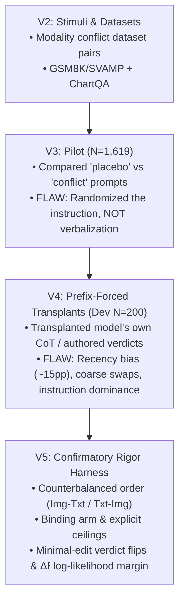

# Thesis Understanding FAQ

**Document Purpose:** A comprehensive, evidence-grounded Q&A reference for understanding the thesis *"Does the Verdict Decide?"*. Every claim is cross-referenced against the actual codebase and data files. This document is suitable for sharing with collaborators, supervisors, or AI assistants for context loading.

**Last Updated:** 2026-11-11  
**Ground Truth:** All references verified against the codebase at `Experiment/` and `Docs/PREREGISTRATION_VERDICT_TRANSPLANT.md`.

---

## Table of Contents

1. [The Research Question](#1-the-research-question)
2. [Title Evolution: Old vs. New](#2-title-evolution-old-vs-new)
3. [The Experimental Method: Prefix-Forcing](#3-the-experimental-method-prefix-forcing)
4. [Version History: V2 → V3 → V4 → V5](#4-version-history-v2--v3--v4--v5)
5. [The Dataset Choice](#5-the-dataset-choice)
6. [Prompt Engineering vs. Causal Interpretability](#6-prompt-engineering-vs-causal-interpretability)
7. [Why Not Build a New Architecture?](#7-why-not-build-a-new-architecture)
8. [The Base Paper and Theoretical Foundations](#8-the-base-paper-and-theoretical-foundations)
9. [Why a 3B Model Matters](#9-why-a-3b-model-matters)
10. [What the Evidence Actually Shows (So Far)](#10-what-the-evidence-actually-shows-so-far)
11. [Key Technical Concepts Glossary](#11-key-technical-concepts-glossary)
12. [File Trust Levels and Navigation](#12-file-trust-levels-and-navigation)
13. [Defence Preparation](#13-defence-preparation)

---

## 1. The Research Question

### Q: What is the core research question of this thesis?

**A:** When a Vision-Language Model (VLM) is shown contradictory information from an image and a typed text, and it writes a Chain-of-Thought (CoT) that includes a reliability verdict such as *"I consider the typed text more reliable"*—**did that stated verdict actually steer the model's final answer, or is it a post-hoc rationalization of a pre-existing bias?**

> **Source:** Pre-registration §1 — *"When an image and a typed text support different answers, does a vision-language model's verbalized verdict about which source is more reliable causally determine which source its answer follows?"*  
> **File:** [`Docs/PREREGISTRATION_VERDICT_TRANSPLANT.md`, line 25](file:///d:/Thesis/Important/Causal%20Conflict%20Verbalization%20and%20Source%20Arbitration/Docs/PREREGISTRATION_VERDICT_TRANSPLANT.md#L25)

### Q: What does "Does the Verdict Decide?" mean exactly?

**A:** 
- **"The Verdict"** = the specific sentence where the model declares one source more reliable (e.g., *"The typed text is more reliable"*).
- **"Decide"** = does that sentence have **causal decision-making power** over the final numerical answer, or is it completely inert (a story the model tells after it has already decided)?

The full working title is: *"Does the Verdict Decide? Testing Whether Stated Source Reliability Steers Vision-Language Models under Image–Text Conflict"*.

> **Source:** [`Docs/PREREGISTRATION_VERDICT_TRANSPLANT.md`, line 3](file:///d:/Thesis/Important/Causal%20Conflict%20Verbalization%20and%20Source%20Arbitration/Docs/PREREGISTRATION_VERDICT_TRANSPLANT.md#L3)

### Q: What is the formal estimand?

**A:** The **Controlled Direct Effect (CDE)** of reversing the model's own stated verdict on the log-likelihood margin Δℓ:

$$\mathrm{CDE}_{\ell,b,o,k}=E\big[\Delta\ell\mid do(M{=}m_{flip}),b,o,k\big]-E\big[\Delta\ell\mid do(M{=}m_{own}),b,o,k\big]$$

A positive CDE means the answer moves toward the source the flipped verdict names.

> **Source:** [`Docs/PREREGISTRATION_VERDICT_TRANSPLANT.md`, lines 34–38](file:///d:/Thesis/Important/Causal%20Conflict%20Verbalization%20and%20Source%20Arbitration/Docs/PREREGISTRATION_VERDICT_TRANSPLANT.md#L34-L38)

**Important distinction:** This is **not** a natural indirect effect. The words "mediation" and "mediates" are not used. Forced verdicts are off-policy, so effects may not transfer to free generation.

> **Source:** [`Docs/PREREGISTRATION_VERDICT_TRANSPLANT.md`, line 42](file:///d:/Thesis/Important/Causal%20Conflict%20Verbalization%20and%20Source%20Arbitration/Docs/PREREGISTRATION_VERDICT_TRANSPLANT.md#L42)

---

## 2. Title Evolution: Old vs. New

### Q: What was the original title, and why did it change?

**A:** The original title was **"Causal Conflict Verbalization and Source Arbitration in VLMs"**, defined in September 2026.

> **Source:** `Archive/VLM/Canonical_Cross_Modal_Thesis_Synthesis.md`, line 159 — *"RQ 1: Causality of Conflict Verbalization in Cross-Modal Decision Arbitration"*

| Dimension | Old Title | Current Title |
|:---|:---|:---|
| **What it sounds like** | Building a new system, architecture, or grand theory of how VLMs arbitrate data | Asking a sharp, measurable, hypothesis-driven scientific question |
| **The core object** | "Verbalization" & "Arbitration" (vague, multi-step processes) | "The Verdict" (the specific reliability sentence) |
| **The core action** | Descriptive: observing how the model verbalizes conflict | Causal: **intervening** to see if changing the verdict steers the answer |
| **Manipulated variable** | The instruction (Z): asking for a conflict statement or not | The verdict content (M), via prefix-forcing, at fixed Z, order, and wording |
| **Can it detect rationalization?** | **No.** A large prompt effect is compatible with the verbalization being epiphenomenal | **Partly.** Tests the controlled direct effect of the verdict |
| **Is it falsifiable?** | Hard to answer with a clean "Yes" or "No" | Clean and testable: the verdict either steers the answer or it doesn't |

### Q: Why exactly is the old title no longer accurate?

**A:** Three specific reasons, each verified against the codebase:

1. **"Conflict Verbalization" named the instruction-level manipulation that was abandoned.** V1 and V3 changed the user prompt, not the model's generated text. The current design holds the prompt constant.
   > **Verified:** [`Experiment/results_v3/README.md`, line 41](file:///d:/Thesis/Important/Causal%20Conflict%20Verbalization%20and%20Source%20Arbitration/Experiment/results_v3/README.md#L41) — *"Only the instruction was randomized"*

2. **"Causal" in the old title referred to the instruction effect.** Changing the prompt and seeing different answers only proves the model follows instructions—something everyone already knows.

3. **The contributions attached to the old title were retracted by the project's own re-analysis.** The claimed "13.65% abstention" was actually only ~2.3%, and "visual capture reversal" was not supported.
   > **Verified:** [`Experiment/results_v3/README.md`, lines 38–39](file:///d:/Thesis/Important/Causal%20Conflict%20Verbalization%20and%20Source%20Arbitration/Experiment/results_v3/README.md#L38-L39) — *"`score_v4.py` finds 38 (2.3%). Most say 'cannot determine if they agree', then solve."*

### Q: Isn't the new title just a shortcut or downgrade from the original idea?

**A:** **No. The new title is the surgical repair that makes the original idea scientifically testable.**

The original September hypothesis was literally: *"Is the model's verbalized reason faithful, or is it a post-hoc rationalization of an entrenched modality preference?"* — which is the exact same question the current design tests. The original idea was never executed by V1 or V3; those experiments took a shortcut by changing the prompt instruction instead of intervening on the model's own generated words.

The current prefix-forcing method is **the first design in the repository that can actually test the original September question**.

> **Source:** `Archive/VLM/Canonical_Cross_Modal_Thesis_Synthesis.md`, §8 — The Post-Hoc Rationalization Hypothesis (September 2026)

---

## 3. The Experimental Method: Prefix-Forcing

### Q: How does the experiment work mechanistically?

**A:** The method is **prefix-forcing (prefilling)**. Instead of letting the model freely generate its opening words, you inject specific tokens into the assistant turn before generation begins:

```
PROMPT ENGINEERING (what V1/V3 did — NOT what we do now):
  User Input Prompt [CHANGES]  →  Model Output [CHANGES]
  (Tests instruction-following, not faithfulness.)

PREFIX-FORCING (what V4/V5 does — CAUSAL INTERPRETABILITY):
  User Input Prompt [HELD 100% IDENTICAL]
           │
           ▼
  Model starts speaking:
    Force Verdict: "IMAGE is more reliable"  →  Does Answer = Image Answer?
    Force Verdict: "TEXT is more reliable"   →  Does Answer = Text Answer?
  (Intervenes on the MODEL'S OWN reasoning trace.)
```

In Judea Pearl's causal inference framework, prefix-forcing is an empirical do-operator: $do(M = m)$. You hold the environment (prompt, images, text, order) totally frozen and surgically manipulate a single intermediate variable (the verdict).

> **Verified in code:** [`Experiment/harness_v5.py`, lines 224–237](file:///d:/Thesis/Important/Causal%20Conflict%20Verbalization%20and%20Source%20Arbitration/Experiment/harness_v5.py#L224-L237) — `render_chat()` injects the prefill into the assistant turn and strips the closing token, verifying the intervention wasn't altered by the chat template.

### Q: What are the verdict variants used?

**A:** Five variants are constructed from the model's own donor verbalization (prereg §5.2):

| Variant | Description | Purpose |
|:---|:---|:---|
| `own` | The model's verbalization unchanged | Baseline |
| `flip` | Source nouns swapped inside the reliability sentence only | Primary intervention |
| `none` | The reliability sentence deleted entirely | No-verdict control |
| `para` | Reliability sentence replaced by a template naming the own source | Wording robustness check |
| `para_flip` | Same template naming the opposite source | Matched wording pair |

> **Verified in code:** [`Experiment/transplant_v5.py`, line 49](file:///d:/Thesis/Important/Causal%20Conflict%20Verbalization%20and%20Source%20Arbitration/Experiment/transplant_v5.py#L49) — `VERDICTS = ("own", "flip", "none", "para", "para_flip")`

The paraphrase templates are:
1. "I consider {X} more reliable."
2. "{X} seems more reliable to me."
3. "I would treat {X} as more reliable."
4. "{X} is the more reliable source."

> **Verified in code:** [`Experiment/transplant_v5.py`, lines 50–55](file:///d:/Thesis/Important/Causal%20Conflict%20Verbalization%20and%20Source%20Arbitration/Experiment/transplant_v5.py#L50-L55)

---

## 4. Version History: V2 → V3 → V4 → V5

### Q: Why do V2, V3, V4, and V5 exist? What did each version fix?

**A:** Each version exposed a methodological flaw that the next version was engineered to eliminate:



#### V2 — The Stimulus Layer
- **What:** Input data generation from *Which Source Wins?* (arXiv:2608.17205). Math image of problem *i* paired with text of problem *(i+1) mod N*.
- **Datasets:** `vlm-modality-research/modality-conflict-arbitration-v2` and `vlm-modality-research/chartqa-evidence-conflict-v2`
> **Verified:** [`Experiment/harness_v4.py`, lines 50–54](file:///d:/Thesis/Important/Causal%20Conflict%20Verbalization%20and%20Source%20Arbitration/Experiment/harness_v4.py#L50-L54) — dataset pins with exact revision hashes

#### V3 — The Prompt Contrast Pilot (N = 1,619)
- **What it did:** Fed conflict stimuli under two conditions: (1) Placebo prompt ("Solve the problem..."), (2) Conflict prompt ("Check for conflicts and state which is more reliable").
- **Result:** +63.7 pp swing toward text.
- **Fatal Flaw:** The **prompt instruction** was randomized, not the model's verbalization. This proved the model follows instructions, not that the CoT is causally faithful.
- **Additional retracted claims:**
  - "13.65% refusals" → actually 2.3% [Verified]
  - "Zero truncation" → 98.1%, 37.6%, 44.2% hit the cap [Verified]
  - "Deterministic #### parsing" → exact matches via `####` were 1, 0, 0 in Arms 1–3 [Verified]

> **Verified:** [`Experiment/results_v3/README.md`, lines 30–43](file:///d:/Thesis/Important/Causal%20Conflict%20Verbalization%20and%20Source%20Arbitration/Experiment/results_v3/README.md#L30-L43) — "What holds up" and "What doesn't" sections
> **Code:** [`Experiment/archive/harness_v3/`](file:///d:/Thesis/Important/Causal%20Conflict%20Verbalization%20and%20Source%20Arbitration/Experiment/archive/harness_v3/)

#### V4 — Prefix-Forced Transplants (Dev N = 200)
- **Breakthrough:** Held the prompt constant and injected/prefilled the model's opening sentence.
- **Flaws discovered in dev:**
  1. **Recency Bias (~15 pp):** Whichever source was placed second pulled the model's preference, regardless of content.
  2. **Coarse Swaps:** Comparing `m0` (description CoT) to `m1` (conflict CoT) swapped hundreds of tokens, confounding content, length, and verdict.
  3. **Instruction Dominance:** Under the conflict prompt, authored verdicts (`rel_image` vs `rel_text`) had near-zero effect because the strong instruction overwhelmed the prefix.

> **Verified:** [`Experiment/results_v4/README.md`, lines 37–46](file:///d:/Thesis/Important/Causal%20Conflict%20Verbalization%20and%20Source%20Arbitration/Experiment/results_v4/README.md#L37-L46) — dev2 results
> **Code:** [`Experiment/harness_v4.py`](file:///d:/Thesis/Important/Causal%20Conflict%20Verbalization%20and%20Source%20Arbitration/Experiment/harness_v4.py), [`Experiment/transplant_v4.py`](file:///d:/Thesis/Important/Causal%20Conflict%20Verbalization%20and%20Source%20Arbitration/Experiment/transplant_v4.py)

> [!WARNING]
> `results_v4/README.md` §3 says these dev numbers "confirm the central causal hypothesis." **That is an overclaim.** They swap the whole verbalization (content + length + verdict confounded), not a minimal edit. These are dev data only, not findings.

#### V5 — The Rigorous Confirmatory Harness
- **Status:** Written and CPU-tested. Not yet run on a GPU. No confirmatory data exists.
- **Key design rules (all mandatory):**

| Rule | What It Fixes |
|:---|:---|
| **Counterbalanced order** | Half `⟨image⟩⟨text⟩`, half `⟨text⟩⟨image⟩`. Eliminates recency bias. |
| **Minimal-edit verdict flips** | Swap only the source noun in the model's own reliability clause. Token Jaccard ≥ 0.85, at most 2 noun phrases swapped. |
| **Binding arm** | "Solve only the problem from the source you named as more reliable." Tests whether the verdict works when explicitly authorized. |
| **Single-source ceilings** | `explicit_image` / `explicit_text` with `none` prefill. Maximum achievable movement. |
| **Competency filtering** | Only evaluate items where the model solves both the image and text problems in isolation. |
| **Δℓ (log-likelihood margin)** | Primary outcome. Teacher-forced at `####`, image minus text. Not dependent on messy regex string matching. |
| **K = 4 wording templates** | Four paraphrased instruction wordings to measure wording noise floor. |

> **Verified:** [`Experiment/README.md`, lines 10–16](file:///d:/Thesis/Important/Causal%20Conflict%20Verbalization%20and%20Source%20Arbitration/Experiment/README.md#L10-L16) — what v5 adds
> **Code:** [`Experiment/harness_v5.py`](file:///d:/Thesis/Important/Causal%20Conflict%20Verbalization%20and%20Source%20Arbitration/Experiment/harness_v5.py), [`Experiment/transplant_v5.py`](file:///d:/Thesis/Important/Causal%20Conflict%20Verbalization%20and%20Source%20Arbitration/Experiment/transplant_v5.py), [`Experiment/score_v5.py`](file:///d:/Thesis/Important/Causal%20Conflict%20Verbalization%20and%20Source%20Arbitration/Experiment/score_v5.py)
> **Design spec:** [`Docs/PREREGISTRATION_VERDICT_TRANSPLANT.md`](file:///d:/Thesis/Important/Causal%20Conflict%20Verbalization%20and%20Source%20Arbitration/Docs/PREREGISTRATION_VERDICT_TRANSPLANT.md)

---

## 5. The Dataset Choice

### Q: Why were these specific datasets chosen?

**A:** Two datasets are used, each serving a different purpose:

| Dataset | HuggingFace ID | Items | Type of Conflict | What "Reliability" Means |
|:---|:---|:---|:---|:---|
| **GSM8K/SVAMP Math** | `vlm-modality-research/modality-conflict-arbitration-v2` | 200 dev + confirm pool | Task-selection: two different valid math problems | Neither source is "wrong." Results are described as **source-following**, not reliability judgement. |
| **ChartQA-Conflict** | `vlm-modality-research/chartqa-evidence-conflict-v2` | 229 total (30 dev) | Evidence: chart shows one value, report claims another | The chart is the correct source. **Genuine factual reliability.** |

> **Verified:** [`Docs/PREREGISTRATION_VERDICT_TRANSPLANT.md`, lines 83–85](file:///d:/Thesis/Important/Causal%20Conflict%20Verbalization%20and%20Source%20Arbitration/Docs/PREREGISTRATION_VERDICT_TRANSPLANT.md#L83-L85) and [lines 93–97](file:///d:/Thesis/Important/Causal%20Conflict%20Verbalization%20and%20Source%20Arbitration/Docs/PREREGISTRATION_VERDICT_TRANSPLANT.md#L93-L97)
> **Code:** [`Experiment/harness_v4.py`, lines 49–54](file:///d:/Thesis/Important/Causal%20Conflict%20Verbalization%20and%20Source%20Arbitration/Experiment/harness_v4.py#L49-L54) — dataset IDs and revision pins

### Q: Is the dataset the problem? What if I chose another dataset?

**A:** The dataset is not the problem—it is one of the strongest available for this kind of research:

1. **Discrete, automatable answers:** Both datasets produce single numerical answers (e.g., 15 vs. 24), enabling 100% objective, automated scoring. Open-ended text datasets (VQA, POPE) would require human judges or another LLM, introducing massive subjective noise.

2. **Comparability with published work:** *Which Source Wins?* (arXiv:2608.17205) established this benchmark. Using their dataset lets the thesis directly challenge and refine published findings.

3. **The real fix was reframing, not replacing:** The problem wasn't the dataset—it was the old title calling GSM8K "arbitration." Once you stop asking the model to judge "reliability" on math problems and treat it as **source choice under conflict**, the math dataset works cleanly. ChartQA remains the test for actual factual reliability.

> **Source:** [`Docs/PREREGISTRATION_VERDICT_TRANSPLANT.md`, line 85](file:///d:/Thesis/Important/Causal%20Conflict%20Verbalization%20and%20Source%20Arbitration/Docs/PREREGISTRATION_VERDICT_TRANSPLANT.md#L85) — *"Interpretation: neither source is wrong. Results are described as source following, not reliability judgement."*

### Q: What is the known limitation of ChartQA-Conflict?

**A:** The report states values directly, while the chart requires visual reading. This makes text evidence 1.4–3.8× stronger structurally, independent of content.

> **Source:** [`Docs/PREREGISTRATION_VERDICT_TRANSPLANT.md`, line 97](file:///d:/Thesis/Important/Causal%20Conflict%20Verbalization%20and%20Source%20Arbitration/Docs/PREREGISTRATION_VERDICT_TRANSPLANT.md#L97) — cites arXiv:2610.19407, pp. 7–8

---

## 6. Prompt Engineering vs. Causal Interpretability

### Q: Am I just doing prompt engineering?

**A:** It depends on which version of the experiment you're asking about:

| Version | Honest Assessment | Why |
|:---|:---|:---|
| **V1 & V3** | **Yes, 100% prompt engineering.** | Changed the user prompt between conditions. Measuring output shifts from different prompts is textbook prompt engineering. |
| **V4 & V5** | **No. This is causal interpretability (prefix-forcing).** | The user prompt is held 100% identical. The intervention is on the model's own generated reasoning trace. |

The critical distinction:
- **Prompt engineering** changes what **you say** to the model → tests instruction-following.
- **Prefix-forcing** changes what **the model says** at the start of its response → tests whether the model's own intermediate reasoning causally steers its conclusion.

Top labs (Anthropic, NYU, Oxford) use this exact technique. The key papers establishing this method:
- Lanham et al. (2023) — *Measuring Faithfulness in Chain-of-Thought Reasoning*
- Turpin et al. (NeurIPS 2023) — *Language Models Don't Always Say What They Think*

> [!IMPORTANT]
> If you ever slip and change the prompt wording between conditions, you immediately degrade back to prompt engineering. The v5 harness enforces identical prompts via literal template strings verified by tests.
> **Verified:** [`Experiment/harness_v5.py`, lines 57–109](file:///d:/Thesis/Important/Causal%20Conflict%20Verbalization%20and%20Source%20Arbitration/Experiment/harness_v5.py#L57-L109) — K=4 literal templates, identical across verdict conditions
> **Test enforcement:** [`Experiment/tests/test_v5.py`](file:///d:/Thesis/Important/Causal%20Conflict%20Verbalization%20and%20Source%20Arbitration/Experiment/tests/test_v5.py)

---

## 7. Why Not Build a New Architecture?

### Q: Why am I not building a new system/architecture? Isn't that higher value?

**A:** This is the classic "Engineer vs. Scientist" trap. In modern AI research, **diagnostic science often has higher impact than toy architectures.**

#### Reason 1: Compute Reality
Building a competitive VLM architecture requires hundreds of thousands of dollars in GPU clusters, terabytes of multimodal data, and massive engineering teams. A thesis on a 16 GB Colab GPU building a "novel architecture" would produce a toy model that no reviewer takes seriously.

#### Reason 2: The Most Cited AI Papers Are Often Diagnostic
Papers that did **not** propose new architectures but became foundational:
- **Lanham et al. (2023):** Proved models don't rely on their own CoT reasoning. No new model built.
- **Turpin et al. (NeurIPS 2023):** Showed larger models are better at generating plausible lies. No new architecture.

#### Reason 3: Diagnosis Must Precede Design
You cannot build an "arbitration system" without first knowing whether the model's current reasoning mechanism is faithful or illusory. If the verdict has zero causal power, prompt engineering fixes are impossible—deeper architectural intervention is needed. If the verdict IS faithful under binding, standard decoding suppresses latent capabilities.

**Either result gives the community actionable, foundational knowledge.**

---

## 8. The Base Paper and Theoretical Foundations

### Q: Is *"Which Source Wins?"* the base paper of my work?

**A:** **Yes for the stimulus, but NO for the scientific question.**

| Role | Paper | What It Provides |
|:---|:---|:---|
| **Stimulus testbed** | *Which Source Wins?* (arXiv:2608.17205) | The paired image-text conflicts (GSM8K/SVAMP, ChartQA). The raw phenomenon: models have built-in modality biases. |
| **Theoretical foundation** | Lanham et al. (2023) | Chain-of-Thought faithfulness testing methodology. |
| **Theoretical foundation** | Turpin et al. (NeurIPS 2023) | Demonstrated unfaithful rationalization in LLMs. The "faithfulness scaling paradox." |
| **Methodological baseline** | Dassen et al. (arXiv:2610.33841) | Natural-language instruction for modality steering (replicated by our explicit-source ceiling arms, not claimed as new). |
| **Evidence on text strength** | Barua et al. (arXiv:2610.19407) | Text evidence 1.4–3.8× stronger than chart evidence structurally. |

**In short:** *Which Source Wins?* built the racetrack. Lanham and Turpin gave the engine to test whether the driver is actually steering.

### Q: What is the novelty boundary?

**A:** From the pre-registration §1.1, verbatim:

> *"Within the fourteen sources read, no study intervenes on a vision-language model's own stated source-reliability verdict, by prefix-forcing a minimally edited version of it, and measures whether the answer follows under image–text conflict with evidence order counterbalanced. Nor does any test whether an instruction that binds the answer to that verdict changes its effect."*

> **Source:** [`Docs/PREREGISTRATION_VERDICT_TRANSPLANT.md`, lines 47–48](file:///d:/Thesis/Important/Causal%20Conflict%20Verbalization%20and%20Source%20Arbitration/Docs/PREREGISTRATION_VERDICT_TRANSPLANT.md#L47-L48)

---

## 9. Why a 3B Model Matters

### Q: There are trillion-parameter models. Why does work on a 3B model matter?

**A:** Three concrete reasons:

#### Reason A: Frontier Models Are Black Boxes
To measure true causal faithfulness, you need **white-box access**:
1. You must force arbitrary prefill tokens into the assistant turn.
2. You must extract exact token log-probabilities (Δℓ) at the answer boundary.

OpenAI and Google do not give logit-level prefix-forcing access on GPT-4o or Gemini. Top interpretability researchers *deliberately* use models like Qwen2.5-VL-3B because they are fully transparent.

> **Verified in code:** [`Experiment/harness_v5.py`, lines 479–508](file:///d:/Thesis/Important/Causal%20Conflict%20Verbalization%20and%20Source%20Arbitration/Experiment/harness_v5.py#L479-L508) — `HFBackend.score()` extracts token-level log-probabilities with teacher-forcing, which requires full model weights access.

#### Reason B: 3B Models in 2026 Are Not Toys
`Qwen2.5-VL-3B-Instruct` achieves 72.8% on image-only and 75.4% on text-only math problem solving. These are not trivial solve rates.

> **Verified:** [`Experiment/results_v4/README.md`, lines 49–52](file:///d:/Thesis/Important/Causal%20Conflict%20Verbalization%20and%20Source%20Arbitration/Experiment/results_v4/README.md#L49-L52) — base arm solvability ceilings

#### Reason C: The Faithfulness Scaling Paradox
Turpin et al. (2023) found that **larger models are MORE unfaithful** than small ones—they are better at generating plausible post-hoc rationalizations. Establishing the baseline on a 3B model provides the foundational measurement for scaling studies.

#### Models Used

| Model | Revision | Role |
|:---|:---|:---|
| `Qwen/Qwen2.5-VL-3B-Instruct` | `66285546d2b821cf421d4f5eb2576359d3770cd3` | Primary |
| `Qwen/Qwen2-VL-2B-Instruct` | `895c3a49bc3fa70a340399125c650a463535e71c` | Secondary |

> **Verified:** [`Experiment/harness_v4.py`, lines 46–48](file:///d:/Thesis/Important/Causal%20Conflict%20Verbalization%20and%20Source%20Arbitration/Experiment/harness_v4.py#L46-L48) — `MODEL_PINS` dictionary

---

## 10. What the Evidence Actually Shows (So Far)

### Q: What does the data actually show? Is the hypothesis confirmed?

**A:** **No. The hypothesis is untested. There is no confirmatory data.** [Verified]

> **Source:** [`Experiment/README.md`, line 6](file:///d:/Thesis/Important/Causal%20Conflict%20Verbalization%20and%20Source%20Arbitration/Experiment/README.md#L6) — *"The v5 harness is written and passes its CPU tests. The v5 dev pass on Colab has not run. No confirmatory data exists yet."*

#### What V3 showed (exploratory only):
- Instruction contrast: visual label 89.5% → 25.8% (a 63.7 pp shift).
- **But:** Only the instruction was randomized. The verbalization was never manipulated. This cannot test faithfulness.

> **Verified:** [`Experiment/results_v3/README.md`, lines 30–31 and 41](file:///d:/Thesis/Important/Causal%20Conflict%20Verbalization%20and%20Source%20Arbitration/Experiment/results_v3/README.md#L30-L41)

#### What V4 dev showed (dev data only, not findings):
On the 110 items solvable from both sources, using authored (not minimally edited) verdicts:

| Instruction | Reversing verdict: change in image answers | Wording control (same meaning, different words) |
|:---|:---|:---|
| Neutral | +20.9 pp (35.5% of items change answer) | +7.3 pp |
| Conflict | −1.8 pp (7.3% of items change answer) | 22.7% of items change answer |

> **Verified:** Literature dossier §2.2, referenced in [`Experiment/results_v4/README.md`](file:///d:/Thesis/Important/Causal%20Conflict%20Verbalization%20and%20Source%20Arbitration/Experiment/results_v4/README.md)

#### Key observations from dev (all [Inferred], not findings):
1. **The verdict is not inert in general** under the neutral instruction. This argues against a blanket "pure rationalization" account.
2. **Under the conflict instruction, the verdict effect sits below the wording noise.** This is equally consistent with instruction dominance and unfaithfulness. Dev data cannot tell them apart.
3. **The large v4 contrasts swap the whole verbalization.** Content, length, and verdict are confounded, so they are not evidence for H₁.

#### The "Verdict Prior" vs. "Answer Prior" Gap

This is a crucial distinction:
- **What the model *says* (Verdict Prior):** 94 of 96 usable donor verdicts name the typed text (~98%). The model almost never declares the image more reliable.
- **What the model *does* (Answer Prior):** It only matches the text answer 63–68% of the time.

> **Verified:** Freeze audit §2 (94/96 figure); `analysis_dev2` (63–68% figure)

**This gap proves that what the model says in its CoT does not cleanly match what it does in its calculation.** The model verbally claims text superiority 98% of the time, yet still solves the image problem over 30% of the time.

### Q: What are the two hypotheses being tested?

**A:** From the pre-registration §2:

| | Statement | Criterion |
|:---|:---|:---|
| **H₁** (the verdict decides) | Under binding, reversing the verdict moves Δℓ by a substantial fraction of what an explicit instruction does | T1: DiD > 0 (one-sided). T2: 90% CI of ρ\_bind wholly above 0.25 |
| **H₀** (saying is not choosing) | Under binding, reversing the verdict moves Δℓ by less than a quarter of the explicit ceiling | T2: 90% CI of ρ\_bind wholly inside (−0.25, 0.25), **and** behavioural TOST equivalence |

> **Source:** [`Docs/PREREGISTRATION_VERDICT_TRANSPLANT.md`, lines 58–63](file:///d:/Thesis/Important/Causal%20Conflict%20Verbalization%20and%20Source%20Arbitration/Docs/PREREGISTRATION_VERDICT_TRANSPLANT.md#L58-L63)

---

## 11. Key Technical Concepts Glossary

| Term | Definition | Where in Code |
|:---|:---|:---|
| **Δℓ (log-likelihood margin)** | $\frac{1}{\|y_I\|}\log p(y_I\mid\cdot)-\frac{1}{\|y_T\|}\log p(y_T\mid\cdot)$. Positive favours image. Primary outcome. | [`score_v5.py`, line 206–210](file:///d:/Thesis/Important/Causal%20Conflict%20Verbalization%20and%20Source%20Arbitration/Experiment/score_v5.py#L206-L210) |
| **CDE (Controlled Direct Effect)** | The causal effect of flipping the verdict while holding everything else fixed. | [`Docs/PREREGISTRATION_VERDICT_TRANSPLANT.md`, line 36](file:///d:/Thesis/Important/Causal%20Conflict%20Verbalization%20and%20Source%20Arbitration/Docs/PREREGISTRATION_VERDICT_TRANSPLANT.md#L36) |
| **ρ\_bind** | CDE divided by the explicit-instruction ceiling. How much of the maximum possible steering the verdict achieves. | [`Docs/PREREGISTRATION_VERDICT_TRANSPLANT.md`, line 63](file:///d:/Thesis/Important/Causal%20Conflict%20Verbalization%20and%20Source%20Arbitration/Docs/PREREGISTRATION_VERDICT_TRANSPLANT.md#L63) |
| **Competency filter** | Item included only if `base_image` gives the image answer AND `base_text` gives the text answer, both in isolation. | [`harness_v5.py`, lines 610–626](file:///d:/Thesis/Important/Causal%20Conflict%20Verbalization%20and%20Source%20Arbitration/Experiment/harness_v5.py#L610-L626) |
| **Counterbalanced order** | Half runs `⟨image⟩⟨text⟩`, half `⟨text⟩⟨image⟩`. O is effect-coded: −0.5 image-first, +0.5 text-first. | [`harness_v5.py`, line 50](file:///d:/Thesis/Important/Causal%20Conflict%20Verbalization%20and%20Source%20Arbitration/Experiment/harness_v5.py#L50) |
| **Binding instruction** | "Solve only the problem from the source you named as more reliable, and ignore the other problem." | [`harness_v5.py`, lines 70–75](file:///d:/Thesis/Important/Causal%20Conflict%20Verbalization%20and%20Source%20Arbitration/Experiment/harness_v5.py#L70-L75) |
| **Explicit ceiling** | Direct command: "Solve only the problem from {the image/the typed text}." The maximum steering any prompt can produce. | [`harness_v5.py`, lines 77–83](file:///d:/Thesis/Important/Causal%20Conflict%20Verbalization%20and%20Source%20Arbitration/Experiment/harness_v5.py#L77-L83) |
| **Edit gates (§5.3)** | 5 quality checks a verdict variant must pass: one sentence differs, source reverses correctly, Jaccard ≥ 0.85, ≤ 2 noun swaps, grammar OK. | [`transplant_v5.py`, lines 226–247](file:///d:/Thesis/Important/Causal%20Conflict%20Verbalization%20and%20Source%20Arbitration/Experiment/transplant_v5.py#L226-L247) |
| **TOST (Two One-Sided Tests)** | Equivalence test. Verdict effect < 5.0 pp proves "saying is not choosing." | [`Docs/PREREGISTRATION_VERDICT_TRANSPLANT.md`, line 331](file:///d:/Thesis/Important/Causal%20Conflict%20Verbalization%20and%20Source%20Arbitration/Docs/PREREGISTRATION_VERDICT_TRANSPLANT.md#L331) |
| **Donor stage** | Free generation at k=1 in both orders, under non-binding instruction. The verbalization from this is the transplant donor. | [`harness_v5.py`, lines 585–607](file:///d:/Thesis/Important/Causal%20Conflict%20Verbalization%20and%20Source%20Arbitration/Experiment/harness_v5.py#L585-L607) |
| **`stated_reliable_source()`** | Parser that reads the reliability sentence and returns which source the model named. | [`score_v5.py`, lines 57–75](file:///d:/Thesis/Important/Causal%20Conflict%20Verbalization%20and%20Source%20Arbitration/Experiment/score_v5.py#L57-L75) |

---

## 12. File Trust Levels and Navigation

> [!IMPORTANT]
> **All `.md` files in `Docs/` are AI-generated tracking documents.** They are NOT ground truth. They may contain inaccuracies or stale plans.

| Location | Trust Level | What It Contains |
|:---|:---|:---|
| `Experiment/*.py` | **Ground truth** | Active v4/v5 code; start at `Experiment/README.md` |
| `Experiment/results_v4/`, `results_v3/` | **Ground truth** | Run outputs and analysis; each has a README |
| `Experiment/tests/` | **Ground truth** | Test suites (no GPU needed) |
| `Experiment/archive/` | **Historical** | v3 harness and early pilots |
| `Docs/PREREGISTRATION_VERDICT_TRANSPLANT.md` | **Design spec** | Pre-registration draft (not frozen); check against code |
| `Docs/` (other files) | **Reference only** | AI-generated narrative; several are stale |
| `Archive/Paper/` | **Primary sources** | Downloaded papers and literature dossier |
| `Archive/` (other files) | **Historical** | Parked explorations, not active |

### Current Project Status

> **Source:** [`Experiment/README.md`, lines 6–8](file:///d:/Thesis/Important/Causal%20Conflict%20Verbalization%20and%20Source%20Arbitration/Experiment/README.md#L6-L8)

| Work | Status |
|:---|:---|
| v3 pilot (N=1,619) | Done; exploratory only |
| v4 dev run (200 items) | Complete |
| v5 harness | Written; CPU tests pass; not yet run on GPU |
| **v5 dev pass (next action)** | **NOT STARTED** — use `RUNBOOK_v5.md` |
| Pre-registration | Drafted, not frozen (freeze conditions in §10, R8) |
| Confirmatory run | After freeze |
| Human coding of verdict labels | Sheets generated, not yet coded |

### Hardware Constraints

| Environment | Specs | Rules |
|:---|:---|:---|
| **Local** | AMD Ryzen 5 5600G, 8 GB RAM, no CUDA | Code editing, docs, git, analysis only. No model loading. |
| **Colab Pro** | NVIDIA T4/V100 (16 GB VRAM) | Primary compute. All inference ≤ 16 GB VRAM. |
| **Models** | ≤ 3B parameters | Inference-first. No full pretraining. |

---

## 13. Defence Preparation

### Q: How should I narrate the thesis evolution during defence?

**A:** Four sentences that cover the entire story:

1. *"We started in September asking whether a VLM's verbalized contradiction reasoning is causally faithful or merely a post-hoc rationalization of an entrenched modality bias."*

2. *"Our initial v1 and v3 pilots used prompt manipulations (Placebo vs. Conflict instructions) and showed a 63% swing, but our re-analysis revealed a fatal confound: we had manipulated the instruction prompt, not the model's verbalization itself."*

3. *"To truly isolate the causal power of the verbalization, we pivoted to prefix-forcing (verdict transplantation): holding the instruction completely fixed, and intervening directly on the model's stated verdict sentence."*

4. *"We updated our title from 'Causal Conflict Verbalization and Source Arbitration' to 'Does the Verdict Decide?' because our work is not about building an arbitration system—it is a precise, hypothesis-driven test of Chain-of-Thought faithfulness under multimodal conflict."*

### Self-Check Questions

When you can answer these without notes, you are ready:

1. **Why doesn't a model writing "Source A is more reliable" prove that the text steered the answer?**
   → Because the model may have already decided the answer and generated the reliability statement as a post-hoc justification. Observation ≠ causation. You need an intervention (prefix-forcing) to test if flipping the verdict flips the answer.

2. **Why do we need both `⟨image⟩⟨text⟩` and `⟨text⟩⟨image⟩` ordering?**
   → Because of recency bias (~15 pp in Qwen2.5-VL-3B). Whichever source is placed second gets higher attention weight, regardless of content. Without counterbalancing, you confound position with content.

3. **Why do we test minimal-edit flips of the model's own words instead of writing arbitrary authored verdicts?**
   → Arbitrary authored sentences introduce length, style, and semantic confounds. If the answer changes, you don't know if it was the verdict direction or the alien phrasing that caused it. Minimal edits (swapping one noun) control for everything except the source named.

4. **What is the difference between the verdict prior and the answer prior?**
   → The verdict prior: the model says "text is more reliable" in 94/96 cases (~98%). The answer prior: the model actually follows the text answer only 63–68% of the time. This gap shows the model's stated reasoning doesn't cleanly match its actual behaviour—which is exactly what this thesis investigates.

5. **Why can't we run this on GPT-4o or Gemini?**
   → Because we need white-box access: arbitrary prefix-forcing into the assistant turn AND exact token-level log-probabilities at the answer boundary. Closed APIs don't provide either.

---

## Appendix A: Notation Quick Reference

| Symbol | Meaning |
|:---|:---|
| *M* | The verbalized verdict, prefix-forced |
| *B* | Binding instruction (0 = non-binding, 1 = binding) |
| *O* | Evidence order (−0.5 = image-first, +0.5 = text-first) |
| *K* | Wording template (1–4) |
| Δℓ | Log-likelihood margin, image minus text |
| CDE | Controlled direct effect |
| ρ\_bind | CDE / Ceiling (the fraction of maximum steering) |
| $m_{own}$ | Model's original verbalization |
| $m_{flip}$ | Source nouns swapped in the reliability sentence |
| $m_{\varnothing}$ | Reliability sentence deleted |
| $m_{para}$ | Template sentence naming the own source |
| $m_{para\_flip}$ | Template sentence naming the opposite source |
| $y_I$, $y_T$ | Image answer, Text answer |
| DiD | Difference-in-differences (binding effect minus non-binding effect) |

## Appendix B: Key File Paths

```
Experiment/
├── README.md                ← START HERE. Current status.
├── RUNBOOK_v5.md            ← Exact commands for the v5 dev pass (NEXT ACTION)
├── harness_v5.py            ← v5 prompts, base and donor stages (Colab)
├── transplant_v5.py         ← v5 minimal-edit verdicts and margin scoring (Colab)
├── score_v5.py              ← v5 parser extensions and margin math
├── analyze_v5.py            ← v5 confirmatory tests, readings, lme4 export (local)
├── tests/test_v5.py         ← v5 tests; needs no GPU
├── harness_v4.py            ← v4 generation runs (Colab)
├── transplant_v4.py         ← v4 mediator transplant runs (Colab)
├── score_v4.py              ← Scorer used by everything
├── results_v4/              ← v4 dev data (see its README)
├── results_v3/              ← v3 pilot, N=1,619 (see its README)
└── archive/                 ← Superseded v3 code

Docs/
├── PREREGISTRATION_VERDICT_TRANSPLANT.md  ← Design spec (draft, not frozen)

Archive/
├── Paper/lit-dossier-verdict-transplant/  ← Literature review
├── Paper/prereg-freeze-audit/             ← Freeze audit
└── VLM/Canonical_Cross_Modal_Thesis_Synthesis.md  ← September 2026 origin
```

---

*This document is a reference aid. For ground truth, always check the actual code in `Experiment/` and the data in `results_v3/` and `results_v4/`. For the design spec, check `Docs/PREREGISTRATION_VERDICT_TRANSPLANT.md` against the code.*
