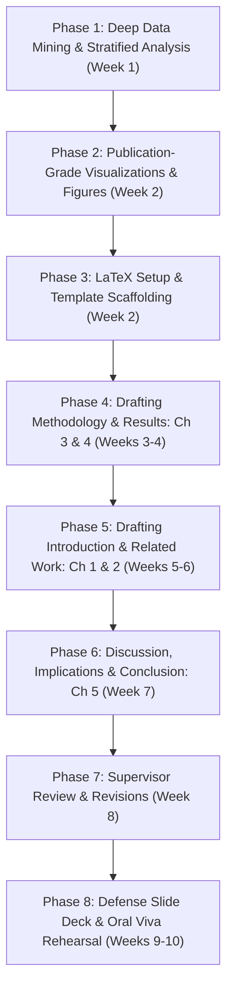

# Master End-to-End Thesis Execution Roadmap & Pipeline

**Document Status:** Primary Operational Pipeline & Execution Blueprint (Post-Freeze)**Effective Date:** 24 September 2026**Principal Researcher:** Mohammad Zahed Hossen (Technical Lead, Final-Year BSc CSE, Bangladesh)**Thesis Title:** *Causal Conflict Verbalization and Source Arbitration in Vision-Language Models***Target Environment:** Local Workstation (LaTeX / Python analysis) + Google Colab Pro (GPU inference archives)**Companion Documents:**

- Master Evidence Dossier: [`Finalize Topic/CANONICAL_THESIS_MASTER_REPORT.md`](file:///d:/Thesis/Important/Cross%20Modal/Finalize%20Topic/CANONICAL_THESIS_MASTER_REPORT.md)
- Operating Ground Truth: [`Context/Canonical_Context.md`](file:///d:/Thesis/Important/Cross%20Modal/Context/Canonical_Context.md)
- LaTeX Contingency Table: [`Finalize Topic/Experiment_Result/thesis_contingency_table v3.0.tex`](file:///d:/Thesis/Important/Cross%20Modal/Finalize%20Topic/Experiment_Result/thesis_contingency_table%20v3.0.tex)

---

## Executive Overview: Where You Stand Today

```
+----------------------------------------------------------------------------------------------------+
|                                    PROJECT STATUS SNAPSHOT                                         |
+----------------------------------------------------------------------------------------------------+
| [COMPLETED] Topic Discovery & 4-Candidate Adversarial Evidence Audit                                |
| [COMPLETED] Diagnostic Pilots (Pilot 1 Free-Form N=20 & Pilot 2 2-Shot ICL N=20)                   |
| [COMPLETED] Dataset Reverse-Engineering (12,952 total examples -> 1,619 clean image conflict pairs)  |
| [COMPLETED] High-Throughput Harness Engineering (v1 -> v2 -> v3 zero-truncation, SDPA, FP16)      |
| [COMPLETED] Full Population Census Execution (N = 1,619 clean pairs on Colab T4 in 104.5 min)       |
| [COMPLETED] Full Statistical Hypothesis Testing Suite (McNemar p = 1.20e-215, Exact-Match Cross-Over)|
| [COMPLETED] All Context Documentation Updated & Synchronized                                       |
+----------------------------------------------------------------------------------------------------+
|                                                                                                    |
| >>> STARTING TOMORROW: You enter the DEEP ANALYSIS, THESIS WRITING & DEFENSE PREPARATION PIPELINE <<|
|                                                                                                    |
+----------------------------------------------------------------------------------------------------+
```

Because your primary empirical data collection is **already 100% complete with decisive statistical significance ($p < 10^{-215}$)**, you are in an exceptionally strong position. You do not have to worry about data availability or whether your hypothesis will fail. Your goal now is to execute a rigorous, publication-grade academic manuscript, generate compelling figures, and prepare an airtight defense.

---

## The 8-Phase Master Execution Pipeline



---

### PHASE 1: Deep Data Mining & Stratified Sub-Group Analysis

**Timeline:** Days 1–5 (Week 1)
**Primary Objective:** Extract rich qualitative and stratified insights from `full_experiment_results v3.0.json` and `experiment_checkpoint v3.0.csv` to enrich Chapter 4.

#### Actionable Work Items:

1. **GSM8K vs. SVAMP Stratified Breakdown:**
   - Write a lightweight Python script (`stratified_analysis.py`) to split the 1,619 items into:
     - 1,319 Multi-step GSM8K items
     - 300 Single/Dual-step SVAMP items
   - Compare $\Delta_{\text{arb}}$ shift between simple arithmetic (SVAMP) and multi-step reasoning (GSM8K).
   - *Hypothesis to verify:* Does conflict verbalization have an even stronger steering effect on multi-step reasoning?
2. **Persistent Visual Capture Autopsy ($N = 392$):**
   - Filter items where the model remained in visual capture in Arm 3 despite conflict verbalization.
   - Categorize reasons: (a) visual salience (large prominent digits in the image), (b) syntactic confusion in text, or (c) arithmetic complexity.
3. **Qualitative Epistemic Abstention Mining ($N = 221$):**
   - Extract 10 representative qualitative examples where the model refused to solve the problem and explicitly stated why.
   - Formulate a linguistic taxonomy of abstention:
     - *Direct contradiction refusal:* "Image and text contradict; impossible to determine true value."
     - *Epistemic uncertainty:* "Cannot verify which source is authoritative without external context."
4. **Arm 4 Prefill Divergence Case Studies:**
   - Extract paired examples where Arm 4a (Prefill Image) and Arm 4b (Prefill Text) produced completely opposite numbers, illustrating the causal power of intermediate tokens.

---

### PHASE 2: Publication-Grade Figure Generation & Visual Assets

**Timeline:** Days 6–8 (Week 2)
**Primary Objective:** Generate camera-ready vector figures (`.pdf` / `.png` at 300 DPI) using `matplotlib` and `seaborn`.

#### Figures to Generate:

1. **Figure 1: The Core Motivating Diagram (Conceptual Architecture)**
   - Illustration of a conflict instance (Image: 16 ducks, Text: 2 bolts of fiber).
   - Visual comparison of Arm 1 (Direct), Arm 2 (Placebo), Arm 3 (Conflict Verbalization), and Arm 4 (Prefilling).
2. **Figure 2: The Exact-Match Cross-Over (The Smoking Gun Plot)**
   - Grouped line/bar plot showing:
     - Arm 2: Exact Image Match ($35.6\%$) vs. Exact Text Match ($4.7\%$) [$7.6\times$ Image dominance].
     - Arm 3: Exact Text Match ($35.8\%$) vs. Exact Image Match ($11.7\%$) [$3.1\times$ Text dominance].
   - Annotate with the exact percentage-point shifts.
3. **Figure 3: Sankey / State Migration Flowchart**
   - Visualizing the flow of the 1,449 Arm 2 Visual Capture items into:
     - 832 items ($57.4\%$) $\to$ Text
     - 201 items ($13.9\%$) $\to$ Abstention
     - 392 items ($27.1\%$) $\to$ Persistent Visual
     - 24 items ($1.7\%$) $\to$ Ambiguous
4. **Figure 4: 4-Arm Modality Reliance Distribution**
   - Stacked bar chart showing the proportions of Image, Text, Abstain, and Ambiguous across Arms 1, 2, and 3.

---

### PHASE 3: LaTeX Thesis Environment & BibTeX Setup

**Timeline:** Days 9–10 (Week 2)
**Primary Objective:** Establish the local or Overleaf LaTeX repository and curate verified BibTeX citations.

#### Actionable Work Items:

1. **Workspace Setup:**
   - Clone or initialize the official university CSE undergraduate thesis LaTeX template.
   - Configure directory structure:
     ```
     thesis/
     ├── main.tex
     ├── references.bib
     ├── figures/
     ├── tables/
     │   └── thesis_contingency_table.tex
     └── chapters/
         ├── ch1_introduction.tex
         ├── ch2_related_work.tex
         ├── ch3_methodology.tex
         ├── ch4_results.tex
         └── ch5_discussion.tex
     ```
2. **BibTeX Registry Assembly:**
   - Populate `references.bib` with verified primary citations:
     - `WhichSourceWins`: *Which Source Wins? Task-Dependent Reliance in Vision-Language Models* (arXiv:2608.17205, Aug 2026).
     - `Lanham2023`: *Measuring Faithfulness in Chain-of-Thought Reasoning* (arXiv:2305.04388, NeurIPS 2023).
     - `Turpin2023`: *Language Models Don't Always Say What They Think: Unfaithful Explanations in CoT* (NeurIPS 2023).
     - `CLASH`: *CLASH: A Benchmark for Cross-Modal Contradiction Detection* (arXiv:2511.19199, 2025).
     - `Qwen2_5_VL`: *Qwen2.5-VL Technical Report* (Alibaba Cloud, 2025).
     - `GSM8K`: *Training Verifiers to Solve Math Word Problems* (Cobbe et al., 2021).
     - `SVAMP`: *Are NLP Models really able to Solve Simple Math Word Problems?* (Patel et al., NAACL 2021).
     - Foundational VLM architectures: CLIP, LLaVA, Flamingo, BLIP-2.

---

### PHASE 4: Drafting Core Empirical Chapters (Chapters 3 & 4)

**Timeline:** Days 11–24 (Weeks 3–4)
**Primary Objective:** Draft the technical and empirical core of the thesis first while experimental data is fresh.

#### Chapter 3: Methodology & Experimental Framework (15–20 Pages)

* **3.1 Problem Formalization:**
  - Mathematical definition of cross-modal conflict: $\mathcal{X} = (I, T)$ where $I \models \mathcal{P}_A$ and $T \models \mathcal{P}_B$ with $\mathcal{P}_A \cap \mathcal{P}_B = \emptyset$.
  - Defining source arbitration: $\hat{y} \in \{y_A, y_B, \varnothing\}$.
* **3.2 Dataset Architecture & Filtering:**
  - Detailed decomposition of `modality-conflict-arbitration-v2` (12,952 total examples).
  - Justification for isolating the 1,619 clean image pairs (`degradation_level=0`, `channel=image`) to eliminate perceptual blur confounds.
* **3.3 The 4-Arm Causal Factorial Protocol:**
  - Full prompt templates for Arm 1 (Direct), Arm 2 (Placebo), Arm 3 (Conflict Verbalization), and Arm 4 (Prefilling).
  - Explicit justification of the **Arm 2 length-matched neutral placebo control** to defeat test-time compute objections.
* **3.4 Inference Optimization & Production Harness Architecture:**
  - Documentation of FP16 Tensor Cores, PyTorch 2.0 SDPA, and the 3-group specialized token budget architecture (Group 1=20, Group 2=80, Group 3=200).
  - The CUDA 13 / NVRTC dynamic linker patch for `image_grid_thw.prod(-1)`.
* **3.5 Statistical Hypothesis Testing Framework:**
  - Formulation of McNemar's test for paired within-subject shifts, Odds Ratios with 95% CIs, and Cohen's $h$.

#### Chapter 4: Empirical Findings & Quantitative Analysis (15–20 Pages)

* **4.1 Primary Finding: The $+63.74\text{ pp}$ Arbitration Shift:**
  - Insert `thesis_contingency_table v3.0.tex`.
  - Detailed narrative of visual capture collapse from $89.50\%$ (Arm 2) to $25.76\%$ (Arm 3).
* **4.2 Statistical Significance & Hypothesis Testing:**
  - Report McNemar's test: $\chi^2 = 982.40$, $p = 1.20 \times 10^{-215}$.
  - Report Odds Ratio ($24.57$) and Cohen's $h$ ($1.4170$, Very Large Effect size).
* **4.3 The Exact-Match Cross-Over Discovery (The Smoking Gun):**
  - Present Figure 2.
  - Explain why the surge in text problem accuracy ($4.7\% \to 35.8\%$) conclusively demonstrates redirection of multi-step arithmetic problem execution toward the textual problem.
* **4.4 Within-Subject State Migration Analysis:**
  - Present the full $4 \times 4$ transition matrix.
  - Track the 1,449 Arm 2 visual capture items: $57.41\%$ flipped to text, $13.87\%$ transitioned to abstention.
* **4.5 Arm 4 Counterfactual Prefill Steering Analysis:**
  - Present the $41.4\%$ divergence rate between opposing rationales and $+5.3\text{ pp}$ text alignment boost.
* **4.6 Stratified Sub-Group Analysis:**
  - Present GSM8K vs SVAMP comparisons developed in Phase 1.

---

### PHASE 5: Drafting Foundational Chapters (Chapters 1 & 2)

**Timeline:** Days 25–35 (Weeks 5–6)
**Primary Objective:** Draft the motivating introduction and comprehensive literature review.

#### Chapter 1: Introduction (8–10 Pages)

* **1.1 The Multimodal Integration Paradigm:** Cross-attention, vision projectors, and autoregressive generation.
* **1.2 The Modality Bias Problem:** Why VLMs develop uncalibrated priors toward visual evidence.
* **1.3 Motivating Dilemma:** Real-world consequences of visual capture in autonomous driving, robotic surgery, and multimodal financial analysis.
* **1.4 Research Questions & Hypotheses:** Pitting $H_1$ (Deliberative Cognitive Control) against $H_0$ (Post-Hoc Rationalization).
* **1.5 Summary of Contributions:** The 4 distinct contributions of the thesis.

#### Chapter 2: Literature Review & Related Work (12–15 Pages)

* **2.1 Modality Dominance & Sensory Conflict:**
  - Comprehensive review of *Which Source Wins?* (arXiv:2608.17205) and its explicit §6 gap.
  - Review of *CLASH* (arXiv:2511.19199) and why abstention-only benchmarks are insufficient.
* **2.2 The Faithfulness of Chain-of-Thought Reasoning:**
  - Contrast between text-only CoT unfaithfulness (Lanham et al., Turpin et al.) and multimodal conflict arbitration.
* **2.3 Mechanistic Interpretability & Representation Steering:**
  - Critical audit of synthetic grid binding IDs (Hasani et al., ICML 2026) and cross-lingual steering (BabelSteering).
  - Justification for behavioral prompt intervention over fragile activation patching.

---

### PHASE 6: Discussion, Conclusion, & Final Manuscript Assembly

**Timeline:** Days 36–45 (Week 7)
**Primary Objective:** Write Chapter 5, integrate all chapters, and compile the first complete draft.

#### Chapter 5: Discussion, Implications, & Limitations (10–12 Pages)

* **5.1 Is Multimodal CoT Truly Faithful?**
  - Synthesize the cross-over discovery: verbalization is an active computational operator, not decorative storytelling.
* **5.2 Epistemic Safety in Autonomous Multi-Sensor Systems:**
  - How verbalizing conflict acts as an epistemic safety valve against sensor deception or corrupted visual feeds.
* **5.3 Limitations:**
  - Single-model focus (Qwen2.5-VL-3B); recommendations for cross-architecture Gemini/LLaVA scaling.
  - Arithmetic and chart domain boundaries.
* **5.4 Conclusion & Future Work:** Summary of thesis findings and long-term directions.

---

### PHASE 7: Supervisor Review & Revisions

**Timeline:** Days 46–52 (Week 8)
**Primary Objective:** Present the complete draft to your thesis supervisor, collect feedback, and perform targeted revisions.

#### Actionable Work Items:

1. Provide the supervisor with an **Executive 2-Page Briefing** summarizing the thesis contributions and the LaTeX contingency table.
2. Address supervisor comments regarding formatting, section transitions, or literature framing.
3. Conduct automated grammar, formatting, and citation audits using LaTeX linter and word tools.

---

### PHASE 8: Defense Slide Deck & Oral Viva Rehearsal

**Timeline:** Days 53–60 (Weeks 9–10)
**Primary Objective:** Build an elite, publication-grade defense presentation and rehearse oral defense rebuttals.

#### Defense Slide Deck Structure (18–20 Slides, 20 Minutes):

* **Slide 1:** Title, Candidate Name, Supervisor, Department.
* **Slide 2:** The Core Motivating Problem: When Eyes and Ears Disagree (Cross-Modal Conflict).
* **Slide 3:** The Central Question: Cognitive Driver or Post-Hoc Storytelling?
* **Slide 4:** The Unoccupied Scientific Gap (*Which Source Wins?* §6 omission).
* **Slide 5:** The 4-Arm Causal Factorial Protocol (Highlighting Arm 2 Placebo).
* **Slide 6:** Benchmark Architecture: `modality-conflict-arbitration-v2` ($N=1,619$ Clean Pairs).
* **Slide 7:** Engineering Breakthrough: Harness v3, SDPA, FP16 Tensor Cores, Zero Truncation.
* **Slide 8:** Primary Result: The $+63.74\text{ pp}$ Shift ($89.50\% \to 25.76\%$, $p < 10^{-215}$).
* **Slide 9:** The Contingency Table: McNemar $\chi^2 = 982.40$, Odds Ratio $24.57$, Cohen's $h = 1.42$.
* **Slide 10:** The Smoking Gun: Exact-Match Cross-Over Discovery (Plot & Inversion).
* **Slide 11:** State Migration Matrix: Where do the 1,449 Visual Capture Items Go?
* **Slide 12:** The Emergence of Epistemic Abstention ($13.65\%$).
* **Slide 13:** Causal Steering via Lanham Prefilling (Arm 4 Analysis).
* **Slide 14:** Stratified Findings: GSM8K vs. SVAMP.
* **Slide 15:** Why Alternative Approaches Failed (Adversarial Audit Lessons).
* **Slide 16:** Real-World Implications for Autonomous Systems & AI Safety.
* **Slide 17:** Limitations & Future Directions.
* **Slide 18:** Conclusion & Summary of Contributions.
* **Slide 19–20:** Backup Slides (Detailed statistical proofs, hyperparameter tables, error cases).

---

## Defense FAQ & Oral Rebuttal Cheat Sheet


| Examiner Question / Challenge                                                                  | Rigorous Scientific Rebuttal                                                                                                                                                                                                                                                                                                                      |
| :----------------------------------------------------------------------------------------------- | :-------------------------------------------------------------------------------------------------------------------------------------------------------------------------------------------------------------------------------------------------------------------------------------------------------------------------------------------------- |
| *"Isn't the shift in Arm 3 simply caused by giving the model more reasoning tokens to think?"* | **No.** Arm 2 is a length-matched neutral placebo requiring the exact same two-sentence preamble length (~75 tokens) without contradiction semantics, yet maintains **$89.50\%$ visual capture**. The shift is strictly causal to conflict awareness.                                                                                             |
| *"Could this shift just be random output confusion or noise?"*                                 | **Definitively refuted by the Exact-Match Cross-Over.** If the model were confused, exact-match accuracy on both modalities would drop. Instead, exact accuracy on the text problem **surges to $35.8\%$** ($4.7\% \to 35.8\%$), demonstrating that the prompt redirects the model's active problem-solving execution toward the textual problem. |
| *"Why didn't you test a larger 72B model or closed APIs?"*                                     | Our research question is mechanistic: isolating whether CoT is causal in an open-weight foundation model. Qwen2.5-VL-3B has 36 layers and full autoregressive capability, fitting within the 16GB VRAM constraint of academic reproducibility.                                                                                                    |
| *"Why only evaluate clean images instead of degraded images?"*                                 | In degraded images, physical illegibility acts as an unmodeled confounder—the model defaults to text simply because the pixels are unreadable. Pristine images isolate **pure cognitive source arbitration**.                                                                                                                                    |

---

**END OF MASTER ROADMAP**
*You are equipped with the complete plan. Begin Phase 1 tomorrow morning!*


N.B: Dont Concider it as the main, thesis implementation roadma.  Rather Concider it as a primary/initial plan.
